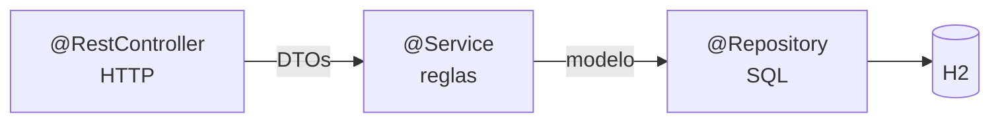
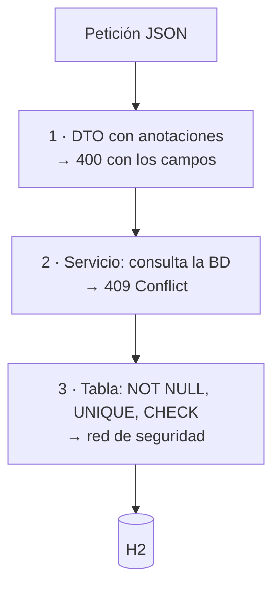

# 3. Las capas: repositorio, servicio y controlador

Una aplicación por capas se escribe **de abajo arriba**: primero el modelo, luego el repositorio, luego el servicio y al final el controlador. Así cada pieza solo necesita lo que ya existe.



| Capa | Sabe de… | No sabe nada de… |
|---|---|---|
| `@RestController` | HTTP, códigos de estado, DTOs | SQL, nombres de tablas |
| `@Service` | Reglas de negocio | HTTP, `ResponseEntity` |
| `@Repository` | SQL y mapeo de filas | Reglas de negocio |

!!! success "El orden en el que se escribe"
    | | Qué | Fichero |
    |:-:|---|---|
    | 1 | **El modelo** | `Funko.java` — un `record` |
    | 2 | **El repositorio** | interfaz + `…Jdbc` |
    | 3 | **Las excepciones** | 3 clases de 4 líneas |
    | 4 | **Los DTOs** | 3 `record` |
    | 5 | **El mapeador** | convierte DTO ↔ modelo |
    | 6 | **El servicio** | interfaz + `…Impl` |
    | 7 | **El controlador** | solo delega |
    | 8 | **El manejador de errores** | 1 clase |

    Y la comprobación de que no se ha cruzado ninguna línea:

    ```bash
    grep -rn "ResponseEntity\|HttpStatus" src/main/java/**/services/    # vacío
    grep -rni "SELECT\|INSERT\|UPDATE" src/main/java/**/controllers/    # vacío
    ```

---

## 3.0. El modelo

Es la clase que representa una fila de la tabla. En esta unidad **un `record` basta**: solo transporta datos.

```java title="funkos/models/Funko.java"
package es.iesx.funkos.funkos.models;

import java.math.BigDecimal;
import java.time.LocalDateTime;

public record Funko(
        Long id,
        String nombre,
        BigDecimal precio,
        Integer cantidad,
        String categoria,
        LocalDateTime createdAt,
        LocalDateTime updatedAt
) {}
```

!!! info "Un `record` y no una clase con *setters*"
    Siete campos, cero métodos, y gratis: constructor, `equals`, `hashCode`, `toString` y los captadores (`f.nombre()`, no `f.getNombre()`).

    Para «cambiar» un campo **se crea otro `record`** con los valores que quieres. Parece raro al principio y es justo lo que hace falta para el PATCH del apartado 3.5.

!!! warning "En la UT5 esto cambia"
    Cuando el modelo pase a ser una `@Entity` de JPA tendrá que ser una **clase** con constructor sin argumentos, porque Hibernate la construye por reflexión. Un `record` no sirve para eso.

    Aquí, sin JPA, el `record` es lo más simple que funciona.

---

## 3.1. El repositorio

**Qué hace:** hablar con la base de datos. Recibe y devuelve **modelos**, y es el único sitio donde hay SQL.

**Qué no hace:** ninguna comprobación de negocio. Si no hay stock, eso lo decide el servicio.

### La interfaz

Se declara primero como interfaz. El servicio dependerá del contrato, no de JDBC.

```java title="funkos/repositories/FunkosRepository.java"
public interface FunkosRepository {
    List<Funko>     findAll();
    Optional<Funko> findById(Long id);
    boolean         existsByNombre(String nombre);
    Funko           save(Funko funko);
    void            update(Funko funko);
    boolean         deleteById(Long id);
}
```

!!! success "Las cuatro firmas que importan, y por qué"
    | Devuelve | Motivo |
    |---|---|
    | `findById` → **`Optional<Funko>`** | Que no exista es normal, no un error. **Nunca `null`** |
    | `save` → **`Funko`** | El mismo funko **con el id ya puesto**. Lo necesita el controlador para la cabecera `Location` |
    | `deleteById` → **`boolean`** | Leído de las filas afectadas: permite que el servicio devuelva 404 |
    | `existsByNombre` → `boolean` | Para una regla de negocio, **sin traerse el objeto entero** |

### Las dos piezas de JDBC

**`JdbcClient`** manda la consulta. **`RowMapper`** convierte una fila en un objeto.

```java title="funkos/repositories/FunkoRowMapper.java"
@Component
public class FunkoRowMapper implements RowMapper<Funko> {

    @Override
    public Funko mapRow(ResultSet rs, int rowNum) throws SQLException {
        return new Funko(
                rs.getLong("id"),
                rs.getString("nombre"),
                rs.getBigDecimal("precio"),
                rs.getInt("cantidad"),
                rs.getString("categoria"),
                rs.getTimestamp("created_at").toLocalDateTime(),
                rs.getTimestamp("updated_at").toLocalDateTime());
    }
}
```

**Uno solo, y reutilizado en todas las consultas.** Cuando la tabla gane una columna, se toca un método.

### La implementación

```java title="funkos/repositories/FunkosRepositoryJdbc.java"
@Repository
public class FunkosRepositoryJdbc implements FunkosRepository {

    private final JdbcClient jdbc;
    private final FunkoRowMapper rowMapper;

    public FunkosRepositoryJdbc(JdbcClient jdbc, FunkoRowMapper rowMapper) {
        this.jdbc = jdbc;
        this.rowMapper = rowMapper;
    }

    @Override
    public List<Funko> findAll() {
        return jdbc.sql("SELECT * FROM funkos ORDER BY id")
                   .query(rowMapper).list();
    }

    @Override
    public Optional<Funko> findById(Long id) {
        return jdbc.sql("SELECT * FROM funkos WHERE id = :id")
                   .param("id", id)
                   .query(rowMapper).optional();
    }

    @Override
    public boolean existsByNombre(String nombre) {
        return jdbc.sql("SELECT COUNT(*) FROM funkos WHERE UPPER(nombre) = UPPER(:nombre)")
                   .param("nombre", nombre)
                   .query(Integer.class).single() > 0;
    }

    @Override
    public Funko save(Funko f) {
        var keys = new GeneratedKeyHolder();
        jdbc.sql("""
                INSERT INTO funkos (nombre, precio, cantidad, categoria, created_at, updated_at)
                VALUES (:nombre, :precio, :cantidad, :categoria, :creado, :actualizado)
                """)
            .param("nombre", f.nombre())
            .param("precio", f.precio())
            .param("cantidad", f.cantidad())
            .param("categoria", f.categoria())
            .param("creado", f.createdAt())
            .param("actualizado", f.updatedAt())
            .update(keys);

        Long id = ((Number) keys.getKeys().get("id")).longValue();
        return new Funko(id, f.nombre(), f.precio(), f.cantidad(),
                         f.categoria(), f.createdAt(), f.updatedAt());
    }

    @Override
    public void update(Funko f) {
        jdbc.sql("""
                UPDATE funkos
                   SET nombre = :nombre, precio = :precio, cantidad = :cantidad,
                       categoria = :categoria, updated_at = :actualizado
                 WHERE id = :id
                """)
            .param("nombre", f.nombre())
            .param("precio", f.precio())
            .param("cantidad", f.cantidad())
            .param("categoria", f.categoria())
            .param("actualizado", f.updatedAt())
            .param("id", f.id())
            .update();
    }

    @Override
    public boolean deleteById(Long id) {
        return jdbc.sql("DELETE FROM funkos WHERE id = :id")
                   .param("id", id)
                   .update() == 1;
    }
}
```

### Las seis formas de cerrar una consulta

| Lo que necesitas | Cómo se cierra |
|---|---|
| Lista de objetos | `.query(rowMapper).list()` |
| Cero o uno | `.query(rowMapper).optional()` → **`Optional`** |
| Uno obligatorio | `.query(rowMapper).single()` |
| Un número o un texto | `.query(Integer.class).single()` |
| Escribir | `.update()` → **`int` de filas afectadas** |
| Escribir y recuperar el id | `.update(keys)` con `GeneratedKeyHolder` |

!!! danger "Los `:param` no son plantillas de texto"
    Por debajo son `PreparedStatement`: el valor viaja aparte y la base de datos **nunca lo interpreta como SQL**. Lo que no se hace jamás:

    ```java
    jdbc.sql("SELECT * FROM funkos WHERE nombre = '" + nombre + "'")   // ❌ inyección SQL
    ```

### Filtros opcionales

Tres filtros opcionales son ocho combinaciones. Se monta el `WHERE` a trozos:

```java
@Override
public List<Funko> buscar(Optional<String> categoria, Optional<String> nombre,
                          Optional<BigDecimal> precioMax) {

    var sql = new StringBuilder("SELECT * FROM funkos WHERE 1 = 1");
    var params = new HashMap<String, Object>();

    categoria.ifPresent(c -> {
        sql.append(" AND UPPER(categoria) = UPPER(:categoria)");
        params.put("categoria", c);
    });
    nombre.ifPresent(n -> {
        sql.append(" AND LOWER(nombre) LIKE LOWER(:nombre)");
        params.put("nombre", "%" + n + "%");
    });
    precioMax.ifPresent(p -> {
        sql.append(" AND precio <= :precioMax");
        params.put("precioMax", p);
    });
    sql.append(" ORDER BY id");

    return jdbc.sql(sql.toString()).params(params).query(rowMapper).list();
}
```

Se concatena **la estructura**; los **valores** van siempre por `params`. El `WHERE 1 = 1` evita llevar la cuenta de cuál es el primer filtro.

### Comprobar y escribir a la vez

Cuando una regla depende del valor actual de la fila, **no se lee, se comprueba y se escribe**:

```java
@Override
public int descontarStock(Long id, int cantidad) {
    return jdbc.sql("""
            UPDATE funkos SET cantidad = cantidad - :cantidad
             WHERE id = :id AND cantidad >= :cantidad
            """)
        .param("cantidad", cantidad).param("id", id)
        .update();
}
```

!!! danger "Por qué no se hace en tres pasos"
    ```java
    var f = repositorio.findById(id).orElseThrow();
    if (f.cantidad() < cantidad) throw new FunkoConflictException("Sin stock");   // ❌
    repositorio.actualizarCantidad(id, f.cantidad() - cantidad);
    ```

    Entre el `if` y el `UPDATE` **cabe otra petición**. Las dos leen 5, las dos creen que pueden vender 3, y el stock acaba en **−1**.

    Con el `UPDATE … WHERE cantidad >= :cantidad` la base de datos lo garantiza, y **las 0 filas afectadas son la respuesta**.

---

## 3.2. El servicio

**Qué hace:** las reglas de negocio. Recibe DTOs, devuelve DTOs, y cuando algo va mal **lanza una excepción**.

**Qué no hace:** nada de HTTP. Ni `ResponseEntity`, ni `HttpStatus`, ni códigos de estado.

### La interfaz

```java title="funkos/services/FunkosService.java"
public interface FunkosService {
    List<FunkoResponse> buscar(Optional<String> categoria, Optional<String> nombre,
                               Optional<BigDecimal> precioMax);
    FunkoResponse findById(Long id);
    FunkoResponse save(FunkoCreateRequest funko);
    FunkoResponse replace(Long id, FunkoCreateRequest funko);
    FunkoResponse update(Long id, FunkoUpdateRequest funko);
    void deleteById(Long id);
}
```

### La implementación

```java title="funkos/services/FunkosServiceImpl.java"
@Service
public class FunkosServiceImpl implements FunkosService {

    private static final Logger log = LoggerFactory.getLogger(FunkosServiceImpl.class);

    private final FunkosRepository repositorio;
    private final FunkoMapper mapper;

    public FunkosServiceImpl(FunkosRepository repositorio, FunkoMapper mapper) {
        this.repositorio = repositorio;
        this.mapper = mapper;
    }

    @Override
    @Transactional(readOnly = true)
    public List<FunkoResponse> buscar(Optional<String> categoria, Optional<String> nombre,
                                      Optional<BigDecimal> precioMax) {
        return mapper.toResponse(repositorio.buscar(categoria, nombre, precioMax));
    }

    @Override
    @Transactional(readOnly = true)
    public FunkoResponse findById(Long id) {
        return repositorio.findById(id)
                .map(mapper::toResponse)
                .orElseThrow(() -> new FunkoNotFoundException(id));
    }

    @Override
    @Transactional
    public FunkoResponse save(FunkoCreateRequest request) {
        if (repositorio.existsByNombre(request.nombre()))
            throw new FunkoConflictException("Ya existe un funko llamado " + request.nombre());

        return mapper.toResponse(repositorio.save(mapper.toModel(request)));
    }

    @Override
    @Transactional
    public FunkoResponse update(Long id, FunkoUpdateRequest request) {
        var original = repositorio.findById(id)
                .orElseThrow(() -> new FunkoNotFoundException(id));

        var parcheado = mapper.parchear(original, request);
        repositorio.update(parcheado);
        return mapper.toResponse(parcheado);
    }

    @Override
    @Transactional
    public void deleteById(Long id) {
        if (!repositorio.deleteById(id))
            throw new FunkoNotFoundException(id);
    }
}
```

!!! success "Los tres patrones que se repiten en todos los servicios"
    **1 · Leer uno o lanzar 404**

    ```java
    repositorio.findById(id).orElseThrow(() -> new FunkoNotFoundException(id));
    ```

    **2 · Comprobar una regla antes de escribir**

    ```java
    if (repositorio.existsByNombre(request.nombre()))
        throw new FunkoConflictException("…");
    ```

    **3 · Usar las filas afectadas para decidir**

    ```java
    if (!repositorio.deleteById(id)) throw new FunkoNotFoundException(id);
    ```

    El tercero es el que se olvida: un `DELETE` de un id inexistente **no lanza nada**, afecta a 0 filas. Sin ese `if`, el cliente recibe un **204** y cree que ha borrado algo.

!!! info "`@Transactional`, en una línea"
    - **`readOnly = true`** en las lecturas: queda documentado que ese método no escribe.
    - **Sin parámetros** en las escrituras.
    - **Imprescindible** cuando un método hace **dos o más escrituras**: o se hacen las dos, o ninguna.

    Y la trampa: **solo revierte con `RuntimeException`**, y si capturas la excepción dentro del método, **no hay *rollback***.

---

## 3.3. Las excepciones

**Tres clases de cuatro líneas, y nada más.** Cada una lleva su código HTTP en una anotación.

```java title="funkos/exceptions/FunkoNotFoundException.java"
@ResponseStatus(HttpStatus.NOT_FOUND)
public class FunkoNotFoundException extends RuntimeException {
    public FunkoNotFoundException(Long id) {
        super("No se ha encontrado el funko con id: " + id);
    }
}
```

```java title="funkos/exceptions/FunkoConflictException.java"
@ResponseStatus(HttpStatus.CONFLICT)
public class FunkoConflictException extends RuntimeException {
    public FunkoConflictException(String mensaje) { super(mensaje); }
}
```

```java title="funkos/exceptions/FunkoBadRequestException.java"
@ResponseStatus(HttpStatus.BAD_REQUEST)
public class FunkoBadRequestException extends RuntimeException {
    public FunkoBadRequestException(String mensaje) { super(mensaje); }
}
```

!!! success "Cómo funciona, de una vez"
    1. El **servicio lanza**: `throw new FunkoNotFoundException(id);`
    2. El **controlador no captura nada**.
    3. Spring lee el **`@ResponseStatus`** de la clase y responde **404**.

    Tres cosas que no hay que hacer: ni `try/catch` en el controlador, ni `ResponseEntity.notFound()` repartido por ahí, ni un handler por excepción.

!!! info "Cuándo usar cada una"
    | | Cuándo | Código |
    |---|---|:-:|
    | `FunkoNotFoundException` | El id no existe | **404** |
    | `FunkoConflictException` | Está bien escrito pero **choca con el estado actual**: nombre repetido, sin stock, borrar algo en uso | **409** |
    | `FunkoBadRequestException` | Un dato es inválido **y no lo puede detectar una anotación** | **400** |

!!! warning "No uses `ResponseStatusException`"
    ```java
    throw new ResponseStatusException(HttpStatus.NOT_FOUND, "No existe");   // ❌
    ```

    Funciona y se escribe en una línea, pero **mete `HttpStatus` dentro del servicio**. Ese servicio ya no se puede reutilizar desde un WebSocket (UT6), donde los códigos HTTP no significan nada.

    Y en el examen: `grep -rn "ResponseStatusException" src/` tiene que estar vacío.

!!! tip "El constructor recibe el dato, no el mensaje"
    `new FunkoNotFoundException(id)` y no `new FunkoNotFoundException("No existe el " + id)`.

    Así **todos** los 404 de la API dicen lo mismo y nadie se inventa la redacción.

---

## 3.4. Los DTOs

**Qué son:** los objetos que viajan entre el controlador y el cliente. Tres `record`, uno por cada cosa que puede pasar.

| | Para qué | Lleva `id` y fechas |
|---|---|:-:|
| `FunkoResponse` | **Sale** hacia el cliente | Sí |
| `FunkoCreateRequest` | **Entra** en el POST y el PUT | **No** |
| `FunkoUpdateRequest` | **Entra** en el PATCH | No, y **todo opcional** |

```java title="funkos/dto/FunkoResponse.java"
public record FunkoResponse(
        Long id,
        String nombre,
        BigDecimal precio,
        Integer cantidad,
        String categoria,
        LocalDateTime createdAt,
        LocalDateTime updatedAt
) {}
```

```java title="funkos/dto/FunkoCreateRequest.java"
public record FunkoCreateRequest(

        @NotBlank(message = "El nombre no puede estar vacío")
        @Size(max = 100, message = "Máximo 100 caracteres")
        String nombre,

        @NotNull(message = "El precio es obligatorio")
        @DecimalMin(value = "0.0", message = "El precio no puede ser negativo")
        BigDecimal precio,

        @NotNull(message = "La cantidad es obligatoria")
        @PositiveOrZero(message = "La cantidad no puede ser negativa")
        Integer cantidad,

        @NotBlank(message = "La categoría no puede estar vacía")
        @Pattern(regexp = "DISNEY|MARVEL|ANIME|OTROS",
                 message = "Debe ser DISNEY, MARVEL, ANIME u OTROS")
        String categoria
) {}
```

```java title="funkos/dto/FunkoUpdateRequest.java"
public record FunkoUpdateRequest(
        @Size(max = 100) String nombre,
        @DecimalMin("0.0") BigDecimal precio,
        @PositiveOrZero Integer cantidad,
        @Pattern(regexp = "DISNEY|MARVEL|ANIME|OTROS") String categoria
) {}
```

!!! success "La única diferencia entre los dos requests"
    En el de actualización **desaparecen los `@NotNull` y `@NotBlank`**. Las reglas de formato (`@Size`, `@Pattern`, `@DecimalMin`) se quedan.

    Porque en un PATCH, `null` significa **«este campo no lo cambies»**. Si fuera obligatorio, no podrías mandar solo el precio.

!!! danger "Por qué el modelo no sale nunca de la aplicación"
    1. **Filtras datos.** Un `Usuario` tiene `passwordHash`. Devuélvelo tal cual y lo has publicado.
    2. **El contrato no depende de la tabla.** Renombrar una columna no rompe a tus clientes.
    3. **El request de creación sin `id`.** Si lo lleva, un cliente puede mandar `{"id": 1, …}` e intentar sobrescribir otro registro.

    Y la regla que resume todo: **nunca aceptes del cliente un dato que puedas calcular**. El total de un pedido, el precio de una línea, el estado inicial, un código correlativo.

---

## 3.5. El mapeador

**Qué hace:** convertir entre DTOs y modelo. **Tres métodos, porque son tres operaciones distintas.**

```java title="funkos/mappers/FunkoMapper.java"
@Component
public class FunkoMapper {

    /** Modelo → lo que sale hacia el cliente. */
    public FunkoResponse toResponse(Funko f) {
        return new FunkoResponse(f.id(), f.nombre(), f.precio(), f.cantidad(),
                                 f.categoria(), f.createdAt(), f.updatedAt());
    }

    public List<FunkoResponse> toResponse(List<Funko> funkos) {
        return funkos.stream().map(this::toResponse).toList();
    }

    /** POST: funko nuevo. El id lo pone la base de datos; las fechas, el servidor. */
    public Funko toModel(FunkoCreateRequest r) {
        var ahora = LocalDateTime.now();
        return new Funko(
                null,                              // id: lo asigna la BD
                r.nombre().trim(),
                r.precio(),
                r.cantidad(),
                r.categoria().toUpperCase(),
                ahora,                             // createdAt
                ahora);                            // updatedAt
    }

    /** PUT: reemplaza todo. Conserva el id y la fecha de creación. */
    public Funko reemplazar(Funko original, FunkoCreateRequest r) {
        return new Funko(
                original.id(),
                r.nombre().trim(),
                r.precio(),
                r.cantidad(),
                r.categoria().toUpperCase(),
                original.createdAt(),
                LocalDateTime.now());
    }

    /** PATCH: cambia solo lo que llega distinto de null. */
    public Funko parchear(Funko original, FunkoUpdateRequest r) {
        return new Funko(
                original.id(),
                r.nombre()    != null ? r.nombre().trim()          : original.nombre(),
                r.precio()    != null ? r.precio()                 : original.precio(),
                r.cantidad()  != null ? r.cantidad()               : original.cantidad(),
                r.categoria() != null ? r.categoria().toUpperCase() : original.categoria(),
                original.createdAt(),
                LocalDateTime.now());
    }
}
```

!!! success "Para qué sirve cada método"
    | Método | Verbo | Qué hace con lo que **no** mandas |
    |---|---|---|
    | `toModel` | POST | No aplica: es nuevo |
    | `reemplazar` | PUT | **Lo borra** (queda `null`) |
    | `parchear` | PATCH | **Lo conserva** |

    Los `!= null` del `parchear` **son** la semántica del PATCH. Si tu PUT y tu PATCH llaman al mismo método, has implementado dos veces el PATCH.

!!! info "Dos campos que no se tocan nunca"
    - **`createdAt`** se arrastra del original. Es la fecha en que nació el registro.
    - **`updatedAt`** se refresca siempre con `LocalDateTime.now()`.

!!! tip "`@Component` y no métodos `static`"
    Así se inyecta por constructor y se puede sustituir en un test. Es un bean más.

---

## 3.6. La validación

Se valida en **tres sitios distintos**, y los tres se ponen.



| | Dónde | Qué comprueba | Código |
|---|---|---|:-:|
| **Formato** | DTO, con anotaciones | Un campo aislado | **400** |
| **Negocio** | **Servicio** | Necesita consultar la BD u otros campos | **409** |
| **Integridad** | **Tabla** | La única que **no se puede saltar** | 409 vía handler |

### 1 · Formato, en el DTO

```java
@PostMapping
public ResponseEntity<FunkoResponse> crear(@Valid @RequestBody FunkoCreateRequest dto) { … }
//                                          ^^^^^^ sin esto NO SE VALIDA NADA
```

!!! danger "Sin `@Valid` no hay validación, y nada avisa"
    El DTO lleno de `@NotBlank` y `@Min`, el código perfecto, y **las anotaciones no se ejecutan**. Un POST con el nombre vacío devuelve **201 Created**.

    No hay warning de compilación. No hay log. Solo datos basura en la tabla.

| | Para qué |
|---|---|
| `@NotNull` | No nulo → números, fechas, booleanos |
| `@NotBlank` | No nulo + no solo espacios → **`String`** |
| `@NotEmpty` | No nulo + `size > 0` → **colecciones** |
| `@Size(max=)` | Longitud |
| `@Min` `@Max` | Enteros |
| `@DecimalMin` `@DecimalMax` | `BigDecimal` |
| `@Positive` `@PositiveOrZero` | Numéricos |
| `@Email` `@Pattern(regexp=)` | Texto |
| `@Past` `@PastOrPresent` `@Future` | Fechas |
| `@Valid` | **En cascada**: objetos y listas anidadas |

!!! warning "`@NotNull`, `@NotEmpty` y `@NotBlank` no son lo mismo"
    | Valor | `@NotNull` | `@NotEmpty` | `@NotBlank` |
    |---|:-:|:-:|:-:|
    | `null` | ❌ | ❌ | ❌ |
    | `""` | ✅ | ❌ | ❌ |
    | `"   "` | ✅ | ✅ | ❌ |

    Un `@NotNull` en un `String` deja pasar `""`. **Para texto, `@NotBlank`.**

### 2 · Negocio, en el servicio

Lo que una anotación no puede comprobar porque necesita la base de datos:

```java
if (repositorio.existsByNombre(request.nombre()))
    throw new FunkoConflictException("Ya existe un funko llamado " + request.nombre());
```

!!! danger "400 no es 409"
    - **400** = «lo que me has mandado está mal escrito».
    - **409** = «está bien escrito, pero choca con el estado actual».

    Que el nombre no esté vacío no necesita la base de datos. Que no esté repetido, sí.

### 3 · El manejador de errores

Una sola clase que convierte los fallos de formato en respuestas útiles.

```java title="common/GlobalExceptionHandler.java"
@RestControllerAdvice
public class GlobalExceptionHandler {

    /** 400 con los errores campo a campo. */
    @ResponseStatus(HttpStatus.BAD_REQUEST)
    @ExceptionHandler(MethodArgumentNotValidException.class)
    public Map<String, Object> validacion(MethodArgumentNotValidException ex) {
        Map<String, String> campos = new LinkedHashMap<>();
        ex.getBindingResult().getFieldErrors()
          .forEach(e -> campos.put(e.getField(), e.getDefaultMessage()));
        return Map.of("status", 400, "error", "Datos de entrada inválidos", "campos", campos);
    }

    /** 400 cuando el JSON no se puede ni leer. */
    @ResponseStatus(HttpStatus.BAD_REQUEST)
    @ExceptionHandler(HttpMessageNotReadableException.class)
    public Map<String, Object> jsonIlegible(HttpMessageNotReadableException ex) {
        return Map.of("status", 400, "error", "El cuerpo no es un JSON valido");
    }

    /** 400 cuando /funkos/abc intenta ser un Long. */
    @ResponseStatus(HttpStatus.BAD_REQUEST)
    @ExceptionHandler(MethodArgumentTypeMismatchException.class)
    public Map<String, Object> tipoMalo(MethodArgumentTypeMismatchException ex) {
        return Map.of("status", 400,
                "error", "El parametro '%s' no tiene el tipo esperado".formatted(ex.getName()));
    }

    /** 409 cuando salta una restriccion de la tabla: UNIQUE, CHECK, FK. */
    @ResponseStatus(HttpStatus.CONFLICT)
    @ExceptionHandler(DataIntegrityViolationException.class)
    public Map<String, Object> integridad(DataIntegrityViolationException ex) {
        return Map.of("status", 409,
                "error", "La operacion viola una restriccion de la base de datos");
    }
}
```

```json
{
  "status": 400,
  "error": "Datos de entrada inválidos",
  "campos": {
    "nombre": "El nombre no puede estar vacío",
    "precio": "El precio no puede ser negativo"
  }
}
```

!!! success "Aquí NO van las excepciones del dominio"
    `FunkoNotFoundException` y `FunkoConflictException` **no necesitan handler**: llevan su `@ResponseStatus` y Spring las traduce solas.

    En esta clase solo van los errores de **hablar HTTP**: validación, JSON roto, tipo de parámetro malo e integridad de la tabla.

---

## 3.7. El controlador

**Qué hace:** recibir la petición, llamar al servicio y envolver la respuesta. **Tres líneas por método.**

**Qué no hace:** ni un `if` de negocio, ni SQL, ni capturar excepciones.

```java title="funkos/controllers/FunkosRestController.java"
@RestController
@RequestMapping("${api.path:/api}/${api.version:v1}/funkos")
public class FunkosRestController {

    private final FunkosService servicio;

    public FunkosRestController(FunkosService servicio) {
        this.servicio = servicio;
    }

    @GetMapping
    public ResponseEntity<List<FunkoResponse>> buscar(
            @RequestParam Optional<String> categoria,
            @RequestParam Optional<String> nombre,
            @RequestParam Optional<BigDecimal> precioMax) {
        return ResponseEntity.ok(servicio.buscar(categoria, nombre, precioMax));
    }

    @GetMapping("/{id}")
    public ResponseEntity<FunkoResponse> findById(@PathVariable Long id) {
        return ResponseEntity.ok(servicio.findById(id));
    }

    @PostMapping
    public ResponseEntity<FunkoResponse> crear(
            @Valid @RequestBody FunkoCreateRequest funko) {
        var creado = servicio.save(funko);
        return ResponseEntity
                .created(URI.create("/api/v1/funkos/" + creado.id()))
                .body(creado);
    }

    @PutMapping("/{id}")
    public ResponseEntity<FunkoResponse> reemplazar(
            @PathVariable Long id, @Valid @RequestBody FunkoCreateRequest funko) {
        return ResponseEntity.ok(servicio.replace(id, funko));
    }

    @PatchMapping("/{id}")
    public ResponseEntity<FunkoResponse> actualizar(
            @PathVariable Long id, @Valid @RequestBody FunkoUpdateRequest funko) {
        return ResponseEntity.ok(servicio.update(id, funko));
    }

    @DeleteMapping("/{id}")
    public ResponseEntity<Void> borrar(@PathVariable Long id) {
        servicio.deleteById(id);
        return ResponseEntity.noContent().build();
    }
}
```

### Las decisiones que hay que tomar, y qué elegir

**1 · ¿Devolver `ResponseEntity<T>` o `T` directamente?**

=== "`ResponseEntity<T>` ✅"

    ```java
    @GetMapping("/{id}")
    public ResponseEntity<FunkoResponse> findById(@PathVariable Long id) {
        return ResponseEntity.ok(servicio.findById(id));
    }
    ```

    Permite elegir el **código** y añadir **cabeceras**. Imprescindible en el POST, que necesita el 201 y el `Location`.

=== "`T` a secas"

    ```java
    @GetMapping("/{id}")
    public FunkoResponse findById(@PathVariable Long id) {
        return servicio.findById(id);
    }
    ```

    Más corto, y Spring responde 200. Pero no puedes devolver 201 ni poner cabeceras, así que el POST necesitaría otra forma.

**En este módulo: siempre `ResponseEntity`**, para que todos los métodos se escriban igual.

**2 · ¿Dónde se decide el código de estado?**

| Caso | Quién lo decide |
|---|---|
| Éxito (200, 201, 204) | **El controlador**, con `ResponseEntity` |
| Error del dominio (404, 409) | **La excepción**, con su `@ResponseStatus` |
| Error de formato (400) | **El `@RestControllerAdvice`** |

El controlador **solo** decide los casos de éxito. Los errores suben solos.

**3 · ¿Qué recibe cada método?**

| Anotación | De dónde | Cuándo |
|---|---|---|
| `@PathVariable` | La ruta | **Identifica** el recurso: `/funkos/42` |
| `@RequestParam` | La query | **Filtra, ordena o pagina**: `?categoria=disney` |
| `@RequestBody` | El cuerpo | POST, PUT, PATCH |

```java
@RequestParam Optional<String> categoria         // ← preferido: sin null
@RequestParam(required = false) String q         // equivalente, con null
@RequestParam(defaultValue = "0") int page       // con valor por defecto
```

**4 · ¿Dónde va la cabecera `Location`?**

Solo en el POST, y con la URL del recurso creado:

```java
return ResponseEntity.created(URI.create("/api/v1/funkos/" + creado.id())).body(creado);
```

Sin ella, el cliente no sabe dónde está lo que acaba de crear.

**5 · ¿Y el `@Valid`?**

En **todos** los `@RequestBody`. En el PUT va con `FunkoCreateRequest` (reemplaza todo, así que los campos vuelven a ser obligatorios); en el PATCH, con `FunkoUpdateRequest`.

!!! success "La forma de los seis métodos es siempre la misma"
    ```
    1 · recibir      @PathVariable / @RequestParam / @Valid @RequestBody
    2 · delegar      servicio.algo(...)
    3 · envolver     ResponseEntity.ok(...) / .created(...).body(...) / .noContent().build()
    ```

    Si un método tiene más de tres líneas, probablemente hay lógica que debería estar en el servicio.

---

## 3.8. La caché

**Qué hace:** guardar en memoria el resultado de un método para no repetir la consulta.

```xml
<dependency>
  <groupId>org.springframework.boot</groupId>
  <artifactId>spring-boot-starter-cache</artifactId>
</dependency>
```

```java
@SpringBootApplication
@EnableCaching                     // sin esto, todo lo de abajo es decoración
public class FunkosApiApplication { … }
```

```java
@Service
@CacheConfig(cacheNames = {"funkos"})
public class FunkosServiceImpl implements FunkosService {

    @Cacheable(key = "#id")                     // si está en caché, no ejecuta
    public FunkoResponse findById(Long id) { … }

    @CacheEvict(allEntries = true)              // invalida TODO al escribir
    public FunkoResponse save(FunkoCreateRequest dto) { … }
}
```

| | Qué significa |
|---|---|
| `@Cacheable` | «Si ya lo tengo, devuelvo la caché» |
| `@CacheEvict` | «Borro la caché» |
| `@CachePut` | «Lo ejecuto **y** actualizo la caché» |

!!! danger "Las tres trampas, y las tres caen en el examen"
    **1.** Sin **`@EnableCaching`** no hace nada, y no avisa.

    **2.** **Todos** los métodos que escriben necesitan `@CacheEvict(allEntries = true)`. Si cacheas `findAll()` y creas un funko, la lista cacheada sigue siendo la antigua: el cliente ve datos viejos **sin ningún error**. Tiene que ser `allEntries` porque un elemento nuevo invalida **todas** las listas.

    **3.** Una llamada **interna** no pasa por la caché:

    ```java
    public FunkoResponse metodoA(Long id) { return findById(id); }   // ← NO cachea
    @Cacheable
    public FunkoResponse findById(Long id) { … }
    ```

    Spring intercepta las llamadas **que entran desde fuera** del bean, con un proxy. A `@Transactional` le pasa lo mismo.

---

## Casos especiales

Los seis sitios donde esto se rompe, y qué hacer.

### 1 · El 500 que debería ser un 404

```java
return ResponseEntity.ok(repositorio.findById(id).get());        // ❌
```

El `.get()` sobre un `Optional` vacío lanza `NoSuchElementException` → **500**. Y el servidor no ha fallado: el recurso no existe, así que es un **404**.

```java
repositorio.findById(id).orElseThrow(() -> new FunkoNotFoundException(id));   // ✅
```

### 2 · El `DELETE` que miente

```java
public void deleteById(Long id) {
    repositorio.deleteById(id);                                   // ❌
}
```

Un `DELETE` de un id inexistente afecta a **0 filas** y no lanza nada. El cliente recibe **204** y cree que ha borrado algo.

```java
if (!repositorio.deleteById(id)) throw new FunkoNotFoundException(id);        // ✅
```

### 3 · El PATCH que borra campos

Si el PATCH llama al mismo método del mapeador que el PUT, mandar `{"precio": 25}` deja el nombre y la categoría en `null`.

```java
mapper.parchear(original, request)      // ✅ PATCH: conserva lo que no llega
mapper.reemplazar(original, request)    // ✅ PUT: lo borra, que es lo correcto ahí
```

### 4 · El `@Valid` olvidado

```java
public ResponseEntity<FunkoResponse> crear(@RequestBody FunkoCreateRequest dto)   // ❌
```

Las anotaciones del DTO **no se ejecutan**: un nombre vacío devuelve 201. No hay ningún aviso.

Se detecta con un test que mande un cuerpo inválido y exija un 400:

```java
mockMvc.perform(post("/api/v1/funkos")
            .contentType(MediaType.APPLICATION_JSON)
            .content("""
                {"nombre":"","precio":10.00,"cantidad":1,"categoria":"ANIME"}"""))
       .andExpect(status().isBadRequest());
```

### 5 · La caché que devuelve datos borrados

Con `@Cacheable` en `findById` y sin `@CacheEvict` en `deleteById`, borras un funko y el siguiente GET **te lo devuelve**.

```java
@CacheEvict(allEntries = true)      // en save, replace, update Y delete
```

### 6 · El stock negativo con dos peticiones a la vez

```java
if (f.cantidad() < 1) throw new FunkoConflictException("Sin stock");    // ❌
repositorio.actualizarCantidad(id, f.cantidad() - 1);
```

Entre el `if` y el `UPDATE` cabe otra petición. En desarrollo nunca falla, porque hay un solo usuario.

```sql
UPDATE funkos SET cantidad = cantidad - 1 WHERE id = :id AND cantidad >= 1
```

Si afecta a **0 filas**, no había stock. Una sola sentencia, y la base de datos garantiza que nadie se cuela.

---

!!! success "Lo siguiente"
    Todo esto, montado de principio a fin y probado con `curl`, está en **[5. Dos proyectos paso a paso](05-proyectos.md)**. Es donde se aprende: aquí solo está la referencia.
