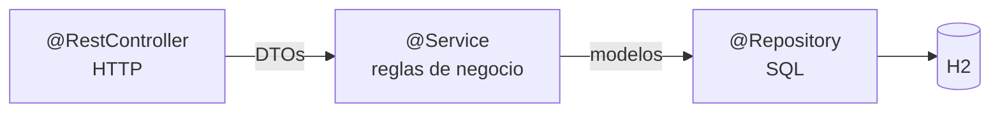
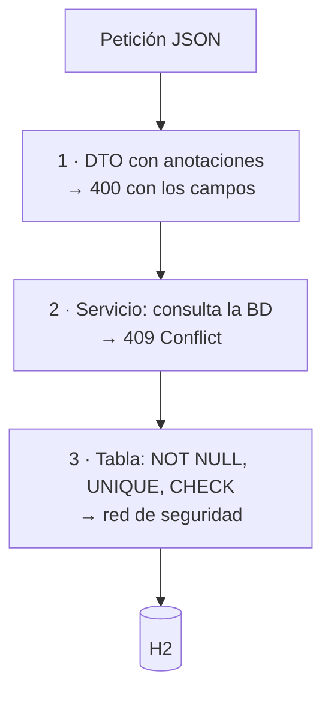

# 3. Repositorios, servicios y DTOs

Las dos capas que quedan por debajo del controlador, y las piezas que viajan entre ellas.



| Capa | Sabe de… | No sabe nada de… |
|---|---|---|
| `@RestController` | HTTP, códigos de estado, DTOs | SQL, nombres de tablas |
| `@Service` | Reglas de negocio | HTTP, `ResponseEntity` |
| `@Repository` | SQL y mapeo de filas | Reglas de negocio |

!!! danger "La prueba de que está bien hecho"
    ```bash
    grep -rn "ResponseEntity\|HttpStatus" src/main/java/**/services/    # debe estar vacío
    grep -rni "SELECT\|INSERT\|UPDATE" src/main/java/**/controllers/    # debe estar vacío
    ```

    Un `ResponseEntity` en el servicio o un `SELECT` en el controlador son los dos errores que más puntos restan en el examen.

---

## 3.1. El repositorio

Es la capa que habla con la base de datos. **El SQL lo escribes tú**: en esta unidad usamos H2 con `JdbcClient`, no JPA.

### La dependencia

```xml
<dependency>
  <groupId>org.springframework.boot</groupId>
  <artifactId>spring-boot-starter-jdbc</artifactId>
</dependency>
<dependency>
  <groupId>com.h2database</groupId>
  <artifactId>h2</artifactId>
  <scope>runtime</scope>
</dependency>
```

!!! info "`starter-jdbc`, no `starter-data-jpa`"
    | | `starter-jdbc` (UT4) | `starter-data-jpa` (UT5) |
    |---|---|---|
    | El SQL | **Lo escribes tú** | Lo genera Hibernate |
    | El esquema | **Tú**, en `schema.sql` | Desde las entidades |
    | El mapeo fila → objeto | **Tú**, con un `RowMapper` | Automático |

    Lo que ya te da: el **pool de conexiones** (HikariCP, configurado solo) y `@Transactional`. Lo que en la [UT3](../ut3/03-base-de-datos.md) hacías a mano con `DriverManager`.

### La interfaz y la implementación

El repositorio se declara como **interfaz** y se implementa aparte. Así el servicio depende del contrato, no de JDBC, y en la UT5 se podrá cambiar la implementación sin tocar nada más.

```java title="funkos/repositories/FunkosRepository.java"
public interface FunkosRepository {
    List<Funko>     findAll();
    Optional<Funko> findById(Long id);
    boolean         existsByNombre(String nombre);
    Funko           save(Funko funko);
    Funko           update(Funko funko);
    boolean         deleteById(Long id);
}
```

!!! success "Las cuatro firmas que hay que copiar siempre"
    | Devuelve | Por qué |
    |---|---|
    | `findById` → **`Optional<Funko>`** | Que no exista es un resultado normal, no un error. Nunca `null` |
    | `save` → **`Funko`** | Con el **id generado** ya puesto |
    | `deleteById` → **`boolean`** | Leído de las filas afectadas: así el servicio puede devolver 404 |
    | `existsByNombre` → `boolean` | Para las reglas de negocio, sin traerse el objeto entero |

### El `RowMapper`

Convierte una fila del `ResultSet` en un objeto. Es el mapeo de la UT3, aislado en su propia clase.

```java title="funkos/mappers/FunkoRowMapper.java"
@Component
public class FunkoRowMapper implements RowMapper<Funko> {

    @Override
    public Funko mapRow(ResultSet rs, int rowNum) throws SQLException {
        return Funko.builder()
                .id(rs.getLong("id"))
                .nombre(rs.getString("nombre"))
                .precio(rs.getBigDecimal("precio"))
                .cantidad(rs.getInt("cantidad"))
                .categoria(rs.getString("categoria"))
                .createdAt(rs.getTimestamp("created_at").toLocalDateTime())
                .build();
    }
}
```

!!! tip "Uno solo, y reutilizado"
    Cuando la tabla gane una columna, se toca **un** método. Si el mapeo está copiado dentro de cada consulta, se tocan todas y alguna se olvida.

### `JdbcClient`: las seis operaciones

```java title="funkos/repositories/FunkosRepositoryJdbc.java"
@Repository
public class FunkosRepositoryJdbc implements FunkosRepository {

    private final JdbcClient jdbc;
    private final FunkoRowMapper rowMapper;

    public FunkosRepositoryJdbc(JdbcClient jdbc, FunkoRowMapper rowMapper) {
        this.jdbc = jdbc;
        this.rowMapper = rowMapper;
    }

    // ── 1 · varias filas
    @Override
    public List<Funko> findAll() {
        return jdbc.sql("SELECT * FROM funkos ORDER BY id")
                   .query(rowMapper).list();
    }

    // ── 2 · cero o una fila → Optional
    @Override
    public Optional<Funko> findById(Long id) {
        return jdbc.sql("SELECT * FROM funkos WHERE id = :id")
                   .param("id", id)
                   .query(rowMapper).optional();
    }

    // ── 3 · un valor suelto
    @Override
    public boolean existsByNombre(String nombre) {
        return jdbc.sql("SELECT COUNT(*) FROM funkos WHERE UPPER(nombre) = UPPER(:nombre)")
                   .param("nombre", nombre)
                   .query(Integer.class).single() > 0;
    }

    // ── 4 · INSERT con id generado
    @Override
    public Funko save(Funko f) {
        var keys = new GeneratedKeyHolder();
        jdbc.sql("""
                INSERT INTO funkos (nombre, precio, cantidad, categoria, created_at, updated_at)
                VALUES (:nombre, :precio, :cantidad, :categoria, :creado, :actualizado)
                """)
            .param("nombre", f.getNombre())
            .param("precio", f.getPrecio())
            .param("cantidad", f.getCantidad())
            .param("categoria", f.getCategoria())
            .param("creado", f.getCreatedAt())
            .param("actualizado", f.getUpdatedAt())
            .update(keys);

        f.setId(((Number) keys.getKeys().get("id")).longValue());
        return f;
    }

    // ── 5 · UPDATE
    @Override
    public Funko update(Funko f) {
        jdbc.sql("""
                UPDATE funkos
                   SET nombre = :nombre, precio = :precio, cantidad = :cantidad,
                       categoria = :categoria, updated_at = :actualizado
                 WHERE id = :id
                """)
            .param("nombre", f.getNombre())
            .param("precio", f.getPrecio())
            .param("cantidad", f.getCantidad())
            .param("categoria", f.getCategoria())
            .param("actualizado", LocalDateTime.now())
            .param("id", f.getId())
            .update();
        return f;
    }

    // ── 6 · DELETE: devuelve si borró algo
    @Override
    public boolean deleteById(Long id) {
        return jdbc.sql("DELETE FROM funkos WHERE id = :id")
                   .param("id", id)
                   .update() == 1;
    }
}
```

| Lo que necesitas | Cómo se cierra la cadena |
|---|---|
| Lista de objetos | `.query(rowMapper).list()` |
| Cero o uno | `.query(rowMapper).optional()` → **`Optional`** |
| Uno obligatorio | `.query(rowMapper).single()` |
| Un número o un texto | `.query(Integer.class).single()` |
| Escribir | `.update()` → **`int` de filas afectadas** |
| Escribir y recuperar el id | `.update(keys)` con un `GeneratedKeyHolder` |

!!! danger "Los `:param` no son plantillas de texto"
    Por debajo son `PreparedStatement`: el valor viaja aparte y la base de datos **nunca lo interpreta como SQL**. La inyección SQL de la [UT3](../ut3/03-base-de-datos.md) no es posible por esta vía.

    Lo que **nunca** se hace, aunque sea más corto:

    ```java
    jdbc.sql("SELECT * FROM funkos WHERE nombre = '" + nombre + "'")   // ❌
    ```

### Filtros opcionales y combinables

Con tres filtros opcionales hay ocho combinaciones. Un método por cada una es inviable, y los `if` anidados son ilegibles. Se monta el `WHERE` a trozos:

```java
@Override
public List<Funko> buscar(Optional<String> categoria, Optional<String> nombre,
                          Optional<BigDecimal> precioMax) {

    var sql = new StringBuilder("SELECT * FROM funkos WHERE 1 = 1");
    var params = new HashMap<String, Object>();

    categoria.ifPresent(c -> {
        sql.append(" AND UPPER(categoria) = UPPER(:categoria)");
        params.put("categoria", c);
    });
    nombre.ifPresent(n -> {
        sql.append(" AND LOWER(nombre) LIKE LOWER(:nombre)");
        params.put("nombre", "%" + n + "%");
    });
    precioMax.ifPresent(p -> {
        sql.append(" AND precio <= :precioMax");
        params.put("precioMax", p);
    });
    sql.append(" ORDER BY id");

    return jdbc.sql(sql.toString()).params(params).query(rowMapper).list();
}
```

!!! success "Lo que se concatena y lo que no"
    ```java
    sql.append(" AND UPPER(categoria) = UPPER(:categoria)");   // ✅ texto FIJO, escrito por ti
    params.put("categoria", c);                                 // ✅ valor parametrizado
    ```

    Se concatena **la estructura**; los **valores** van siempre por `params`. Y el `WHERE 1 = 1` evita llevar la cuenta de cuál es el primer filtro.

### Comprobar y escribir en la misma sentencia

Cuando una regla depende del estado actual de la fila, **no se lee, se comprueba y se escribe**: se hace todo en un `UPDATE` condicionado.

=== "❌ Mal: tres pasos"

    ```java
    var funko = repositorio.findById(id).orElseThrow();
    if (funko.getCantidad() < cantidad) throw new StockInsuficienteException(…);
    repositorio.actualizarStock(id, funko.getCantidad() - cantidad);
    ```

    Entre el `if` y el `UPDATE` **cabe otra petición** haciendo lo mismo. Las dos leen 5, las dos creen que pueden vender 3, y el stock acaba en **−1**.

    Se llama **condición de carrera**, y en desarrollo nunca se reproduce porque hay un solo usuario.

=== "✅ Bien: una sentencia atómica"

    ```java
    @Override
    public int descontarStock(Long id, int cantidad) {
        return jdbc.sql("""
                UPDATE funkos SET cantidad = cantidad - :cantidad
                 WHERE id = :id AND cantidad >= :cantidad
                """)
            .param("cantidad", cantidad).param("id", id)
            .update();
    }
    ```

    ```java
    // en el servicio
    if (repositorio.descontarStock(id, cantidad) == 0)
        throw new FunkoConflictException("Stock insuficiente");
    ```

    La base de datos garantiza que nadie se cuela en medio. Si no había bastante, afecta a **0 filas**, y **ese número es la respuesta**.

---

## 3.2. El servicio

Encapsula la lógica de negocio. El controlador recibe y responde HTTP; el servicio **decide**.

```java title="funkos/services/FunkosService.java"
public interface FunkosService {
    List<FunkoResponse> buscar(Optional<String> categoria, Optional<String> nombre,
                               Optional<BigDecimal> precioMax);
    FunkoResponse findById(Long id);
    FunkoResponse save(FunkoCreateRequest funko);
    FunkoResponse replace(Long id, FunkoCreateRequest funko);
    FunkoResponse update(Long id, FunkoUpdateRequest funko);
    void deleteById(Long id);
}
```

```java title="funkos/services/FunkosServiceImpl.java"
@Service
@CacheConfig(cacheNames = {"funkos"})
public class FunkosServiceImpl implements FunkosService {

    private static final Logger log = LoggerFactory.getLogger(FunkosServiceImpl.class);

    private final FunkosRepository repositorio;
    private final FunkoMapper mapper;

    public FunkosServiceImpl(FunkosRepository repositorio, FunkoMapper mapper) {
        this.repositorio = repositorio;
        this.mapper = mapper;
    }

    @Override
    @Transactional(readOnly = true)
    @Cacheable(key = "#id")
    public FunkoResponse findById(Long id) {
        return repositorio.findById(id)
                .map(mapper::toResponse)
                .orElseThrow(() -> new FunkoNotFoundException(id));
    }

    @Override
    @Transactional
    @CacheEvict(allEntries = true)
    public FunkoResponse save(FunkoCreateRequest request) {
        if (repositorio.existsByNombre(request.nombre()))
            throw new FunkoConflictException("Ya existe un funko llamado " + request.nombre());
        return mapper.toResponse(repositorio.save(mapper.toModel(request)));
    }

    @Override
    @Transactional
    @CacheEvict(allEntries = true)
    public void deleteById(Long id) {
        if (!repositorio.deleteById(id))
            throw new FunkoNotFoundException(id);
    }
}
```

!!! success "Lo que hay que mirar de este fichero es lo que NO contiene"
    Ni `ResponseEntity`, ni `HttpStatus`, ni `@PathVariable`. **El servicio no sabe que existe HTTP**: recibe DTOs, devuelve DTOs y cuando algo va mal **lanza**.

    Por eso en la UT6 este mismo servicio podrá atender un WebSocket y una consulta GraphQL sin cambiar una línea.

!!! danger "El `deleteById` usa lo que devuelve el repositorio"
    ```java
    if (!repositorio.deleteById(id)) throw new FunkoNotFoundException(id);
    ```

    Un `DELETE` de un id que no existe **no lanza nada**: afecta a 0 filas. Sin ese `if`, el cliente recibe un **204** y cree que ha borrado algo. Con él, **404**.

### Una interfaz por delante, aunque haya una sola implementación

Es la interfaz de la [UT2](../ut2/03-poo-en-java.md) con Spring eligiendo la implementación. Lo que te da en la práctica: en el test del controlador puedes inyectar un doble del servicio sin levantar nada.

---

## 3.3. Excepciones de dominio

### La opción rápida: `ResponseStatusException`

```java
return repositorio.findById(id)
        .orElseThrow(() -> new ResponseStatusException(
                HttpStatus.NOT_FOUND, "No existe el funko " + id));
```

Funciona y se escribe en una línea. **Y mete `HttpStatus` dentro del servicio**, con lo que ese servicio ya no se puede reutilizar desde un WebSocket. Conviene conocerla porque la verás en mucho código.

### La que usamos: excepciones propias con `@ResponseStatus`

```java title="funkos/exceptions/"
public abstract class FunkoException extends RuntimeException {
    protected FunkoException(String mensaje) { super(mensaje); }
}

@ResponseStatus(HttpStatus.NOT_FOUND)
public class FunkoNotFoundException extends FunkoException {
    public FunkoNotFoundException(Long id) {
        super("No se ha encontrado el funko con id: " + id);
    }
}

@ResponseStatus(HttpStatus.CONFLICT)
public class FunkoConflictException extends FunkoException {
    public FunkoConflictException(String mensaje) { super(mensaje); }
}

@ResponseStatus(HttpStatus.BAD_REQUEST)
public class FunkoBadRequestException extends FunkoException {
    public FunkoBadRequestException(String mensaje) { super(mensaje); }
}
```

Una base **abstracta** por dominio y una subclase por código de estado.

| | Ventaja concreta |
|---|---|
| El servicio lanza `new FunkoNotFoundException(id)` | **No menciona HTTP**: la anotación está en la excepción |
| El controlador no captura nada | Spring lee `@ResponseStatus` y responde 404 |
| En un test | `assertThrows(FunkoNotFoundException.class, …)`, sin servidor |
| `catch (FunkoException e)` | Captura todas las del dominio de golpe |

!!! tip "El constructor recibe el dato, no el mensaje montado"
    `FunkoNotFoundException(Long id)`, no `FunkoNotFoundException(String mensaje)`. Así todos los 404 de la API dicen exactamente lo mismo y nadie se inventa la redacción.

### Ver los mensajes

```properties
### Desarrollo
server.error.include-message=always
server.error.include-binding-errors=always

### Producción
server.error.include-message=never
server.error.include-stacktrace=never
```

!!! danger "Nunca `include-stacktrace=always`"
    Una traza en la respuesta dice qué framework usas, con qué versión, qué librerías tienes y cómo se llaman tus clases y tus tablas. Es un mapa para quien busque una vulnerabilidad conocida.

    **Mensaje genérico al cliente, traza completa al log.**

---

## 3.4. DTOs

Un DTO es el objeto que viaja entre el controlador y el cliente. **El modelo no sale nunca de la aplicación.**

```java
// Lo que el cliente RECIBE
public record FunkoResponse(
        Long id, String nombre, BigDecimal precio, Integer cantidad,
        String categoria, LocalDateTime createdAt, LocalDateTime updatedAt) {}

// Lo que MANDA al crear (POST y PUT): sin id ni fechas
public record FunkoCreateRequest(
        @NotBlank(message = "El nombre no puede estar vacío")
        @Size(max = 100) String nombre,
        @NotNull @DecimalMin("0.0") @Digits(integer = 8, fraction = 2) BigDecimal precio,
        @NotNull @PositiveOrZero Integer cantidad,
        @NotBlank @Pattern(regexp = "DISNEY|MARVEL|ANIME|OTROS") String categoria) {}

// Lo que MANDA al actualizar (PATCH): todo opcional
public record FunkoUpdateRequest(
        @Size(max = 100) String nombre,
        @DecimalMin("0.0") BigDecimal precio,
        @PositiveOrZero Integer cantidad,
        @Pattern(regexp = "DISNEY|MARVEL|ANIME|OTROS") String categoria) {}
```

!!! success "Tres DTOs, y la diferencia son los obligatorios"
    | | `CreateRequest` | `UpdateRequest` |
    |---|---|---|
    | `nombre` | `@NotBlank` + `@Size` | solo `@Size` |
    | `precio` | `@NotNull` + `@DecimalMin` | solo `@DecimalMin` |
    | `categoria` | `@NotBlank` + `@Pattern` | solo `@Pattern` |

    En el de actualización **desaparecen los `@NotNull` y `@NotBlank`**, porque en un PATCH `null` significa «este campo no lo cambies». Las reglas de formato se quedan: si mandas un valor, tiene que ser válido.

!!! danger "Por qué el modelo no sale nunca"
    1. **Filtras datos.** Un `Usuario` tiene `passwordHash`. Devuélvelo tal cual y lo has publicado.
    2. **El contrato deja de depender de la tabla.** Renombrar una columna no rompe a tus clientes.
    3. **El DTO de creación sin `id`.** Si lo lleva, un cliente puede mandar `{"id": 1, …}` e intentar sobrescribir otro registro. Es una vulnerabilidad, no estilo.
    4. **Nunca aceptes del cliente lo que puedas calcular**: el total de un pedido, el precio congelado de una línea, el estado inicial, un código correlativo.

    Y en la UT5 hay dos razones más: la recursión infinita al serializar y el `LazyInitializationException`.

---

## 3.5. El mapeador

Convierte entre DTOs y modelos. Tres métodos, porque son tres operaciones distintas.

```java title="funkos/mappers/FunkoMapper.java"
@Component
public class FunkoMapper {

    public FunkoResponse toResponse(Funko f) {
        return new FunkoResponse(f.getId(), f.getNombre(), f.getPrecio(),
                f.getCantidad(), f.getCategoria(), f.getCreatedAt(), f.getUpdatedAt());
    }

    public List<FunkoResponse> toResponse(List<Funko> funkos) {
        return funkos.stream().map(this::toResponse).toList();
    }

    /** POST: nuevo. El id y las fechas los pone el servidor. */
    public Funko toModel(FunkoCreateRequest r) {
        var ahora = LocalDateTime.now();
        return Funko.builder()
                .nombre(r.nombre().trim())
                .precio(r.precio())
                .cantidad(r.cantidad())
                .categoria(r.categoria().toUpperCase())
                .createdAt(ahora).updatedAt(ahora)
                .build();
    }

    /** PUT: reemplaza todo menos el id y la fecha de creación. */
    public Funko toModelReemplazando(Funko original, FunkoCreateRequest r) {
        return Funko.builder()
                .id(original.getId())
                .nombre(r.nombre().trim())
                .precio(r.precio())
                .cantidad(r.cantidad())
                .categoria(r.categoria().toUpperCase())
                .createdAt(original.getCreatedAt())
                .updatedAt(LocalDateTime.now())
                .build();
    }

    /** PATCH: solo cambia lo que llega distinto de null. */
    public Funko toModelParcheando(Funko original, FunkoUpdateRequest r) {
        return Funko.builder()
                .id(original.getId())
                .nombre(r.nombre()       != null ? r.nombre().trim()           : original.getNombre())
                .precio(r.precio()       != null ? r.precio()                  : original.getPrecio())
                .cantidad(r.cantidad()   != null ? r.cantidad()                : original.getCantidad())
                .categoria(r.categoria() != null ? r.categoria().toUpperCase() : original.getCategoria())
                .createdAt(original.getCreatedAt())
                .updatedAt(LocalDateTime.now())
                .build();
    }
}
```

!!! danger "PUT y PATCH no pueden llamar al mismo método"
    | Método | Verbo | Qué hace con lo que no mandas |
    |---|---|---|
    | `toModel` | POST | No aplica: es nuevo |
    | `toModelReemplazando` | PUT | **Lo borra** (queda `null`) |
    | `toModelParcheando` | PATCH | **Lo conserva** |

    Los `!= null` **son** la semántica del PATCH. Si tu PUT y tu PATCH usan el mismo método, has implementado dos veces el PATCH, y eso resta puntos en la rúbrica.

    Y `createdAt` **nunca** se toca después del `toModel`.

---

## 3.6. Validación

### En el DTO, con anotaciones

```java
@PostMapping
public ResponseEntity<FunkoResponse> crear(@Valid @RequestBody FunkoCreateRequest dto) { … }
//                                          ^^^^^^ sin esto NO SE VALIDA NADA
```

!!! danger "Sin `@Valid` no hay validación, y nada avisa"
    El DTO está lleno de `@NotBlank` y `@Min`, el código parece perfecto, y **las anotaciones no se ejecutan**. Un POST con el nombre vacío devuelve un **201 Created** tan contento.

    No hay warning de compilación. No hay log. Solo datos basura en la base de datos.

| | Para qué |
|---|---|
| `@NotNull` | No nulo → números, fechas, booleanos |
| `@NotBlank` | No nulo + no solo espacios → **`String`** |
| `@NotEmpty` | No nulo + `size > 0` → **colecciones** |
| `@Size(min=, max=)` | Longitud o tamaño |
| `@Min` `@Max` | Enteros |
| `@DecimalMin` `@DecimalMax` `@Digits(integer=, fraction=)` | `BigDecimal` |
| `@Positive` `@PositiveOrZero` `@Negative` `@NegativeOrZero` | Numéricos |
| `@Email` `@Pattern(regexp=)` | Texto |
| `@Past` `@PastOrPresent` `@Future` `@FutureOrPresent` | Fechas |
| `@AssertTrue` `@AssertFalse` | Validación **de clase**: compara dos campos |
| **`@Valid`** | **En cascada**: objetos y listas anidadas |

!!! warning "`@NotNull`, `@NotEmpty` y `@NotBlank` no son sinónimos"
    | Valor | `@NotNull` | `@NotEmpty` | `@NotBlank` |
    |---|:-:|:-:|:-:|
    | `null` | ❌ | ❌ | ❌ |
    | `""` | ✅ | ❌ | ❌ |
    | `"   "` | ✅ | ✅ | ❌ |

    Un `@NotNull` en un `String` deja pasar `""`, que es el error que llena las tablas de nombres vacíos.

### En cascada, para objetos y listas anidadas

```java
record PedidoRequest(
    @NotNull Long clienteId,
    @NotEmpty @Valid List<LineaRequest> lineas) {}   // ← sin @Valid, las líneas NO se validan
```

Sin ese `@Valid`, el `@NotEmpty` de la lista sí se ejecuta, pero el `@Min(1)` de cada cantidad **no**: un pedido con `cantidad: -5` pasaría la validación.

### De clase, para reglas que comparan dos campos

```java
record ReservaRequest(@NotNull LocalTime desde, @NotNull LocalTime hasta) {

    @AssertTrue(message = "La hora de fin debe ser posterior a la de inicio")
    public boolean isRangoValido() {
        if (desde == null || hasta == null) return true;   // de eso ya se queja @NotNull
        return hasta.isAfter(desde);
    }
}
```

El `return true` cuando hay nulos evita **dos mensajes de error para el mismo problema** y un `NullPointerException` dentro del validador.

### Los tres niveles, y los tres se ponen



| | Dónde | Qué comprueba | Código |
|---|---|---|:-:|
| **Formato** | DTO, anotaciones | Un campo aislado, o dos del mismo objeto | **400** |
| **Negocio** | **Servicio** | Nombre único, stock suficiente, fechas coherentes | **409** |
| **Integridad** | **Tabla** | La única que **no se puede saltar** | 409 vía handler |

```java
// Negocio: necesita consultar
if (repositorio.existsByNombre(request.nombre()))
    throw new FunkoConflictException("Ya existe un funko llamado " + request.nombre());
```

!!! danger "400 no es 409"
    - **400** = «lo que me has mandado está mal escrito».
    - **409 Conflict** = «está bien escrito, pero choca con el estado actual del sistema».

    Que el nombre no esté vacío no necesita la base de datos. Que no esté repetido, sí. Confundir los dos códigos resta en la rúbrica.

### El manejador global

```java title="common/GlobalExceptionHandler.java"
@RestControllerAdvice
public class GlobalExceptionHandler {

    /** 400 con los errores campo a campo. */
    @ResponseStatus(HttpStatus.BAD_REQUEST)
    @ExceptionHandler(MethodArgumentNotValidException.class)
    public Map<String, Object> validacion(MethodArgumentNotValidException ex) {
        Map<String, String> campos = new LinkedHashMap<>();
        ex.getBindingResult().getFieldErrors()
          .forEach(e -> campos.put(e.getField(), e.getDefaultMessage()));
        return Map.of("status", 400, "error", "Datos de entrada inválidos", "campos", campos);
    }

    /** 400 cuando el JSON no se puede ni leer. */
    @ResponseStatus(HttpStatus.BAD_REQUEST)
    @ExceptionHandler(HttpMessageNotReadableException.class)
    public Map<String, Object> jsonIlegible(HttpMessageNotReadableException ex) {
        return Map.of("status", 400, "error", "El cuerpo no es un JSON valido");
    }

    /** 400 cuando /funkos/abc intenta ser un Long. */
    @ResponseStatus(HttpStatus.BAD_REQUEST)
    @ExceptionHandler(MethodArgumentTypeMismatchException.class)
    public Map<String, Object> tipoMalo(MethodArgumentTypeMismatchException ex) {
        return Map.of("status", 400,
                "error", "El parametro '%s' no tiene el tipo esperado".formatted(ex.getName()));
    }

    /** 409 cuando salta una restriccion de la tabla: UNIQUE, CHECK, FK. */
    @ResponseStatus(HttpStatus.CONFLICT)
    @ExceptionHandler(DataIntegrityViolationException.class)
    public Map<String, Object> integridad(DataIntegrityViolationException ex) {
        return Map.of("status", 409,
                "error", "La operacion viola una restriccion de la base de datos");
    }
}
```

```json
{
  "status": 400,
  "error": "Datos de entrada inválidos",
  "campos": {
    "nombre": "El nombre no puede estar vacío",
    "precio": "El precio no puede ser negativo"
  }
}
```

Un 400 con los errores **campo a campo** es lo que un formulario necesita para pintar el mensaje debajo de cada casilla. Una respuesta que solo dice «datos inválidos» obliga al cliente a adivinar.

!!! success "Lo que NO está en el handler, y es deliberado"
    No hay handler para `FunkoNotFoundException` ni para `FunkoConflictException`: **llevan su `@ResponseStatus` y Spring las traduce solas**.

    Aquí solo están los errores que **no son del dominio**: validación, JSON roto, tipo de parámetro incorrecto y violaciones de integridad.

---

## 3.7. Caché

```xml
<dependency>
  <groupId>org.springframework.boot</groupId>
  <artifactId>spring-boot-starter-cache</artifactId>
</dependency>
```

```java
@SpringBootApplication
@EnableCaching                     // sin esto, todo lo de abajo es decoración
public class FunkosApiApplication { … }
```

```java
@Service
@CacheConfig(cacheNames = {"funkos"})
public class FunkosServiceImpl implements FunkosService {

    @Cacheable(key = "#id")                     // si está en caché, no ejecuta
    public FunkoResponse findById(Long id) { … }

    @CacheEvict(allEntries = true)              // invalida TODO al escribir
    public FunkoResponse save(FunkoCreateRequest dto) { … }

    @CachePut(key = "#result.id")               // ejecuta y guarda el resultado
    public FunkoResponse actualizar(…) { … }
}
```

| | Qué hace |
|---|---|
| `@Cacheable` | «Si ya lo tengo, devuelvo la caché» |
| `@CachePut` | «Lo ejecuto **y** actualizo la caché» |
| `@CacheEvict` | «Borro de la caché» |

!!! danger "Las tres trampas de la caché, y las tres caen en el examen"
    **1. Sin `@EnableCaching` no hace nada**, y no avisa. Es el mismo fallo silencioso que el `@Valid` olvidado.

    **2. Todo método que escribe necesita `@CacheEvict(allEntries = true)`.** Si cacheas `findAll()` y creas un funko, la lista cacheada sigue siendo la antigua: el cliente ve datos viejos **y nadie ve ningún error**. Tiene que ser `allEntries` porque un elemento nuevo invalida **todas** las listas, no una entrada.

    **3. Una llamada interna no pasa por la caché.**

    ```java
    public FunkoResponse metodoA(Long id) {
        return findById(id);          // ← NO pasa por la caché
    }
    @Cacheable
    public FunkoResponse findById(Long id) { … }
    ```

    Spring envuelve el bean en un **proxy** e intercepta las llamadas **que entran desde fuera**. Un `this.findById(...)` no sale del objeto. Le pasa lo mismo a `@Transactional`.

!!! info "Esta caché es de memoria y de esta instancia"
    Sin más configuración, Spring usa un `ConcurrentHashMap`: **sin límite de tamaño y sin caducidad**. Para un ejercicio vale; en producción se cambia por Caffeine (una dependencia) o Redis si hay varias instancias.

    Y con dos instancias detrás de un balanceador, **cada una tiene su caché** y pueden contestar cosas distintas.

---

## Pruébalo ahora (15 min)

Sobre el proyecto que montarás en el [tema 5](05-proyectos.md), o sobre cualquier CRUD que tengas:

1. Quita el `@Valid` del `@RequestBody` y manda un POST con el nombre vacío. ¿Qué código devuelve?
2. Vuelve a ponerlo y repite. Mira el cuerpo de la respuesta.
3. Añade `@Cacheable` a `findById` con un `log.info` dentro. Llama dos veces al mismo id. ¿Cuántas veces sale el log?
4. Con la caché puesta, borra ese funko y vuelve a pedirlo. ¿Qué pasa?
5. Quita el `if (!repositorio.deleteById(id))` del servicio y borra un id que no exista.

??? success "Solución de las cinco"

    **1. 201 Created.** Sin `@Valid` las anotaciones del DTO son decoración: nadie las ejecuta.

    **2. 400 Bad Request**, y con el `@RestControllerAdvice` puesto:

    ```json
    { "status": 400, "error": "Datos de entrada inválidos",
      "campos": { "nombre": "El nombre no puede estar vacío" } }
    ```

    **3. Una sola vez.** La segunda llamada no entra en el método: el proxy devuelve el valor guardado.

    **4.** Si el `delete` no tiene `@CacheEvict`, el GET **devuelve el funko borrado**. Y sigue mal aunque pongas `@CacheEvict(key = "#id")`: `findAll()` cacheada también tiene la lista antigua, así que hace falta `allEntries = true`.

    **5. 204 No Content**, y el cliente cree que ha borrado algo que no existía. Debería ser **404**.

---

## Ejercicios (con solución)

### E1 — Las cuatro firmas del repositorio

¿Qué devuelve cada uno y por qué?

```java
?  findById(Long id);
?  save(Funko f);
?  deleteById(Long id);
?  existsByNombre(String nombre);
```

??? success "Solución"

    ```java
    Optional<Funko> findById(Long id);
    Funko           save(Funko f);
    boolean         deleteById(Long id);
    boolean         existsByNombre(String nombre);
    ```

    - **`Optional`** porque que no exista es un resultado normal, no un error. Nunca `null`.
    - **`Funko`** con el id generado ya puesto: lo necesita el controlador para la cabecera `Location`.
    - **`boolean`** leído de las filas afectadas: un `DELETE` de un id inexistente afecta a 0 y eso es lo que permite devolver 404.
    - **`boolean`** para una regla de negocio, sin traerse el objeto entero de la base de datos.

### E2 — El `UPDATE` condicionado

¿Por qué esto está mal y cómo se arregla?

```java
var funko = repositorio.findById(id).orElseThrow();
if (funko.getCantidad() < 1) throw new FunkoConflictException("Sin stock");
repositorio.actualizarCantidad(id, funko.getCantidad() - 1);
```

??? success "Solución"

    Entre el `if` y el `UPDATE` **cabe otra petición**: las dos leen cantidad 1, las dos pasan la comprobación, y el stock acaba en **−1**.

    ```java
    // en el repositorio
    return jdbc.sql("""
            UPDATE funkos SET cantidad = cantidad - 1
             WHERE id = :id AND cantidad >= 1
            """).param("id", id).update();

    // en el servicio
    if (repositorio.descontarUno(id) == 0)
        throw new FunkoConflictException("Sin stock");
    ```

    **Una sola sentencia atómica.** La base de datos garantiza que nadie se cuela, y las **0 filas afectadas** son la señal.

    En desarrollo el primer código funciona perfectamente, porque hay un solo usuario. Por eso es un error que solo se detecta razonando.

### E3 — Tres razones para no devolver el modelo

??? success "Solución"

    1. **Expone datos que no debe**: `passwordHash`, el id interno del proveedor, un campo de borrado lógico.
    2. **Ata el contrato de la API a la tabla**: renombrar una columna rompe a todos los clientes.
    3. **No permite dos vistas del mismo dato**, que es lo que hace falta para versionar (`/v1` y `/v2`).

    Y en la UT5 hay dos más: la recursión infinita con relaciones bidireccionales y el `LazyInitializationException`.

### E4 — Por qué el DTO de creación no lleva `id`

??? success "Solución"

    Porque **el id lo asigna el servidor**.

    Si el DTO lo lleva, un cliente puede mandar `{"id": 1, "nombre": "..."}` y, según cómo esté escrito el `save`, **sobrescribir el registro 1** en lugar de crear uno nuevo.

    Mismo razonamiento para `createdAt`: las fechas las pone el servidor con `LocalDateTime.now()`, porque el reloj del cliente no es de fiar.

    **Regla general: nunca aceptes del cliente un dato que puedas calcular.**

### E5 — `ResponseStatusException` o excepción propia

??? success "Solución"

    | | `ResponseStatusException` | Excepción propia |
    |---|---|---|
    | Código a escribir | Una línea | Una clase por caso |
    | ¿El servicio sabe de HTTP? | **Sí** | No |
    | Testear | Hay que inspeccionar el `HttpStatus` | `assertThrows(FunkoNotFoundException.class, …)` |
    | Reutilizar en WebSocket / GraphQL | **No se puede** | Sí |
    | Capturar todo un dominio | No | `catch (FunkoException e)` |

    **Excepción propia**, por la penúltima fila: en la UT6 ese servicio atiende un WebSocket, donde `HttpStatus.NOT_FOUND` no significa nada.

### E6 — Las dos validaciones

Clasifica: (a) el nombre no puede estar vacío · (b) el nombre no puede estar repetido · (c) el precio debe ser positivo · (d) no se puede borrar un funko con stock

??? success "Solución"

    | | Dónde | Cómo | Código |
    |---|---|---|:-:|
    | (a) | DTO | `@NotBlank` | 400 |
    | (b) | **Servicio** | `existsByNombre` → `FunkoConflictException` | **409** |
    | (c) | DTO | `@PositiveOrZero` | 400 |
    | (d) | **Servicio** | consulta → excepción | **409** |

    **El criterio:** si para comprobarlo hay que mirar la base de datos u otros campos, no es formato. Las anotaciones solo ven **un campo aislado**.

### E7 — El `@Valid` anidado

```java
record PedidoRequest(@NotNull Long clienteId, @NotEmpty List<LineaRequest> lineas) {}
record LineaRequest(@NotNull Long productoId, @NotNull @Min(1) Integer cantidad) {}
```

Mandas `{"clienteId":1,"lineas":[{"productoId":1,"cantidad":0}]}`. ¿Qué pasa?

??? success "Solución"

    **Pasa la validación**: devuelve 201 con una línea de cantidad 0.

    El `@NotEmpty` de la lista sí se ejecuta, pero **las anotaciones de dentro de cada `LineaRequest` no**. Falta el `@Valid` en cascada:

    ```java
    record PedidoRequest(@NotNull Long clienteId,
                         @NotEmpty @Valid List<LineaRequest> lineas) {}
    ```

    Con él, el error llega identificado por posición:

    ```json
    { "campos": { "lineas[0].cantidad": "La cantidad mínima es 1" } }
    ```

    Es el mismo olvido que el `@Valid` del `@RequestBody`, un nivel más abajo y más difícil de ver.

### E8 — La caché que miente

```java
@Cacheable public List<FunkoResponse> findAll() { … }
           public FunkoResponse save(FunkoCreateRequest f) { … }
```

??? success "Solución"

    Creas un funko, pides la lista y **ves la de antes**, sin ningún error.

    ```java
    @CacheEvict(cacheNames = "funkos", allEntries = true)
    public FunkoResponse save(FunkoCreateRequest f) { … }
    ```

    Tiene que ser `allEntries = true`: un elemento nuevo invalida **todas** las listas cacheadas.

    Y la regla general: `save`, `replace`, `update` y `delete`, **los cuatro** con `@CacheEvict`.

### E9 — El PATCH que borra campos

Escribe el método del mapeador que aplica un `FunkoUpdateRequest` sobre un `Funko` existente.

??? success "Solución"

    ```java
    public Funko toModelParcheando(Funko original, FunkoUpdateRequest r) {
        return Funko.builder()
                .id(original.getId())
                .nombre(r.nombre()       != null ? r.nombre()       : original.getNombre())
                .precio(r.precio()       != null ? r.precio()       : original.getPrecio())
                .cantidad(r.cantidad()   != null ? r.cantidad()     : original.getCantidad())
                .categoria(r.categoria() != null ? r.categoria()    : original.getCategoria())
                .createdAt(original.getCreatedAt())   // nunca se toca
                .updatedAt(LocalDateTime.now())       // siempre se refresca
                .build();
    }
    ```

    Los `!= null` **son** la semántica del PATCH: «lo que no me has mandado, déjalo como estaba».

    El límite de este diseño, que conviene saber: **no se puede poner un campo a `null` a propósito**, porque `null` ya significa «no lo cambies». Resolverlo bien requiere JSON Merge Patch y no entra en el módulo.

### E10 — Cómo se detecta un `@Valid` olvidado

??? success "Solución"

    Con un test de la capa web que mande un cuerpo inválido y exija un 400:

    ```java
    @Test
    void postConNombreVacioDevuelve400() throws Exception {
        mockMvc.perform(post("/api/v1/funkos")
                    .contentType(MediaType.APPLICATION_JSON)
                    .content("""
                        {"nombre":"","precio":10.00,"cantidad":1,"categoria":"ANIME"}"""))
               .andExpect(status().isBadRequest())
               .andExpect(jsonPath("$.campos.nombre").exists());
    }
    ```

    Sin el `@Valid`, este test falla con «expected 400, was 201», que es **exactamente** lo que quieres que ocurra.

    Y es la razón de fondo de tener tests de capa web: detectan en medio segundo algo que probándolo a mano no mirarías nunca, porque ¿quién prueba a mandar un nombre vacío?
