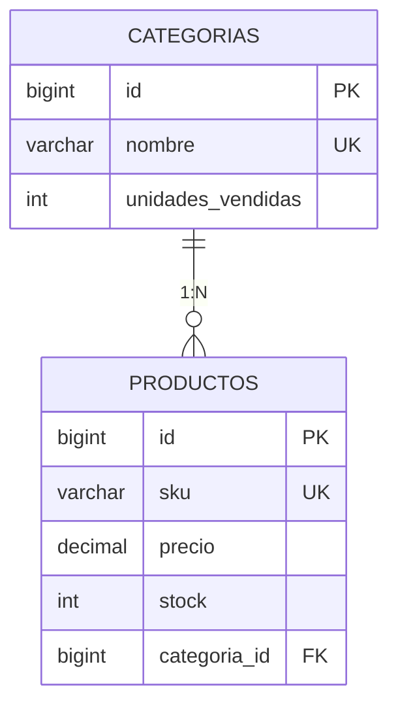
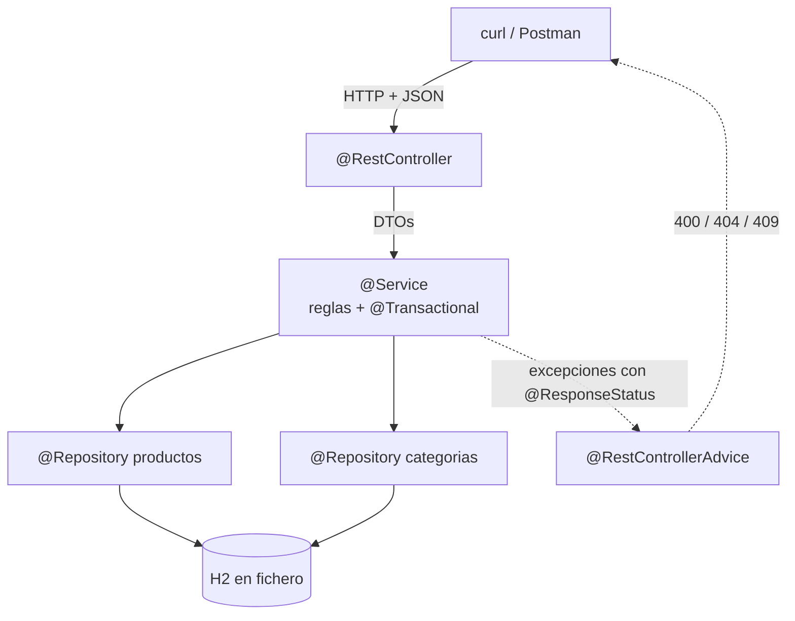

# 5. Dos proyectos paso a paso

Dos APIs REST completas con **Maven, Spring Web y H2 por JDBC**. Se teclean de arriba abajo y cada paso deja el proyecto **arrancando**.

| | Proyecto | Tablas | Lo nuevo |
|:-:|---|:-:|---|
| **A** | [API de Funkos](#proyecto-a-api-de-funkos) | 1 | Las ocho capas completas, de cero a `.jar` |
| **B** | [API de una tienda](#proyecto-b-api-de-una-tienda) | 2 | Clave ajena, **una operación que toca las dos tablas** y la **caché** |

!!! danger "Aquí no hay JPA ni Hibernate"
    El SQL lo escribes tú. **JPA es la [UT5](../ut5/index.md)**, y entonces se cambiará solo el repositorio.

!!! info "Cómo se trabaja"
    No se lee: se teclea. **`git commit` al final de cada paso**, que es la única forma de volver atrás cuando el paso 8 rompe algo del paso 3.

    El orden es el del [tema 3](03-repositorios-servicios-dtos.md): modelo → repositorio → excepciones → DTOs → mapeador → servicio → controlador → errores.

    **Aquí no se escriben tests.** Estos dos proyectos se comprueban **ejecutándolos**: cada paso acaba con las peticiones `curl` que demuestran que funciona, y cada proyecto con su lista de comprobación. Los tests se trabajan aparte, con tiempo propio.

---

# Proyecto A · API de Funkos

```
GET    /api/v1/funkos          ?categoria= &nombre= &precioMax=
GET    /api/v1/funkos/{id}
POST   /api/v1/funkos
PUT    /api/v1/funkos/{id}
PATCH  /api/v1/funkos/{id}
DELETE /api/v1/funkos/{id}
```

## Paso 1 · Crear el proyecto

```bash
curl https://start.spring.io/starter.zip \
  -d type=maven-project -d language=java \
  -d bootVersion=3.5.6 -d javaVersion=25 \
  -d groupId=es.iesx -d artifactId=funkos-api \
  -d packageName=es.iesx.funkos \
  -d dependencies=web,validation,jdbc,h2,devtools \
  -o funkos-api.zip

unzip funkos-api.zip -d funkos-api && cd funkos-api
./mvnw spring-boot:run
```

```
Tomcat started on port 8080 (http)
Started FunkosApiApplication in 1.412 seconds
```

!!! info "Las cinco dependencias"
    | | Para qué |
    |---|---|
    | `web` | Tomcat, `@RestController`, Jackson |
    | `validation` | `@Valid`, `@NotBlank` |
    | **`jdbc`** | `DataSource`, pool, **`JdbcClient`**, `@Transactional` |
    | `h2` | La base de datos |
    | `devtools` | Reinicio al guardar (solo desarrollo) |

    **`jdbc`, no `data-jpa`.** Si pones JPA por error, Hibernate intentará crear las tablas y chocará con tu `schema.sql`.

## Paso 2 · La configuración

```properties title="src/main/resources/application.properties"
spring.application.name=funkos-api

server.port=${PORT:8080}
api.path=/api
api.version=v1

### H2 en FICHERO: los datos sobreviven al reinicio
spring.datasource.url=${DB_URL:jdbc:h2:file:./datos/funkos;AUTO_SERVER=TRUE}
spring.datasource.username=${DB_USER:sa}
spring.datasource.password=${DB_PASSWORD:}
spring.datasource.driver-class-name=org.h2.Driver

### El esquema y los datos los creamos nosotros
spring.sql.init.mode=always
spring.sql.init.schema-locations=classpath:schema.sql
spring.sql.init.data-locations=classpath:data.sql

### Consola web de H2: http://localhost:8080/h2-console
spring.h2.console.enabled=true
spring.h2.console.path=/h2-console

server.error.include-message=always
server.error.include-binding-errors=always
server.error.include-stacktrace=never

logging.level.es.iesx=DEBUG
```

```gitignore title=".gitignore — añade esto"
datos/
```

!!! danger "`file:` y `AUTO_SERVER=TRUE`"
    | URL | Dónde viven los datos |
    |---|---|
    | `jdbc:h2:mem:funkos` | En memoria: **se borran al parar** |
    | `jdbc:h2:file:./datos/funkos` | En `datos/funkos.mv.db`: **sobreviven** |

    Y `AUTO_SERVER=TRUE` permite que la consola de H2 y tu aplicación abran la base **a la vez**. Sin él, la segunda falla con `Database may be already in use`.

## Paso 3 · El esquema y los datos

```sql title="src/main/resources/schema.sql"
CREATE TABLE IF NOT EXISTS funkos (
    id         BIGINT AUTO_INCREMENT PRIMARY KEY,
    nombre     VARCHAR(100)  NOT NULL,
    precio     DECIMAL(10,2) NOT NULL,
    cantidad   INT           NOT NULL DEFAULT 0,
    categoria  VARCHAR(20)   NOT NULL,
    created_at TIMESTAMP     NOT NULL DEFAULT CURRENT_TIMESTAMP,
    updated_at TIMESTAMP     NOT NULL DEFAULT CURRENT_TIMESTAMP,
    CONSTRAINT uk_funko_nombre UNIQUE (nombre),
    CONSTRAINT ck_funko_precio   CHECK (precio   >= 0),
    CONSTRAINT ck_funko_cantidad CHECK (cantidad >= 0),
    CONSTRAINT ck_funko_categoria
        CHECK (categoria IN ('DISNEY','MARVEL','ANIME','OTROS'))
);

CREATE INDEX IF NOT EXISTS idx_funko_categoria ON funkos (categoria);
```

```sql title="src/main/resources/data.sql"
MERGE INTO funkos (id, nombre, precio, cantidad, categoria) KEY(id) VALUES
  (1, 'Mickey Mouse', 15.99, 10, 'DISNEY'),
  (2, 'Stitch',       17.00,  8, 'DISNEY'),
  (3, 'Spider-Man',   19.99,  5, 'MARVEL'),
  (4, 'Iron Man',     21.50,  2, 'MARVEL'),
  (5, 'Goku',         22.50,  3, 'ANIME'),
  (6, 'Naruto',       18.75,  0, 'ANIME');

ALTER TABLE funkos ALTER COLUMN id RESTART WITH 7;
```

!!! danger "Las tres cosas que fallan en este paso"
    **1 · `CREATE TABLE IF NOT EXISTS`.** Con H2 en fichero, `schema.sql` se ejecuta **en cada arranque**. Sin el `IF NOT EXISTS`, al segundo arranque: `Table "FUNKOS" already exists`.

    **2 · `MERGE … KEY(id)` y no `INSERT`.** Mismo motivo: un `INSERT` con id fijo falla al segundo arranque por clave primaria duplicada.

    **3 · El `ALTER … RESTART WITH 7`.** Si insertas con ids explícitos, el contador del `AUTO_INCREMENT` sigue en 1, así que **el primer POST chocará con Mickey Mouse**. Es un error desconcertante porque el código del POST está bien.

!!! success "Comprueba antes de seguir"
    ```bash
    ./mvnw spring-boot:run
    # Ctrl+C y otra vez: tiene que arrancar las dos veces sin error
    ```

    Y en `http://localhost:8080/h2-console`, con `jdbc:h2:file:./datos/funkos`, usuario `sa` y contraseña vacía:

    ```sql
    SELECT * FROM funkos;
    ```

## Paso 4 · El modelo

```java title="funkos/models/Funko.java"
package es.iesx.funkos.funkos.models;

import java.math.BigDecimal;
import java.time.LocalDateTime;

public record Funko(
        Long id,
        String nombre,
        BigDecimal precio,
        Integer cantidad,
        String categoria,
        LocalDateTime createdAt,
        LocalDateTime updatedAt
) {}
```

**Un fichero, siete líneas.** El `record` trae el constructor, los captadores (`f.nombre()`), `equals`, `hashCode` y `toString`.

!!! info "Y `BigDecimal`, no `double`"
    Es dinero: `0.1 + 0.2` en `double` da `0.30000000000000004`. La columna es `DECIMAL(10,2)` por lo mismo.

## Paso 5 · El repositorio

```java title="funkos/repositories/FunkosRepository.java"
package es.iesx.funkos.funkos.repositories;

import es.iesx.funkos.funkos.models.Funko;
import java.math.BigDecimal;
import java.util.*;

public interface FunkosRepository {
    List<Funko>       buscar(Optional<String> categoria, Optional<String> nombre,
                             Optional<BigDecimal> precioMax);
    Optional<Funko>   findById(Long id);
    boolean           existsByNombre(String nombre);
    Funko             save(Funko funko);
    void              update(Funko funko);
    boolean           deleteById(Long id);
    Map<String, Long> contarPorCategoria();
}
```

```java title="funkos/repositories/FunkoRowMapper.java"
package es.iesx.funkos.funkos.repositories;

import es.iesx.funkos.funkos.models.Funko;
import org.springframework.jdbc.core.RowMapper;
import org.springframework.stereotype.Component;

import java.sql.ResultSet;
import java.sql.SQLException;

@Component
public class FunkoRowMapper implements RowMapper<Funko> {

    @Override
    public Funko mapRow(ResultSet rs, int rowNum) throws SQLException {
        return new Funko(
                rs.getLong("id"),
                rs.getString("nombre"),
                rs.getBigDecimal("precio"),
                rs.getInt("cantidad"),
                rs.getString("categoria"),
                rs.getTimestamp("created_at").toLocalDateTime(),
                rs.getTimestamp("updated_at").toLocalDateTime());
    }
}
```

```java title="funkos/repositories/FunkosRepositoryJdbc.java"
package es.iesx.funkos.funkos.repositories;

import es.iesx.funkos.funkos.models.Funko;
import org.springframework.jdbc.core.simple.JdbcClient;
import org.springframework.jdbc.support.GeneratedKeyHolder;
import org.springframework.stereotype.Repository;

import java.math.BigDecimal;
import java.util.*;

@Repository
public class FunkosRepositoryJdbc implements FunkosRepository {

    private final JdbcClient jdbc;
    private final FunkoRowMapper rowMapper;

    public FunkosRepositoryJdbc(JdbcClient jdbc, FunkoRowMapper rowMapper) {
        this.jdbc = jdbc;
        this.rowMapper = rowMapper;
    }

    @Override
    public List<Funko> buscar(Optional<String> categoria, Optional<String> nombre,
                              Optional<BigDecimal> precioMax) {
        var sql = new StringBuilder("SELECT * FROM funkos WHERE 1 = 1");
        var params = new HashMap<String, Object>();

        categoria.ifPresent(c -> {
            sql.append(" AND UPPER(categoria) = UPPER(:categoria)");
            params.put("categoria", c);
        });
        nombre.ifPresent(n -> {
            sql.append(" AND LOWER(nombre) LIKE LOWER(:nombre)");
            params.put("nombre", "%" + n + "%");
        });
        precioMax.ifPresent(p -> {
            sql.append(" AND precio <= :precioMax");
            params.put("precioMax", p);
        });
        sql.append(" ORDER BY id");

        return jdbc.sql(sql.toString()).params(params).query(rowMapper).list();
    }

    @Override
    public Optional<Funko> findById(Long id) {
        return jdbc.sql("SELECT * FROM funkos WHERE id = :id")
                   .param("id", id)
                   .query(rowMapper).optional();
    }

    @Override
    public boolean existsByNombre(String nombre) {
        return jdbc.sql("SELECT COUNT(*) FROM funkos WHERE UPPER(nombre) = UPPER(:nombre)")
                   .param("nombre", nombre)
                   .query(Integer.class).single() > 0;
    }

    @Override
    public Funko save(Funko f) {
        var keys = new GeneratedKeyHolder();
        jdbc.sql("""
                INSERT INTO funkos (nombre, precio, cantidad, categoria, created_at, updated_at)
                VALUES (:nombre, :precio, :cantidad, :categoria, :creado, :actualizado)
                """)
            .param("nombre", f.nombre())
            .param("precio", f.precio())
            .param("cantidad", f.cantidad())
            .param("categoria", f.categoria())
            .param("creado", f.createdAt())
            .param("actualizado", f.updatedAt())
            .update(keys);

        Long id = ((Number) keys.getKeys().get("id")).longValue();
        return new Funko(id, f.nombre(), f.precio(), f.cantidad(),
                         f.categoria(), f.createdAt(), f.updatedAt());
    }

    @Override
    public void update(Funko f) {
        jdbc.sql("""
                UPDATE funkos
                   SET nombre = :nombre, precio = :precio, cantidad = :cantidad,
                       categoria = :categoria, updated_at = :actualizado
                 WHERE id = :id
                """)
            .param("nombre", f.nombre())
            .param("precio", f.precio())
            .param("cantidad", f.cantidad())
            .param("categoria", f.categoria())
            .param("actualizado", f.updatedAt())
            .param("id", f.id())
            .update();
    }

    @Override
    public boolean deleteById(Long id) {
        return jdbc.sql("DELETE FROM funkos WHERE id = :id")
                   .param("id", id)
                   .update() == 1;
    }

    @Override
    public Map<String, Long> contarPorCategoria() {
        var filas = jdbc.sql("""
                SELECT categoria, COUNT(*) AS total
                  FROM funkos
                 GROUP BY categoria
                 ORDER BY categoria
                """)
            .query((rs, n) -> Map.entry(rs.getString("categoria"), rs.getLong("total")))
            .list();

        var resultado = new LinkedHashMap<String, Long>();
        filas.forEach(e -> resultado.put(e.getKey(), e.getValue()));
        return resultado;
    }
}
```

!!! success "Compara con la UT3"
    | | UT3, a mano | UT4, con `JdbcClient` |
    |---|---|---|
    | Abrir la conexión | `DriverManager` + `try-with-resources` | **Spring**, de un pool |
    | Parámetros | `ps.setString(1, …)` desde 1 | `:nombre`, con nombre |
    | Recorrer el `ResultSet` | `while (rs.next())` | `RowMapper` + `.list()` |
    | Cero o uno | `rs.next() ? … : null` | **`.optional()`** |
    | Cerrar | A mano | **Spring** |

    El SQL sigue siendo tuyo, y los `:param` siguen siendo `PreparedStatement`: **la inyección SQL no es posible por esta vía**.

## Paso 6 · Las excepciones

Tres ficheros de cuatro líneas:

```java title="funkos/exceptions/FunkoNotFoundException.java"
package es.iesx.funkos.funkos.exceptions;

import org.springframework.http.HttpStatus;
import org.springframework.web.bind.annotation.ResponseStatus;

@ResponseStatus(HttpStatus.NOT_FOUND)
public class FunkoNotFoundException extends RuntimeException {
    public FunkoNotFoundException(Long id) {
        super("No se ha encontrado el funko con id: " + id);
    }
}
```

```java title="funkos/exceptions/FunkoConflictException.java"
@ResponseStatus(HttpStatus.CONFLICT)
public class FunkoConflictException extends RuntimeException {
    public FunkoConflictException(String mensaje) { super(mensaje); }
}
```

```java title="funkos/exceptions/FunkoBadRequestException.java"
@ResponseStatus(HttpStatus.BAD_REQUEST)
public class FunkoBadRequestException extends RuntimeException {
    public FunkoBadRequestException(String mensaje) { super(mensaje); }
}
```

El servicio lanza, el controlador no captura, y Spring lee el `@ResponseStatus`.

## Paso 7 · Los DTOs

```java title="funkos/dto/FunkoResponse.java"
package es.iesx.funkos.funkos.dto;

import java.math.BigDecimal;
import java.time.LocalDateTime;

public record FunkoResponse(
        Long id,
        String nombre,
        BigDecimal precio,
        Integer cantidad,
        String categoria,
        LocalDateTime createdAt,
        LocalDateTime updatedAt
) {}
```

```java title="funkos/dto/FunkoCreateRequest.java"
package es.iesx.funkos.funkos.dto;

import jakarta.validation.constraints.*;
import java.math.BigDecimal;

public record FunkoCreateRequest(

        @NotBlank(message = "El nombre no puede estar vacío")
        @Size(max = 100, message = "Máximo 100 caracteres")
        String nombre,

        @NotNull(message = "El precio es obligatorio")
        @DecimalMin(value = "0.0", message = "El precio no puede ser negativo")
        BigDecimal precio,

        @NotNull(message = "La cantidad es obligatoria")
        @PositiveOrZero(message = "La cantidad no puede ser negativa")
        Integer cantidad,

        @NotBlank(message = "La categoría no puede estar vacía")
        @Pattern(regexp = "DISNEY|MARVEL|ANIME|OTROS",
                 message = "Debe ser DISNEY, MARVEL, ANIME u OTROS")
        String categoria
) {}
```

```java title="funkos/dto/FunkoUpdateRequest.java"
public record FunkoUpdateRequest(
        @Size(max = 100) String nombre,
        @DecimalMin("0.0") BigDecimal precio,
        @PositiveOrZero Integer cantidad,
        @Pattern(regexp = "DISNEY|MARVEL|ANIME|OTROS") String categoria
) {}
```

```java title="funkos/dto/EstadisticasResponse.java"
public record EstadisticasResponse(
        int total,
        Map<String, Long> porCategoria,
        BigDecimal valorInventario,
        long sinStock,
        String masCaro
) {}
```

**En el `UpdateRequest` desaparecen los obligatorios**, porque en un PATCH `null` significa «no lo cambies». Y el `CreateRequest` **no lleva `id` ni fechas**: las pone el servidor.

## Paso 8 · El mapeador

```java title="funkos/mappers/FunkoMapper.java"
package es.iesx.funkos.funkos.mappers;

import es.iesx.funkos.funkos.dto.*;
import es.iesx.funkos.funkos.models.Funko;
import org.springframework.stereotype.Component;

import java.time.LocalDateTime;
import java.util.List;

@Component
public class FunkoMapper {

    public FunkoResponse toResponse(Funko f) {
        return new FunkoResponse(f.id(), f.nombre(), f.precio(), f.cantidad(),
                                 f.categoria(), f.createdAt(), f.updatedAt());
    }

    public List<FunkoResponse> toResponse(List<Funko> funkos) {
        return funkos.stream().map(this::toResponse).toList();
    }

    /** POST: nuevo. El id lo pone la BD; las fechas, el servidor. */
    public Funko toModel(FunkoCreateRequest r) {
        var ahora = LocalDateTime.now();
        return new Funko(
                null,
                r.nombre().trim(),
                r.precio(),
                r.cantidad(),
                r.categoria().toUpperCase(),
                ahora,
                ahora);
    }

    /** PUT: reemplaza todo menos el id y la fecha de creación. */
    public Funko reemplazar(Funko original, FunkoCreateRequest r) {
        return new Funko(
                original.id(),
                r.nombre().trim(),
                r.precio(),
                r.cantidad(),
                r.categoria().toUpperCase(),
                original.createdAt(),
                LocalDateTime.now());
    }

    /** PATCH: cambia solo lo que llega distinto de null. */
    public Funko parchear(Funko original, FunkoUpdateRequest r) {
        return new Funko(
                original.id(),
                r.nombre()    != null ? r.nombre().trim()           : original.nombre(),
                r.precio()    != null ? r.precio()                  : original.precio(),
                r.cantidad()  != null ? r.cantidad()                : original.cantidad(),
                r.categoria() != null ? r.categoria().toUpperCase() : original.categoria(),
                original.createdAt(),
                LocalDateTime.now());
    }
}
```

!!! danger "`reemplazar` y `parchear` tienen que ser dos métodos distintos"
    | | Qué hace con lo que **no** mandas |
    |---|---|
    | `reemplazar` (PUT) | **Lo borra** |
    | `parchear` (PATCH) | **Lo conserva** |

    Si el PATCH llama a `reemplazar`, mandar `{"precio": 25}` deja el nombre en `null`. Es el error de diseño más común de la unidad.

## Paso 9 · El servicio

```java title="funkos/services/FunkosService.java"
package es.iesx.funkos.funkos.services;

import es.iesx.funkos.funkos.dto.*;
import java.math.BigDecimal;
import java.util.*;

public interface FunkosService {
    List<FunkoResponse> buscar(Optional<String> categoria, Optional<String> nombre,
                               Optional<BigDecimal> precioMax);
    FunkoResponse findById(Long id);
    FunkoResponse save(FunkoCreateRequest funko);
    FunkoResponse replace(Long id, FunkoCreateRequest funko);
    FunkoResponse update(Long id, FunkoUpdateRequest funko);
    void deleteById(Long id);
    EstadisticasResponse estadisticas();
}
```

```java title="funkos/services/FunkosServiceImpl.java"
package es.iesx.funkos.funkos.services;

import es.iesx.funkos.funkos.dto.*;
import es.iesx.funkos.funkos.exceptions.*;
import es.iesx.funkos.funkos.mappers.FunkoMapper;
import es.iesx.funkos.funkos.models.Funko;
import es.iesx.funkos.funkos.repositories.FunkosRepository;
import org.slf4j.*;
import org.springframework.stereotype.Service;
import org.springframework.transaction.annotation.Transactional;

import java.math.BigDecimal;
import java.util.*;

@Service
public class FunkosServiceImpl implements FunkosService {

    private static final Logger log = LoggerFactory.getLogger(FunkosServiceImpl.class);

    private final FunkosRepository repositorio;
    private final FunkoMapper mapper;

    public FunkosServiceImpl(FunkosRepository repositorio, FunkoMapper mapper) {
        this.repositorio = repositorio;
        this.mapper = mapper;
    }

    @Override
    @Transactional(readOnly = true)
    public List<FunkoResponse> buscar(Optional<String> categoria, Optional<String> nombre,
                                      Optional<BigDecimal> precioMax) {
        log.debug("buscar categoria={} nombre={} precioMax={}", categoria, nombre, precioMax);
        return mapper.toResponse(repositorio.buscar(categoria, nombre, precioMax));
    }

    @Override
    @Transactional(readOnly = true)
    public FunkoResponse findById(Long id) {
        return repositorio.findById(id)
                .map(mapper::toResponse)
                .orElseThrow(() -> new FunkoNotFoundException(id));
    }

    @Override
    @Transactional
    public FunkoResponse save(FunkoCreateRequest request) {
        if (repositorio.existsByNombre(request.nombre()))
            throw new FunkoConflictException(
                    "Ya existe un funko con el nombre: " + request.nombre());

        return mapper.toResponse(repositorio.save(mapper.toModel(request)));
    }

    @Override
    @Transactional
    public FunkoResponse replace(Long id, FunkoCreateRequest request) {
        var original = repositorio.findById(id)
                .orElseThrow(() -> new FunkoNotFoundException(id));

        var nuevo = mapper.reemplazar(original, request);
        repositorio.update(nuevo);
        return mapper.toResponse(nuevo);
    }

    @Override
    @Transactional
    public FunkoResponse update(Long id, FunkoUpdateRequest request) {
        var original = repositorio.findById(id)
                .orElseThrow(() -> new FunkoNotFoundException(id));

        var parcheado = mapper.parchear(original, request);
        repositorio.update(parcheado);
        return mapper.toResponse(parcheado);
    }

    @Override
    @Transactional
    public void deleteById(Long id) {
        if (!repositorio.deleteById(id))
            throw new FunkoNotFoundException(id);
    }

    @Override
    @Transactional(readOnly = true)
    public EstadisticasResponse estadisticas() {
        var todos = repositorio.buscar(Optional.empty(), Optional.empty(), Optional.empty());

        var valor = BigDecimal.ZERO;
        for (var f : todos)
            valor = valor.add(f.precio().multiply(BigDecimal.valueOf(f.cantidad())));

        var masCaro = todos.stream()
                .max(Comparator.comparing(Funko::precio))
                .map(Funko::nombre)
                .orElse("—");

        var sinStock = todos.stream().filter(f -> f.cantidad() == 0).count();

        return new EstadisticasResponse(todos.size(), repositorio.contarPorCategoria(),
                                        valor, sinStock, masCaro);
    }
}
```

!!! success "Lee este fichero y mira lo que NO hay"
    Ni `ResponseEntity`, ni `HttpStatus`, ni `@PathVariable`. **El servicio no sabe que existe HTTP.**

    Y el `deleteById`: `if (!repositorio.deleteById(id)) throw …`. Sin ese `if`, borrar un id inexistente devuelve **204** y el cliente cree que ha borrado algo.

## Paso 10 · El controlador

```java title="funkos/controllers/FunkosRestController.java"
package es.iesx.funkos.funkos.controllers;

import es.iesx.funkos.funkos.dto.*;
import es.iesx.funkos.funkos.services.FunkosService;
import jakarta.validation.Valid;
import org.springframework.http.ResponseEntity;
import org.springframework.web.bind.annotation.*;

import java.math.BigDecimal;
import java.net.URI;
import java.util.*;

@RestController
@RequestMapping("${api.path:/api}/${api.version:v1}/funkos")
public class FunkosRestController {

    private final FunkosService servicio;

    public FunkosRestController(FunkosService servicio) {
        this.servicio = servicio;
    }

    @GetMapping
    public ResponseEntity<List<FunkoResponse>> buscar(
            @RequestParam Optional<String> categoria,
            @RequestParam Optional<String> nombre,
            @RequestParam Optional<BigDecimal> precioMax) {
        return ResponseEntity.ok(servicio.buscar(categoria, nombre, precioMax));
    }

    @GetMapping("/estadisticas")
    public ResponseEntity<EstadisticasResponse> estadisticas() {
        return ResponseEntity.ok(servicio.estadisticas());
    }

    @GetMapping("/{id}")
    public ResponseEntity<FunkoResponse> findById(@PathVariable Long id) {
        return ResponseEntity.ok(servicio.findById(id));
    }

    @PostMapping
    public ResponseEntity<FunkoResponse> crear(
            @Valid @RequestBody FunkoCreateRequest funko) {
        var creado = servicio.save(funko);
        return ResponseEntity
                .created(URI.create("/api/v1/funkos/" + creado.id()))
                .body(creado);
    }

    @PutMapping("/{id}")
    public ResponseEntity<FunkoResponse> reemplazar(
            @PathVariable Long id, @Valid @RequestBody FunkoCreateRequest funko) {
        return ResponseEntity.ok(servicio.replace(id, funko));
    }

    @PatchMapping("/{id}")
    public ResponseEntity<FunkoResponse> actualizar(
            @PathVariable Long id, @Valid @RequestBody FunkoUpdateRequest funko) {
        return ResponseEntity.ok(servicio.update(id, funko));
    }

    @DeleteMapping("/{id}")
    public ResponseEntity<Void> borrar(@PathVariable Long id) {
        servicio.deleteById(id);
        return ResponseEntity.noContent().build();
    }
}
```

!!! warning "`/estadisticas` va ANTES de `/{id}`"
    Si `/{id}` estuviera primero, Spring intentaría convertir `"estadisticas"` en un `Long` y devolvería un **400**.

    Las rutas fijas siempre antes que las variables.

## Paso 11 · El manejador de errores

```java title="common/GlobalExceptionHandler.java"
package es.iesx.funkos.common;

import org.springframework.dao.DataIntegrityViolationException;
import org.springframework.http.HttpStatus;
import org.springframework.http.converter.HttpMessageNotReadableException;
import org.springframework.web.bind.MethodArgumentNotValidException;
import org.springframework.web.bind.annotation.*;
import org.springframework.web.method.annotation.MethodArgumentTypeMismatchException;

import java.util.*;

@RestControllerAdvice
public class GlobalExceptionHandler {

    @ResponseStatus(HttpStatus.BAD_REQUEST)
    @ExceptionHandler(MethodArgumentNotValidException.class)
    public Map<String, Object> validacion(MethodArgumentNotValidException ex) {
        Map<String, String> campos = new LinkedHashMap<>();
        ex.getBindingResult().getFieldErrors()
          .forEach(e -> campos.put(e.getField(), e.getDefaultMessage()));
        return Map.of("status", 400, "error", "Datos de entrada inválidos", "campos", campos);
    }

    @ResponseStatus(HttpStatus.BAD_REQUEST)
    @ExceptionHandler(HttpMessageNotReadableException.class)
    public Map<String, Object> jsonIlegible(HttpMessageNotReadableException ex) {
        return Map.of("status", 400, "error", "El cuerpo no es un JSON valido");
    }

    @ResponseStatus(HttpStatus.BAD_REQUEST)
    @ExceptionHandler(MethodArgumentTypeMismatchException.class)
    public Map<String, Object> tipoMalo(MethodArgumentTypeMismatchException ex) {
        return Map.of("status", 400,
                "error", "El parametro '%s' no tiene el tipo esperado".formatted(ex.getName()));
    }

    @ResponseStatus(HttpStatus.CONFLICT)
    @ExceptionHandler(DataIntegrityViolationException.class)
    public Map<String, Object> integridad(DataIntegrityViolationException ex) {
        return Map.of("status", 409,
                "error", "La operacion viola una restriccion de la base de datos");
    }
}
```

## Paso 12 · Probarlo

```bash
./mvnw spring-boot:run
```

=== "Lo que funciona"

    ```bash
    # Los seis de data.sql
    curl -s localhost:8080/api/v1/funkos | jq length
    # 6

    # Filtros, combinables y sin distinguir mayúsculas
    curl -s "localhost:8080/api/v1/funkos?categoria=disney" | jq '[.[].nombre]'
    # ["Mickey Mouse","Stitch"]

    curl -s "localhost:8080/api/v1/funkos?nombre=man&precioMax=20" | jq '[.[].nombre]'
    # ["Spider-Man"]

    # Crear: 201 + Location
    curl -i -X POST localhost:8080/api/v1/funkos \
      -H "Content-Type: application/json" \
      -d '{"nombre":"Pikachu","precio":20.00,"cantidad":7,"categoria":"ANIME"}'
    # HTTP/1.1 201
    # Location: /api/v1/funkos/7

    # PATCH: solo el precio, la cantidad intacta
    curl -s -X PATCH localhost:8080/api/v1/funkos/7 \
      -H "Content-Type: application/json" \
      -d '{"precio":25.00}' | jq '{nombre, precio, cantidad}'
    # { "nombre": "Pikachu", "precio": 25.00, "cantidad": 7 }

    # Estadísticas
    curl -s localhost:8080/api/v1/funkos/estadisticas | jq
    # { "total": 7, "porCategoria": {"ANIME":3,"DISNEY":2,"MARVEL":2}, … }

    curl -i -X DELETE localhost:8080/api/v1/funkos/7
    # HTTP/1.1 204
    ```

=== "Los errores"

    ```bash
    # 404
    curl -i localhost:8080/api/v1/funkos/9999
    # 404 · "No se ha encontrado el funko con id: 9999"

    # 400 con los campos señalados
    curl -s -X POST localhost:8080/api/v1/funkos \
      -H "Content-Type: application/json" \
      -d '{"nombre":"","precio":-5,"cantidad":1,"categoria":"COCINA"}' | jq .campos
    # {
    #   "nombre": "El nombre no puede estar vacío",
    #   "precio": "El precio no puede ser negativo",
    #   "categoria": "Debe ser DISNEY, MARVEL, ANIME u OTROS"
    # }

    # 409: nombre repetido
    curl -i -X POST localhost:8080/api/v1/funkos \
      -H "Content-Type: application/json" \
      -d '{"nombre":"Goku","precio":10.00,"cantidad":1,"categoria":"ANIME"}'
    # 409

    curl -i localhost:8080/api/v1/funkos/abc                            # 400
    curl -i -X POST localhost:8080/api/v1/funkos -d '{"nombre":"X"}'    # 415
    curl -i -X DELETE localhost:8080/api/v1/funkos/9999                 # 404
    ```

=== "Que persiste"

    ```bash
    curl -X POST localhost:8080/api/v1/funkos \
      -H "Content-Type: application/json" \
      -d '{"nombre":"Totoro","precio":24.00,"cantidad":4,"categoria":"ANIME"}'

    # Ctrl+C y volver a arrancar
    ./mvnw spring-boot:run

    curl -s "localhost:8080/api/v1/funkos?nombre=totoro" | jq length
    # 1   ← el fichero datos/funkos.mv.db lo ha guardado
    ```

## Paso 13 · Generar el `.jar`

```bash
./mvnw clean package
java -jar target/funkos-api-0.0.1-SNAPSHOT.jar
```

```bash
# Y comprobar que arranca con otro perfil y otro puerto
PORT=9090 SPRING_PROFILES_ACTIVE=prod java -jar target/funkos-api-0.0.1-SNAPSHOT.jar
```

!!! success "Comprueba el proyecto A"
    - [ ] Los **seis endpoints** responden con el código correcto
    - [ ] Los datos **sobreviven** a parar y arrancar, y arranca **dos veces seguidas** sin error
    - [ ] Un `POST` inválido devuelve **400 con los campos**
    - [ ] Un `id` inexistente devuelve **404**, no 500
    - [ ] El `POST` correcto devuelve **201** y la cabecera `Location`
    - [ ] `grep -rn "ResponseEntity\|HttpStatus" src/main/java/**/services/` → **vacío**
    - [ ] `grep -rn "@Autowired" src/main/java/` → **vacío**
    - [ ] El `.jar` se genera y arranca

---

# Proyecto B · API de una tienda

Dos tablas con clave ajena, y una operación que toca las dos. Es donde `@Transactional` deja de ser una anotación que se copia.

```
GET    /api/v1/categorias        CRUD
GET    /api/v1/categorias/{id}/productos

GET    /api/v1/productos         ?categoria= &nombre= &conStock=
GET    /api/v1/productos/{id}
POST   /api/v1/productos
PATCH  /api/v1/productos/{id}
DELETE /api/v1/productos/{id}
POST   /api/v1/productos/{id}/venta      ← toca las DOS tablas
```

## Paso 1 · El esquema

```sql title="src/main/resources/schema.sql"
CREATE TABLE IF NOT EXISTS categorias (
    id                BIGINT AUTO_INCREMENT PRIMARY KEY,
    nombre            VARCHAR(40) NOT NULL,
    unidades_vendidas INT         NOT NULL DEFAULT 0,
    CONSTRAINT uk_categoria_nombre UNIQUE (nombre),
    CONSTRAINT ck_categoria_vendidas CHECK (unidades_vendidas >= 0)
);

CREATE TABLE IF NOT EXISTS productos (
    id           BIGINT AUTO_INCREMENT PRIMARY KEY,
    sku          VARCHAR(20)   NOT NULL,
    nombre       VARCHAR(150)  NOT NULL,
    precio       DECIMAL(10,2) NOT NULL,
    stock        INT           NOT NULL DEFAULT 0,
    categoria_id BIGINT        NOT NULL,
    created_at   TIMESTAMP     NOT NULL DEFAULT CURRENT_TIMESTAMP,
    updated_at   TIMESTAMP     NOT NULL DEFAULT CURRENT_TIMESTAMP,
    CONSTRAINT uk_producto_sku UNIQUE (sku),
    CONSTRAINT fk_producto_categoria
        FOREIGN KEY (categoria_id) REFERENCES categorias (id),
    CONSTRAINT ck_producto_precio CHECK (precio >= 0),
    CONSTRAINT ck_producto_stock  CHECK (stock  >= 0)
);

CREATE INDEX IF NOT EXISTS idx_producto_categoria ON productos (categoria_id);
```

```sql title="src/main/resources/data.sql"
MERGE INTO categorias (id, nombre, unidades_vendidas) KEY(id) VALUES
  (1, 'INFORMATICA', 0),
  (2, 'PAPELERIA',   0),
  (3, 'MOBILIARIO',  0);

MERGE INTO productos (id, sku, nombre, precio, stock, categoria_id) KEY(id) VALUES
  (1, 'SKU-001', 'Teclado mecánico', 79.90, 10, 1),
  (2, 'SKU-002', 'Ratón vertical',   45.50,  3, 1),
  (3, 'SKU-003', 'Monitor 27"',     229.00,  1, 1),
  (4, 'SKU-004', 'Cuaderno A4',       4.95, 50, 2),
  (5, 'SKU-005', 'Silla de oficina', 149.00, 0, 3);

ALTER TABLE categorias ALTER COLUMN id RESTART WITH 4;
ALTER TABLE productos  ALTER COLUMN id RESTART WITH 6;
```



!!! success "Las tres decisiones del esquema"
    **1 · `fk_producto_categoria` sin cascada.** Borrar una categoría que tiene productos **tiene que fallar**, y la base de datos lo impide. Eso se traduce en un 409.

    **2 · `CHECK (stock >= 0)`.** La última defensa contra vender más de lo que hay. Aunque tu código tenga un bug, el stock no queda negativo.

    **3 · `unidades_vendidas` en la categoría.** Es el contador que hace que la venta toque **dos tablas**, que es el punto del proyecto.

## Paso 2 · Los modelos

```java title="categorias/models/Categoria.java"
public record Categoria(
        Long id,
        String nombre,
        Integer unidadesVendidas
) {}
```

```java title="productos/models/Producto.java"
public record Producto(
        Long id,
        String sku,
        String nombre,
        BigDecimal precio,
        Integer stock,
        Long categoriaId,
        LocalDateTime createdAt,
        LocalDateTime updatedAt
) {}
```

!!! info "`categoriaId`, no `Categoria categoria`"
    El modelo guarda **el id de la clave ajena**, no el objeto entero. Es lo que hay en la columna.

    Cuando el controlador necesite devolver el **nombre** de la categoría, el repositorio hace un `JOIN` y el DTO lo lleva. Sin JPA no hay navegación automática, y aquí eso es una ventaja: **se ve exactamente qué consulta se lanza**.

## Paso 3 · Los DTOs

```java title="productos/dto/"
/** Sale hacia el cliente: con el NOMBRE de la categoría, no su id. */
public record ProductoResponse(
        Long id,
        String sku,
        String nombre,
        BigDecimal precio,
        Integer stock,
        String categoria,
        LocalDateTime createdAt,
        LocalDateTime updatedAt
) {}

/** Entra en el POST: la categoría se indica por NOMBRE. */
public record ProductoCreateRequest(

        @NotBlank @Pattern(regexp = "SKU-\\d{3}", message = "El SKU debe ser SKU-nnn")
        String sku,

        @NotBlank @Size(max = 150) String nombre,

        @NotNull @DecimalMin(value = "0.0", message = "El precio no puede ser negativo")
        BigDecimal precio,

        @NotNull @PositiveOrZero Integer stock,

        @NotBlank(message = "La categoría es obligatoria") String categoria
) {}

public record ProductoUpdateRequest(
        @Size(max = 150) String nombre,
        @DecimalMin("0.0") BigDecimal precio,
        @PositiveOrZero Integer stock,
        String categoria
) {}

/** El cuerpo de la venta. */
public record VentaRequest(
        @NotNull @Min(value = 1, message = "La cantidad mínima es 1") Integer cantidad
) {}
```

## Paso 4 · Los repositorios

```java title="productos/repositories/ProductosRepository.java"
public interface ProductosRepository {
    List<ProductoConCategoria> buscar(Optional<String> categoria, Optional<String> nombre,
                                      Optional<Boolean> conStock);
    Optional<ProductoConCategoria> findById(Long id);
    boolean   existsBySku(String sku);
    long      contarPorCategoria(Long categoriaId);
    Producto  save(Producto producto);
    void      update(Producto producto);
    boolean   deleteById(Long id);

    /** Descuenta SOLO si hay suficiente. Devuelve las filas afectadas. */
    int descontarStock(Long id, int cantidad);
}
```

```java title="productos/repositories/ProductoConCategoria.java"
/** Lo que devuelve el JOIN: el producto y el nombre de su categoría. */
public record ProductoConCategoria(Producto producto, String categoriaNombre) {}
```

```java title="productos/repositories/ProductoConCategoriaRowMapper.java"
@Component
public class ProductoConCategoriaRowMapper implements RowMapper<ProductoConCategoria> {

    @Override
    public ProductoConCategoria mapRow(ResultSet rs, int rowNum) throws SQLException {
        var producto = new Producto(
                rs.getLong("id"),
                rs.getString("sku"),
                rs.getString("nombre"),
                rs.getBigDecimal("precio"),
                rs.getInt("stock"),
                rs.getLong("categoria_id"),
                rs.getTimestamp("created_at").toLocalDateTime(),
                rs.getTimestamp("updated_at").toLocalDateTime());

        return new ProductoConCategoria(producto, rs.getString("categoria_nombre"));
    }
}
```

```java title="productos/repositories/ProductosRepositoryJdbc.java (lo relevante)"
@Repository
public class ProductosRepositoryJdbc implements ProductosRepository {

    private static final String SELECT_CON_CATEGORIA = """
            SELECT p.*, c.nombre AS categoria_nombre
              FROM productos p
              JOIN categorias c ON c.id = p.categoria_id
            """;

    private final JdbcClient jdbc;
    private final ProductoConCategoriaRowMapper rowMapper;

    public ProductosRepositoryJdbc(JdbcClient jdbc, ProductoConCategoriaRowMapper rowMapper) {
        this.jdbc = jdbc;
        this.rowMapper = rowMapper;
    }

    @Override
    public List<ProductoConCategoria> buscar(Optional<String> categoria,
                                             Optional<String> nombre,
                                             Optional<Boolean> conStock) {
        var sql = new StringBuilder(SELECT_CON_CATEGORIA).append(" WHERE 1 = 1");
        var params = new HashMap<String, Object>();

        categoria.ifPresent(c -> {
            sql.append(" AND UPPER(c.nombre) = UPPER(:categoria)");
            params.put("categoria", c);
        });
        nombre.ifPresent(n -> {
            sql.append(" AND LOWER(p.nombre) LIKE LOWER(:nombre)");
            params.put("nombre", "%" + n + "%");
        });
        conStock.filter(Boolean::booleanValue).ifPresent(x -> sql.append(" AND p.stock > 0"));
        sql.append(" ORDER BY p.id");

        return jdbc.sql(sql.toString()).params(params).query(rowMapper).list();
    }

    @Override
    public Optional<ProductoConCategoria> findById(Long id) {
        return jdbc.sql(SELECT_CON_CATEGORIA + " WHERE p.id = :id")
                   .param("id", id)
                   .query(rowMapper).optional();
    }

    @Override
    public long contarPorCategoria(Long categoriaId) {
        return jdbc.sql("SELECT COUNT(*) FROM productos WHERE categoria_id = :id")
                   .param("id", categoriaId)
                   .query(Long.class).single();
    }

    /** La pieza central del proyecto. */
    @Override
    public int descontarStock(Long id, int cantidad) {
        return jdbc.sql("""
                UPDATE productos
                   SET stock = stock - :cantidad, updated_at = CURRENT_TIMESTAMP
                 WHERE id = :id AND stock >= :cantidad
                """)
            .param("cantidad", cantidad).param("id", id)
            .update();
    }
}
```

```java title="categorias/repositories/CategoriasRepository.java"
public interface CategoriasRepository {
    List<Categoria>     findAll();
    Optional<Categoria> findById(Long id);
    Optional<Categoria> findByNombre(String nombre);
    Categoria           save(Categoria categoria);
    boolean             deleteById(Long id);

    /** Suma unidades al contador de la categoría. */
    int sumarVendidas(Long id, int cantidad);
}
```

!!! success "El `JOIN` está en una constante"
    `SELECT_CON_CATEGORIA` se reutiliza en `buscar` y en `findById`. Si mañana hay que añadir una columna al `SELECT`, se toca **un sitio**.

## Paso 5 · La venta: la operación que toca dos tablas

```java title="productos/services/ProductosServiceImpl.java (el método clave)"
/**
 * Vende unidades de un producto: descuenta su stock y suma al contador
 * de su categoría. Las dos cosas, o ninguna.
 */
@Override
@Transactional
public ProductoResponse vender(Long id, VentaRequest request) {

    // 1 · el producto tiene que existir
    var actual = repositorio.findById(id)
            .orElseThrow(() -> new ProductoNotFoundException(id));

    // 2 · descontar stock, de forma atómica
    if (repositorio.descontarStock(id, request.cantidad()) == 0)
        throw new ProductoConflictException(
                "Stock insuficiente de %s: piden %d, hay %d"
                        .formatted(actual.producto().nombre(),
                                   request.cantidad(),
                                   actual.producto().stock()));

    // 3 · sumar al contador de la categoría
    categoriasRepository.sumarVendidas(actual.producto().categoriaId(), request.cantidad());

    log.info("Vendidas {} unidades de {}", request.cantidad(), actual.producto().sku());

    // 4 · devolver el estado nuevo
    return mapper.toResponse(repositorio.findById(id).orElseThrow());
}
```

!!! danger "El `@Transactional` es todo el proyecto en una anotación"
    Sigue el camino de una venta que falla en el paso 3:

    ```
    1 · el producto existe                       OK
    2 · descontar stock        → UPDATE ejecutado
    3 · sumar a la categoría   → falla
    ───────────────────────────────────────────────
    ROLLBACK: el UPDATE del paso 2 se deshace
    ```

    **Sin `@Transactional`**, cada `update()` se confirma solo: el stock se queda descontado y el contador sin subir. **Has perdido stock sin vender nada, y nadie recibe ningún error.**

!!! danger "Y el `AND stock >= :cantidad` evita el stock negativo"
    === "❌ Mal: comprobar y después restar"

        ```java
        var p = repositorio.findById(id).orElseThrow();
        if (p.producto().stock() < cantidad)
            throw new ProductoConflictException("Sin stock");
        repositorio.actualizarStock(id, p.producto().stock() - cantidad);
        ```

        Entre el `if` y el `UPDATE` **cabe otra petición**. Las dos leen stock 5, las dos creen que pueden vender 3, y el stock acaba en **−1**.

        En desarrollo nunca se reproduce, porque hay un solo usuario.

    === "✅ Bien: una sola sentencia"

        ```java
        if (repositorio.descontarStock(id, cantidad) == 0)
            throw new ProductoConflictException("Stock insuficiente…");
        ```

        El `UPDATE … WHERE stock >= :cantidad` es **atómico**: la base de datos garantiza que nadie se cuela. Si no había bastante, afecta a **0 filas**.

### Y las otras dos reglas

```java
@Override
@Transactional
public ProductoResponse save(ProductoCreateRequest request) {
    if (repositorio.existsBySku(request.sku()))
        throw new ProductoConflictException("Ya existe un producto con el SKU " + request.sku());

    var categoria = categoriasRepository.findByNombre(request.categoria())
            .orElseThrow(() -> new ProductoBadRequestException(
                    "La categoría " + request.categoria() + " no existe"));

    return mapper.toResponse(repositorio.findById(
            repositorio.save(mapper.toModel(request, categoria.id())).id()).orElseThrow());
}
```

```java title="categorias/services/CategoriasServiceImpl.java"
@Override
@Transactional
public void deleteById(Long id) {
    categoriasRepository.findById(id)
            .orElseThrow(() -> new CategoriaNotFoundException(id));

    long productos = productosRepository.contarPorCategoria(id);
    if (productos > 0)
        throw new CategoriaConflictException(
                "No se puede borrar la categoría: tiene %d productos".formatted(productos));

    categoriasRepository.deleteById(id);
}
```

## Paso 6 · El mapeador con dos tablas

```java title="productos/mappers/ProductoMapper.java"
@Component
public class ProductoMapper {

    /** El JOIN ya trae el nombre de la categoría: lo pasamos al DTO. */
    public ProductoResponse toResponse(ProductoConCategoria pc) {
        var p = pc.producto();
        return new ProductoResponse(p.id(), p.sku(), p.nombre(), p.precio(),
                                    p.stock(), pc.categoriaNombre(),
                                    p.createdAt(), p.updatedAt());
    }

    public List<ProductoResponse> toResponse(List<ProductoConCategoria> lista) {
        return lista.stream().map(this::toResponse).toList();
    }

    /** POST: recibe el id de la categoría ya resuelto por el servicio. */
    public Producto toModel(ProductoCreateRequest r, Long categoriaId) {
        var ahora = LocalDateTime.now();
        return new Producto(
                null,
                r.sku().trim().toUpperCase(),
                r.nombre().trim(),
                r.precio(),
                r.stock(),
                categoriaId,
                ahora,
                ahora);
    }

    /** PATCH: conserva lo que no llega. La categoría también viene resuelta. */
    public Producto parchear(Producto original, ProductoUpdateRequest r, Long categoriaId) {
        return new Producto(
                original.id(),
                original.sku(),                                   // el SKU no se cambia
                r.nombre() != null ? r.nombre().trim() : original.nombre(),
                r.precio() != null ? r.precio()        : original.precio(),
                r.stock()  != null ? r.stock()         : original.stock(),
                categoriaId,
                original.createdAt(),
                LocalDateTime.now());
    }
}
```

!!! info "Quién resuelve el nombre de la categoría"
    El cliente manda `"categoria": "INFORMATICA"`. **El servicio** lo busca y obtiene el id; **el mapeador** solo recibe el `Long` ya resuelto.

    Así el mapeador no necesita repositorios: sigue siendo una clase que solo convierte datos.

## Paso 7 · Probar el proyecto B

=== "Una venta correcta"

    ```bash
    curl -s localhost:8080/api/v1/productos/1 | jq '{nombre, stock, categoria}'
    # { "nombre": "Teclado mecánico", "stock": 10, "categoria": "INFORMATICA" }

    curl -s -X POST localhost:8080/api/v1/productos/1/venta \
      -H "Content-Type: application/json" -d '{"cantidad":3}' | jq '{nombre, stock}'
    # { "nombre": "Teclado mecánico", "stock": 7 }

    curl -s localhost:8080/api/v1/categorias | jq '.[] | select(.nombre=="INFORMATICA")'
    # { "id": 1, "nombre": "INFORMATICA", "unidadesVendidas": 3 }
    ```

    **Las dos tablas han cambiado con una sola petición.**

=== "La transacción, comprobada"

    ```bash
    # Antes
    curl -s localhost:8080/api/v1/productos | jq '[.[] | {sku, stock}]'
    curl -s localhost:8080/api/v1/categorias | jq '[.[] | {nombre, unidadesVendidas}]'

    # Venta de más unidades de las que hay
    curl -i -X POST localhost:8080/api/v1/productos/3/venta \
      -H "Content-Type: application/json" -d '{"cantidad":5}'
    # 409 · "Stock insuficiente de Monitor 27\": piden 5, hay 1"

    # Después: NINGUNA de las dos tablas ha cambiado
    curl -s localhost:8080/api/v1/productos | jq '[.[] | {sku, stock}]'
    curl -s localhost:8080/api/v1/categorias | jq '[.[] | {nombre, unidadesVendidas}]'
    ```

    **Esos dos pares de salidas idénticas son el resultado de aprendizaje del proyecto.**

=== "Los errores"

    ```bash
    # 409: borrar una categoría con productos
    curl -i -X DELETE localhost:8080/api/v1/categorias/1
    # 409 · "No se puede borrar la categoría: tiene 3 productos"

    # 400: categoría que no existe
    curl -i -X POST localhost:8080/api/v1/productos \
      -H "Content-Type: application/json" \
      -d '{"sku":"SKU-010","nombre":"Mesa","precio":99.00,"stock":2,"categoria":"COCINA"}'
    # 400

    # 400: SKU con formato malo
    curl -s -X POST localhost:8080/api/v1/productos \
      -H "Content-Type: application/json" \
      -d '{"sku":"ABC","nombre":"Mesa","precio":99.00,"stock":2,"categoria":"PAPELERIA"}' \
      | jq .campos
    # { "sku": "El SKU debe ser SKU-nnn" }

    # 400: cantidad 0 en la venta
    curl -s -X POST localhost:8080/api/v1/productos/1/venta \
      -H "Content-Type: application/json" -d '{"cantidad":0}' | jq .campos
    # { "cantidad": "La cantidad mínima es 1" }

    # 409: vender un producto sin stock
    curl -i -X POST localhost:8080/api/v1/productos/5/venta \
      -H "Content-Type: application/json" -d '{"cantidad":1}'
    # 409
    ```

## Paso 8 · La caché

El listado de productos y la ficha de un producto se piden mucho y cambian poco: son el caso de libro para una caché.

```xml title="pom.xml"
<dependency>
  <groupId>org.springframework.boot</groupId>
  <artifactId>spring-boot-starter-cache</artifactId>
</dependency>
```

```java title="TiendaApiApplication.java"
@SpringBootApplication
@EnableCaching                     // ← sin esto, lo de abajo no hace nada
public class TiendaApiApplication {
    public static void main(String[] args) {
        SpringApplication.run(TiendaApiApplication.class, args);
    }
}
```

```java title="productos/services/ProductosServiceImpl.java"
@Service
@CacheConfig(cacheNames = {"productos"})
public class ProductosServiceImpl implements ProductosService {

    // ───── LECTURAS: guardan en la caché ─────

    @Override
    @Cacheable
    public List<ProductoResponse> findAll(Optional<String> categoria,
                                          Optional<String> nombre) {
        return mapper.toResponse(repositorio.buscar(categoria, nombre));
    }

    @Override
    @Cacheable(key = "#id")
    public ProductoResponse findById(Long id) {
        return repositorio.findById(id)
                .map(mapper::toResponse)
                .orElseThrow(() -> new ProductoNotFoundException(id));
    }

    // ───── ESCRITURAS: vacían la caché. LAS CUATRO ─────

    @Override
    @Transactional
    @CacheEvict(allEntries = true)
    public ProductoResponse save(ProductoCreateRequest request) { … }

    @Override
    @Transactional
    @CacheEvict(allEntries = true)
    public ProductoResponse update(Long id, ProductoUpdateRequest request) { … }

    @Override
    @Transactional
    @CacheEvict(allEntries = true)
    public void deleteById(Long id) { … }

    /** La venta también escribe: cambia el stock. */
    @Override
    @Transactional
    @CacheEvict(allEntries = true)
    public ProductoResponse vender(Long id, VentaRequest request) { … }
}
```

!!! danger "El `vender` es el que se olvida"
    Es el único método de escritura que no se llama `save`, `update` ni `delete`, y por eso se queda sin `@CacheEvict` la primera vez que alguien hace esto.

    La consecuencia: **vendes tres unidades, el stock baja en la base de datos, y el `GET` sigue devolviendo el stock de antes.** Nadie recibe ningún error.

### Comprobar que funciona

```properties title="application-dev.properties"
logging.level.org.springframework.jdbc.core=DEBUG
```

=== "La caché, funcionando"

    ```bash
    curl -s localhost:8080/api/v1/productos/1 > /dev/null    # ← SELECT en el log
    curl -s localhost:8080/api/v1/productos/1 > /dev/null    # ← nada
    curl -s localhost:8080/api/v1/productos/1 > /dev/null    # ← nada
    ```

    **Una consulta, tres peticiones.**

=== "La escritura, vaciándola"

    ```bash
    curl -s -X POST localhost:8080/api/v1/productos/1/venta \
      -H "Content-Type: application/json" -d '{"cantidad":2}' > /dev/null

    curl -s localhost:8080/api/v1/productos/1 | jq '.stock'   # ← SELECT otra vez
    ```

    **El stock que sale es el nuevo.** Quita el `@CacheEvict` del `vender` y repite: el stock que sale es el viejo, y ahí tienes el error en tres comandos.

=== "Sin `@EnableCaching`"

    ```bash
    curl -s localhost:8080/api/v1/productos/1 > /dev/null
    curl -s localhost:8080/api/v1/productos/1 > /dev/null
    ```

    **Dos `SELECT`.** Si te pasa esto con todas las anotaciones puestas, es que falta esa línea en la clase de arranque.

!!! success "Comprueba el proyecto B"
    - [ ] Una venta correcta cambia **las dos tablas**
    - [ ] Una venta sin stock devuelve **409** y **ninguna de las dos cambia**
    - [ ] El `UPDATE … WHERE stock >= :cantidad` impide el stock negativo
    - [ ] El `JOIN` del listado trae el nombre de la categoría, no el `categoriaId`
    - [ ] La segunda petición de `GET /productos/1` **no** genera consulta
    - [ ] Después de vender, el `GET` devuelve el **stock nuevo**
    - [ ] `grep -rn "@CacheEvict" src/main/java/` → **las cuatro escrituras**
    - [ ] El `.jar` se genera y arranca

---

## Lo que has construido



!!! success "Comprueba los dos proyectos"
    **Comunes**

    - [ ] `./mvnw clean package` en verde y el `.jar` arranca
    - [ ] Arranca **dos veces seguidas** sin error (`IF NOT EXISTS` y `MERGE`)
    - [ ] Los datos **sobreviven** a parar y arrancar
    - [ ] GET de un id inexistente → **404**, no 500
    - [ ] POST inválido → **400 con los campos**
    - [ ] DELETE de un id inexistente → **404**, no 204
    - [ ] POST correcto → **201** con `Location`
    - [ ] El PATCH conserva lo que no mandas
    - [ ] El `@Service` no contiene la palabra `ResponseEntity`
    - [ ] Ni una concatenación de valores en el SQL
    - [ ] **Ningún patrón builder**: `record` y `new`

    **Solo el proyecto B**

    - [ ] Una venta correcta cambia **las dos tablas**
    - [ ] Una venta sin stock → **409 y ninguna de las dos cambia**
    - [ ] Borrar una categoría con productos → **409**
    - [ ] El `ProductoResponse` lleva el **nombre** de la categoría, no su id
    - [ ] La segunda petición del mismo producto **no** genera consulta
    - [ ] Después de vender, el `GET` devuelve el **stock nuevo**

!!! info "En la UT5 se cambia una sola capa"
    Los `…RepositoryJdbc` y los `RowMapper` desaparecen; en su lugar, interfaces que extienden `JpaRepository` y los modelos pasan a ser `@Entity`.

    **Controlador, servicio, DTOs, mapeador, excepciones y la caché no se tocan.**
