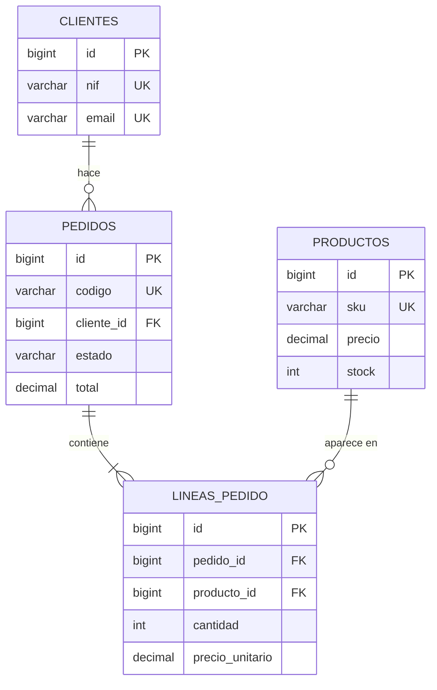
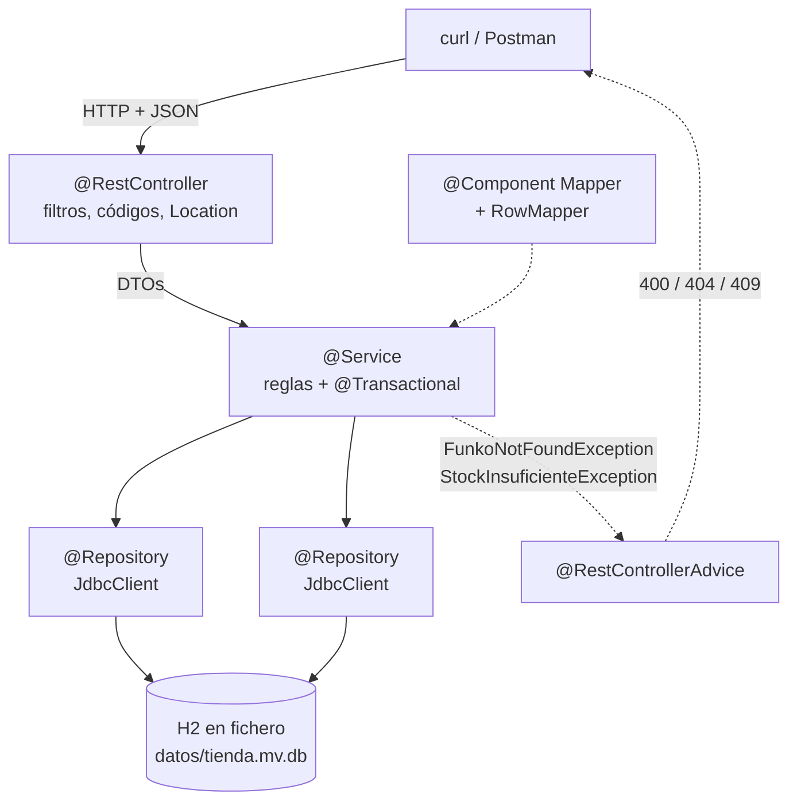

# 5. Dos proyectos paso a paso

Dos APIs REST completas, de cero a `.jar`, con **Maven, Spring Web y H2 por JDBC**. La primera es de una tabla; la segunda, de tres tablas relacionadas.

| | Proyecto | Tablas | Lo nuevo que enseña |
|:-:|---|:-:|---|
| **A** | [API de Funkos](#proyecto-a-api-de-funkos) | 1 | Las capas completas, DTOs, validación, excepciones, caché y JDBC con `JdbcClient` |
| **B** | [API de una tienda](#proyecto-b-api-de-una-tienda) | 3 | Claves ajenas, una operación que toca tres tablas y **`@Transactional` de verdad** |

!!! danger "Aquí NO hay JPA ni Hibernate, y es a propósito"
    En esta unidad hablamos con H2 **a mano**, con SQL que escribes tú, igual que en la [UT3](../ut3/03-base-de-datos.md) pero con Spring poniendo el pegamento (`DataSource`, pool de conexiones, transacciones).

    **JPA, las entidades, las relaciones y los repositorios automáticos son la [UT5](../ut5/index.md).** Mezclarlo ahora haría que atribuyeras a Hibernate problemas que son de arquitectura, y la arquitectura es justo lo que se evalúa en el RA5.

    Lo que sí ganas: cuando en la UT5 Spring Data te genere un `findByCategoriaIgnoreCase` sin escribir nada, sabrás **exactamente** qué SQL está sustituyendo.

!!! info "Cómo se trabaja esto"
    No se lee: se teclea. Cada paso deja el proyecto **compilando y arrancando**, así que si algo falla sabes en qué paso fue.

    `git commit` al final de cada paso. Es la única forma de volver atrás cuando el paso 9 rompe algo del paso 4.

---

## Lo que compartís los dos proyectos

### El `pom.xml`

```xml title="pom.xml"
<?xml version="1.0" encoding="UTF-8"?>
<project xmlns="http://maven.apache.org/POM/4.0.0"
         xmlns:xsi="http://www.w3.org/2001/XMLSchema-instance"
         xsi:schemaLocation="http://maven.apache.org/POM/4.0.0
                             https://maven.apache.org/xsd/maven-4.0.0.xsd">
  <modelVersion>4.0.0</modelVersion>

  <parent>
    <groupId>org.springframework.boot</groupId>
    <artifactId>spring-boot-starter-parent</artifactId>
    <version>3.5.6</version>
    <relativePath/>
  </parent>

  <groupId>es.iesx</groupId>
  <artifactId>funkos-api</artifactId>
  <version>1.0.0</version>

  <properties>
    <java.version>25</java.version>
    <project.build.sourceEncoding>UTF-8</project.build.sourceEncoding>
  </properties>

  <dependencies>
    <dependency>
      <groupId>org.springframework.boot</groupId>
      <artifactId>spring-boot-starter-web</artifactId>
    </dependency>
    <dependency>
      <groupId>org.springframework.boot</groupId>
      <artifactId>spring-boot-starter-validation</artifactId>
    </dependency>
    <dependency>
      <groupId>org.springframework.boot</groupId>
      <artifactId>spring-boot-starter-cache</artifactId>
    </dependency>

    <!-- JDBC con DataSource, pool y transacciones. NO es JPA -->
    <dependency>
      <groupId>org.springframework.boot</groupId>
      <artifactId>spring-boot-starter-jdbc</artifactId>
    </dependency>
    <dependency>
      <groupId>com.h2database</groupId>
      <artifactId>h2</artifactId>
      <scope>runtime</scope>
    </dependency>

    <dependency>
      <groupId>org.springframework.boot</groupId>
      <artifactId>spring-boot-devtools</artifactId>
      <scope>runtime</scope>
      <optional>true</optional>
    </dependency>
    <dependency>
      <groupId>org.springframework.boot</groupId>
      <artifactId>spring-boot-starter-test</artifactId>
      <scope>test</scope>
    </dependency>
  </dependencies>

  <build>
    <plugins>
      <plugin>
        <groupId>org.springframework.boot</groupId>
        <artifactId>spring-boot-maven-plugin</artifactId>
      </plugin>
    </plugins>
  </build>
</project>
```

!!! success "`spring-boot-starter-jdbc` frente a `spring-boot-starter-data-jpa`"
    | | `starter-jdbc` (UT4) | `starter-data-jpa` (UT5) |
    |---|---|---|
    | Trae | `DataSource`, HikariCP, `JdbcClient`, transacciones | Todo eso **+ Hibernate + Spring Data** |
    | El SQL lo escribes | **Tú** | Lo genera Hibernate |
    | El esquema lo creas | **Tú**, en `schema.sql` | `ddl-auto`, desde las entidades |
    | El mapeo fila → objeto | **Tú**, con un `RowMapper` | Automático, con `@Entity` |
    | Lo que aprendes | Qué pasa por debajo | A no repetirte |

    Lo que **ya te da** el starter de JDBC y en la UT3 no tenías: el **pool de conexiones** (HikariCP, configurado solo) y el `@Transactional`.

### La configuración

```properties title="src/main/resources/application.properties"
spring.application.name=funkos-api

server.port=${PORT:8080}
api.path=/api
api.version=v1

### H2 en FICHERO: los datos sobreviven al reinicio
spring.datasource.url=${DB_URL:jdbc:h2:file:./datos/funkos;AUTO_SERVER=TRUE}
spring.datasource.username=${DB_USER:sa}
spring.datasource.password=${DB_PASSWORD:}
spring.datasource.driver-class-name=org.h2.Driver

### Esquema y datos: los creamos NOSOTROS
spring.sql.init.mode=always
spring.sql.init.schema-locations=classpath:schema.sql
spring.sql.init.data-locations=classpath:data.sql

### Consola web de H2, solo en desarrollo
spring.h2.console.enabled=true
spring.h2.console.path=/h2-console

### Errores
server.error.include-message=always
server.error.include-binding-errors=always
server.error.include-stacktrace=never

logging.level.es.iesx=DEBUG
spring.profiles.active=${SPRING_PROFILES_ACTIVE:dev}
```

!!! danger "`file:` y no `mem:`, y el `AUTO_SERVER=TRUE`"
    | URL | Dónde viven los datos |
    |---|---|
    | `jdbc:h2:mem:funkos` | **En memoria.** Se borran al parar la aplicación |
    | `jdbc:h2:file:./datos/funkos` | **En un fichero** `datos/funkos.mv.db`. Sobreviven |

    Usamos **fichero** porque la gracia de la unidad es que los datos persistan. Y `AUTO_SERVER=TRUE` permite que **la consola de H2 y tu aplicación** abran la misma base de datos a la vez; sin él, lo segundo que se conecte falla con `Database may be already in use`.

    Añade `datos/` al `.gitignore`: la base de datos no se sube.

!!! warning "`spring.sql.init.mode=always` reejecuta `schema.sql` en cada arranque"
    Con un fichero persistente, eso significa que tu `schema.sql` **tiene que ser idempotente**: `CREATE TABLE IF NOT EXISTS`, y los `INSERT` de `data.sql` con `MERGE` o condicionados.

    Si no, al segundo arranque falla con `Table "FUNKOS" already exists`. Es el error número uno de este tema.

### La estructura de paquetes

```
src/main/java/es/iesx/funkos/
├── FunkosApiApplication.java          ← arranque (paquete RAÍZ)
├── config/
│   └── CacheConfig.java
├── funkos/
│   ├── controllers/FunkosRestController.java
│   ├── services/{FunkosService, FunkosServiceImpl}.java
│   ├── repositories/{FunkosRepository, FunkosRepositoryJdbc}.java
│   ├── models/Funko.java
│   ├── dto/{FunkoResponse, FunkoCreateRequest, FunkoUpdateRequest}.java
│   ├── mappers/{FunkoMapper, FunkoRowMapper}.java
│   └── exceptions/{FunkoException, FunkoNotFoundException, …}.java
└── common/GlobalExceptionHandler.java
```

```
src/main/resources/
├── application.properties
├── application-dev.properties
├── application-prod.properties
├── schema.sql
└── data.sql
```

!!! tip "Agrupado por *feature*, no por capa"
    Todo lo de funkos está junto. En el proyecto B, añadir pedidos es **una carpeta nueva** y cero ficheros tocados.

    Y lo que no es negociable: **`FunkosApiApplication` va en el paquete raíz**, porque `@ComponentScan` escanea desde ahí hacia abajo.

---

# Proyecto A · API de Funkos

Una tabla, las capas completas y JDBC. Es el proyecto de referencia de la unidad.

```
GET    /api/v1/funkos          ?categoria= &nombre= &precioMax=
GET    /api/v1/funkos/{id}
POST   /api/v1/funkos
PUT    /api/v1/funkos/{id}
PATCH  /api/v1/funkos/{id}
DELETE /api/v1/funkos/{id}
GET    /api/v1/funkos/estadisticas
```

## A.1 · El esquema y los datos

```sql title="src/main/resources/schema.sql"
CREATE TABLE IF NOT EXISTS funkos (
    id          BIGINT AUTO_INCREMENT PRIMARY KEY,
    nombre      VARCHAR(100)  NOT NULL,
    precio      DECIMAL(10,2) NOT NULL,
    cantidad    INT           NOT NULL DEFAULT 0,
    imagen      VARCHAR(500),
    categoria   VARCHAR(20)   NOT NULL,
    created_at  TIMESTAMP     NOT NULL DEFAULT CURRENT_TIMESTAMP,
    updated_at  TIMESTAMP     NOT NULL DEFAULT CURRENT_TIMESTAMP,
    CONSTRAINT uk_funko_nombre UNIQUE (nombre),
    CONSTRAINT ck_funko_precio CHECK (precio >= 0),
    CONSTRAINT ck_funko_cantidad CHECK (cantidad >= 0),
    CONSTRAINT ck_funko_categoria
        CHECK (categoria IN ('DISNEY','MARVEL','ANIME','OTROS'))
);

CREATE INDEX IF NOT EXISTS idx_funko_categoria ON funkos (categoria);
```

```sql title="src/main/resources/data.sql"
-- MERGE en vez de INSERT: idempotente, no falla al segundo arranque
MERGE INTO funkos (id, nombre, precio, cantidad, imagen, categoria) KEY(id) VALUES
  (1, 'Mickey Mouse', 15.99, 10, 'https://placehold.co/300', 'DISNEY'),
  (2, 'Stitch',       17.00,  8, 'https://placehold.co/300', 'DISNEY'),
  (3, 'Spider-Man',   19.99,  5, 'https://placehold.co/300', 'MARVEL'),
  (4, 'Iron Man',     21.50,  2, 'https://placehold.co/300', 'MARVEL'),
  (5, 'Goku',         22.50,  3, 'https://placehold.co/300', 'ANIME'),
  (6, 'Naruto',       18.75,  0, 'https://placehold.co/300', 'ANIME');

-- la secuencia del AUTO_INCREMENT tiene que quedar por encima
ALTER TABLE funkos ALTER COLUMN id RESTART WITH 7;
```

!!! danger "Las tres cosas de este paso que se olvidan y cuestan una tarde"
    **1. `CREATE TABLE IF NOT EXISTS`.** Con H2 en fichero, `schema.sql` se ejecuta en cada arranque. Sin el `IF NOT EXISTS`: `Table "FUNKOS" already exists`.

    **2. `MERGE … KEY(id)` en vez de `INSERT`.** Mismo motivo: un `INSERT` con id fijo falla al segundo arranque por la clave primaria duplicada.

    **3. El `ALTER … RESTART WITH 7`.** Si insertas con ids explícitos, el contador del `AUTO_INCREMENT` **sigue en 1**, así que el primer `POST` intentará usar el id 1 y chocará con Mickey Mouse. Es un error desconcertante porque el código del POST está bien.

!!! success "Las restricciones de la tabla son la tercera capa de validación"
    Fíjate en el `UNIQUE`, los dos `CHECK` de rango y el `CHECK` de la lista de categorías.

    | | Dónde | Cuándo salta | Qué ve el cliente |
    |---|---|---|---|
    | `@NotBlank`, `@Positive` | DTO | Al validar la petición | **400** con el campo |
    | `existsByNombre` | Servicio | Antes de insertar | **409** |
    | `UNIQUE`, `CHECK` | **Tabla** | Al hacer el `INSERT` | La única que **no se puede saltar** |

    La tercera es la red de seguridad para cuando el dato llega por otra vía: un `data.sql`, un script de migración, otro servicio.

## A.2 · El modelo

```java title="funkos/models/Funko.java"
package es.iesx.funkos.funkos.models;

import java.math.BigDecimal;
import java.time.LocalDateTime;

public class Funko {
    private Long id;
    private String nombre;
    private BigDecimal precio;
    private Integer cantidad;
    private String imagen;
    private String categoria;
    private LocalDateTime createdAt;
    private LocalDateTime updatedAt;

    public Funko() {}

    public static Builder builder() { return new Builder(); }

    public Long getId() { return id; }
    public void setId(Long id) { this.id = id; }
    public String getNombre() { return nombre; }
    public BigDecimal getPrecio() { return precio; }
    public Integer getCantidad() { return cantidad; }
    public String getImagen() { return imagen; }
    public String getCategoria() { return categoria; }
    public LocalDateTime getCreatedAt() { return createdAt; }
    public LocalDateTime getUpdatedAt() { return updatedAt; }

    public static class Builder {
        private final Funko f = new Funko();
        public Builder id(Long v)                 { f.id = v;        return this; }
        public Builder nombre(String v)           { f.nombre = v;    return this; }
        public Builder precio(BigDecimal v)       { f.precio = v;    return this; }
        public Builder cantidad(Integer v)        { f.cantidad = v;  return this; }
        public Builder imagen(String v)           { f.imagen = v;    return this; }
        public Builder categoria(String v)        { f.categoria = v; return this; }
        public Builder createdAt(LocalDateTime v) { f.createdAt = v; return this; }
        public Builder updatedAt(LocalDateTime v) { f.updatedAt = v; return this; }
        public Funko build() { return f; }
    }
}
```

!!! info "`BigDecimal` y no `double`, desde el primer día"
    Es dinero, y `0.1 + 0.2` en `double` da `0.30000000000000004`. Está en la [UT2, E1](../ut2/ejercicios.md), y la columna es `DECIMAL(10,2)` precisamente por eso.

    El `builder` tampoco es decoración: con ocho campos, `new Funko(null, "Casco", …, ahora, ahora)` es ilegible y basta con cambiar dos parámetros de sitio para meter un bug que compila.

## A.3 · Los DTOs

```java title="funkos/dto/FunkoResponse.java"
public record FunkoResponse(
        Long id, String nombre, BigDecimal precio, Integer cantidad,
        String imagen, String categoria,
        LocalDateTime createdAt, LocalDateTime updatedAt) {}
```

```java title="funkos/dto/FunkoCreateRequest.java"
public record FunkoCreateRequest(

        @NotBlank(message = "El nombre no puede estar vacío")
        @Size(max = 100, message = "El nombre no puede tener más de 100 caracteres")
        String nombre,

        @NotNull(message = "El precio es obligatorio")
        @DecimalMin(value = "0.0", message = "El precio no puede ser negativo")
        @Digits(integer = 8, fraction = 2, message = "Como máximo 2 decimales")
        BigDecimal precio,

        @NotNull(message = "La cantidad es obligatoria")
        @PositiveOrZero(message = "La cantidad no puede ser negativa")
        Integer cantidad,

        @Pattern(regexp = "^https?://.+", message = "La imagen debe ser una URL")
        String imagen,

        @NotBlank(message = "La categoría no puede estar vacía")
        @Pattern(regexp = "DISNEY|MARVEL|ANIME|OTROS",
                 message = "La categoría debe ser DISNEY, MARVEL, ANIME u OTROS")
        String categoria
) {}
```

```java title="funkos/dto/FunkoUpdateRequest.java"
public record FunkoUpdateRequest(
        @Size(max = 100) String nombre,
        @DecimalMin("0.0") @Digits(integer = 8, fraction = 2) BigDecimal precio,
        @PositiveOrZero Integer cantidad,
        @Pattern(regexp = "^https?://.+") String imagen,
        @Pattern(regexp = "DISNEY|MARVEL|ANIME|OTROS") String categoria) {}
```

!!! success "Tres DTOs, y la diferencia está en los `@NotNull`"
    | | `CreateRequest` | `UpdateRequest` |
    |---|---|---|
    | `nombre` | `@NotBlank` + `@Size` | solo `@Size` |
    | `precio` | `@NotNull` + `@DecimalMin` | solo `@DecimalMin` |
    | `categoria` | `@NotBlank` + `@Pattern` | solo `@Pattern` |

    En el de actualización **desaparecen los obligatorios**, porque en un PATCH `null` significa «este campo no lo cambies». Las reglas de formato se quedan: si mandas un valor, tiene que ser válido.

    Y el `CreateRequest` **no lleva `id` ni fechas**: las pone el servidor. Si llevara `id`, un cliente podría mandar `{"id": 1, …}` e intentar sobrescribir otro registro.

## A.4 · El repositorio con `JdbcClient`

```java title="funkos/repositories/FunkosRepository.java"
package es.iesx.funkos.funkos.repositories;

import es.iesx.funkos.funkos.models.Funko;
import java.math.BigDecimal;
import java.util.*;

public interface FunkosRepository {
    List<Funko>     findAll();
    List<Funko>     buscar(Optional<String> categoria, Optional<String> nombre,
                           Optional<BigDecimal> precioMax);
    Optional<Funko> findById(Long id);
    boolean         existsByNombre(String nombre);
    Funko           save(Funko funko);
    Funko           update(Funko funko);
    boolean         deleteById(Long id);
    Map<String, Long> contarPorCategoria();
}
```

```java title="funkos/mappers/FunkoRowMapper.java"
package es.iesx.funkos.funkos.mappers;

import es.iesx.funkos.funkos.models.Funko;
import org.springframework.jdbc.core.RowMapper;
import org.springframework.stereotype.Component;

import java.sql.ResultSet;
import java.sql.SQLException;

/** Convierte una fila del ResultSet en un Funko. Es el mapeo de la UT3, aislado. */
@Component
public class FunkoRowMapper implements RowMapper<Funko> {

    @Override
    public Funko mapRow(ResultSet rs, int rowNum) throws SQLException {
        return Funko.builder()
                .id(rs.getLong("id"))
                .nombre(rs.getString("nombre"))
                .precio(rs.getBigDecimal("precio"))
                .cantidad(rs.getInt("cantidad"))
                .imagen(rs.getString("imagen"))
                .categoria(rs.getString("categoria"))
                .createdAt(rs.getTimestamp("created_at").toLocalDateTime())
                .updatedAt(rs.getTimestamp("updated_at").toLocalDateTime())
                .build();
    }
}
```

```java title="funkos/repositories/FunkosRepositoryJdbc.java"
package es.iesx.funkos.funkos.repositories;

import es.iesx.funkos.funkos.mappers.FunkoRowMapper;
import es.iesx.funkos.funkos.models.Funko;
import org.springframework.jdbc.core.simple.JdbcClient;
import org.springframework.jdbc.support.GeneratedKeyHolder;
import org.springframework.stereotype.Repository;

import java.math.BigDecimal;
import java.time.LocalDateTime;
import java.util.*;
import java.util.stream.Collectors;

@Repository
public class FunkosRepositoryJdbc implements FunkosRepository {

    private final JdbcClient jdbc;
    private final FunkoRowMapper rowMapper;

    public FunkosRepositoryJdbc(JdbcClient jdbc, FunkoRowMapper rowMapper) {
        this.jdbc = jdbc;
        this.rowMapper = rowMapper;
    }

    @Override
    public List<Funko> findAll() {
        return jdbc.sql("SELECT * FROM funkos ORDER BY id")
                   .query(rowMapper).list();
    }

    /** Filtros opcionales y combinables, montando el WHERE a trozos. */
    @Override
    public List<Funko> buscar(Optional<String> categoria, Optional<String> nombre,
                              Optional<BigDecimal> precioMax) {
        var sql = new StringBuilder("SELECT * FROM funkos WHERE 1 = 1");
        var params = new HashMap<String, Object>();

        categoria.ifPresent(c -> {
            sql.append(" AND UPPER(categoria) = UPPER(:categoria)");
            params.put("categoria", c);
        });
        nombre.ifPresent(n -> {
            sql.append(" AND LOWER(nombre) LIKE LOWER(:nombre)");
            params.put("nombre", "%" + n + "%");
        });
        precioMax.ifPresent(p -> {
            sql.append(" AND precio <= :precioMax");
            params.put("precioMax", p);
        });
        sql.append(" ORDER BY id");

        return jdbc.sql(sql.toString()).params(params).query(rowMapper).list();
    }

    @Override
    public Optional<Funko> findById(Long id) {
        return jdbc.sql("SELECT * FROM funkos WHERE id = :id")
                   .param("id", id)
                   .query(rowMapper).optional();
    }

    @Override
    public boolean existsByNombre(String nombre) {
        return jdbc.sql("SELECT COUNT(*) FROM funkos WHERE UPPER(nombre) = UPPER(:nombre)")
                   .param("nombre", nombre)
                   .query(Integer.class).single() > 0;
    }

    @Override
    public Funko save(Funko f) {
        var keys = new GeneratedKeyHolder();
        jdbc.sql("""
                INSERT INTO funkos (nombre, precio, cantidad, imagen, categoria,
                                    created_at, updated_at)
                VALUES (:nombre, :precio, :cantidad, :imagen, :categoria, :creado, :actualizado)
                """)
            .param("nombre", f.getNombre())
            .param("precio", f.getPrecio())
            .param("cantidad", f.getCantidad())
            .param("imagen", f.getImagen())
            .param("categoria", f.getCategoria())
            .param("creado", f.getCreatedAt())
            .param("actualizado", f.getUpdatedAt())
            .update(keys);

        f.setId(((Number) keys.getKeys().get("id")).longValue());
        return f;
    }

    @Override
    public Funko update(Funko f) {
        int filas = jdbc.sql("""
                UPDATE funkos
                   SET nombre = :nombre, precio = :precio, cantidad = :cantidad,
                       imagen = :imagen, categoria = :categoria, updated_at = :actualizado
                 WHERE id = :id
                """)
            .param("nombre", f.getNombre())
            .param("precio", f.getPrecio())
            .param("cantidad", f.getCantidad())
            .param("imagen", f.getImagen())
            .param("categoria", f.getCategoria())
            .param("actualizado", LocalDateTime.now())
            .param("id", f.getId())
            .update();

        if (filas == 0) throw new IllegalStateException("No se actualizó ninguna fila");
        return f;
    }

    /** Devuelve si borró algo, leído de las filas afectadas. */
    @Override
    public boolean deleteById(Long id) {
        return jdbc.sql("DELETE FROM funkos WHERE id = :id")
                   .param("id", id)
                   .update() == 1;
    }

    @Override
    public Map<String, Long> contarPorCategoria() {
        return jdbc.sql("""
                SELECT categoria, COUNT(*) AS total
                  FROM funkos
                 GROUP BY categoria
                 ORDER BY categoria
                """)
            .query((rs, n) -> Map.entry(rs.getString("categoria"), rs.getLong("total")))
            .list().stream()
            .collect(Collectors.toMap(Map.Entry::getKey, Map.Entry::getValue,
                                      (a, b) -> a, LinkedHashMap::new));
    }
}
```

!!! success "Compara esto con la UT3 y verás qué pone Spring"
    | | UT3, a mano | UT4, con `JdbcClient` |
    |---|---|---|
    | Abrir la conexión | `DriverManager.getConnection(...)` + `try-with-resources` | **Spring**, de un pool |
    | Parámetros | `ps.setString(1, ...)` **numerados desde 1** | `:nombre`, **con nombre** |
    | Recorrer el `ResultSet` | `while (rs.next()) { … }` | `RowMapper` + `.list()` |
    | Cero o un resultado | `rs.next() ? … : null` | **`.optional()` → `Optional`** |
    | Id generado | `Statement.RETURN_GENERATED_KEYS` + `getGeneratedKeys()` | `GeneratedKeyHolder` |
    | Cerrar | A mano, y si se olvida se agota el pool | **Spring** |

    El SQL sigue siendo **tuyo**, y los `:param` siguen siendo `PreparedStatement` por debajo: **la inyección SQL de la [UT3, E22](../ut3/ejercicios.md) no es posible por esta vía**.

!!! danger "Lo único peligroso del método `buscar`"
    Fíjate en que los **valores** van en `params` y lo que se concatena es **solo texto fijo escrito por ti**:

    ```java
    sql.append(" AND UPPER(categoria) = UPPER(:categoria)");   // ✅ texto fijo
    params.put("categoria", c);                                 // ✅ valor parametrizado
    ```

    Lo que **nunca** se hace, aunque sea más corto:

    ```java
    sql.append(" AND categoria = '" + c + "'");                 // ❌ inyección SQL
    ```

    Y el `WHERE 1 = 1` es un truco para que todos los filtros empiecen por `AND` y no haya que llevar la cuenta de cuál es el primero.

!!! tip "`JdbcTemplate` es el clásico, `JdbcClient` el moderno"
    `JdbcClient` existe desde Spring 6.1 / Boot 3.2 y es una fachada más legible sobre `JdbcTemplate`. Si encuentras tutoriales con `jdbcTemplate.query(sql, rowMapper, param1, param2)`, es lo mismo con parámetros posicionales.

    En el examen vale cualquiera de los dos, pero con `JdbcClient` se lee mejor **qué parámetro es cuál**, y eso evita el bug clásico de intercambiar dos.

## A.5 · Las excepciones, el mapeador y el servicio

```java title="funkos/exceptions/"
public abstract class FunkoException extends RuntimeException {
    protected FunkoException(String mensaje) { super(mensaje); }
}

@ResponseStatus(HttpStatus.NOT_FOUND)
public class FunkoNotFoundException extends FunkoException {
    public FunkoNotFoundException(Long id) {
        super("No se ha encontrado el funko con id: " + id);
    }
}

@ResponseStatus(HttpStatus.CONFLICT)
public class FunkoConflictException extends FunkoException {
    public FunkoConflictException(String mensaje) { super(mensaje); }
}

@ResponseStatus(HttpStatus.BAD_REQUEST)
public class FunkoBadRequestException extends FunkoException {
    public FunkoBadRequestException(String mensaje) { super(mensaje); }
}
```

```java title="funkos/mappers/FunkoMapper.java"
@Component
public class FunkoMapper {

    public FunkoResponse toResponse(Funko f) {
        return new FunkoResponse(f.getId(), f.getNombre(), f.getPrecio(),
                f.getCantidad(), f.getImagen(), f.getCategoria(),
                f.getCreatedAt(), f.getUpdatedAt());
    }

    public List<FunkoResponse> toResponse(List<Funko> funkos) {
        return funkos.stream().map(this::toResponse).toList();
    }

    /** POST: nuevo. El id y las fechas los pone el servidor. */
    public Funko toModel(FunkoCreateRequest r) {
        var ahora = LocalDateTime.now();
        return Funko.builder()
                .nombre(r.nombre().trim())
                .precio(r.precio())
                .cantidad(r.cantidad())
                .imagen(r.imagen() != null ? r.imagen() : "https://placehold.co/300")
                .categoria(r.categoria().toUpperCase())
                .createdAt(ahora).updatedAt(ahora)
                .build();
    }

    /** PUT: reemplaza todo menos el id y la fecha de creación. */
    public Funko toModelReemplazando(Funko original, FunkoCreateRequest r) {
        return Funko.builder()
                .id(original.getId())
                .nombre(r.nombre().trim())
                .precio(r.precio())
                .cantidad(r.cantidad())
                .imagen(r.imagen())
                .categoria(r.categoria().toUpperCase())
                .createdAt(original.getCreatedAt())
                .updatedAt(LocalDateTime.now())
                .build();
    }

    /** PATCH: solo cambia lo que llega distinto de null. */
    public Funko toModelParcheando(Funko original, FunkoUpdateRequest r) {
        return Funko.builder()
                .id(original.getId())
                .nombre(r.nombre()       != null ? r.nombre().trim()           : original.getNombre())
                .precio(r.precio()       != null ? r.precio()                  : original.getPrecio())
                .cantidad(r.cantidad()   != null ? r.cantidad()                : original.getCantidad())
                .imagen(r.imagen()       != null ? r.imagen()                  : original.getImagen())
                .categoria(r.categoria() != null ? r.categoria().toUpperCase() : original.getCategoria())
                .createdAt(original.getCreatedAt())
                .updatedAt(LocalDateTime.now())
                .build();
    }
}
```

!!! success "Tres métodos porque son tres operaciones distintas"
    | Método | Verbo | Qué hace con lo que no mandas |
    |---|---|---|
    | `toModel` | POST | No aplica: es nuevo |
    | `toModelReemplazando` | PUT | **Lo borra** (queda `null`) |
    | `toModelParcheando` | PATCH | **Lo conserva** |

    Si tu PUT y tu PATCH llaman al mismo método, **has implementado dos veces el PATCH**. Es el error de diseño más común de la unidad y resta puntos en la rúbrica.

```java title="funkos/services/FunkosServiceImpl.java"
package es.iesx.funkos.funkos.services;

import es.iesx.funkos.funkos.dto.*;
import es.iesx.funkos.funkos.exceptions.*;
import es.iesx.funkos.funkos.mappers.FunkoMapper;
import es.iesx.funkos.funkos.repositories.FunkosRepository;
import org.slf4j.*;
import org.springframework.cache.annotation.*;
import org.springframework.stereotype.Service;
import org.springframework.transaction.annotation.Transactional;

import java.math.BigDecimal;
import java.util.*;

@Service
@CacheConfig(cacheNames = {"funkos"})
public class FunkosServiceImpl implements FunkosService {

    private static final Logger log = LoggerFactory.getLogger(FunkosServiceImpl.class);

    private final FunkosRepository repositorio;
    private final FunkoMapper mapper;

    public FunkosServiceImpl(FunkosRepository repositorio, FunkoMapper mapper) {
        this.repositorio = repositorio;
        this.mapper = mapper;
    }

    @Override
    @Transactional(readOnly = true)
    public List<FunkoResponse> buscar(Optional<String> categoria, Optional<String> nombre,
                                      Optional<BigDecimal> precioMax) {
        log.debug("buscar categoria={} nombre={} precioMax={}", categoria, nombre, precioMax);
        return mapper.toResponse(repositorio.buscar(categoria, nombre, precioMax));
    }

    @Override
    @Transactional(readOnly = true)
    @Cacheable(key = "#id")
    public FunkoResponse findById(Long id) {
        log.debug("findById {}", id);
        return repositorio.findById(id)
                .map(mapper::toResponse)
                .orElseThrow(() -> new FunkoNotFoundException(id));
    }

    @Override
    @Transactional
    @CacheEvict(allEntries = true)
    public FunkoResponse save(FunkoCreateRequest request) {
        if (repositorio.existsByNombre(request.nombre()))
            throw new FunkoConflictException(
                    "Ya existe un funko con el nombre: " + request.nombre());
        return mapper.toResponse(repositorio.save(mapper.toModel(request)));
    }

    @Override
    @Transactional
    @CacheEvict(allEntries = true)
    public FunkoResponse replace(Long id, FunkoCreateRequest request) {
        var original = repositorio.findById(id)
                .orElseThrow(() -> new FunkoNotFoundException(id));
        return mapper.toResponse(
                repositorio.update(mapper.toModelReemplazando(original, request)));
    }

    @Override
    @Transactional
    @CacheEvict(allEntries = true)
    public FunkoResponse update(Long id, FunkoUpdateRequest request) {
        var original = repositorio.findById(id)
                .orElseThrow(() -> new FunkoNotFoundException(id));
        return mapper.toResponse(
                repositorio.update(mapper.toModelParcheando(original, request)));
    }

    @Override
    @Transactional
    @CacheEvict(allEntries = true)
    public void deleteById(Long id) {
        if (!repositorio.deleteById(id))
            throw new FunkoNotFoundException(id);
    }

    @Override
    @Transactional(readOnly = true)
    public EstadisticasResponse estadisticas() {
        var todos = repositorio.findAll();
        return new EstadisticasResponse(
                todos.size(),
                repositorio.contarPorCategoria(),
                todos.stream().map(f -> f.getPrecio()
                        .multiply(BigDecimal.valueOf(f.getCantidad())))
                     .reduce(BigDecimal.ZERO, BigDecimal::add),
                todos.stream().filter(f -> f.getCantidad() == 0).count(),
                todos.stream()
                     .max(Comparator.comparing(f -> f.getPrecio()))
                     .map(f -> f.getNombre()).orElse("—"));
    }
}
```

```java title="funkos/dto/EstadisticasResponse.java"
public record EstadisticasResponse(
        int total,
        Map<String, Long> porCategoria,
        BigDecimal valorInventario,
        long sinStock,
        String masCaro) {}
```

!!! danger "Los cuatro detalles que marcan la diferencia en este fichero"
    **1. El `@Service` no contiene ni una palabra de HTTP.** Ni `ResponseEntity`, ni `HttpStatus`, ni `@PathVariable`. Es el criterio que más puntos vale en la rúbrica.

    **2. `deleteById` usa el valor que devuelve el repositorio.**

    ```java
    if (!repositorio.deleteById(id)) throw new FunkoNotFoundException(id);
    ```

    El `DELETE` de un id que no existe **no lanza nada**: afecta a 0 filas. Sin ese `if`, el cliente recibe un **204** y cree que ha borrado algo. Con él, **404**.

    **3. `@CacheEvict(allEntries = true)` en los CUATRO métodos de escritura.** No solo en `save`. Un `update` también deja obsoleta la lista completa.

    **4. `@Transactional(readOnly = true)` en las lecturas.** Con JDBC también sirve: el driver puede optimizar y queda documentado que ese método no escribe.

!!! info "El método `estadisticas` es la UT2 entera en diez líneas"
    `contarPorCategoria` lo resuelve **la base de datos** con un `GROUP BY` (que es lo correcto: no traigas 10.000 filas para contarlas en Java), y el resto son `map`, `reduce`, `filter` y `max` con `Optional`, del [tema 4 de la UT2](../ut2/04-colecciones-y-funcional.md).

    El `reduce(BigDecimal.ZERO, BigDecimal::add)` en vez de `mapToDouble(...).sum()`: es dinero.

## A.6 · El controlador y el manejador de errores

```java title="funkos/controllers/FunkosRestController.java"
@RestController
@RequestMapping("${api.path:/api}/${api.version:v1}/funkos")
public class FunkosRestController {

    private final FunkosService servicio;

    public FunkosRestController(FunkosService servicio) { this.servicio = servicio; }

    @GetMapping
    public ResponseEntity<List<FunkoResponse>> findAll(
            @RequestParam Optional<String> categoria,
            @RequestParam Optional<String> nombre,
            @RequestParam Optional<BigDecimal> precioMax) {
        return ResponseEntity.ok(servicio.buscar(categoria, nombre, precioMax));
    }

    @GetMapping("/{id}")
    public ResponseEntity<FunkoResponse> findById(@PathVariable Long id) {
        return ResponseEntity.ok(servicio.findById(id));
    }

    @GetMapping("/estadisticas")
    public ResponseEntity<EstadisticasResponse> estadisticas() {
        return ResponseEntity.ok(servicio.estadisticas());
    }

    @PostMapping
    public ResponseEntity<FunkoResponse> create(
            @Valid @RequestBody FunkoCreateRequest funko) {
        var creado = servicio.save(funko);
        return ResponseEntity
                .created(URI.create("/api/v1/funkos/" + creado.id()))
                .body(creado);
    }

    @PutMapping("/{id}")
    public ResponseEntity<FunkoResponse> replace(
            @PathVariable Long id, @Valid @RequestBody FunkoCreateRequest funko) {
        return ResponseEntity.ok(servicio.replace(id, funko));
    }

    @PatchMapping("/{id}")
    public ResponseEntity<FunkoResponse> update(
            @PathVariable Long id, @Valid @RequestBody FunkoUpdateRequest funko) {
        return ResponseEntity.ok(servicio.update(id, funko));
    }

    @DeleteMapping("/{id}")
    public ResponseEntity<Void> delete(@PathVariable Long id) {
        servicio.deleteById(id);
        return ResponseEntity.noContent().build();
    }
}
```

```java title="common/GlobalExceptionHandler.java"
@RestControllerAdvice
public class GlobalExceptionHandler {

    private static final Logger log = LoggerFactory.getLogger(GlobalExceptionHandler.class);

    /** 400 con los errores campo a campo. */
    @ResponseStatus(HttpStatus.BAD_REQUEST)
    @ExceptionHandler(MethodArgumentNotValidException.class)
    public Map<String, Object> validacion(MethodArgumentNotValidException ex) {
        Map<String, String> campos = new LinkedHashMap<>();
        ex.getBindingResult().getFieldErrors()
          .forEach(e -> campos.put(e.getField(), e.getDefaultMessage()));
        return Map.of(
                "timestamp", LocalDateTime.now().toString(),
                "status", 400,
                "error", "Datos de entrada inválidos",
                "campos", campos);
    }

    /** 400 cuando el JSON no se puede ni leer. */
    @ResponseStatus(HttpStatus.BAD_REQUEST)
    @ExceptionHandler(HttpMessageNotReadableException.class)
    public Map<String, Object> jsonIlegible(HttpMessageNotReadableException ex) {
        return Map.of("status", 400, "error", "El cuerpo no es un JSON valido");
    }

    /** 400 cuando /funkos/abc intenta ser un Long. */
    @ResponseStatus(HttpStatus.BAD_REQUEST)
    @ExceptionHandler(MethodArgumentTypeMismatchException.class)
    public Map<String, Object> tipoMalo(MethodArgumentTypeMismatchException ex) {
        return Map.of("status", 400,
                "error", "El parametro '%s' no tiene el tipo esperado".formatted(ex.getName()));
    }

    /** 409 cuando salta una restriccion de la tabla (UNIQUE, CHECK, FK). */
    @ResponseStatus(HttpStatus.CONFLICT)
    @ExceptionHandler(DataIntegrityViolationException.class)
    public Map<String, Object> integridad(DataIntegrityViolationException ex) {
        log.warn("Violacion de integridad: {}", ex.getMostSpecificCause().getMessage());
        return Map.of("status", 409,
                "error", "La operacion viola una restriccion de la base de datos");
    }
}
```

!!! success "Lo que NO está en el handler, y es deliberado"
    No hay un handler para `FunkoNotFoundException` ni para `FunkoConflictException`. **No hacen falta**: llevan su `@ResponseStatus` y Spring las traduce solas.

    Aquí solo están los errores que **no son del dominio**: validación, JSON roto, tipo de parámetro incorrecto y violaciones de integridad de la base de datos.

!!! tip "El handler de `DataIntegrityViolationException` es la red de seguridad"
    Tu servicio comprueba el nombre repetido **antes** de insertar. Pero entre esa comprobación y el `INSERT` cabe otra petición haciendo lo mismo, y entonces salta el `UNIQUE` de la tabla.

    Sin este handler eso es un **500**; con él, un **409** correcto. Es el E23 de la [UT3](../ut3/ejercicios.md) llevado a Spring.

    Fíjate también en el `getMostSpecificCause()`: la excepción de Spring envuelve la del driver, y el mensaje útil está en la de dentro.

## A.7 · Probar el proyecto A

```java title="FunkosApiApplication.java"
@SpringBootApplication
@EnableCaching                    // sin esto, @Cacheable NO hace nada
public class FunkosApiApplication {
    public static void main(String[] args) {
        SpringApplication.run(FunkosApiApplication.class, args);
    }
}
```

```bash
./mvnw spring-boot:run
```

=== "Lo que funciona"

    ```bash
    # Los seis de data.sql
    curl -s localhost:8080/api/v1/funkos | jq length
    # 6

    # Filtros, combinables y sin distinguir mayúsculas
    curl -s "localhost:8080/api/v1/funkos?categoria=disney" | jq '[.[].nombre]'
    # ["Mickey Mouse","Stitch"]

    curl -s "localhost:8080/api/v1/funkos?nombre=man&precioMax=20" | jq '[.[].nombre]'
    # ["Spider-Man"]

    # Crear: 201 + Location
    curl -i -X POST localhost:8080/api/v1/funkos \
      -H "Content-Type: application/json" \
      -d '{"nombre":"Pikachu","precio":20.00,"cantidad":7,"categoria":"ANIME"}'
    # HTTP/1.1 201
    # Location: /api/v1/funkos/7

    # PATCH: solo el precio, la cantidad intacta
    curl -s -X PATCH localhost:8080/api/v1/funkos/7 \
      -H "Content-Type: application/json" \
      -d '{"precio":25.00}' | jq '{nombre, precio, cantidad}'
    # { "nombre": "Pikachu", "precio": 25.00, "cantidad": 7 }

    # Estadísticas
    curl -s localhost:8080/api/v1/funkos/estadisticas | jq
    # { "total": 7, "porCategoria": {"ANIME":3,"DISNEY":2,"MARVEL":2},
    #   "valorInventario": 622.72, "sinStock": 1, "masCaro": "Pikachu" }

    curl -i -X DELETE localhost:8080/api/v1/funkos/7
    # HTTP/1.1 204
    ```

=== "Los errores"

    ```bash
    # 404
    curl -i localhost:8080/api/v1/funkos/9999
    # HTTP/1.1 404 · "No se ha encontrado el funko con id: 9999"

    # 400 con los campos señalados
    curl -s -X POST localhost:8080/api/v1/funkos \
      -H "Content-Type: application/json" \
      -d '{"nombre":"","precio":-5,"cantidad":1,"categoria":"COCINA"}' | jq .campos
    # {
    #   "nombre": "El nombre no puede estar vacío",
    #   "precio": "El precio no puede ser negativo",
    #   "categoria": "La categoría debe ser DISNEY, MARVEL, ANIME u OTROS"
    # }

    # 409: nombre repetido
    curl -i -X POST localhost:8080/api/v1/funkos \
      -H "Content-Type: application/json" \
      -d '{"nombre":"Goku","precio":10.00,"cantidad":1,"categoria":"ANIME"}'
    # HTTP/1.1 409

    # 400: el id no es un número
    curl -i localhost:8080/api/v1/funkos/abc       # 400

    # 415: falta el Content-Type
    curl -i -X POST localhost:8080/api/v1/funkos -d '{"nombre":"X"}'    # 415

    # 404 en DELETE
    curl -i -X DELETE localhost:8080/api/v1/funkos/9999                 # 404
    ```

=== "Que persiste de verdad"

    ```bash
    curl -X POST localhost:8080/api/v1/funkos \
      -H "Content-Type: application/json" \
      -d '{"nombre":"Totoro","precio":24.00,"cantidad":4,"categoria":"ANIME"}'

    # Ctrl+C y volver a arrancar
    ./mvnw spring-boot:run

    curl -s "localhost:8080/api/v1/funkos?nombre=totoro" | jq length
    # 1   ← el fichero datos/funkos.mv.db lo ha guardado
    ```

    Y se puede mirar por dentro: **`http://localhost:8080/h2-console`**, con
    `jdbc:h2:file:./datos/funkos`, usuario `sa` y contraseña vacía.

    ```sql
    SELECT categoria, COUNT(*), SUM(precio * cantidad) FROM funkos GROUP BY categoria;
    ```

!!! danger "La consola de H2 se apaga en producción"
    ```properties title="application-prod.properties"
    spring.h2.console.enabled=false
    ```

    Es **una consola SQL abierta en tu servidor**. Dejarla accesible es regalar la base de datos.

## A.8 · Los tests

```java title="src/test/java/.../FunkosServiceImplTest.java"
@ExtendWith(MockitoExtension.class)
class FunkosServiceImplTest {

    @Mock FunkosRepository repositorio;
    @Spy  FunkoMapper mapper = new FunkoMapper();
    @InjectMocks FunkosServiceImpl servicio;

    @Test
    void findByIdQueNoExisteLanzaNotFound() {
        when(repositorio.findById(99L)).thenReturn(Optional.empty());

        var ex = assertThrows(FunkoNotFoundException.class, () -> servicio.findById(99L));

        assertTrue(ex.getMessage().contains("99"));
        verify(repositorio, times(1)).findById(99L);
    }

    @Test
    void saveConNombreRepetidoLanzaConflictYNoInserta() {
        when(repositorio.existsByNombre("Goku")).thenReturn(true);

        var req = new FunkoCreateRequest("Goku", new BigDecimal("10.00"), 1, null, "ANIME");

        assertThrows(FunkoConflictException.class, () -> servicio.save(req));
        verify(repositorio, never()).save(any());
    }

    @Test
    void deleteDeUnIdQueNoExisteLanzaNotFound() {
        when(repositorio.deleteById(99L)).thenReturn(false);

        assertThrows(FunkoNotFoundException.class, () -> servicio.deleteById(99L));
    }

    @Test
    void elPatchConservaLosCamposQueNoLlegan() {
        var original = Funko.builder().id(1L).nombre("Goku")
                .precio(new BigDecimal("22.50")).cantidad(3)
                .categoria("ANIME").createdAt(LocalDateTime.now())
                .updatedAt(LocalDateTime.now()).build();
        when(repositorio.findById(1L)).thenReturn(Optional.of(original));
        when(repositorio.update(any())).thenAnswer(i -> i.getArgument(0));

        var r = servicio.update(1L, new FunkoUpdateRequest(
                null, new BigDecimal("30.00"), null, null, null));

        assertEquals("Goku", r.nombre());                       // conservado
        assertEquals(3, r.cantidad());                          // conservado
        assertEquals(new BigDecimal("30.00"), r.precio());      // cambiado
    }
}
```

```java title="src/test/java/.../FunkosRestControllerTest.java"
@SpringBootTest
@AutoConfigureMockMvc
@ActiveProfiles("test")
class FunkosRestControllerTest {

    @Autowired MockMvc mockMvc;
    @MockitoBean FunkosService servicio;

    @Test
    void postConNombreVacioDevuelve400ConElCampoSenalado() throws Exception {
        mockMvc.perform(post("/api/v1/funkos")
                    .contentType(MediaType.APPLICATION_JSON)
                    .content("""
                        {"nombre":"","precio":10.00,"cantidad":1,"categoria":"ANIME"}"""))
               .andExpect(status().isBadRequest())
               .andExpect(jsonPath("$.campos.nombre").exists());
    }

    @Test
    void getDeUnIdQueNoExisteDevuelve404() throws Exception {
        when(servicio.findById(99L)).thenThrow(new FunkoNotFoundException(99L));

        mockMvc.perform(get("/api/v1/funkos/99"))
               .andExpect(status().isNotFound());
    }

    @Test
    void elPostDevuelve201ConLocation() throws Exception {
        when(servicio.save(any())).thenReturn(new FunkoResponse(
                7L, "Pikachu", new BigDecimal("20.00"), 7, null, "ANIME",
                LocalDateTime.now(), LocalDateTime.now()));

        mockMvc.perform(post("/api/v1/funkos")
                    .contentType(MediaType.APPLICATION_JSON)
                    .content("""
                        {"nombre":"Pikachu","precio":20.00,"cantidad":7,"categoria":"ANIME"}"""))
               .andExpect(status().isCreated())
               .andExpect(header().string("Location", "/api/v1/funkos/7"));
    }
}
```

```properties title="src/test/resources/application-test.properties"
spring.datasource.url=jdbc:h2:mem:test;DB_CLOSE_DELAY=-1
spring.sql.init.mode=always
logging.level.root=WARN
```

```bash
./mvnw clean package
java -jar target/funkos-api-1.0.0.jar
```

!!! success "Los dos tipos de test y para qué sirve cada uno"
    | | Mockito | `@SpringBootTest` + `MockMvc` |
    |---|---|---|
    | Qué prueba | Las reglas del servicio | La capa HTTP |
    | Levanta Spring | **No** | Sí |
    | Tarda | milisegundos | ~2 s |
    | Detecta | un 409 que falta, un PATCH que borra campos | **`@Valid` olvidado**, rutas, códigos, `Location` |

    El `@Valid` olvidado **solo** lo caza el segundo. Por eso van los dos, y por eso el test del PATCH de arriba es el que más vale: comprueba la semántica, no que el método no explote.

!!! info "`@MockitoBean`, no `@MockBean`"
    `@MockBean` está obsoleta desde Spring Boot 3.4. Con 3.5 toca `@MockitoBean`, del paquete `org.springframework.test.context.bean.override.mockito`.

---

# Proyecto B · API de una tienda

Tres tablas relacionadas, y una operación que toca las tres a la vez. Es donde `@Transactional` deja de ser una anotación que se copia.

```
GET    /api/v1/clientes        ?nombre=       CRUD completo
GET    /api/v1/clientes/{id}
GET    /api/v1/clientes/{id}/pedidos

GET    /api/v1/productos       ?categoria= &conStock=    CRUD completo
GET    /api/v1/productos/{id}
PATCH  /api/v1/productos/{id}/stock

GET    /api/v1/pedidos         ?clienteId= &estado=
GET    /api/v1/pedidos/{id}                   ← con sus líneas
POST   /api/v1/pedidos                        ← crea Y descuenta stock
POST   /api/v1/pedidos/{id}/cancelar          ← cancela Y devuelve stock
GET    /api/v1/pedidos/estadisticas
```

!!! danger "La única regla que importa de este proyecto"
    **Crear un pedido de tres líneas toca tres productos. O se descuentan los tres, o ninguno.**

    Si falta stock en el tercero, los dos primeros **no pueden quedar descontados**. Eso es una transacción, y es lo que el proyecto A no podía enseñar porque solo tenía una tabla.

## B.1 · El esquema

```sql title="src/main/resources/schema.sql"
CREATE TABLE IF NOT EXISTS clientes (
    id         BIGINT AUTO_INCREMENT PRIMARY KEY,
    nif        VARCHAR(9)   NOT NULL,
    nombre     VARCHAR(100) NOT NULL,
    email      VARCHAR(150) NOT NULL,
    ciudad     VARCHAR(80),
    activo     BOOLEAN      NOT NULL DEFAULT TRUE,
    created_at TIMESTAMP    NOT NULL DEFAULT CURRENT_TIMESTAMP,
    CONSTRAINT uk_cliente_nif   UNIQUE (nif),
    CONSTRAINT uk_cliente_email UNIQUE (email)
);

CREATE TABLE IF NOT EXISTS productos (
    id         BIGINT AUTO_INCREMENT PRIMARY KEY,
    sku        VARCHAR(20)   NOT NULL,
    nombre     VARCHAR(150)  NOT NULL,
    categoria  VARCHAR(40)   NOT NULL,
    precio     DECIMAL(10,2) NOT NULL,
    stock      INT           NOT NULL DEFAULT 0,
    created_at TIMESTAMP     NOT NULL DEFAULT CURRENT_TIMESTAMP,
    CONSTRAINT uk_producto_sku UNIQUE (sku),
    CONSTRAINT ck_producto_precio CHECK (precio >= 0),
    CONSTRAINT ck_producto_stock  CHECK (stock  >= 0)
);

CREATE TABLE IF NOT EXISTS pedidos (
    id         BIGINT AUTO_INCREMENT PRIMARY KEY,
    codigo     VARCHAR(20)   NOT NULL,
    cliente_id BIGINT        NOT NULL,
    estado     VARCHAR(20)   NOT NULL DEFAULT 'PENDIENTE',
    total      DECIMAL(12,2) NOT NULL DEFAULT 0,
    fecha      TIMESTAMP     NOT NULL DEFAULT CURRENT_TIMESTAMP,
    CONSTRAINT uk_pedido_codigo UNIQUE (codigo),
    CONSTRAINT fk_pedido_cliente FOREIGN KEY (cliente_id) REFERENCES clientes (id),
    CONSTRAINT ck_pedido_estado
        CHECK (estado IN ('PENDIENTE','PAGADO','ENVIADO','ENTREGADO','CANCELADO'))
);

CREATE TABLE IF NOT EXISTS lineas_pedido (
    id              BIGINT AUTO_INCREMENT PRIMARY KEY,
    pedido_id       BIGINT        NOT NULL,
    producto_id     BIGINT        NOT NULL,
    cantidad        INT           NOT NULL,
    precio_unitario DECIMAL(10,2) NOT NULL,
    CONSTRAINT fk_linea_pedido   FOREIGN KEY (pedido_id)   REFERENCES pedidos (id)
        ON DELETE CASCADE,
    CONSTRAINT fk_linea_producto FOREIGN KEY (producto_id) REFERENCES productos (id),
    CONSTRAINT ck_linea_cantidad CHECK (cantidad > 0)
);

CREATE INDEX IF NOT EXISTS idx_pedido_cliente ON pedidos (cliente_id);
CREATE INDEX IF NOT EXISTS idx_pedido_estado  ON pedidos (estado);
CREATE INDEX IF NOT EXISTS idx_linea_pedido   ON lineas_pedido (pedido_id);
```



!!! success "Las cuatro decisiones del esquema, y por qué cada una"
    **1. `precio_unitario` en la línea, no solo en el producto.** Se **copia** del producto al crear el pedido. Si mañana sube el precio, **el pedido histórico no cambia**. Una factura de hace un año no puede recalcularse sola.

    **2. `ON DELETE CASCADE` solo en `lineas_pedido`.** Borrar un pedido borra sus líneas, porque **una línea no existe sin su pedido**. En cambio `fk_linea_producto` **no** tiene cascada: borrar un producto que está en pedidos tiene que fallar, y la base de datos lo impide.

    **3. `CHECK (stock >= 0)`.** Es la última defensa contra vender más de lo que hay. Aunque tu código tenga un bug, **la base de datos no deja que el stock quede negativo**.

    **4. `total` guardado en el pedido.** Es un dato derivado, y guardarlo es redundante — pero el total de una factura es un **hecho histórico**, no un cálculo. Lo pone el servidor; nunca se acepta del cliente.

!!! danger "El `ON DELETE CASCADE` que NO está"
    `fk_linea_producto FOREIGN KEY (producto_id) REFERENCES productos (id)` sin cascada significa que un `DELETE FROM productos WHERE id = 3` **falla** si ese producto aparece en algún pedido.

    Eso es lo que quieres, y en tu código se traduce así:

    ```java
    @ExceptionHandler(DataIntegrityViolationException.class)   // → 409 Conflict
    ```

    Si hubieras puesto cascada, borrar un producto **borraría líneas de facturas emitidas**. No se arregla con un `undo`.

## B.2 · Los modelos y los DTOs

```java title="pedidos/models/"
public enum EstadoPedido { PENDIENTE, PAGADO, ENVIADO, ENTREGADO, CANCELADO }

public class Pedido {
    private Long id;
    private String codigo;
    private Long clienteId;
    private EstadoPedido estado;
    private BigDecimal total;
    private LocalDateTime fecha;
    private List<LineaPedido> lineas = new ArrayList<>();
    // constructor vacío, builder, getters…
}

public class LineaPedido {
    private Long id;
    private Long pedidoId;
    private Long productoId;
    private Integer cantidad;
    private BigDecimal precioUnitario;

    public BigDecimal subtotal() {
        return precioUnitario.multiply(BigDecimal.valueOf(cantidad));
    }
    // constructor vacío, builder, getters…
}
```

```java title="pedidos/dto/"
/** Lo que el cliente MANDA: solo el cliente y qué quiere comprar. */
public record PedidoCreateRequest(

        @NotNull(message = "El cliente es obligatorio")
        @Positive Long clienteId,

        @NotEmpty(message = "El pedido debe tener al menos una línea")
        @Size(max = 50, message = "Como máximo 50 líneas por pedido")
        @Valid List<LineaRequest> lineas
) {}

public record LineaRequest(
        @NotNull @Positive Long productoId,
        @NotNull @Min(value = 1, message = "La cantidad mínima es 1")
                 @Max(value = 100, message = "La cantidad máxima es 100") Integer cantidad
) {}

/** Lo que el cliente RECIBE: con el total y los nombres ya resueltos. */
public record PedidoResponse(
        Long id, String codigo, ClienteResumen cliente, String estado,
        BigDecimal total, LocalDateTime fecha, List<LineaResponse> lineas) {}

public record ClienteResumen(Long id, String nombre, String email) {}

public record LineaResponse(
        Long productoId, String sku, String nombre,
        Integer cantidad, BigDecimal precioUnitario, BigDecimal subtotal) {}
```

!!! danger "Lo que el `PedidoCreateRequest` NO lleva, y es lo importante"
    No lleva **`total`**, no lleva **`precioUnitario`**, no lleva **`estado`** y no lleva **`codigo`**.

    | Campo | Quién lo pone | Qué pasa si lo acepta el cliente |
    |---|---|---|
    | `total` | **El servidor**, sumando | Te compran por 0,01 € |
    | `precioUnitario` | **El servidor**, del producto | Igual |
    | `estado` | **El servidor**: siempre `PENDIENTE` | Se crean pedidos ya `PAGADO` |
    | `codigo` | **El servidor**, correlativo | Códigos duplicados o adivinables |

    **La regla general: nunca aceptes del cliente un dato que puedas calcular.** Es una vulnerabilidad, no una cuestión de estilo.

!!! tip "El `@Valid` dentro de la lista"
    ```java
    @Valid List<LineaRequest> lineas
    ```

    **Sin ese `@Valid`, las anotaciones de dentro de cada `LineaRequest` no se ejecutan.** El `@NotEmpty` de la lista sí, pero el `@Min(1)` de cada cantidad, no: un pedido con `cantidad: -5` pasaría la validación.

    Es el mismo olvido que el `@Valid` del `@RequestBody`, un nivel más abajo y aún más difícil de ver.

## B.3 · El repositorio de pedidos

```java title="pedidos/repositories/PedidosRepositoryJdbc.java"
@Repository
public class PedidosRepositoryJdbc implements PedidosRepository {

    private final JdbcClient jdbc;

    public PedidosRepositoryJdbc(JdbcClient jdbc) { this.jdbc = jdbc; }

    /** Código correlativo por año: PED-2026-000123 */
    @Override
    public String siguienteCodigo() {
        int anio = LocalDate.now().getYear();
        Long ultimo = jdbc.sql("""
                SELECT COALESCE(MAX(CAST(SUBSTRING(codigo, 10) AS BIGINT)), 0)
                  FROM pedidos
                 WHERE codigo LIKE :patron
                """)
            .param("patron", "PED-" + anio + "-%")
            .query(Long.class).single();
        return "PED-%d-%06d".formatted(anio, ultimo + 1);
    }

    @Override
    public Pedido save(Pedido p) {
        var keys = new GeneratedKeyHolder();
        jdbc.sql("""
                INSERT INTO pedidos (codigo, cliente_id, estado, total, fecha)
                VALUES (:codigo, :clienteId, :estado, :total, :fecha)
                """)
            .param("codigo", p.getCodigo())
            .param("clienteId", p.getClienteId())
            .param("estado", p.getEstado().name())
            .param("total", p.getTotal())
            .param("fecha", p.getFecha())
            .update(keys);

        p.setId(((Number) keys.getKeys().get("id")).longValue());

        for (var l : p.getLineas()) {
            jdbc.sql("""
                    INSERT INTO lineas_pedido (pedido_id, producto_id, cantidad, precio_unitario)
                    VALUES (:pedidoId, :productoId, :cantidad, :precio)
                    """)
                .param("pedidoId", p.getId())
                .param("productoId", l.getProductoId())
                .param("cantidad", l.getCantidad())
                .param("precio", l.getPrecioUnitario())
                .update();
        }
        return p;
    }

    /** El pedido con su cliente y sus líneas, en DOS consultas y sin N+1. */
    @Override
    public Optional<PedidoCompleto> findCompletoById(Long id) {
        var pedido = jdbc.sql("""
                SELECT p.*, c.nombre AS cliente_nombre, c.email AS cliente_email
                  FROM pedidos p
                  JOIN clientes c ON c.id = p.cliente_id
                 WHERE p.id = :id
                """)
            .param("id", id)
            .query(new PedidoConClienteRowMapper()).optional();

        if (pedido.isEmpty()) return Optional.empty();

        var lineas = jdbc.sql("""
                SELECT l.*, pr.sku, pr.nombre
                  FROM lineas_pedido l
                  JOIN productos pr ON pr.id = l.producto_id
                 WHERE l.pedido_id = :id
                 ORDER BY l.id
                """)
            .param("id", id)
            .query(new LineaConProductoRowMapper()).list();

        return pedido.map(p -> new PedidoCompleto(p, lineas));
    }

    @Override
    public int cambiarEstado(Long id, EstadoPedido nuevo) {
        return jdbc.sql("UPDATE pedidos SET estado = :estado WHERE id = :id")
                   .param("estado", nuevo.name()).param("id", id)
                   .update();
    }
}
```

```java title="productos/repositories/ProductosRepositoryJdbc.java (los dos métodos clave)"
/** Descuenta stock SOLO si hay suficiente. Devuelve las filas afectadas. */
@Override
public int descontarStock(Long productoId, int cantidad) {
    return jdbc.sql("""
            UPDATE productos
               SET stock = stock - :cantidad
             WHERE id = :id AND stock >= :cantidad
            """)
        .param("cantidad", cantidad).param("id", productoId)
        .update();
}

@Override
public int devolverStock(Long productoId, int cantidad) {
    return jdbc.sql("UPDATE productos SET stock = stock + :cantidad WHERE id = :id")
               .param("cantidad", cantidad).param("id", productoId)
               .update();
}
```

!!! danger "El `AND stock >= :cantidad` del `UPDATE` es la pieza central del proyecto"
    Compara las dos formas de descontar stock:

    === "❌ Mal: comprobar y después restar"

        ```java
        var producto = repositorio.findById(id).orElseThrow();
        if (producto.getStock() < cantidad)
            throw new StockInsuficienteException(...);
        repositorio.actualizarStock(id, producto.getStock() - cantidad);
        ```

        Entre el `if` y el `UPDATE` **cabe otra petición** haciendo lo mismo. Las dos leen stock 5, las dos creen que pueden vender 3, y el stock acaba en **-1**.

        Se llama **condición de carrera**, y en desarrollo nunca se reproduce porque hay un solo usuario.

    === "✅ Bien: comprobar y restar en la misma sentencia"

        ```java
        int filas = repositorio.descontarStock(id, cantidad);
        if (filas == 0) throw new StockInsuficienteException(...);
        ```

        El `UPDATE … WHERE stock >= :cantidad` es **una sola operación atómica**: la base de datos garantiza que nadie se cuela en medio.

        Si no había bastante, afecta a **0 filas** y eso es la señal. **El valor que devuelve `update()` es la respuesta**, igual que en el [E20 de la UT3](../ut3/ejercicios.md).

    Y aún así el `CHECK (stock >= 0)` del esquema sigue ahí, por si algún día alguien escribe un `UPDATE` sin el `WHERE`.

!!! tip "`findCompletoById` hace dos consultas, no N+1"
    Una para el pedido con su cliente (un `JOIN`) y **una** para todas sus líneas con sus productos (otro `JOIN`). Dos consultas, independientemente de cuántas líneas tenga el pedido.

    Lo que **no** se hace: traer el pedido, recorrer las líneas y pedir el producto de cada una. Eso son 1 + N consultas, y es el problema que reaparecerá en la [UT5](../ut5/04-proyectos.md) con JPA y en la UT6 con GraphQL.

## B.4 · El servicio con la transacción

```java title="pedidos/services/PedidosServiceImpl.java"
@Service
public class PedidosServiceImpl implements PedidosService {

    private static final Logger log = LoggerFactory.getLogger(PedidosServiceImpl.class);

    private final PedidosRepository pedidos;
    private final ProductosRepository productos;
    private final ClientesRepository clientes;
    private final PedidoMapper mapper;

    public PedidosServiceImpl(PedidosRepository pedidos, ProductosRepository productos,
                              ClientesRepository clientes, PedidoMapper mapper) {
        this.pedidos = pedidos;
        this.productos = productos;
        this.clientes = clientes;
        this.mapper = mapper;
    }

    /**
     * Crea el pedido y descuenta el stock de TODAS sus líneas.
     * Si falla una, no se descuenta ninguna y no se crea el pedido.
     */
    @Override
    @Transactional
    public PedidoResponse crear(PedidoCreateRequest request) {

        // 1 · el cliente tiene que existir y estar activo
        var cliente = clientes.findById(request.clienteId())
                .orElseThrow(() -> new ClienteNotFoundException(request.clienteId()));
        if (!cliente.isActivo())
            throw new PedidoConflictException(
                    "El cliente %s está desactivado".formatted(cliente.getNombre()));

        // 2 · agrupar líneas repetidas del mismo producto
        var cantidadPorProducto = request.lineas().stream()
                .collect(Collectors.groupingBy(LineaRequest::productoId, TreeMap::new,
                         Collectors.summingInt(LineaRequest::cantidad)));

        var lineas = new ArrayList<LineaPedido>();
        var total = BigDecimal.ZERO;

        // 3 · por cada producto: existe, descontar stock, copiar el precio
        for (var e : cantidadPorProducto.entrySet()) {
            Long productoId = e.getKey();
            int cantidad = e.getValue();

            var producto = productos.findById(productoId)
                    .orElseThrow(() -> new ProductoNotFoundException(productoId));

            if (productos.descontarStock(productoId, cantidad) == 0)
                throw new StockInsuficienteException(
                        "Stock insuficiente de %s (sku %s): piden %d, hay %d"
                                .formatted(producto.getNombre(), producto.getSku(),
                                           cantidad, producto.getStock()));

            lineas.add(LineaPedido.builder()
                    .productoId(productoId)
                    .cantidad(cantidad)
                    .precioUnitario(producto.getPrecio())      // ← SE COPIA el precio
                    .build());

            total = total.add(producto.getPrecio()
                    .multiply(BigDecimal.valueOf(cantidad)));
        }

        // 4 · guardar el pedido, con el total que hemos calculado NOSOTROS
        var pedido = Pedido.builder()
                .codigo(pedidos.siguienteCodigo())
                .clienteId(cliente.getId())
                .estado(EstadoPedido.PENDIENTE)
                .total(total.setScale(2, RoundingMode.HALF_UP))
                .fecha(LocalDateTime.now())
                .lineas(lineas)
                .build();

        var guardado = pedidos.save(pedido);
        log.info("Pedido {} creado para el cliente {} por {} €",
                 guardado.getCodigo(), cliente.getNombre(), guardado.getTotal());

        return mapper.toResponse(pedidos.findCompletoById(guardado.getId()).orElseThrow());
    }

    /** Cancela y DEVUELVE el stock. Solo desde PENDIENTE o PAGADO. */
    @Override
    @Transactional
    public PedidoResponse cancelar(Long id) {
        var completo = pedidos.findCompletoById(id)
                .orElseThrow(() -> new PedidoNotFoundException(id));

        var estado = completo.pedido().getEstado();
        if (estado != EstadoPedido.PENDIENTE && estado != EstadoPedido.PAGADO)
            throw new PedidoConflictException(
                    "No se puede cancelar un pedido en estado " + estado);

        for (var l : completo.lineas())
            productos.devolverStock(l.getProductoId(), l.getCantidad());

        pedidos.cambiarEstado(id, EstadoPedido.CANCELADO);
        return mapper.toResponse(pedidos.findCompletoById(id).orElseThrow());
    }

    /** Transiciones permitidas: PENDIENTE → PAGADO → ENVIADO → ENTREGADO */
    @Override
    @Transactional
    public PedidoResponse cambiarEstado(Long id, EstadoPedido nuevo) {
        var completo = pedidos.findCompletoById(id)
                .orElseThrow(() -> new PedidoNotFoundException(id));
        var actual = completo.pedido().getEstado();

        if (!TRANSICIONES.getOrDefault(actual, Set.of()).contains(nuevo))
            throw new PedidoConflictException(
                    "No se puede pasar de %s a %s".formatted(actual, nuevo));

        pedidos.cambiarEstado(id, nuevo);
        return mapper.toResponse(pedidos.findCompletoById(id).orElseThrow());
    }

    private static final Map<EstadoPedido, Set<EstadoPedido>> TRANSICIONES = Map.of(
            EstadoPedido.PENDIENTE, Set.of(EstadoPedido.PAGADO, EstadoPedido.CANCELADO),
            EstadoPedido.PAGADO,    Set.of(EstadoPedido.ENVIADO, EstadoPedido.CANCELADO),
            EstadoPedido.ENVIADO,   Set.of(EstadoPedido.ENTREGADO),
            EstadoPedido.ENTREGADO, Set.of(),
            EstadoPedido.CANCELADO, Set.of());
}
```

!!! danger "El `@Transactional` del método `crear` es toda la unidad en una anotación"
    Sigue el camino de un pedido de tres líneas donde **falla la tercera**:

    ```
    1 · cliente OK
    2 · producto A: descuenta 2  →  UPDATE ejecutado
    3 · producto B: descuenta 1  →  UPDATE ejecutado
    4 · producto C: filas == 0   →  StockInsuficienteException
    ──────────────────────────────────────────────────────────
    ROLLBACK: los UPDATE de A y B se deshacen. Ningún INSERT.
    ```

    **Sin `@Transactional`**, cada `update()` se confirma solo: A y B se quedan descontados y el pedido no existe. Has perdido tres unidades de stock sin vender nada, y nadie recibe ningún error.

    Compruébalo: quita la anotación, provoca el fallo y mira el stock antes y después.

!!! warning "Las tres trampas de `@Transactional`, y todas aparecen aquí"
    **1. Solo revierte con `RuntimeException`.** `StockInsuficienteException` hereda de `RuntimeException` (vía `PedidoException`), así que va bien. Si heredara de `Exception`, **la transacción se confirmaría** con el trabajo a medias.

    **2. Si capturas la excepción dentro, no hay *rollback*.**

    ```java
    @Transactional
    public PedidoResponse crear(...) {
        try { … }
        catch (StockInsuficienteException e) { log.error("ups"); }  // ← SE CONFIRMA
    }
    ```

    La excepción tiene que **salir** del método transaccional.

    **3. Funciona por proxy.** `this.crear(...)` llamado desde otro método del mismo bean **no abre transacción**. Es lo mismo que le pasa a `@Cacheable`.

!!! success "El `groupingBy` del paso 2 arregla un bug que no se ve"
    Si el cliente manda dos líneas del mismo producto:

    ```json
    { "clienteId": 1, "lineas": [
        { "productoId": 3, "cantidad": 2 },
        { "productoId": 3, "cantidad": 2 }
    ]}
    ```

    Sin agrupar, se hacen **dos** `descontarStock(3, 2)`. Si había 3 unidades, el primero pasa (quedan 1) y el segundo falla: **error correcto por casualidad**. Pero si había 4, pasan los dos y el pedido sale con **dos líneas del mismo producto**, que luego no cuadra en la factura.

    `Collectors.groupingBy(…, summingInt(…))` lo convierte en un único `descontarStock(3, 4)`. Es el [`groupingBy` de la UT2](../ut2/04-colecciones-y-funcional.md) resolviendo un problema de negocio, no un informe.

## B.5 · Probar el proyecto B

```sql title="src/main/resources/data.sql (extracto)"
MERGE INTO clientes (id, nif, nombre, email, ciudad) KEY(id) VALUES
  (1, '12345678Z', 'Ana Pérez',  'ana@correo.es',   'Madrid'),
  (2, '87654321X', 'Bruno Díaz', 'bruno@correo.es', 'Getafe');

MERGE INTO productos (id, sku, nombre, categoria, precio, stock) KEY(id) VALUES
  (1, 'SKU-001', 'Teclado mecánico', 'informatica', 79.90, 10),
  (2, 'SKU-002', 'Ratón vertical',   'informatica', 45.50,  3),
  (3, 'SKU-003', 'Monitor 27"',      'informatica', 229.00, 1),
  (4, 'SKU-004', 'Alfombrilla XL',   'accesorios',  19.99, 50);

ALTER TABLE clientes  ALTER COLUMN id RESTART WITH 3;
ALTER TABLE productos ALTER COLUMN id RESTART WITH 5;
```

=== "Un pedido que funciona"

    ```bash
    curl -s -X POST localhost:8080/api/v1/pedidos \
      -H "Content-Type: application/json" \
      -d '{"clienteId":1,"lineas":[
             {"productoId":1,"cantidad":2},
             {"productoId":4,"cantidad":1}]}' | jq
    ```

    ```json
    {
      "id": 1,
      "codigo": "PED-2026-000001",
      "cliente": { "id": 1, "nombre": "Ana Pérez", "email": "ana@correo.es" },
      "estado": "PENDIENTE",
      "total": 179.79,
      "lineas": [
        { "sku": "SKU-001", "nombre": "Teclado mecánico",
          "cantidad": 2, "precioUnitario": 79.90, "subtotal": 159.80 },
        { "sku": "SKU-004", "nombre": "Alfombrilla XL",
          "cantidad": 1, "precioUnitario": 19.99, "subtotal": 19.99 }
      ]
    }
    ```

    ```bash
    # El stock ha bajado
    curl -s localhost:8080/api/v1/productos/1 | jq .stock    # 8
    curl -s localhost:8080/api/v1/productos/4 | jq .stock    # 49
    ```

=== "La transacción, comprobada"

    ```bash
    # Antes
    curl -s localhost:8080/api/v1/productos | jq '[.[] | {id, stock}]'
    # [{"id":1,"stock":8},{"id":2,"stock":3},{"id":3,"stock":1},{"id":4,"stock":49}]

    # Pedido de TRES líneas donde la TERCERA no tiene stock
    curl -i -X POST localhost:8080/api/v1/pedidos \
      -H "Content-Type: application/json" \
      -d '{"clienteId":1,"lineas":[
             {"productoId":1,"cantidad":1},
             {"productoId":4,"cantidad":1},
             {"productoId":3,"cantidad":5}]}'
    ```

    ```
    HTTP/1.1 409
    "Stock insuficiente de Monitor 27\" (sku SKU-003): piden 5, hay 1"
    ```

    ```bash
    # Después: EL STOCK NO HA CAMBIADO EN NINGUNO
    curl -s localhost:8080/api/v1/productos | jq '[.[] | {id, stock}]'
    # [{"id":1,"stock":8},{"id":2,"stock":3},{"id":3,"stock":1},{"id":4,"stock":49}]

    # Y el pedido no existe
    curl -s localhost:8080/api/v1/pedidos | jq length    # 1, el de antes
    ```

    **Ese par de salidas idénticas es el resultado de aprendizaje de este proyecto.**

=== "Cancelar y devolver stock"

    ```bash
    curl -s localhost:8080/api/v1/productos/1 | jq .stock          # 8

    curl -s -X POST localhost:8080/api/v1/pedidos/1/cancelar | jq '{codigo, estado}'
    # { "codigo": "PED-2026-000001", "estado": "CANCELADO" }

    curl -s localhost:8080/api/v1/productos/1 | jq .stock          # 10 ← devuelto

    # Y no se puede cancelar dos veces
    curl -i -X POST localhost:8080/api/v1/pedidos/1/cancelar
    # HTTP/1.1 409 · "No se puede cancelar un pedido en estado CANCELADO"
    ```

=== "Los errores"

    ```bash
    # 404: cliente que no existe
    curl -i -X POST localhost:8080/api/v1/pedidos \
      -H "Content-Type: application/json" \
      -d '{"clienteId":999,"lineas":[{"productoId":1,"cantidad":1}]}'     # 404

    # 400: pedido sin líneas
    curl -s -X POST localhost:8080/api/v1/pedidos \
      -H "Content-Type: application/json" \
      -d '{"clienteId":1,"lineas":[]}' | jq .campos
    # { "lineas": "El pedido debe tener al menos una línea" }

    # 400: cantidad 0 → lo caza el @Valid de DENTRO de la lista
    curl -s -X POST localhost:8080/api/v1/pedidos \
      -H "Content-Type: application/json" \
      -d '{"clienteId":1,"lineas":[{"productoId":1,"cantidad":0}]}' | jq .campos
    # { "lineas[0].cantidad": "La cantidad mínima es 1" }

    # 409: transición de estado inválida
    curl -i -X PATCH localhost:8080/api/v1/pedidos/2/estado \
      -H "Content-Type: application/json" -d '{"estado":"ENTREGADO"}'
    # HTTP/1.1 409 · "No se puede pasar de PENDIENTE a ENTREGADO"

    # 409: borrar un producto que está en un pedido (lo impide la FK)
    curl -i -X DELETE localhost:8080/api/v1/productos/1
    # HTTP/1.1 409 · "La operacion viola una restriccion de la base de datos"
    ```

## B.6 · Los tests de la transacción

```java
@SpringBootTest
@ActiveProfiles("test")
class PedidosTransaccionTest {

    @Autowired PedidosService pedidos;
    @Autowired ProductosRepository productos;

    @Test
    void siFallaUnaLineaNoSeDescuentaNingunStock() {
        var antes = productos.findAll().stream()
                .collect(Collectors.toMap(Producto::getId, Producto::getStock));

        var request = new PedidoCreateRequest(1L, List.of(
                new LineaRequest(1L, 1),      // hay stock
                new LineaRequest(4L, 1),      // hay stock
                new LineaRequest(3L, 999)));  // NO hay stock

        assertThrows(StockInsuficienteException.class, () -> pedidos.crear(request));

        var despues = productos.findAll().stream()
                .collect(Collectors.toMap(Producto::getId, Producto::getStock));

        assertEquals(antes, despues, "El rollback debe dejar el stock intacto");
    }

    @Test
    void cancelarDevuelveElStock() {
        var stockInicial = productos.findById(1L).orElseThrow().getStock();

        var pedido = pedidos.crear(new PedidoCreateRequest(1L,
                List.of(new LineaRequest(1L, 2))));
        assertEquals(stockInicial - 2, productos.findById(1L).orElseThrow().getStock());

        pedidos.cancelar(pedido.id());
        assertEquals(stockInicial, productos.findById(1L).orElseThrow().getStock());
    }

    @Test
    void elPrecioSeCongelaEnLaLinea() {
        var pedido = pedidos.crear(new PedidoCreateRequest(1L,
                List.of(new LineaRequest(1L, 1))));
        var precioEnLaLinea = pedido.lineas().get(0).precioUnitario();

        productos.actualizarPrecio(1L, new BigDecimal("999.00"));

        var releido = pedidos.findById(pedido.id());
        assertEquals(precioEnLaLinea, releido.lineas().get(0).precioUnitario(),
                "El precio del pedido histórico no puede cambiar");
    }

    @Test
    void noSePuedeSaltarUnEstado() {
        var pedido = pedidos.crear(new PedidoCreateRequest(1L,
                List.of(new LineaRequest(4L, 1))));

        assertThrows(PedidoConflictException.class,
                () -> pedidos.cambiarEstado(pedido.id(), EstadoPedido.ENTREGADO));
    }
}
```

!!! success "El primer test es el que vale la unidad"
    ```java
    assertEquals(antes, despues, "El rollback debe dejar el stock intacto");
    ```

    Compara **el mapa entero de stocks** antes y después de un fallo. Es la única forma de demostrar que la transacción funciona, y lo que un `curl` solo te deja ver a ojo.

    Quita el `@Transactional` del servicio y este test se pone rojo. Eso es exactamente lo que un test tiene que hacer.

---

## Lo que has construido



!!! success "Checklist de los dos proyectos"
    **Comunes**

    - [ ] `./mvnw clean package` en verde, con los tests
    - [ ] Los datos **sobreviven** a parar y arrancar
    - [ ] `schema.sql` con `IF NOT EXISTS` y `data.sql` con `MERGE`: arranca dos veces seguidas sin error
    - [ ] El `ALTER … RESTART WITH` puesto: el primer POST no choca
    - [ ] GET de un id inexistente → **404**, no 500
    - [ ] POST inválido → **400** con los campos
    - [ ] DELETE de un id inexistente → **404**, no 204
    - [ ] POST correcto → **201** con cabecera `Location`
    - [ ] El PATCH conserva lo que no mandas; el PUT **no**
    - [ ] El `@Service` no contiene la palabra `ResponseEntity`
    - [ ] Ni una sola concatenación de valores en el SQL

    **Solo el proyecto B**

    - [ ] Un pedido con una línea sin stock → **409 y el stock no cambia en ninguna**
    - [ ] Cancelar **devuelve** el stock, y solo se puede una vez
    - [ ] El `precioUnitario` queda congelado en la línea
    - [ ] Las transiciones de estado se respetan → 409 si no
    - [ ] Borrar un producto que está en un pedido → **409** (lo impide la FK)
    - [ ] `cantidad: 0` dentro de la lista → **400** (el `@Valid` anidado)

!!! info "Y en la UT5 se cambia una sola capa"
    Los `FunkosRepositoryJdbc` y `PedidosRepositoryJdbc` desaparecen; en su lugar, interfaces que extienden `JpaRepository` y entidades con `@Entity`.

    **Controlador, servicio, DTOs, mapeador, excepciones y tests de capa web no se tocan.** Eso es lo que compras con las capas, y solo se nota el día que cambias una.
