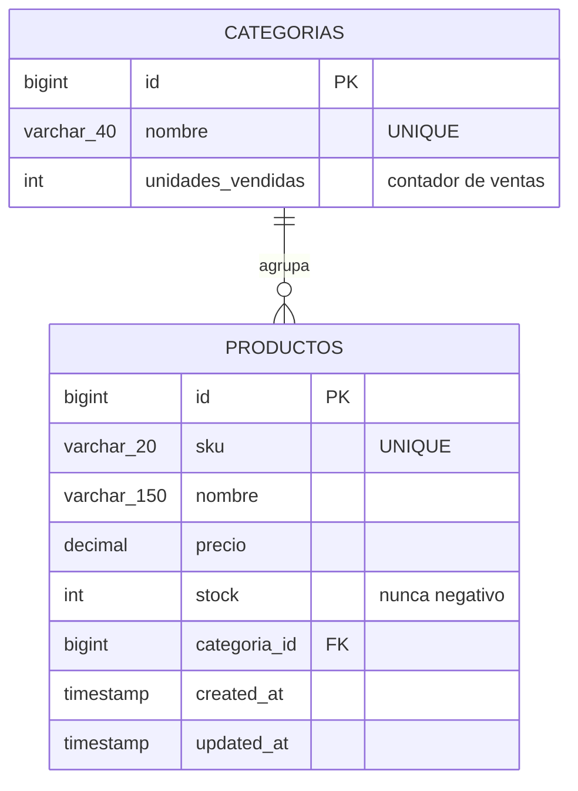
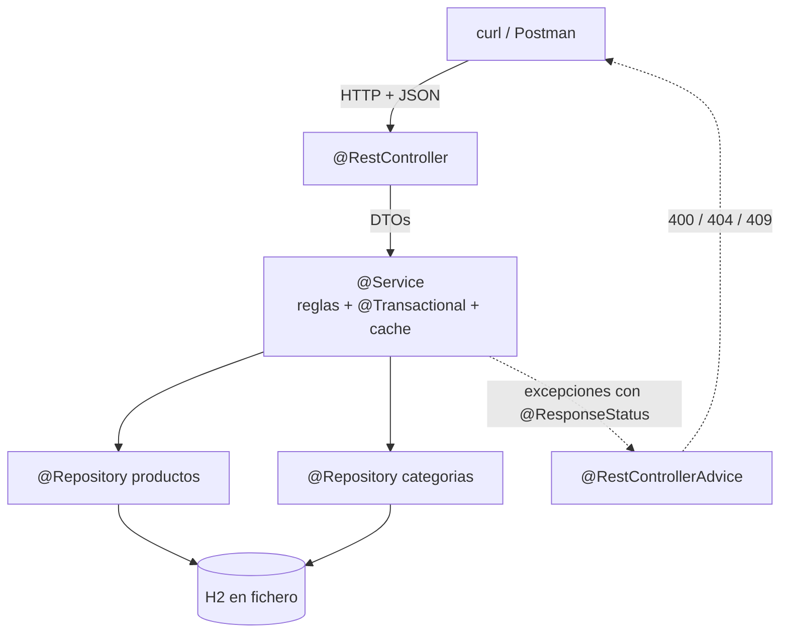

# 5. Dos proyectos paso a paso

Dos APIs REST completas con **Maven, Spring Web y H2 por JDBC**. Se teclean de arriba abajo y cada paso deja el proyecto **arrancando**.

| | Proyecto | Tablas | Lo nuevo |
|:-:|---|:-:|---|
| **A** | [API de Funkos](#proyecto-a-api-de-funkos) | 1 | Las ocho capas completas, de cero a `.jar` |
| **B** | [API de una tienda](#proyecto-b-api-de-una-tienda) | 2 | Clave ajena, **una operación que toca las dos tablas** y la **caché** |

!!! danger "Aquí no hay JPA ni Hibernate"
    El SQL lo escribes tú. **JPA es la [UT5](../ut5/index.md)**, y entonces se cambiará solo el repositorio.

!!! info "Cómo se trabaja"
    No se lee: se teclea. **`git commit` al final de cada paso**, que es la única forma de volver atrás cuando el paso 8 rompe algo del paso 3.

    El orden es el del [tema 3](03-repositorios-servicios-dtos.md): modelo → repositorio → excepciones → DTOs → mapeador → servicio → controlador → errores.

    **Aquí no se escriben tests.** Estos dos proyectos se comprueban **ejecutándolos**: cada paso acaba con las peticiones `curl` que demuestran que funciona, y cada proyecto con su lista de comprobación. Los tests se trabajan aparte, con tiempo propio.

---

# Proyecto A · API de Funkos

```
GET    /api/v1/funkos          ?categoria= &nombre= &precioMax=
GET    /api/v1/funkos/{id}
POST   /api/v1/funkos
PUT    /api/v1/funkos/{id}
PATCH  /api/v1/funkos/{id}
DELETE /api/v1/funkos/{id}
```

## Paso 1 · Crear el proyecto

```bash
curl https://start.spring.io/starter.zip \
  -d type=maven-project -d language=java \
  -d bootVersion=3.5.6 -d javaVersion=25 \
  -d groupId=es.iesx -d artifactId=funkos-api \
  -d packageName=es.iesx.funkos \
  -d dependencies=web,validation,jdbc,h2,devtools \
  -o funkos-api.zip

unzip funkos-api.zip -d funkos-api && cd funkos-api
./mvnw spring-boot:run
```

```
Tomcat started on port 8080 (http)
Started FunkosApiApplication in 1.412 seconds
```

!!! info "Las cinco dependencias"
    | | Para qué |
    |---|---|
    | `web` | Tomcat, `@RestController`, Jackson |
    | `validation` | `@Valid`, `@NotBlank` |
    | **`jdbc`** | `DataSource`, pool, **`JdbcClient`**, `@Transactional` |
    | `h2` | La base de datos |
    | `devtools` | Reinicio al guardar (solo desarrollo) |

    **`jdbc`, no `data-jpa`.** Si pones JPA por error, Hibernate intentará crear las tablas y chocará con tu `schema.sql`.

## Paso 2 · La configuración

```properties title="src/main/resources/application.properties"
spring.application.name=funkos-api

server.port=${PORT:8080}
api.path=/api
api.version=v1

### H2 en FICHERO: los datos sobreviven al reinicio
spring.datasource.url=${DB_URL:jdbc:h2:file:./datos/funkos;AUTO_SERVER=TRUE}
spring.datasource.username=${DB_USER:sa}
spring.datasource.password=${DB_PASSWORD:}
spring.datasource.driver-class-name=org.h2.Driver

### El esquema y los datos los creamos nosotros
spring.sql.init.mode=always
spring.sql.init.schema-locations=classpath:schema.sql
spring.sql.init.data-locations=classpath:data.sql

### Consola web de H2: http://localhost:8080/h2-console
spring.h2.console.enabled=true
spring.h2.console.path=/h2-console

server.error.include-message=always
server.error.include-binding-errors=always
server.error.include-stacktrace=never

logging.level.es.iesx=DEBUG
```

```gitignore title=".gitignore — añade esto"
datos/
```

!!! danger "`file:` y `AUTO_SERVER=TRUE`"
    | URL | Dónde viven los datos |
    |---|---|
    | `jdbc:h2:mem:funkos` | En memoria: **se borran al parar** |
    | `jdbc:h2:file:./datos/funkos` | En `datos/funkos.mv.db`: **sobreviven** |

    Y `AUTO_SERVER=TRUE` permite que la consola de H2 y tu aplicación abran la base **a la vez**. Sin él, la segunda falla con `Database may be already in use`.

## Paso 3 · El esquema y los datos

```sql title="src/main/resources/schema.sql"
CREATE TABLE IF NOT EXISTS funkos (
    id         BIGINT AUTO_INCREMENT PRIMARY KEY,
    nombre     VARCHAR(100)  NOT NULL,
    precio     DECIMAL(10,2) NOT NULL,
    cantidad   INT           NOT NULL DEFAULT 0,
    categoria  VARCHAR(20)   NOT NULL,
    created_at TIMESTAMP     NOT NULL DEFAULT CURRENT_TIMESTAMP,
    updated_at TIMESTAMP     NOT NULL DEFAULT CURRENT_TIMESTAMP,
    CONSTRAINT uk_funko_nombre UNIQUE (nombre),
    CONSTRAINT ck_funko_precio   CHECK (precio   >= 0),
    CONSTRAINT ck_funko_cantidad CHECK (cantidad >= 0),
    CONSTRAINT ck_funko_categoria
        CHECK (categoria IN ('DISNEY','MARVEL','ANIME','OTROS'))
);

CREATE INDEX IF NOT EXISTS idx_funko_categoria ON funkos (categoria);
```

```sql title="src/main/resources/data.sql"
MERGE INTO funkos (id, nombre, precio, cantidad, categoria) KEY(id) VALUES
  (1, 'Mickey Mouse', 15.99, 10, 'DISNEY'),
  (2, 'Stitch',       17.00,  8, 'DISNEY'),
  (3, 'Spider-Man',   19.99,  5, 'MARVEL'),
  (4, 'Iron Man',     21.50,  2, 'MARVEL'),
  (5, 'Goku',         22.50,  3, 'ANIME'),
  (6, 'Naruto',       18.75,  0, 'ANIME');

ALTER TABLE funkos ALTER COLUMN id RESTART WITH 7;
```

!!! danger "Las tres cosas que fallan en este paso"
    **1 · `CREATE TABLE IF NOT EXISTS`.** Con H2 en fichero, `schema.sql` se ejecuta **en cada arranque**. Sin el `IF NOT EXISTS`, al segundo arranque: `Table "FUNKOS" already exists`.

    **2 · `MERGE … KEY(id)` y no `INSERT`.** Mismo motivo: un `INSERT` con id fijo falla al segundo arranque por clave primaria duplicada.

    **3 · El `ALTER … RESTART WITH 7`.** Si insertas con ids explícitos, el contador del `AUTO_INCREMENT` sigue en 1, así que **el primer POST chocará con Mickey Mouse**. Es un error desconcertante porque el código del POST está bien.

!!! success "Comprueba antes de seguir"
    ```bash
    ./mvnw spring-boot:run
    # Ctrl+C y otra vez: tiene que arrancar las dos veces sin error
    ```

    Y en `http://localhost:8080/h2-console`, con `jdbc:h2:file:./datos/funkos`, usuario `sa` y contraseña vacía:

    ```sql
    SELECT * FROM funkos;
    ```

## Paso 4 · El modelo

```java title="funkos/models/Funko.java"
package es.iesx.funkos.funkos.models;

import java.math.BigDecimal;
import java.time.LocalDateTime;

public record Funko(
        Long id,
        String nombre,
        BigDecimal precio,
        Integer cantidad,
        String categoria,
        LocalDateTime createdAt,
        LocalDateTime updatedAt
) {}
```

**Un fichero, siete líneas.** El `record` trae el constructor, los captadores (`f.nombre()`), `equals`, `hashCode` y `toString`.

!!! info "Y `BigDecimal`, no `double`"
    Es dinero: `0.1 + 0.2` en `double` da `0.30000000000000004`. La columna es `DECIMAL(10,2)` por lo mismo.

## Paso 5 · El repositorio

```java title="funkos/repositories/FunkosRepository.java"
package es.iesx.funkos.funkos.repositories;

import es.iesx.funkos.funkos.models.Funko;
import java.math.BigDecimal;
import java.util.*;

public interface FunkosRepository {
    List<Funko>       buscar(Optional<String> categoria, Optional<String> nombre,
                             Optional<BigDecimal> precioMax);
    Optional<Funko>   findById(Long id);
    boolean           existsByNombre(String nombre);
    Funko             save(Funko funko);
    void              update(Funko funko);
    boolean           deleteById(Long id);
    Map<String, Long> contarPorCategoria();
}
```

```java title="funkos/repositories/FunkoRowMapper.java"
package es.iesx.funkos.funkos.repositories;

import es.iesx.funkos.funkos.models.Funko;
import org.springframework.jdbc.core.RowMapper;
import org.springframework.stereotype.Component;

import java.sql.ResultSet;
import java.sql.SQLException;

@Component
public class FunkoRowMapper implements RowMapper<Funko> {

    @Override
    public Funko mapRow(ResultSet rs, int rowNum) throws SQLException {
        return new Funko(
                rs.getLong("id"),
                rs.getString("nombre"),
                rs.getBigDecimal("precio"),
                rs.getInt("cantidad"),
                rs.getString("categoria"),
                rs.getTimestamp("created_at").toLocalDateTime(),
                rs.getTimestamp("updated_at").toLocalDateTime());
    }
}
```

```java title="funkos/repositories/FunkosRepositoryJdbc.java"
package es.iesx.funkos.funkos.repositories;

import es.iesx.funkos.funkos.models.Funko;
import org.springframework.jdbc.core.simple.JdbcClient;
import org.springframework.jdbc.support.GeneratedKeyHolder;
import org.springframework.stereotype.Repository;

import java.math.BigDecimal;
import java.util.*;

@Repository
public class FunkosRepositoryJdbc implements FunkosRepository {

    private final JdbcClient jdbc;
    private final FunkoRowMapper rowMapper;

    public FunkosRepositoryJdbc(JdbcClient jdbc, FunkoRowMapper rowMapper) {
        this.jdbc = jdbc;
        this.rowMapper = rowMapper;
    }

    @Override
    public List<Funko> buscar(Optional<String> categoria, Optional<String> nombre,
                              Optional<BigDecimal> precioMax) {
        var sql = new StringBuilder("SELECT * FROM funkos WHERE 1 = 1");
        var params = new HashMap<String, Object>();

        categoria.ifPresent(c -> {
            sql.append(" AND UPPER(categoria) = UPPER(:categoria)");
            params.put("categoria", c);
        });
        nombre.ifPresent(n -> {
            sql.append(" AND LOWER(nombre) LIKE LOWER(:nombre)");
            params.put("nombre", "%" + n + "%");
        });
        precioMax.ifPresent(p -> {
            sql.append(" AND precio <= :precioMax");
            params.put("precioMax", p);
        });
        sql.append(" ORDER BY id");

        return jdbc.sql(sql.toString()).params(params).query(rowMapper).list();
    }

    @Override
    public Optional<Funko> findById(Long id) {
        return jdbc.sql("SELECT * FROM funkos WHERE id = :id")
                   .param("id", id)
                   .query(rowMapper).optional();
    }

    @Override
    public boolean existsByNombre(String nombre) {
        return jdbc.sql("SELECT COUNT(*) FROM funkos WHERE UPPER(nombre) = UPPER(:nombre)")
                   .param("nombre", nombre)
                   .query(Integer.class).single() > 0;
    }

    @Override
    public Funko save(Funko f) {
        var keys = new GeneratedKeyHolder();
        jdbc.sql("""
                INSERT INTO funkos (nombre, precio, cantidad, categoria, created_at, updated_at)
                VALUES (:nombre, :precio, :cantidad, :categoria, :creado, :actualizado)
                """)
            .param("nombre", f.nombre())
            .param("precio", f.precio())
            .param("cantidad", f.cantidad())
            .param("categoria", f.categoria())
            .param("creado", f.createdAt())
            .param("actualizado", f.updatedAt())
            .update(keys, "ID");                 // ← el nombre de la columna, en MAYUSCULAS

        Number id = (Number) keys.getKeys().get("ID");
        if (id == null) {
            throw new IllegalStateException("La base de datos no ha devuelto la clave ID");
        }
        return findById(id.longValue()).orElseThrow();
    }

    @Override
    public void update(Funko f) {
        jdbc.sql("""
                UPDATE funkos
                   SET nombre = :nombre, precio = :precio, cantidad = :cantidad,
                       categoria = :categoria, updated_at = :actualizado
                 WHERE id = :id
                """)
            .param("nombre", f.nombre())
            .param("precio", f.precio())
            .param("cantidad", f.cantidad())
            .param("categoria", f.categoria())
            .param("actualizado", f.updatedAt())
            .param("id", f.id())
            .update();
    }

    @Override
    public boolean deleteById(Long id) {
        return jdbc.sql("DELETE FROM funkos WHERE id = :id")
                   .param("id", id)
                   .update() == 1;
    }

    @Override
    public Map<String, Long> contarPorCategoria() {
        var filas = jdbc.sql("""
                SELECT categoria, COUNT(*) AS total
                  FROM funkos
                 GROUP BY categoria
                 ORDER BY categoria
                """)
            .query((rs, n) -> Map.entry(rs.getString("categoria"), rs.getLong("total")))
            .list();

        var resultado = new LinkedHashMap<String, Long>();
        filas.forEach(e -> resultado.put(e.getKey(), e.getValue()));
        return resultado;
    }
}
```

!!! success "Compara con la UT3"
    | | UT3, a mano | UT4, con `JdbcClient` |
    |---|---|---|
    | Abrir la conexión | `DriverManager` + `try-with-resources` | **Spring**, de un pool |
    | Parámetros | `ps.setString(1, …)` desde 1 | `:nombre`, con nombre |
    | Recorrer el `ResultSet` | `while (rs.next())` | `RowMapper` + `.list()` |
    | Cero o uno | `rs.next() ? … : null` | **`.optional()`** |
    | Cerrar | A mano | **Spring** |

    El SQL sigue siendo tuyo, y los `:param` siguen siendo `PreparedStatement`: **la inyección SQL no es posible por esta vía**.

## Paso 6 · Las excepciones

Tres ficheros de cuatro líneas:

```java title="funkos/exceptions/FunkoNotFoundException.java"
package es.iesx.funkos.funkos.exceptions;

import org.springframework.http.HttpStatus;
import org.springframework.web.bind.annotation.ResponseStatus;

@ResponseStatus(HttpStatus.NOT_FOUND)
public class FunkoNotFoundException extends RuntimeException {
    public FunkoNotFoundException(Long id) {
        super("No se ha encontrado el funko con id: " + id);
    }
}
```

```java title="funkos/exceptions/FunkoConflictException.java"
@ResponseStatus(HttpStatus.CONFLICT)
public class FunkoConflictException extends RuntimeException {
    public FunkoConflictException(String mensaje) { super(mensaje); }
}
```

```java title="funkos/exceptions/FunkoBadRequestException.java"
@ResponseStatus(HttpStatus.BAD_REQUEST)
public class FunkoBadRequestException extends RuntimeException {
    public FunkoBadRequestException(String mensaje) { super(mensaje); }
}
```

El servicio lanza, el controlador no captura, y Spring lee el `@ResponseStatus`.

## Paso 7 · Los DTOs

```java title="funkos/dto/FunkoResponse.java"
package es.iesx.funkos.funkos.dto;

import java.math.BigDecimal;
import java.time.LocalDateTime;

public record FunkoResponse(
        Long id,
        String nombre,
        BigDecimal precio,
        Integer cantidad,
        String categoria,
        LocalDateTime createdAt,
        LocalDateTime updatedAt
) {}
```

```java title="funkos/dto/FunkoCreateRequest.java"
package es.iesx.funkos.funkos.dto;

import jakarta.validation.constraints.*;
import java.math.BigDecimal;

public record FunkoCreateRequest(

        @NotBlank(message = "El nombre no puede estar vacío")
        @Size(max = 100, message = "Máximo 100 caracteres")
        String nombre,

        @NotNull(message = "El precio es obligatorio")
        @DecimalMin(value = "0.0", message = "El precio no puede ser negativo")
        BigDecimal precio,

        @NotNull(message = "La cantidad es obligatoria")
        @PositiveOrZero(message = "La cantidad no puede ser negativa")
        Integer cantidad,

        @NotBlank(message = "La categoría no puede estar vacía")
        @Pattern(regexp = "DISNEY|MARVEL|ANIME|OTROS",
                 message = "Debe ser DISNEY, MARVEL, ANIME u OTROS")
        String categoria
) {}
```

```java title="funkos/dto/FunkoUpdateRequest.java"
public record FunkoUpdateRequest(
        @Size(max = 100) String nombre,
        @DecimalMin("0.0") BigDecimal precio,
        @PositiveOrZero Integer cantidad,
        @Pattern(regexp = "DISNEY|MARVEL|ANIME|OTROS") String categoria
) {}
```

```java title="funkos/dto/EstadisticasResponse.java"
public record EstadisticasResponse(
        int total,
        Map<String, Long> porCategoria,
        BigDecimal valorInventario,
        long sinStock,
        String masCaro
) {}
```

**En el `UpdateRequest` desaparecen los obligatorios**, porque en un PATCH `null` significa «no lo cambies». Y el `CreateRequest` **no lleva `id` ni fechas**: las pone el servidor.

## Paso 8 · El mapeador

```java title="funkos/mappers/FunkoMapper.java"
package es.iesx.funkos.funkos.mappers;

import es.iesx.funkos.funkos.dto.*;
import es.iesx.funkos.funkos.models.Funko;
import org.springframework.stereotype.Component;

import java.time.LocalDateTime;
import java.util.List;

@Component
public class FunkoMapper {

    public FunkoResponse toResponse(Funko f) {
        return new FunkoResponse(f.id(), f.nombre(), f.precio(), f.cantidad(),
                                 f.categoria(), f.createdAt(), f.updatedAt());
    }

    public List<FunkoResponse> toResponse(List<Funko> funkos) {
        return funkos.stream().map(this::toResponse).toList();
    }

    /** POST: nuevo. El id lo pone la BD; las fechas, el servidor. */
    public Funko toModel(FunkoCreateRequest r) {
        var ahora = LocalDateTime.now();
        return new Funko(
                null,
                r.nombre().trim(),
                r.precio(),
                r.cantidad(),
                r.categoria().toUpperCase(),
                ahora,
                ahora);
    }

    /** PUT: reemplaza todo menos el id y la fecha de creación. */
    public Funko reemplazar(Funko original, FunkoCreateRequest r) {
        return new Funko(
                original.id(),
                r.nombre().trim(),
                r.precio(),
                r.cantidad(),
                r.categoria().toUpperCase(),
                original.createdAt(),
                LocalDateTime.now());
    }

    /** PATCH: cambia solo lo que llega distinto de null. */
    public Funko parchear(Funko original, FunkoUpdateRequest r) {
        return new Funko(
                original.id(),
                r.nombre()    != null ? r.nombre().trim()           : original.nombre(),
                r.precio()    != null ? r.precio()                  : original.precio(),
                r.cantidad()  != null ? r.cantidad()                : original.cantidad(),
                r.categoria() != null ? r.categoria().toUpperCase() : original.categoria(),
                original.createdAt(),
                LocalDateTime.now());
    }
}
```

!!! danger "`reemplazar` y `parchear` tienen que ser dos métodos distintos"
    | | Qué hace con lo que **no** mandas |
    |---|---|
    | `reemplazar` (PUT) | **Lo borra** |
    | `parchear` (PATCH) | **Lo conserva** |

    Si el PATCH llama a `reemplazar`, mandar `{"precio": 25}` deja el nombre en `null`. Es el error de diseño más común de la unidad.

## Paso 9 · El servicio

```java title="funkos/services/FunkosService.java"
package es.iesx.funkos.funkos.services;

import es.iesx.funkos.funkos.dto.*;
import java.math.BigDecimal;
import java.util.*;

public interface FunkosService {
    List<FunkoResponse> buscar(Optional<String> categoria, Optional<String> nombre,
                               Optional<BigDecimal> precioMax);
    FunkoResponse findById(Long id);
    FunkoResponse save(FunkoCreateRequest funko);
    FunkoResponse replace(Long id, FunkoCreateRequest funko);
    FunkoResponse update(Long id, FunkoUpdateRequest funko);
    void deleteById(Long id);
    EstadisticasResponse estadisticas();
}
```

```java title="funkos/services/FunkosServiceImpl.java"
package es.iesx.funkos.funkos.services;

import es.iesx.funkos.funkos.dto.*;
import es.iesx.funkos.funkos.exceptions.*;
import es.iesx.funkos.funkos.mappers.FunkoMapper;
import es.iesx.funkos.funkos.models.Funko;
import es.iesx.funkos.funkos.repositories.FunkosRepository;
import org.slf4j.*;
import org.springframework.stereotype.Service;
import org.springframework.transaction.annotation.Transactional;

import java.math.BigDecimal;
import java.util.*;

@Service
public class FunkosServiceImpl implements FunkosService {

    private static final Logger log = LoggerFactory.getLogger(FunkosServiceImpl.class);

    private final FunkosRepository repositorio;
    private final FunkoMapper mapper;

    public FunkosServiceImpl(FunkosRepository repositorio, FunkoMapper mapper) {
        this.repositorio = repositorio;
        this.mapper = mapper;
    }

    @Override
    @Transactional(readOnly = true)
    public List<FunkoResponse> buscar(Optional<String> categoria, Optional<String> nombre,
                                      Optional<BigDecimal> precioMax) {
        log.debug("buscar categoria={} nombre={} precioMax={}", categoria, nombre, precioMax);
        return mapper.toResponse(repositorio.buscar(categoria, nombre, precioMax));
    }

    @Override
    @Transactional(readOnly = true)
    public FunkoResponse findById(Long id) {
        return repositorio.findById(id)
                .map(mapper::toResponse)
                .orElseThrow(() -> new FunkoNotFoundException(id));
    }

    @Override
    @Transactional
    public FunkoResponse save(FunkoCreateRequest request) {
        if (repositorio.existsByNombre(request.nombre()))
            throw new FunkoConflictException(
                    "Ya existe un funko con el nombre: " + request.nombre());

        return mapper.toResponse(repositorio.save(mapper.toModel(request)));
    }

    @Override
    @Transactional
    public FunkoResponse replace(Long id, FunkoCreateRequest request) {
        var original = repositorio.findById(id)
                .orElseThrow(() -> new FunkoNotFoundException(id));

        var nuevo = mapper.reemplazar(original, request);
        repositorio.update(nuevo);
        return mapper.toResponse(nuevo);
    }

    @Override
    @Transactional
    public FunkoResponse update(Long id, FunkoUpdateRequest request) {
        var original = repositorio.findById(id)
                .orElseThrow(() -> new FunkoNotFoundException(id));

        var parcheado = mapper.parchear(original, request);
        repositorio.update(parcheado);
        return mapper.toResponse(parcheado);
    }

    @Override
    @Transactional
    public void deleteById(Long id) {
        if (!repositorio.deleteById(id))
            throw new FunkoNotFoundException(id);
    }

    @Override
    @Transactional(readOnly = true)
    public EstadisticasResponse estadisticas() {
        var todos = repositorio.buscar(Optional.empty(), Optional.empty(), Optional.empty());

        var valor = BigDecimal.ZERO;
        for (var f : todos)
            valor = valor.add(f.precio().multiply(BigDecimal.valueOf(f.cantidad())));

        var masCaro = todos.stream()
                .max(Comparator.comparing(Funko::precio))
                .map(Funko::nombre)
                .orElse("—");

        var sinStock = todos.stream().filter(f -> f.cantidad() == 0).count();

        return new EstadisticasResponse(todos.size(), repositorio.contarPorCategoria(),
                                        valor, sinStock, masCaro);
    }
}
```

!!! success "Lee este fichero y mira lo que NO hay"
    Ni `ResponseEntity`, ni `HttpStatus`, ni `@PathVariable`. **El servicio no sabe que existe HTTP.**

    Y el `deleteById`: `if (!repositorio.deleteById(id)) throw …`. Sin ese `if`, borrar un id inexistente devuelve **204** y el cliente cree que ha borrado algo.

## Paso 10 · El controlador

```java title="funkos/controllers/FunkosRestController.java"
package es.iesx.funkos.funkos.controllers;

import es.iesx.funkos.funkos.dto.*;
import es.iesx.funkos.funkos.services.FunkosService;
import jakarta.validation.Valid;
import org.springframework.http.ResponseEntity;
import org.springframework.web.bind.annotation.*;

import java.math.BigDecimal;
import java.net.URI;
import java.util.*;

@RestController
@RequestMapping("${api.path:/api}/${api.version:v1}/funkos")
public class FunkosRestController {

    private final FunkosService servicio;

    public FunkosRestController(FunkosService servicio) {
        this.servicio = servicio;
    }

    @GetMapping
    public ResponseEntity<List<FunkoResponse>> buscar(
            @RequestParam Optional<String> categoria,
            @RequestParam Optional<String> nombre,
            @RequestParam Optional<BigDecimal> precioMax) {
        return ResponseEntity.ok(servicio.buscar(categoria, nombre, precioMax));
    }

    @GetMapping("/estadisticas")
    public ResponseEntity<EstadisticasResponse> estadisticas() {
        return ResponseEntity.ok(servicio.estadisticas());
    }

    @GetMapping("/{id}")
    public ResponseEntity<FunkoResponse> findById(@PathVariable Long id) {
        return ResponseEntity.ok(servicio.findById(id));
    }

    @PostMapping
    public ResponseEntity<FunkoResponse> crear(
            @Valid @RequestBody FunkoCreateRequest funko) {
        var creado = servicio.save(funko);
        return ResponseEntity
                .created(URI.create("/api/v1/funkos/" + creado.id()))
                .body(creado);
    }

    @PutMapping("/{id}")
    public ResponseEntity<FunkoResponse> reemplazar(
            @PathVariable Long id, @Valid @RequestBody FunkoCreateRequest funko) {
        return ResponseEntity.ok(servicio.replace(id, funko));
    }

    @PatchMapping("/{id}")
    public ResponseEntity<FunkoResponse> actualizar(
            @PathVariable Long id, @Valid @RequestBody FunkoUpdateRequest funko) {
        return ResponseEntity.ok(servicio.update(id, funko));
    }

    @DeleteMapping("/{id}")
    public ResponseEntity<Void> borrar(@PathVariable Long id) {
        servicio.deleteById(id);
        return ResponseEntity.noContent().build();
    }
}
```

!!! warning "`/estadisticas` va ANTES de `/{id}`"
    Si `/{id}` estuviera primero, Spring intentaría convertir `"estadisticas"` en un `Long` y devolvería un **400**.

    Las rutas fijas siempre antes que las variables.

## Paso 11 · El manejador de errores

```java title="common/GlobalExceptionHandler.java"
package es.iesx.funkos.common;

import org.springframework.dao.DataIntegrityViolationException;
import org.springframework.http.HttpStatus;
import org.springframework.http.converter.HttpMessageNotReadableException;
import org.springframework.web.bind.MethodArgumentNotValidException;
import org.springframework.web.bind.annotation.*;
import org.springframework.web.method.annotation.MethodArgumentTypeMismatchException;

import java.util.*;

@RestControllerAdvice
public class GlobalExceptionHandler {

    @ResponseStatus(HttpStatus.BAD_REQUEST)
    @ExceptionHandler(MethodArgumentNotValidException.class)
    public Map<String, Object> validacion(MethodArgumentNotValidException ex) {
        Map<String, String> campos = new LinkedHashMap<>();
        ex.getBindingResult().getFieldErrors()
          .forEach(e -> campos.put(e.getField(), e.getDefaultMessage()));
        return Map.of("status", 400, "error", "Datos de entrada inválidos", "campos", campos);
    }

    @ResponseStatus(HttpStatus.BAD_REQUEST)
    @ExceptionHandler(HttpMessageNotReadableException.class)
    public Map<String, Object> jsonIlegible(HttpMessageNotReadableException ex) {
        return Map.of("status", 400, "error", "El cuerpo no es un JSON valido");
    }

    @ResponseStatus(HttpStatus.BAD_REQUEST)
    @ExceptionHandler(MethodArgumentTypeMismatchException.class)
    public Map<String, Object> tipoMalo(MethodArgumentTypeMismatchException ex) {
        return Map.of("status", 400,
                "error", "El parametro '%s' no tiene el tipo esperado".formatted(ex.getName()));
    }

    @ResponseStatus(HttpStatus.CONFLICT)
    @ExceptionHandler(DataIntegrityViolationException.class)
    public Map<String, Object> integridad(DataIntegrityViolationException ex) {
        return Map.of("status", 409,
                "error", "La operacion viola una restriccion de la base de datos");
    }
}
```

## Paso 12 · Probarlo

```bash
./mvnw spring-boot:run
```

=== "Lo que funciona"

    ```bash
    # Los seis de data.sql
    curl -s localhost:8080/api/v1/funkos | jq length
    # 6

    # Filtros, combinables y sin distinguir mayúsculas
    curl -s "localhost:8080/api/v1/funkos?categoria=disney" | jq '[.[].nombre]'
    # ["Mickey Mouse","Stitch"]

    curl -s "localhost:8080/api/v1/funkos?nombre=man&precioMax=20" | jq '[.[].nombre]'
    # ["Spider-Man"]

    # Crear: 201 + Location
    curl -i -X POST localhost:8080/api/v1/funkos \
      -H "Content-Type: application/json" \
      -d '{"nombre":"Pikachu","precio":20.00,"cantidad":7,"categoria":"ANIME"}'
    # HTTP/1.1 201
    # Location: /api/v1/funkos/7

    # PATCH: solo el precio, la cantidad intacta
    curl -s -X PATCH localhost:8080/api/v1/funkos/7 \
      -H "Content-Type: application/json" \
      -d '{"precio":25.00}' | jq '{nombre, precio, cantidad}'
    # { "nombre": "Pikachu", "precio": 25.00, "cantidad": 7 }

    # Estadísticas
    curl -s localhost:8080/api/v1/funkos/estadisticas | jq
    # { "total": 7, "porCategoria": {"ANIME":3,"DISNEY":2,"MARVEL":2}, … }

    curl -i -X DELETE localhost:8080/api/v1/funkos/7
    # HTTP/1.1 204
    ```

=== "Los errores"

    ```bash
    # 404
    curl -i localhost:8080/api/v1/funkos/9999
    # 404 · "No se ha encontrado el funko con id: 9999"

    # 400 con los campos señalados
    curl -s -X POST localhost:8080/api/v1/funkos \
      -H "Content-Type: application/json" \
      -d '{"nombre":"","precio":-5,"cantidad":1,"categoria":"COCINA"}' | jq .campos
    # {
    #   "nombre": "El nombre no puede estar vacío",
    #   "precio": "El precio no puede ser negativo",
    #   "categoria": "Debe ser DISNEY, MARVEL, ANIME u OTROS"
    # }

    # 409: nombre repetido
    curl -i -X POST localhost:8080/api/v1/funkos \
      -H "Content-Type: application/json" \
      -d '{"nombre":"Goku","precio":10.00,"cantidad":1,"categoria":"ANIME"}'
    # 409

    curl -i localhost:8080/api/v1/funkos/abc                            # 400
    curl -i -X POST localhost:8080/api/v1/funkos -d '{"nombre":"X"}'    # 415
    curl -i -X DELETE localhost:8080/api/v1/funkos/9999                 # 404
    ```

=== "Que persiste"

    ```bash
    curl -X POST localhost:8080/api/v1/funkos \
      -H "Content-Type: application/json" \
      -d '{"nombre":"Totoro","precio":24.00,"cantidad":4,"categoria":"ANIME"}'

    # Ctrl+C y volver a arrancar
    ./mvnw spring-boot:run

    curl -s "localhost:8080/api/v1/funkos?nombre=totoro" | jq length
    # 1   ← el fichero datos/funkos.mv.db lo ha guardado
    ```

## Paso 13 · Generar el `.jar`

```bash
./mvnw clean package
java -jar target/funkos-api-0.0.1-SNAPSHOT.jar
```

```bash
# Y comprobar que arranca con otro perfil y otro puerto
PORT=9090 SPRING_PROFILES_ACTIVE=prod java -jar target/funkos-api-0.0.1-SNAPSHOT.jar
```

!!! success "Comprueba el proyecto A"
    - [ ] Los **seis endpoints** responden con el código correcto
    - [ ] Los datos **sobreviven** a parar y arrancar, y arranca **dos veces seguidas** sin error
    - [ ] Un `POST` inválido devuelve **400 con los campos**
    - [ ] Un `id` inexistente devuelve **404**, no 500
    - [ ] El `POST` correcto devuelve **201** y la cabecera `Location`
    - [ ] `grep -rn "ResponseEntity\|HttpStatus" src/main/java/**/services/` → **vacío**
    - [ ] `grep -rn "@Autowired" src/main/java/` → **vacío**
    - [ ] El `.jar` se genera y arranca

---

# Proyecto B · API de una tienda

**Dos tablas y una operación que toca las dos.** Mismas capas que el proyecto A, con dos cosas nuevas: **dos repositorios** y **la venta transaccional**.

```
GET    /api/v1/categorias
GET    /api/v1/categorias/{id}

GET    /api/v1/productos            ?categoria= &nombre= &conStock=
GET    /api/v1/productos/{id}
POST   /api/v1/productos
PATCH  /api/v1/productos/{id}
DELETE /api/v1/productos/{id}
POST   /api/v1/productos/{id}/venta      ← toca las DOS tablas
```

| Paso | Qué se escribe |
|:-:|---|
| **1** | El esquema y los datos |
| **2** | Los modelos |
| **3** | Los DTOs |
| **4** | El repositorio de **categorías**, completo |
| **5** | El repositorio de **productos**, completo |
| **6** | Las excepciones y el mapeador |
| **7** | El servicio, completo |
| **8** | El controlador, completo |
| **9** | La caché |
| **10** | **Probarlo todo**: lo que va bien, lo que falla y la caché |

---

## Paso 1 · El esquema y los datos



```sql title="src/main/resources/schema.sql"
CREATE TABLE IF NOT EXISTS categorias (
    id                BIGINT AUTO_INCREMENT PRIMARY KEY,
    nombre            VARCHAR(40) NOT NULL,
    unidades_vendidas INT         NOT NULL DEFAULT 0,
    CONSTRAINT uk_categoria_nombre   UNIQUE (nombre),
    CONSTRAINT ck_categoria_vendidas CHECK  (unidades_vendidas >= 0)
);

CREATE TABLE IF NOT EXISTS productos (
    id           BIGINT AUTO_INCREMENT PRIMARY KEY,
    sku          VARCHAR(20)   NOT NULL,
    nombre       VARCHAR(150)  NOT NULL,
    precio       DECIMAL(10,2) NOT NULL,
    stock        INT           NOT NULL DEFAULT 0,
    categoria_id BIGINT        NOT NULL,
    created_at   TIMESTAMP     NOT NULL DEFAULT CURRENT_TIMESTAMP,
    updated_at   TIMESTAMP     NOT NULL DEFAULT CURRENT_TIMESTAMP,
    CONSTRAINT uk_producto_sku    UNIQUE (sku),
    CONSTRAINT ck_producto_precio CHECK  (precio >= 0),
    CONSTRAINT ck_producto_stock  CHECK  (stock  >= 0),
    CONSTRAINT fk_producto_categoria FOREIGN KEY (categoria_id) REFERENCES categorias (id)
);
```

```sql title="src/main/resources/data.sql"
MERGE INTO categorias (id, nombre, unidades_vendidas) KEY(id) VALUES
  (1, 'INFORMATICA', 0),
  (2, 'PAPELERIA',   0),
  (3, 'MOBILIARIO',  0);

MERGE INTO productos (id, sku, nombre, precio, stock, categoria_id) KEY(id) VALUES
  (1, 'SKU-001', 'Teclado mecánico', 79.90, 10, 1),
  (2, 'SKU-002', 'Ratón vertical',   45.50,  3, 1),
  (3, 'SKU-003', 'Monitor 27 pulgadas', 229.00, 1, 1),
  (4, 'SKU-004', 'Cuaderno A4',       4.95, 50, 2),
  (5, 'SKU-005', 'Silla de oficina', 149.00,  0, 3);

ALTER TABLE categorias ALTER COLUMN id RESTART WITH 4;
ALTER TABLE productos  ALTER COLUMN id RESTART WITH 6;
```

!!! success "Las tres decisiones del esquema"
    **1 · La clave ajena, sin cascada.** Borrar una categoría con productos **tiene que fallar**, y de eso se encarga la base de datos. Se traduce en un **409**.

    **2 · `CHECK (stock >= 0)`.** La última defensa: aunque tu código tenga un fallo, el stock nunca queda negativo.

    **3 · `unidades_vendidas` en la categoría.** Es el contador que hace que **una venta escriba en las dos tablas**, que es el punto de este proyecto.

---

## Paso 2 · Los modelos

```java title="categorias/models/Categoria.java"
package es.iesx.tienda.categorias.models;

public record Categoria(
        Long id,
        String nombre,
        Integer unidadesVendidas
) {}
```

```java title="productos/models/Producto.java"
package es.iesx.tienda.productos.models;

import java.math.BigDecimal;
import java.time.LocalDateTime;

public record Producto(
        Long id,
        String sku,
        String nombre,
        BigDecimal precio,
        Integer stock,
        Long categoriaId,
        LocalDateTime createdAt,
        LocalDateTime updatedAt
) {}
```

!!! info "`categoriaId`, no `Categoria categoria`"
    El modelo guarda **lo que hay en la columna**: el id. Sin JPA no hay navegación automática entre tablas, y aquí eso es una ventaja, porque **se ve exactamente qué consulta se lanza**.

    El nombre de la categoría, que es lo que quiere el cliente, lo pone el servicio juntando los dos repositorios. Lo verás en el paso 7.

---

## Paso 3 · Los DTOs

```java title="productos/dto/ProductoResponse.java"
/** Sale hacia el cliente: con el NOMBRE de la categoría, no su id. */
public record ProductoResponse(
        Long id,
        String sku,
        String nombre,
        BigDecimal precio,
        Integer stock,
        String categoria,
        LocalDateTime createdAt,
        LocalDateTime updatedAt
) {}
```

```java title="productos/dto/ProductoCreateRequest.java"
/** Entra en el POST: la categoría se indica por NOMBRE. */
public record ProductoCreateRequest(

        @NotBlank
        @Pattern(regexp = "SKU-\\d{3}", message = "El SKU debe tener el formato SKU-nnn")
        String sku,

        @NotBlank @Size(max = 150)
        String nombre,

        @NotNull @DecimalMin(value = "0.0", message = "El precio no puede ser negativo")
        BigDecimal precio,

        @NotNull @PositiveOrZero
        Integer stock,

        @NotBlank(message = "La categoría es obligatoria")
        String categoria
) {}
```

```java title="productos/dto/ProductoUpdateRequest.java"
/** Entra en el PATCH: todo opcional, solo reglas de formato. */
public record ProductoUpdateRequest(
        @Size(max = 150) String nombre,
        @DecimalMin("0.0") BigDecimal precio,
        @PositiveOrZero Integer stock,
        String categoria
) {}
```

```java title="productos/dto/VentaRequest.java"
public record VentaRequest(
        @NotNull @Min(value = 1, message = "La cantidad mínima es 1")
        Integer cantidad
) {}
```

```java title="categorias/dto/CategoriaResponse.java"
public record CategoriaResponse(
        Long id,
        String nombre,
        Integer unidadesVendidas
) {}
```

---

## Paso 4 · El repositorio de categorías

**Primero la interfaz:** cuatro métodos, y ya está.

```java title="categorias/repositories/CategoriasRepository.java"
package es.iesx.tienda.categorias.repositories;

import es.iesx.tienda.categorias.models.Categoria;
import java.util.List;
import java.util.Optional;

public interface CategoriasRepository {

    List<Categoria> findAll();

    Optional<Categoria> findById(Long id);

    Optional<Categoria> findByNombre(String nombre);

    /** Suma unidades al contador de ventas. Devuelve las filas afectadas. */
    int sumarVendidas(Long id, int cantidad);
}
```

**El `RowMapper`:** convierte una fila en un `Categoria`.

```java title="categorias/repositories/CategoriaRowMapper.java"
package es.iesx.tienda.categorias.repositories;

import es.iesx.tienda.categorias.models.Categoria;
import org.springframework.jdbc.core.RowMapper;
import org.springframework.stereotype.Component;

import java.sql.ResultSet;
import java.sql.SQLException;

@Component
public class CategoriaRowMapper implements RowMapper<Categoria> {

    @Override
    public Categoria mapRow(ResultSet rs, int rowNum) throws SQLException {
        return new Categoria(
                rs.getLong("id"),
                rs.getString("nombre"),
                rs.getInt("unidades_vendidas"));
    }
}
```

**Y la implementación, completa:**

```java title="categorias/repositories/CategoriasRepositoryJdbc.java"
package es.iesx.tienda.categorias.repositories;

import es.iesx.tienda.categorias.models.Categoria;
import org.springframework.jdbc.core.simple.JdbcClient;
import org.springframework.stereotype.Repository;

import java.util.List;
import java.util.Optional;

@Repository
public class CategoriasRepositoryJdbc implements CategoriasRepository {

    private final JdbcClient jdbc;
    private final CategoriaRowMapper rowMapper;

    public CategoriasRepositoryJdbc(JdbcClient jdbc, CategoriaRowMapper rowMapper) {
        this.jdbc = jdbc;
        this.rowMapper = rowMapper;
    }

    @Override
    public List<Categoria> findAll() {
        return jdbc.sql("SELECT * FROM categorias ORDER BY id")
                .query(rowMapper)
                .list();
    }

    @Override
    public Optional<Categoria> findById(Long id) {
        return jdbc.sql("SELECT * FROM categorias WHERE id = :id")
                .param("id", id)
                .query(rowMapper)
                .optional();
    }

    @Override
    public Optional<Categoria> findByNombre(String nombre) {
        return jdbc.sql("SELECT * FROM categorias WHERE UPPER(nombre) = UPPER(:nombre)")
                .param("nombre", nombre)
                .query(rowMapper)
                .optional();
    }

    @Override
    public int sumarVendidas(Long id, int cantidad) {
        return jdbc.sql("""
                UPDATE categorias
                   SET unidades_vendidas = unidades_vendidas + :cantidad
                 WHERE id = :id
                """)
                .param("id", id)
                .param("cantidad", cantidad)
                .update();
    }
}
```

!!! success "Comprueba que arranca"
    ```bash
    ./mvnw spring-boot:run
    ```

    Todavía no hay endpoints de categorías, pero si la aplicación levanta sin errores, **el repositorio está bien cableado**. Un `JdbcClient` mal inyectado o un `@Repository` olvidado fallan aquí, no más tarde.

---

## Paso 5 · El repositorio de productos

**La interfaz:**

```java title="productos/repositories/ProductosRepository.java"
package es.iesx.tienda.productos.repositories;

import es.iesx.tienda.productos.models.Producto;
import java.util.List;
import java.util.Optional;

public interface ProductosRepository {

    /** Listado con tres filtros opcionales. Un null significa "no filtrar por esto". */
    List<Producto> buscar(Long categoriaId, String nombre, Boolean conStock);

    Optional<Producto> findById(Long id);

    boolean existsBySku(String sku);

    /** Cuántos productos tiene esa categoría. Para poder borrarla o no. */
    long contarPorCategoria(Long categoriaId);

    Producto save(Producto producto);

    Producto update(Producto producto);

    /** Devuelve true si ha borrado algo. */
    boolean deleteById(Long id);

    /** Descuenta stock SOLO si hay suficiente. Devuelve las filas afectadas. */
    int descontarStock(Long id, int cantidad);
}
```

**El `RowMapper`:**

```java title="productos/repositories/ProductoRowMapper.java"
package es.iesx.tienda.productos.repositories;

import es.iesx.tienda.productos.models.Producto;
import org.springframework.jdbc.core.RowMapper;
import org.springframework.stereotype.Component;

import java.sql.ResultSet;
import java.sql.SQLException;

@Component
public class ProductoRowMapper implements RowMapper<Producto> {

    @Override
    public Producto mapRow(ResultSet rs, int rowNum) throws SQLException {
        return new Producto(
                rs.getLong("id"),
                rs.getString("sku"),
                rs.getString("nombre"),
                rs.getBigDecimal("precio"),
                rs.getInt("stock"),
                rs.getLong("categoria_id"),
                rs.getTimestamp("created_at").toLocalDateTime(),
                rs.getTimestamp("updated_at").toLocalDateTime());
    }
}
```

**La implementación, completa:**

```java title="productos/repositories/ProductosRepositoryJdbc.java"
package es.iesx.tienda.productos.repositories;

import es.iesx.tienda.productos.models.Producto;
import org.springframework.jdbc.core.simple.JdbcClient;
import org.springframework.jdbc.support.GeneratedKeyHolder;
import org.springframework.stereotype.Repository;

import java.util.HashMap;
import java.util.List;
import java.util.Optional;

@Repository
public class ProductosRepositoryJdbc implements ProductosRepository {

    private final JdbcClient jdbc;
    private final ProductoRowMapper rowMapper;

    public ProductosRepositoryJdbc(JdbcClient jdbc, ProductoRowMapper rowMapper) {
        this.jdbc = jdbc;
        this.rowMapper = rowMapper;
    }

    @Override
    public List<Producto> buscar(Long categoriaId, String nombre, Boolean conStock) {
        var sql = new StringBuilder("SELECT * FROM productos WHERE 1 = 1");
        var params = new HashMap<String, Object>();

        if (categoriaId != null) {
            sql.append(" AND categoria_id = :categoriaId");
            params.put("categoriaId", categoriaId);
        }
        if (nombre != null) {
            sql.append(" AND UPPER(nombre) LIKE UPPER(:nombre)");
            params.put("nombre", "%" + nombre + "%");
        }
        if (conStock != null) {
            sql.append(conStock ? " AND stock > 0" : " AND stock = 0");
        }
        sql.append(" ORDER BY id");

        return jdbc.sql(sql.toString())
                .params(params)
                .query(rowMapper)
                .list();
    }

    @Override
    public Optional<Producto> findById(Long id) {
        return jdbc.sql("SELECT * FROM productos WHERE id = :id")
                .param("id", id)
                .query(rowMapper)
                .optional();
    }

    @Override
    public boolean existsBySku(String sku) {
        return jdbc.sql("SELECT count(*) FROM productos WHERE UPPER(sku) = UPPER(:sku)")
                .param("sku", sku)
                .query(Long.class)
                .single() > 0;
    }

    @Override
    public long contarPorCategoria(Long categoriaId) {
        return jdbc.sql("SELECT count(*) FROM productos WHERE categoria_id = :id")
                .param("id", categoriaId)
                .query(Long.class)
                .single();
    }

    @Override
    public Producto save(Producto p) {
        var keys = new GeneratedKeyHolder();

        jdbc.sql("""
                INSERT INTO productos (sku, nombre, precio, stock, categoria_id,
                                       created_at, updated_at)
                VALUES (:sku, :nombre, :precio, :stock, :categoriaId,
                        CURRENT_TIMESTAMP, CURRENT_TIMESTAMP)
                """)
                .param("sku", p.sku())
                .param("nombre", p.nombre())
                .param("precio", p.precio())
                .param("stock", p.stock())
                .param("categoriaId", p.categoriaId())
                .update(keys, "ID");             // ← el nombre de la columna, en MAYUSCULAS

        Number id = (Number) keys.getKeys().get("ID");
        if (id == null) {
            throw new IllegalStateException("La base de datos no ha devuelto la clave ID");
        }
        return findById(id.longValue()).orElseThrow();
    }

    @Override
    public Producto update(Producto p) {
        jdbc.sql("""
                UPDATE productos
                   SET nombre = :nombre, precio = :precio, stock = :stock,
                       categoria_id = :categoriaId, updated_at = CURRENT_TIMESTAMP
                 WHERE id = :id
                """)
                .param("id", p.id())
                .param("nombre", p.nombre())
                .param("precio", p.precio())
                .param("stock", p.stock())
                .param("categoriaId", p.categoriaId())
                .update();

        return findById(p.id()).orElseThrow();
    }

    @Override
    public boolean deleteById(Long id) {
        return jdbc.sql("DELETE FROM productos WHERE id = :id")
                .param("id", id)
                .update() > 0;
    }

    @Override
    public int descontarStock(Long id, int cantidad) {
        return jdbc.sql("""
                UPDATE productos
                   SET stock = stock - :cantidad, updated_at = CURRENT_TIMESTAMP
                 WHERE id = :id AND stock >= :cantidad
                """)
                .param("id", id)
                .param("cantidad", cantidad)
                .update();
    }
}
```

!!! danger "Los dos métodos que no son un CRUD normal"
    **`descontarStock`** lleva la comprobación **dentro del `UPDATE`**:

    ```sql
    WHERE id = :id AND stock >= :cantidad
    ```

    Si no hay bastante, afecta a **0 filas** y no cambia nada. El servicio mira ese número y lanza el 409. Si en su lugar hicieras «leer, comprobar con un `if`, escribir», dos peticiones simultáneas podrían colarse las dos y dejar el stock negativo.

    **`deleteById`** devuelve `boolean` en vez de `void`, porque `update()` da **las filas afectadas**. Sin eso, borrar un id que no existe devolvería 204 en lugar de 404.

---

## Paso 6 · Las excepciones y el mapeador

```java title="productos/exceptions/"
@ResponseStatus(HttpStatus.NOT_FOUND)
public class ProductoNotFoundException extends RuntimeException {
    public ProductoNotFoundException(Long id) {
        super("No se ha encontrado el producto con id: " + id);
    }
}

@ResponseStatus(HttpStatus.CONFLICT)
public class ProductoConflictException extends RuntimeException {
    public ProductoConflictException(String mensaje) { super(mensaje); }
}

@ResponseStatus(HttpStatus.BAD_REQUEST)
public class ProductoBadRequestException extends RuntimeException {
    public ProductoBadRequestException(String mensaje) { super(mensaje); }
}
```

```java title="categorias/exceptions/"
@ResponseStatus(HttpStatus.NOT_FOUND)
public class CategoriaNotFoundException extends RuntimeException {
    public CategoriaNotFoundException(Long id) {
        super("No se ha encontrado la categoría con id: " + id);
    }
}
```

```java title="productos/mappers/ProductoMapper.java"
package es.iesx.tienda.productos.mappers;

import org.springframework.stereotype.Component;
import java.time.LocalDateTime;

@Component
public class ProductoMapper {

    /** Modelo + nombre de su categoría → lo que ve el cliente. */
    public ProductoResponse toResponse(Producto p, String categoriaNombre) {
        return new ProductoResponse(
                p.id(), p.sku(), p.nombre(), p.precio(), p.stock(),
                categoriaNombre, p.createdAt(), p.updatedAt());
    }

    /** POST → modelo nuevo. El servicio ya ha resuelto el id de la categoría. */
    public Producto toModel(ProductoCreateRequest r, Long categoriaId) {
        var ahora = LocalDateTime.now();
        return new Producto(
                null,
                r.sku().trim().toUpperCase(),
                r.nombre().trim(),
                r.precio(),
                r.stock(),
                categoriaId,
                ahora,
                ahora);
    }

    /** PATCH → copia con solo lo que ha llegado distinto de null. */
    public Producto parchear(Producto original, ProductoUpdateRequest r, Long categoriaId) {
        return new Producto(
                original.id(),
                original.sku(),                                   // el SKU no se cambia
                r.nombre() != null ? r.nombre().trim() : original.nombre(),
                r.precio() != null ? r.precio()        : original.precio(),
                r.stock()  != null ? r.stock()         : original.stock(),
                categoriaId != null ? categoriaId      : original.categoriaId(),
                original.createdAt(),
                LocalDateTime.now());
    }
}
```

```java title="categorias/mappers/CategoriaMapper.java"
@Component
public class CategoriaMapper {

    public CategoriaResponse toResponse(Categoria c) {
        return new CategoriaResponse(c.id(), c.nombre(), c.unidadesVendidas());
    }

    public List<CategoriaResponse> toResponse(List<Categoria> categorias) {
        return categorias.stream().map(this::toResponse).toList();
    }
}
```

---

## Paso 7 · El servicio

**Aquí está toda la lógica, y se escribe de una vez.** Seis métodos públicos y dos auxiliares privados.

```java title="productos/services/ProductosService.java"
public interface ProductosService {
    List<ProductoResponse> findAll(Optional<String> categoria,
                                   Optional<String> nombre,
                                   Optional<Boolean> conStock);
    ProductoResponse findById(Long id);
    ProductoResponse save(ProductoCreateRequest request);
    ProductoResponse update(Long id, ProductoUpdateRequest request);
    void deleteById(Long id);
    ProductoResponse vender(Long id, VentaRequest request);
}
```

```java title="productos/services/ProductosServiceImpl.java"
package es.iesx.tienda.productos.services;

import org.slf4j.Logger;
import org.slf4j.LoggerFactory;
import org.springframework.stereotype.Service;
import org.springframework.transaction.annotation.Transactional;

import java.util.List;
import java.util.Map;
import java.util.Optional;
import java.util.function.Function;
import java.util.stream.Collectors;

@Service
public class ProductosServiceImpl implements ProductosService {

    private static final Logger log = LoggerFactory.getLogger(ProductosServiceImpl.class);

    private final ProductosRepository productosRepository;
    private final CategoriasRepository categoriasRepository;
    private final ProductoMapper mapper;

    public ProductosServiceImpl(ProductosRepository productosRepository,
                                CategoriasRepository categoriasRepository,
                                ProductoMapper mapper) {
        this.productosRepository = productosRepository;
        this.categoriasRepository = categoriasRepository;
        this.mapper = mapper;
    }

    // ─────────────────────────── LECTURAS ───────────────────────────

    @Override
    public List<ProductoResponse> findAll(Optional<String> categoria,
                                          Optional<String> nombre,
                                          Optional<Boolean> conStock) {

        // Si se filtra por categoria, hay que traducir el NOMBRE a su id
        Long categoriaId = categoria
                .map(this::buscarCategoriaPorNombre)
                .map(Categoria::id)
                .orElse(null);

        var productos = productosRepository.buscar(
                categoriaId, nombre.orElse(null), conStock.orElse(null));

        // Una sola consulta para TODAS las categorias, y se mapea en memoria
        var nombresPorId = nombresDeCategorias();

        return productos.stream()
                .map(p -> mapper.toResponse(p, nombresPorId.get(p.categoriaId())))
                .toList();
    }

    @Override
    public ProductoResponse findById(Long id) {
        var producto = productosRepository.findById(id)
                .orElseThrow(() -> new ProductoNotFoundException(id));

        return mapper.toResponse(producto, nombreDeCategoria(producto.categoriaId()));
    }

    // ─────────────────────────── ESCRITURAS ───────────────────────────

    @Override
    @Transactional
    public ProductoResponse save(ProductoCreateRequest request) {

        // R1 · el SKU no puede repetirse
        if (productosRepository.existsBySku(request.sku())) {
            throw new ProductoConflictException("Ya existe un producto con el SKU " + request.sku());
        }

        // R2 · la categoria tiene que existir
        var categoria = buscarCategoriaPorNombre(request.categoria());

        var guardado = productosRepository.save(mapper.toModel(request, categoria.id()));

        log.info("Producto creado: {} ({})", guardado.sku(), guardado.id());
        return mapper.toResponse(guardado, categoria.nombre());
    }

    @Override
    @Transactional
    public ProductoResponse update(Long id, ProductoUpdateRequest request) {

        var original = productosRepository.findById(id)
                .orElseThrow(() -> new ProductoNotFoundException(id));

        // Si llega categoria, se valida; si no, se conserva la que tenia
        Long categoriaId = request.categoria() == null
                ? null
                : buscarCategoriaPorNombre(request.categoria()).id();

        var actualizado = productosRepository.update(
                mapper.parchear(original, request, categoriaId));

        return mapper.toResponse(actualizado, nombreDeCategoria(actualizado.categoriaId()));
    }

    @Override
    @Transactional
    public void deleteById(Long id) {

        var producto = productosRepository.findById(id)
                .orElseThrow(() -> new ProductoNotFoundException(id));

        // R3 · no se borra un producto que todavia tiene stock
        if (producto.stock() > 0) {
            throw new ProductoConflictException(
                    "No se puede borrar %s: todavía tiene %d unidades en stock"
                            .formatted(producto.sku(), producto.stock()));
        }

        productosRepository.deleteById(id);
        log.info("Producto borrado: {}", id);
    }

    /**
     * R4 · Vender: descuenta stock del producto Y suma al contador de su categoria.
     * Las dos cosas, o ninguna.
     */
    @Override
    @Transactional
    public ProductoResponse vender(Long id, VentaRequest request) {

        var producto = productosRepository.findById(id)
                .orElseThrow(() -> new ProductoNotFoundException(id));

        // 1 · descontar de forma atomica: 0 filas = no habia bastante
        if (productosRepository.descontarStock(id, request.cantidad()) == 0) {
            throw new ProductoConflictException(
                    "Stock insuficiente de %s: se piden %d y hay %d"
                            .formatted(producto.nombre(), request.cantidad(), producto.stock()));
        }

        // 2 · sumar al contador de la categoria
        categoriasRepository.sumarVendidas(producto.categoriaId(), request.cantidad());

        log.info("Vendidas {} unidades de {}", request.cantidad(), producto.sku());

        var actualizado = productosRepository.findById(id).orElseThrow();
        return mapper.toResponse(actualizado, nombreDeCategoria(actualizado.categoriaId()));
    }

    // ─────────────────────────── AUXILIARES ───────────────────────────

    /** Busca una categoria por nombre, o lanza 400 si no existe. */
    private Categoria buscarCategoriaPorNombre(String nombre) {
        return categoriasRepository.findByNombre(nombre)
                .orElseThrow(() -> new ProductoBadRequestException(
                        "La categoría '" + nombre + "' no existe"));
    }

    /** El nombre de una categoria por su id. */
    private String nombreDeCategoria(Long categoriaId) {
        return categoriasRepository.findById(categoriaId)
                .map(Categoria::nombre)
                .orElse("SIN CATEGORÍA");
    }

    /** Todas las categorias de una vez: id → nombre. */
    private Map<Long, String> nombresDeCategorias() {
        return categoriasRepository.findAll().stream()
                .collect(Collectors.toMap(Categoria::id, Categoria::nombre));
    }
}
```

```java title="categorias/services/CategoriasServiceImpl.java"
@Service
public class CategoriasServiceImpl implements CategoriasService {

    private final CategoriasRepository categoriasRepository;
    private final ProductosRepository productosRepository;
    private final CategoriaMapper mapper;

    public CategoriasServiceImpl(CategoriasRepository categoriasRepository,
                                 ProductosRepository productosRepository,
                                 CategoriaMapper mapper) {
        this.categoriasRepository = categoriasRepository;
        this.productosRepository = productosRepository;
        this.mapper = mapper;
    }

    @Override
    public List<CategoriaResponse> findAll() {
        return mapper.toResponse(categoriasRepository.findAll());
    }

    @Override
    public CategoriaResponse findById(Long id) {
        return categoriasRepository.findById(id)
                .map(mapper::toResponse)
                .orElseThrow(() -> new CategoriaNotFoundException(id));
    }
}
```

!!! success "Lo que hace el `vender`, en tres líneas"
    | | Qué pasa |
    |:-:|---|
    | 1 | **Descuenta el stock** con el `UPDATE` condicionado. Si devuelve 0, lanza **409** y aquí se acaba |
    | 2 | **Suma al contador** de la categoría |
    | 3 | Relee el producto y lo devuelve ya mapeado |

    **El `@Transactional` es lo que une los pasos 1 y 2.** Si el segundo fallara, el primero se deshace: no se puede descontar stock sin registrar la venta.

!!! danger "Por qué el listado no hace una consulta por producto"
    El `findAll` necesita el **nombre** de la categoría de cada producto. La forma ingenua sería preguntar por cada uno:

    ```java
    productos.stream()
             .map(p -> mapper.toResponse(p, nombreDeCategoria(p.categoriaId())))  // ❌
    ```

    Con 50 productos eso son **51 consultas**. Como las categorías son pocas, se traen **todas de una vez** y se mapean en memoria:

    ```java
    var nombresPorId = nombresDeCategorias();      // ✅ 1 consulta, y vale para todos
    ```

    **Dos consultas en total, pase lo que pase.** En la [UT5](../ut5/02-resultados-avanzados.md) verás que este problema tiene nombre —el N+1— y que con JPA es todavía más fácil caer en él.

---

## Paso 8 · El controlador

```java title="productos/controllers/ProductosRestController.java"
package es.iesx.tienda.productos.controllers;

import jakarta.validation.Valid;
import org.springframework.http.ResponseEntity;
import org.springframework.web.bind.annotation.*;

import java.net.URI;
import java.util.List;
import java.util.Optional;

@RestController
@RequestMapping("${api.path:/api}/${api.version:v1}/productos")
public class ProductosRestController {

    private final ProductosService servicio;

    public ProductosRestController(ProductosService servicio) {
        this.servicio = servicio;
    }

    @GetMapping
    public ResponseEntity<List<ProductoResponse>> findAll(
            @RequestParam Optional<String> categoria,
            @RequestParam Optional<String> nombre,
            @RequestParam Optional<Boolean> conStock) {

        return ResponseEntity.ok(servicio.findAll(categoria, nombre, conStock));
    }

    @GetMapping("/{id}")
    public ResponseEntity<ProductoResponse> findById(@PathVariable Long id) {
        return ResponseEntity.ok(servicio.findById(id));
    }

    @PostMapping
    public ResponseEntity<ProductoResponse> save(@Valid @RequestBody ProductoCreateRequest dto) {
        var creado = servicio.save(dto);
        return ResponseEntity
                .created(URI.create("/api/v1/productos/" + creado.id()))
                .body(creado);
    }

    @PatchMapping("/{id}")
    public ResponseEntity<ProductoResponse> update(
            @PathVariable Long id,
            @Valid @RequestBody ProductoUpdateRequest dto) {

        return ResponseEntity.ok(servicio.update(id, dto));
    }

    @DeleteMapping("/{id}")
    public ResponseEntity<Void> deleteById(@PathVariable Long id) {
        servicio.deleteById(id);
        return ResponseEntity.noContent().build();
    }

    @PostMapping("/{id}/venta")
    public ResponseEntity<ProductoResponse> vender(
            @PathVariable Long id,
            @Valid @RequestBody VentaRequest dto) {

        return ResponseEntity.ok(servicio.vender(id, dto));
    }
}
```

```java title="categorias/controllers/CategoriasRestController.java"
@RestController
@RequestMapping("${api.path:/api}/${api.version:v1}/categorias")
public class CategoriasRestController {

    private final CategoriasService servicio;

    public CategoriasRestController(CategoriasService servicio) {
        this.servicio = servicio;
    }

    @GetMapping
    public ResponseEntity<List<CategoriaResponse>> findAll() {
        return ResponseEntity.ok(servicio.findAll());
    }

    @GetMapping("/{id}")
    public ResponseEntity<CategoriaResponse> findById(@PathVariable Long id) {
        return ResponseEntity.ok(servicio.findById(id));
    }
}
```

**El manejador de errores es el mismo del proyecto A**, sin cambios: validación, JSON ilegible, tipo erróneo e integridad de la tabla.

---

## Paso 9 · La caché

El listado y la ficha de un producto se piden mucho y cambian poco.

```xml title="pom.xml"
<dependency>
  <groupId>org.springframework.boot</groupId>
  <artifactId>spring-boot-starter-cache</artifactId>
</dependency>
```

```java title="TiendaApiApplication.java"
@SpringBootApplication
@EnableCaching                     // ← sin esto, lo de abajo no hace nada
public class TiendaApiApplication {
    public static void main(String[] args) {
        SpringApplication.run(TiendaApiApplication.class, args);
    }
}
```

**Y en el servicio, dos anotaciones en las lecturas y una en cada escritura:**

```java title="productos/services/ProductosServiceImpl.java"
@Service
@CacheConfig(cacheNames = {"productos"})
public class ProductosServiceImpl implements ProductosService {

    @Override
    @Cacheable
    public List<ProductoResponse> findAll(…) { … }

    @Override
    @Cacheable(key = "#id")
    public ProductoResponse findById(Long id) { … }

    @Override
    @Transactional
    @CacheEvict(allEntries = true)
    public ProductoResponse save(ProductoCreateRequest request) { … }

    @Override
    @Transactional
    @CacheEvict(allEntries = true)
    public ProductoResponse update(Long id, ProductoUpdateRequest request) { … }

    @Override
    @Transactional
    @CacheEvict(allEntries = true)
    public void deleteById(Long id) { … }

    @Override
    @Transactional
    @CacheEvict(allEntries = true)          // ← la venta TAMBIÉN escribe
    public ProductoResponse vender(Long id, VentaRequest request) { … }
}
```

| | Qué hace |
|---|---|
| `@Cacheable` | Si ya está guardado, **devuelve sin ejecutar el método** |
| `@CacheEvict(allEntries = true)` | Ejecuta el método y **vacía la caché entera** |

!!! danger "El `vender` es el que se olvida"
    Es el único método de escritura que no se llama `save`, `update` ni `delete`.

    Si se queda sin `@CacheEvict`: vendes tres unidades, el stock baja en la base de datos, y **el `GET` sigue devolviendo el stock de antes**. Nadie recibe ningún error.

```properties title="application-dev.properties — para verlo en el log"
logging.level.org.springframework.jdbc.core=DEBUG
```

---

## Paso 10 · Probarlo todo

```bash
./mvnw clean package
java -jar target/tienda-api-0.0.1-SNAPSHOT.jar
```

### 10.1 · Lo que tiene que ir bien

```bash
# ── Categorías ────────────────────────────────────────────────────────────
curl -s localhost:8080/api/v1/categorias | jq
# [ {"id":1,"nombre":"INFORMATICA","unidadesVendidas":0}, … ]

curl -s localhost:8080/api/v1/categorias/1 | jq '.nombre'
# "INFORMATICA"


# ── Listado y filtros ─────────────────────────────────────────────────────
curl -s localhost:8080/api/v1/productos | jq length
# 5

curl -s "localhost:8080/api/v1/productos?categoria=informatica" | jq '[.[].sku]'
# ["SKU-001","SKU-002","SKU-003"]          ← el filtro NO distingue mayúsculas

curl -s "localhost:8080/api/v1/productos?nombre=teclado" | jq '[.[].nombre]'
# ["Teclado mecánico"]

curl -s "localhost:8080/api/v1/productos?conStock=false" | jq '[.[].sku]'
# ["SKU-005"]                              ← el único con stock 0

curl -s "localhost:8080/api/v1/productos?categoria=informatica&conStock=true" \
  | jq '[.[] | {sku, stock}]'


# ── Ficha de un producto ──────────────────────────────────────────────────
curl -s localhost:8080/api/v1/productos/1 | jq
# { "id":1, "sku":"SKU-001", "nombre":"Teclado mecánico",
#   "precio":79.90, "stock":10, "categoria":"INFORMATICA", … }
#                                ↑ el NOMBRE, no el categoria_id


# ── Alta ──────────────────────────────────────────────────────────────────
curl -i -X POST localhost:8080/api/v1/productos \
  -H "Content-Type: application/json" \
  -d '{"sku":"SKU-006","nombre":"Webcam HD","precio":59.90,"stock":7,
       "categoria":"INFORMATICA"}'
# HTTP/1.1 201
# Location: /api/v1/productos/6


# ── Modificación parcial ──────────────────────────────────────────────────
curl -s -X PATCH localhost:8080/api/v1/productos/6 \
  -H "Content-Type: application/json" -d '{"precio":49.90}' \
  | jq '{sku, nombre, precio, stock}'
# { "sku":"SKU-006", "nombre":"Webcam HD", "precio":49.90, "stock":7 }
#                     ↑ el nombre y el stock SE CONSERVAN


# ── Venta: la operación que toca las dos tablas ───────────────────────────
curl -s localhost:8080/api/v1/productos/1 | jq '.stock'
# 10
curl -s localhost:8080/api/v1/categorias/1 | jq '.unidadesVendidas'
# 0

curl -s -X POST localhost:8080/api/v1/productos/1/venta \
  -H "Content-Type: application/json" -d '{"cantidad":3}' | jq '{nombre, stock}'
# { "nombre":"Teclado mecánico", "stock":7 }

curl -s localhost:8080/api/v1/categorias/1 | jq '.unidadesVendidas'
# 3                                        ← ha cambiado la OTRA tabla


# ── Borrado ───────────────────────────────────────────────────────────────
curl -s -X PATCH localhost:8080/api/v1/productos/6 \
  -H "Content-Type: application/json" -d '{"stock":0}' > /dev/null

curl -i -X DELETE localhost:8080/api/v1/productos/6
# HTTP/1.1 204


# ── Persistencia ──────────────────────────────────────────────────────────
# Para la aplicación (Ctrl+C), arráncala otra vez y repite:
curl -s localhost:8080/api/v1/productos/1 | jq '.stock'
# 7                                        ← el stock vendido SIGUE descontado
```

### 10.2 · Lo que tiene que fallar

```bash
# ── 404 · no existe ───────────────────────────────────────────────────────
curl -i localhost:8080/api/v1/productos/9999
# HTTP/1.1 404
# "No se ha encontrado el producto con id: 9999"

curl -i -X DELETE localhost:8080/api/v1/productos/9999
# HTTP/1.1 404                             ← NO 204

curl -i localhost:8080/api/v1/categorias/9999
# HTTP/1.1 404


# ── 400 · validación del DTO ──────────────────────────────────────────────
curl -s -X POST localhost:8080/api/v1/productos \
  -H "Content-Type: application/json" \
  -d '{"sku":"XX","nombre":"","precio":-5,"stock":-1,"categoria":""}' | jq
# {
#   "status": 400,
#   "error": "Datos de entrada inválidos",
#   "campos": {
#     "sku":       "El SKU debe tener el formato SKU-nnn",
#     "nombre":    "no debe estar vacío",
#     "precio":    "El precio no puede ser negativo",
#     "stock":     "debe ser mayor o igual que 0",
#     "categoria": "La categoría es obligatoria"
#   }
# }
#                                          ← los CINCO campos de una vez


# ── 400 · la categoría no existe ──────────────────────────────────────────
curl -i -X POST localhost:8080/api/v1/productos \
  -H "Content-Type: application/json" \
  -d '{"sku":"SKU-007","nombre":"Lámpara","precio":19.90,"stock":4,
       "categoria":"ILUMINACION"}'
# HTTP/1.1 400
# "La categoría 'ILUMINACION' no existe"


# ── 400 · el id no es un número ───────────────────────────────────────────
curl -i localhost:8080/api/v1/productos/abc
# HTTP/1.1 400
# "El parámetro 'id' no tiene el tipo esperado"


# ── 400 · JSON roto ───────────────────────────────────────────────────────
curl -i -X POST localhost:8080/api/v1/productos \
  -H "Content-Type: application/json" -d '{"sku": }'
# HTTP/1.1 400
# "El cuerpo no es un JSON válido"


# ── 415 · sin Content-Type ────────────────────────────────────────────────
curl -i -X POST localhost:8080/api/v1/productos \
  -d '{"sku":"SKU-008","nombre":"X","precio":1,"stock":1,"categoria":"PAPELERIA"}'
# HTTP/1.1 415


# ── 409 · SKU repetido ────────────────────────────────────────────────────
curl -i -X POST localhost:8080/api/v1/productos \
  -H "Content-Type: application/json" \
  -d '{"sku":"SKU-001","nombre":"Otro teclado","precio":30,"stock":2,
       "categoria":"INFORMATICA"}'
# HTTP/1.1 409
# "Ya existe un producto con el SKU SKU-001"


# ── 409 · borrar un producto con stock ────────────────────────────────────
curl -i -X DELETE localhost:8080/api/v1/productos/1
# HTTP/1.1 409
# "No se puede borrar SKU-001: todavía tiene 7 unidades en stock"


# ── 409 · vender más de lo que hay ────────────────────────────────────────
curl -i -X POST localhost:8080/api/v1/productos/3/venta \
  -H "Content-Type: application/json" -d '{"cantidad":999}'
# HTTP/1.1 409
# "Stock insuficiente de Monitor 27 pulgadas: se piden 999 y hay 1"


# ── 400 · vender cero unidades ────────────────────────────────────────────
curl -s -X POST localhost:8080/api/v1/productos/1/venta \
  -H "Content-Type: application/json" -d '{"cantidad":0}' | jq '.campos'
# { "cantidad": "La cantidad mínima es 1" }
```

!!! danger "La prueba que de verdad importa: el *rollback*"
    Una venta que falla **no puede dejar nada a medias**. Se comprueba mirando las dos tablas antes y después:

    ```bash
    # ANTES
    curl -s localhost:8080/api/v1/productos   | jq '[.[] | {sku, stock}]'
    curl -s localhost:8080/api/v1/categorias  | jq '[.[] | {nombre, unidadesVendidas}]'

    # La venta imposible
    curl -i -X POST localhost:8080/api/v1/productos/3/venta \
      -H "Content-Type: application/json" -d '{"cantidad":999}'      # 409

    # DESPUÉS — tiene que salir EXACTAMENTE lo mismo
    curl -s localhost:8080/api/v1/productos   | jq '[.[] | {sku, stock}]'
    curl -s localhost:8080/api/v1/categorias  | jq '[.[] | {nombre, unidadesVendidas}]'
    ```

    **Esas dos parejas de salidas idénticas son el resultado de aprendizaje del proyecto.**

    Quita el `@Transactional` del `vender`, provoca un fallo entre los dos pasos y repite: verás el stock descontado y el contador sin subir.

### 10.3 · La caché

Con `logging.level.org.springframework.jdbc.core=DEBUG`, **mira el log mientras lanzas esto**:

```bash
# ── 1 · Tres peticiones iguales: solo la primera consulta ─────────────────
curl -s localhost:8080/api/v1/productos/1 > /dev/null     # ← SELECT en el log
curl -s localhost:8080/api/v1/productos/1 > /dev/null     # ← nada
curl -s localhost:8080/api/v1/productos/1 > /dev/null     # ← nada


# ── 2 · Una escritura vacía la caché ──────────────────────────────────────
curl -s -X POST localhost:8080/api/v1/productos/1/venta \
  -H "Content-Type: application/json" -d '{"cantidad":1}' > /dev/null

curl -s localhost:8080/api/v1/productos/1 | jq '.stock'   # ← SELECT otra vez
# 6                                        ← y el stock es el NUEVO


# ── 3 · El listado se cachea igual ────────────────────────────────────────
curl -s localhost:8080/api/v1/productos > /dev/null       # ← dos SELECT
curl -s localhost:8080/api/v1/productos > /dev/null       # ← nada

curl -s -X POST localhost:8080/api/v1/productos \
  -H "Content-Type: application/json" \
  -d '{"sku":"SKU-009","nombre":"Alfombrilla","precio":9.90,"stock":20,
       "categoria":"INFORMATICA"}' > /dev/null

curl -s localhost:8080/api/v1/productos | jq length       # ← consulta de nuevo
# 6                                        ← y el nuevo producto APARECE
```

| Si ves esto | Es que |
|---|---|
| Un `SELECT` en **las tres** peticiones iguales | Falta **`@EnableCaching`** en la clase de arranque |
| Después de vender, el `GET` devuelve **el stock viejo** | Falta **`@CacheEvict`** en el `vender` |
| El producto nuevo **no aparece** en el listado | Falta `@CacheEvict` en el `save`, o no es `allEntries = true` |

!!! success "Comprueba el proyecto B"
    **Funciona**

    - [ ] Los **ocho endpoints** responden con el código correcto
    - [ ] El `ProductoResponse` lleva el **nombre** de la categoría, no su id
    - [ ] Los tres filtros funcionan por separado y combinados
    - [ ] El PATCH **conserva** los campos que no mandas
    - [ ] Una venta correcta cambia **las dos tablas**
    - [ ] Los datos **sobreviven** a parar y arrancar

    **Falla cuando tiene que fallar**

    - [ ] 404 en `GET` y `DELETE` de un id inexistente
    - [ ] 400 con los **cinco campos** a la vez
    - [ ] 400 si la categoría no existe · 400 si el id no es un número
    - [ ] 409 con un SKU repetido · 409 al borrar con stock · 409 al vender de más
    - [ ] **Una venta fallida no cambia ninguna de las dos tablas**

    **La caché**

    - [ ] La segunda petición del mismo producto **no genera consulta**
    - [ ] Después de vender, el `GET` devuelve el **stock nuevo**
    - [ ] `grep -rn "@CacheEvict" src/main/java/` → **las cuatro escrituras**

    **El código**

    - [ ] `grep -rn "ResponseEntity\|HttpStatus" src/main/java/**/services/` → **vacío**
    - [ ] `grep -rn "@Autowired" src/main/java/` → **vacío**
    - [ ] Ni una concatenación de valores en el SQL: todo con `:parametro`
    - [ ] El `.jar` se genera y arranca

## Lo que has construido



| | Proyecto A | Proyecto B |
|---|---|---|
| Tablas | 1 | **2 con clave ajena** |
| Repositorios | 1 | **2** |
| Lo que añade | Las ocho capas, de cero a `.jar` | **Transacción de dos tablas** y **caché** |

Las listas de comprobación están al final de cada proyecto: [la del A](#paso-13-generar-el-jar) y [la del B](#103-la-cache).

!!! info "En la UT5 se cambia una sola capa"
    Los `…RepositoryJdbc` y los `RowMapper` desaparecen; en su lugar, interfaces que extienden `JpaRepository`, y los modelos pasan a ser `@Entity`.

    **Controlador, servicio, DTOs, mapeador, excepciones y caché no se tocan.**
