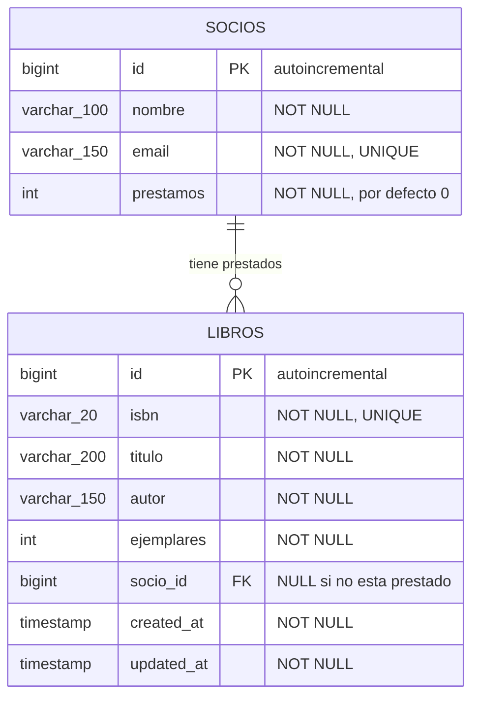
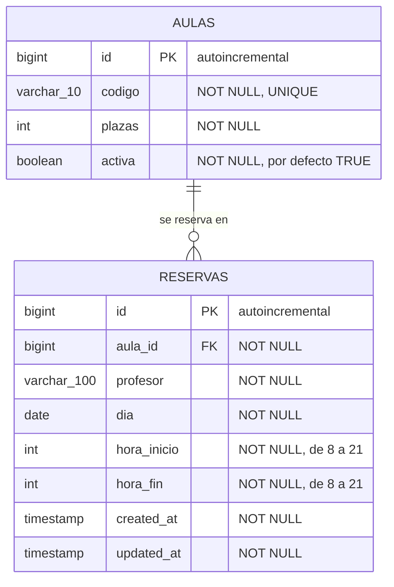
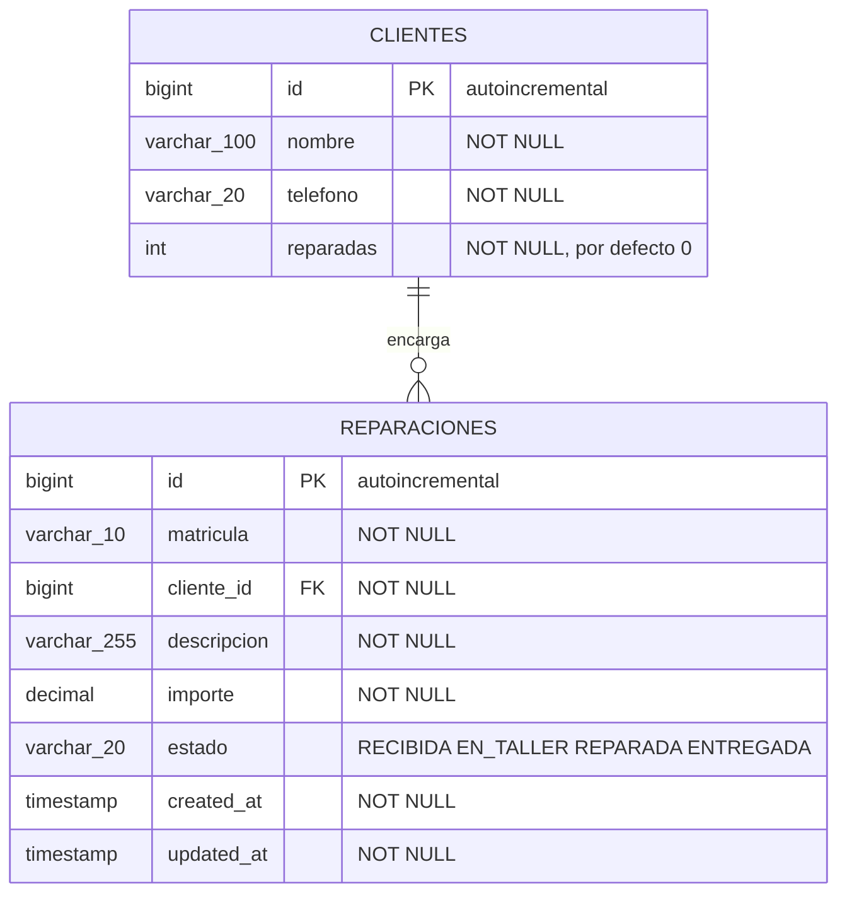
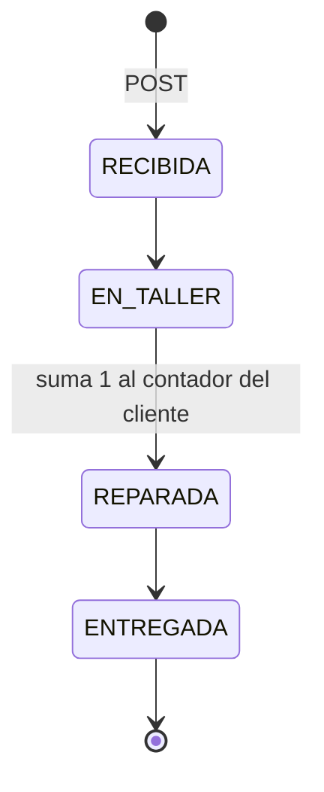

# Examen práctico — UT4 (RA5)

!!! danger "Esta página ES el examen"
    **El examen de la UT4 es uno de estos tres enunciados, con otro dominio.** Mismo formato, misma estructura, misma valoración y **el mismo material entregado**.

    Resuelve los tres y habrás hecho el examen tres veces.

| | Enunciado | Tablas |
|:-:|---|:-:|
| **E1** | [Biblioteca](#e1-biblioteca) | 2 |
| **E2** | [Reservas de aulas](#e2-reservas-de-aulas) | 2 |
| **E3** | [Taller mecánico](#e3-taller-mecanico) | 2 |

---

## Material entregado

Recibes un proyecto que **arranca y se conecta a la base de datos**, con estos ficheros ya escritos:

| | Fichero | Estado |
|:-:|---|---|
| 1 | `pom.xml` | **Completo**: Web, Validation, JDBC, H2, DevTools |
| 2 | `application.properties` y los perfiles `dev` / `prod` / `test` | **Completos** |
| 3 | `schema.sql` | **Completo**: las tablas creadas |
| 4 | `data.sql` | **Completo**: datos de prueba |
| 5 | `…ApiApplication.java` | **Completa** |
| 6 | **`…Repository.java`** (la interfaz) | **Completa** |
| 7 | **`…RepositoryJdbc.java`** (la implementación con `JdbcClient`) | **Completa** |
| 8 | **`…RowMapper.java`** | **Completo** |
| 9 | **`…Mapper.java`** (el mapeador) | **Completo** |

!!! warning "El proyecto no compila al abrirlo"
    Los ficheros **6 a 9** usan clases que todavía no existen: el modelo y los DTOs. Esos ficheros **son la especificación de lo que tienes que escribir**, y no se pueden modificar.

## Material que entregas

| | Fichero | Contenido |
|:-:|---|---|
| 1 | La **estructura de paquetes** por capas | `models`, `dto`, `mappers`, `repositories`, `services`, `controllers`, `exceptions` |
| 2 | **El modelo** | Uno o dos `record` |
| 3 | **Los DTOs** | `Response`, `CreateRequest`, `UpdateRequest` y el de la operación, con sus validaciones |
| 4 | **Las excepciones** | Tres clases con `@ResponseStatus` |
| 5 | **El servicio** | Interfaz e implementación, con todas las reglas |
| 6 | **El controlador** | Los seis endpoints |
| 7 | **El manejador de errores** | `@RestControllerAdvice` |

Se entrega comprimido, **sin `target/` ni `datos/`**, con un `README.md` de diez líneas que diga cómo arrancar.

## Condiciones

| | |
|---|---|
| Documentación permitida | **La chuleta de la unidad impresa**. Nada más |
| Defensa oral | **No hay**: se corrige el código y la salida de las peticiones |
| Nota mínima | **5,0**, y el bloque de capas no puede quedar en 0 |

---

# E1 · Biblioteca

Una API REST para gestionar los libros de una biblioteca y sus préstamos a socios.

## 1 · Modelo de datos



```sql title="schema.sql · entregado"
CREATE TABLE IF NOT EXISTS socios (
    id          BIGINT AUTO_INCREMENT PRIMARY KEY,
    nombre      VARCHAR(100) NOT NULL,
    email       VARCHAR(150) NOT NULL UNIQUE,
    prestamos   INT          NOT NULL DEFAULT 0
);

CREATE TABLE IF NOT EXISTS libros (
    id          BIGINT AUTO_INCREMENT PRIMARY KEY,
    isbn        VARCHAR(20)  NOT NULL UNIQUE,
    titulo      VARCHAR(200) NOT NULL,
    autor       VARCHAR(150) NOT NULL,
    ejemplares  INT          NOT NULL,
    socio_id    BIGINT       NULL,
    created_at  TIMESTAMP    NOT NULL DEFAULT CURRENT_TIMESTAMP,
    updated_at  TIMESTAMP    NOT NULL DEFAULT CURRENT_TIMESTAMP,
    CONSTRAINT fk_libro_socio FOREIGN KEY (socio_id) REFERENCES socios (id)
);
```

## 2 · Código entregado

```java title="libros/repositories/LibrosRepository.java"
public interface LibrosRepository {
    List<Libro> findAll();
    List<Libro> findByAutorContainsIgnoreCase(String autor);
    Optional<Libro> findById(Long id);
    Optional<Libro> findByIsbn(String isbn);
    Libro save(Libro libro);
    Libro update(Libro libro);
    void deleteById(Long id);

    /** Descuenta un ejemplar SOLO si queda alguno. Devuelve las filas afectadas. */
    int descontarEjemplar(Long id);
    /** Suma uno al contador de prestamos del socio. */
    int sumarPrestamo(Long socioId);
    /** Cuantos libros tiene prestados ese socio. */
    long contarPrestadosDe(Long socioId);
    boolean existsSocioById(Long socioId);
}
```

```java title="libros/repositories/LibrosRepositoryJdbc.java"
@Repository
public class LibrosRepositoryJdbc implements LibrosRepository {

    private static final String SELECT = "SELECT * FROM libros";

    private final JdbcClient jdbc;
    private final RowMapper<Libro> rowMapper = new LibroRowMapper();

    public LibrosRepositoryJdbc(JdbcClient jdbc) { this.jdbc = jdbc; }

    @Override
    public List<Libro> findAll() {
        return jdbc.sql(SELECT + " ORDER BY id").query(rowMapper).list();
    }

    @Override
    public List<Libro> findByAutorContainsIgnoreCase(String autor) {
        return jdbc.sql(SELECT + " WHERE UPPER(autor) LIKE UPPER(:autor) ORDER BY id")
                .param("autor", "%" + autor + "%")
                .query(rowMapper).list();
    }

    @Override
    public Optional<Libro> findById(Long id) {
        return jdbc.sql(SELECT + " WHERE id = :id")
                .param("id", id).query(rowMapper).optional();
    }

    @Override
    public Optional<Libro> findByIsbn(String isbn) {
        return jdbc.sql(SELECT + " WHERE isbn = :isbn")
                .param("isbn", isbn).query(rowMapper).optional();
    }

    @Override
    public Libro save(Libro libro) {
        var keys = new GeneratedKeyHolder();
        jdbc.sql("""
                INSERT INTO libros (isbn, titulo, autor, ejemplares, socio_id,
                                    created_at, updated_at)
                VALUES (:isbn, :titulo, :autor, :ejemplares, :socioId,
                        CURRENT_TIMESTAMP, CURRENT_TIMESTAMP)
                """)
                .param("isbn", libro.isbn())
                .param("titulo", libro.titulo())
                .param("autor", libro.autor())
                .param("ejemplares", libro.ejemplares())
                .param("socioId", libro.socioId())
                .update(keys, "ID");             // ← el nombre de la columna, en MAYUSCULAS

        Number id = (Number) keys.getKeys().get("ID");
        if (id == null) {
            throw new IllegalStateException("La base de datos no ha devuelto la clave ID");
        }
        return findById(id.longValue()).orElseThrow();
    }

    @Override
    public Libro update(Libro libro) {
        jdbc.sql("""
                UPDATE libros
                   SET isbn = :isbn, titulo = :titulo, autor = :autor,
                       ejemplares = :ejemplares, socio_id = :socioId,
                       updated_at = CURRENT_TIMESTAMP
                 WHERE id = :id
                """)
                .param("id", libro.id())
                .param("isbn", libro.isbn())
                .param("titulo", libro.titulo())
                .param("autor", libro.autor())
                .param("ejemplares", libro.ejemplares())
                .param("socioId", libro.socioId())
                .update();
        return findById(libro.id()).orElseThrow();
    }

    @Override
    public void deleteById(Long id) {
        jdbc.sql("DELETE FROM libros WHERE id = :id").param("id", id).update();
    }

    @Override
    public int descontarEjemplar(Long id) {
        return jdbc.sql("""
                UPDATE libros SET ejemplares = ejemplares - 1,
                                  updated_at = CURRENT_TIMESTAMP
                 WHERE id = :id AND ejemplares >= 1
                """).param("id", id).update();
    }

    @Override
    public int sumarPrestamo(Long socioId) {
        return jdbc.sql("UPDATE socios SET prestamos = prestamos + 1 WHERE id = :id")
                .param("id", socioId).update();
    }

    @Override
    public long contarPrestadosDe(Long socioId) {
        return jdbc.sql("SELECT count(*) FROM libros WHERE socio_id = :id")
                .param("id", socioId).query(Long.class).single();
    }

    @Override
    public boolean existsSocioById(Long socioId) {
        return jdbc.sql("SELECT count(*) FROM socios WHERE id = :id")
                .param("id", socioId).query(Long.class).single() > 0;
    }
}
```

```java title="libros/repositories/LibroRowMapper.java"
@Component
public class LibroRowMapper implements RowMapper<Libro> {
    @Override
    public Libro mapRow(ResultSet rs, int n) throws SQLException {
        return new Libro(
                rs.getLong("id"),
                rs.getString("isbn"),
                rs.getString("titulo"),
                rs.getString("autor"),
                rs.getInt("ejemplares"),
                rs.getObject("socio_id", Long.class),
                rs.getTimestamp("created_at").toLocalDateTime(),
                rs.getTimestamp("updated_at").toLocalDateTime());
    }
}
```

```java title="libros/mappers/LibroMapper.java"
@Component
public class LibroMapper {

    public LibroResponse toResponse(Libro l) {
        return new LibroResponse(l.id(), l.isbn(), l.titulo(), l.autor(),
                l.ejemplares(), l.socioId(), l.createdAt(), l.updatedAt());
    }

    public List<LibroResponse> toResponse(List<Libro> libros) {
        return libros.stream().map(this::toResponse).toList();
    }

    public Libro toModel(LibroCreateRequest r) {
        return new Libro(null, r.isbn().trim(), r.titulo().trim(), r.autor().trim(),
                r.ejemplares(), null, LocalDateTime.now(), LocalDateTime.now());
    }

    public Libro parchear(Libro original, LibroUpdateRequest r) {
        return new Libro(
                original.id(),
                original.isbn(),
                r.titulo()     != null ? r.titulo().trim() : original.titulo(),
                r.autor()      != null ? r.autor().trim()  : original.autor(),
                r.ejemplares() != null ? r.ejemplares()    : original.ejemplares(),
                original.socioId(),
                original.createdAt(),
                LocalDateTime.now());
    }

    public Libro conSocio(Libro original, Long socioId) {
        return new Libro(original.id(), original.isbn(), original.titulo(),
                original.autor(), original.ejemplares(), socioId,
                original.createdAt(), LocalDateTime.now());
    }
}
```

## 3 · Clases que tienes que escribir

| Clase | Definida por |
|---|---|
| `record Libro` | `new Libro(id, isbn, titulo, autor, ejemplares, socioId, createdAt, updatedAt)` |
| `record LibroResponse` | Los mismos ocho componentes |
| `record LibroCreateRequest` | `isbn`, `titulo`, `autor`, `ejemplares` |
| `record LibroUpdateRequest` | `titulo`, `autor`, `ejemplares` |
| `record PrestamoRequest` | `socioId` |
| `LibroNotFoundException` · `LibroConflictException` · `LibroBadRequestException` | 404 · 409 · 400 |
| `LibrosService` + `LibrosServiceImpl` | Las reglas R1 a R6 |
| `LibrosRestController` | Los endpoints del punto 4 |
| `GlobalExceptionHandler` | Validación, JSON ilegible, tipo erróneo, integridad |

## 4 · Endpoints

| Método | Ruta | Devuelve |
|---|---|---|
| `GET` | `/api/v1/libros` · filtro opcional `?autor=` | **200** con la lista |
| `GET` | `/api/v1/libros/{id}` | **200** con el libro |
| `POST` | `/api/v1/libros` | **201** + cabecera `Location` |
| `PATCH` | `/api/v1/libros/{id}` | **200** con el libro actualizado |
| `DELETE` | `/api/v1/libros/{id}` | **204** sin cuerpo |
| `POST` | `/api/v1/libros/{id}/prestar` · cuerpo `{ "socioId": 3 }` | **200** con el libro prestado |

## 5 · Reglas

| | Regla | Código si no se cumple |
|:-:|---|:-:|
| **R1** | `isbn` obligatorio y de exactamente 13 caracteres · `titulo` y `autor` no vacíos · `ejemplares` mayor o igual que 0 | **400** |
| **R2** | El `isbn` no puede repetirse | **409** |
| **R3** | Un libro con `socio_id` no se puede borrar | **409** |
| **R4** | Prestar descuenta un ejemplar, y solo si queda alguno | **409** |
| **R5** | Un socio no puede tener más de **3** libros prestados a la vez | **409** |
| **R6** | Un `id` o un `socioId` que no existe, en cualquier endpoint | **404** |

**La operación de prestar hace tres cosas, y las tres o ninguna:** descontar un ejemplar, sumar 1 al contador del socio y poner el `socio_id` en el libro.

## 6 · Valoración orientativa

!!! info "Esta valoración es una referencia, no es definitiva"
    Sirve para saber dónde está el peso. La puntuación final es la [rúbrica común](#rubrica-comun), que es igual para los tres enunciados.

| | Qué se valora | Puntos |
|:-:|---|:-:|
| 1 | Estructura por capas, con el servicio detrás de una interfaz e inyección por constructor | **2,5** |
| 2 | El modelo y los DTOs compilan con el código entregado, sin tocarlo | **2,0** |
| 3 | Los seis endpoints, con sus códigos de estado y la cabecera `Location` | **2,0** |
| 4 | Las reglas R1 a R6, las excepciones propias y el manejador de errores | **2,5** |
| 5 | Uso correcto del código entregado y `@Transactional` en la operación de prestar | **1,0** |
| | | **10,0** |

## 7 · Cómo se comprueba

```bash
# Listado y filtro
curl -s localhost:8080/api/v1/libros | jq length
curl -s "localhost:8080/api/v1/libros?autor=delibes" | jq '[.[].titulo]'

# R1 · un ISBN de 5 caracteres
curl -i -X POST localhost:8080/api/v1/libros -H "Content-Type: application/json" \
  -d '{"isbn":"12345","titulo":"X","autor":"Y","ejemplares":1}'          # 400

# Alta correcta
curl -i -X POST localhost:8080/api/v1/libros -H "Content-Type: application/json" \
  -d '{"isbn":"9788437604947","titulo":"El Jarama","autor":"Ferlosio","ejemplares":2}'
#                                                                        201 + Location

# R2 · el mismo ISBN otra vez                                             409
# R4 · prestar hasta agotar los ejemplares; el ultimo                     409
# R5 · cuatro prestamos al mismo socio; el cuarto                        409
# R3 · borrar un libro prestado                                           409
# R6 · GET /api/v1/libros/9999                                            404
```

---

## Notas del E1

!!! success "Lo que mide cada regla"
    **La R4 y la R5 son el ejercicio.** El repositorio entregado ya trae `descontarEjemplar` con el `UPDATE … WHERE ejemplares >= 1`, así que lo que se valora es:

    - que **mires el valor devuelto** (`== 0` significa que no quedaban) en lugar de leer, comprobar y escribir;
    - que la R5 se compruebe **antes** de tocar nada, con `contarPrestadosDe`;
    - que las tres escrituras de prestar vayan en un método con **`@Transactional`**.

!!! warning "Dos errores habituales en este enunciado"
    **1 · El `socioId` del modelo admite `null`.** Un libro sin prestar no tiene socio, así que el componente es `Long` y no `long`. El `RowMapper` entregado usa `rs.getObject("socio_id", Long.class)` justo por eso.

    **2 · El `LibroCreateRequest` no lleva `socioId`.** Un libro se crea sin prestar: el mapeador entregado pasa `null` en esa posición. Si tu DTO de creación acepta un socio, el cliente puede dar de alta un libro ya prestado sin pasar por ninguna regla.

---

# E2 · Reservas de aulas

Una API REST para reservar aulas por tramos horarios.

## 1 · Modelo de datos



```sql title="schema.sql · entregado"
CREATE TABLE IF NOT EXISTS aulas (
    id          BIGINT AUTO_INCREMENT PRIMARY KEY,
    codigo      VARCHAR(10)  NOT NULL UNIQUE,
    plazas      INT          NOT NULL,
    activa      BOOLEAN      NOT NULL DEFAULT TRUE
);

CREATE TABLE IF NOT EXISTS reservas (
    id          BIGINT AUTO_INCREMENT PRIMARY KEY,
    aula_id     BIGINT       NOT NULL,
    profesor    VARCHAR(100) NOT NULL,
    dia         DATE         NOT NULL,
    hora_inicio INT          NOT NULL,
    hora_fin    INT          NOT NULL,
    created_at  TIMESTAMP    NOT NULL DEFAULT CURRENT_TIMESTAMP,
    updated_at  TIMESTAMP    NOT NULL DEFAULT CURRENT_TIMESTAMP,
    CONSTRAINT fk_reserva_aula FOREIGN KEY (aula_id) REFERENCES aulas (id)
);
```

## 2 · Código entregado

```java title="reservas/repositories/ReservasRepository.java"
public interface ReservasRepository {
    List<Reserva> findAll();
    List<Reserva> findByDia(LocalDate dia);
    List<Reserva> findByAulaId(Long aulaId);
    Optional<Reserva> findById(Long id);
    Reserva save(Reserva reserva);
    Reserva update(Reserva reserva);
    void deleteById(Long id);

    /** Las reservas de esa aula y ese dia, para comprobar los solapes. */
    List<Reserva> findByAulaIdAndDia(Long aulaId, LocalDate dia);
    /** Las reservas de un profesor un dia, para el tope diario. */
    long contarDe(String profesor, LocalDate dia);
    Optional<Aula> findAulaById(Long aulaId);
}
```

```java title="reservas/repositories/ReservasRepositoryJdbc.java"
@Repository
public class ReservasRepositoryJdbc implements ReservasRepository {

    private static final String SELECT = "SELECT * FROM reservas";

    private final JdbcClient jdbc;
    private final RowMapper<Reserva> rowMapper = new ReservaRowMapper();
    private final RowMapper<Aula> aulaRowMapper = new AulaRowMapper();

    public ReservasRepositoryJdbc(JdbcClient jdbc) { this.jdbc = jdbc; }

    @Override
    public List<Reserva> findAll() {
        return jdbc.sql(SELECT + " ORDER BY dia, hora_inicio").query(rowMapper).list();
    }

    @Override
    public List<Reserva> findByDia(LocalDate dia) {
        return jdbc.sql(SELECT + " WHERE dia = :dia ORDER BY hora_inicio")
                .param("dia", dia).query(rowMapper).list();
    }

    @Override
    public List<Reserva> findByAulaId(Long aulaId) {
        return jdbc.sql(SELECT + " WHERE aula_id = :aulaId ORDER BY dia, hora_inicio")
                .param("aulaId", aulaId).query(rowMapper).list();
    }

    @Override
    public Optional<Reserva> findById(Long id) {
        return jdbc.sql(SELECT + " WHERE id = :id")
                .param("id", id).query(rowMapper).optional();
    }

    @Override
    public Reserva save(Reserva r) {
        var keys = new GeneratedKeyHolder();
        jdbc.sql("""
                INSERT INTO reservas (aula_id, profesor, dia, hora_inicio, hora_fin,
                                      created_at, updated_at)
                VALUES (:aulaId, :profesor, :dia, :horaInicio, :horaFin,
                        CURRENT_TIMESTAMP, CURRENT_TIMESTAMP)
                """)
                .param("aulaId", r.aulaId())
                .param("profesor", r.profesor())
                .param("dia", r.dia())
                .param("horaInicio", r.horaInicio())
                .param("horaFin", r.horaFin())
                .update(keys, "ID");             // ← el nombre de la columna, en MAYUSCULAS

        Number id = (Number) keys.getKeys().get("ID");
        if (id == null) {
            throw new IllegalStateException("La base de datos no ha devuelto la clave ID");
        }
        return findById(id.longValue()).orElseThrow();
    }

    @Override
    public Reserva update(Reserva r) {
        jdbc.sql("""
                UPDATE reservas
                   SET aula_id = :aulaId, profesor = :profesor, dia = :dia,
                       hora_inicio = :horaInicio, hora_fin = :horaFin,
                       updated_at = CURRENT_TIMESTAMP
                 WHERE id = :id
                """)
                .param("id", r.id())
                .param("aulaId", r.aulaId())
                .param("profesor", r.profesor())
                .param("dia", r.dia())
                .param("horaInicio", r.horaInicio())
                .param("horaFin", r.horaFin())
                .update();
        return findById(r.id()).orElseThrow();
    }

    @Override
    public void deleteById(Long id) {
        jdbc.sql("DELETE FROM reservas WHERE id = :id").param("id", id).update();
    }

    @Override
    public List<Reserva> findByAulaIdAndDia(Long aulaId, LocalDate dia) {
        return jdbc.sql(SELECT + " WHERE aula_id = :aulaId AND dia = :dia")
                .param("aulaId", aulaId).param("dia", dia)
                .query(rowMapper).list();
    }

    @Override
    public long contarDe(String profesor, LocalDate dia) {
        return jdbc.sql("""
                SELECT count(*) FROM reservas
                 WHERE UPPER(profesor) = UPPER(:profesor) AND dia = :dia
                """)
                .param("profesor", profesor).param("dia", dia)
                .query(Long.class).single();
    }

    @Override
    public Optional<Aula> findAulaById(Long aulaId) {
        return jdbc.sql("SELECT * FROM aulas WHERE id = :id")
                .param("id", aulaId).query(aulaRowMapper).optional();
    }
}
```

```java title="reservas/repositories/ReservaRowMapper.java y AulaRowMapper.java"
@Component
public class ReservaRowMapper implements RowMapper<Reserva> {
    @Override
    public Reserva mapRow(ResultSet rs, int n) throws SQLException {
        return new Reserva(
                rs.getLong("id"),
                rs.getLong("aula_id"),
                rs.getString("profesor"),
                rs.getDate("dia").toLocalDate(),
                rs.getInt("hora_inicio"),
                rs.getInt("hora_fin"),
                rs.getTimestamp("created_at").toLocalDateTime(),
                rs.getTimestamp("updated_at").toLocalDateTime());
    }
}

@Component
public class AulaRowMapper implements RowMapper<Aula> {
    @Override
    public Aula mapRow(ResultSet rs, int n) throws SQLException {
        return new Aula(rs.getLong("id"), rs.getString("codigo"),
                        rs.getInt("plazas"), rs.getBoolean("activa"));
    }
}
```

```java title="reservas/mappers/ReservaMapper.java"
@Component
public class ReservaMapper {

    /** El Response lleva el CODIGO del aula, no su id. */
    public ReservaResponse toResponse(Reserva r, String aulaCodigo) {
        return new ReservaResponse(r.id(), aulaCodigo, r.profesor(), r.dia(),
                r.horaInicio(), r.horaFin(), r.createdAt(), r.updatedAt());
    }

    public Reserva toModel(ReservaCreateRequest r) {
        return new Reserva(null, r.aulaId(), r.profesor().trim(), r.dia(),
                r.horaInicio(), r.horaFin(), LocalDateTime.now(), LocalDateTime.now());
    }

    public Reserva parchear(Reserva original, ReservaUpdateRequest r) {
        return new Reserva(
                original.id(),
                original.aulaId(),
                r.profesor()   != null ? r.profesor().trim() : original.profesor(),
                r.dia()        != null ? r.dia()             : original.dia(),
                r.horaInicio() != null ? r.horaInicio()      : original.horaInicio(),
                r.horaFin()    != null ? r.horaFin()         : original.horaFin(),
                original.createdAt(),
                LocalDateTime.now());
    }
}
```

## 3 · Clases que tienes que escribir

| Clase | Definida por |
|---|---|
| `record Reserva` | `new Reserva(id, aulaId, profesor, dia, horaInicio, horaFin, createdAt, updatedAt)` |
| `record Aula` | `new Aula(id, codigo, plazas, activa)` |
| `record ReservaResponse` | `id`, `aulaCodigo`, `profesor`, `dia`, `horaInicio`, `horaFin`, `createdAt`, `updatedAt` |
| `record ReservaCreateRequest` | `aulaId`, `profesor`, `dia`, `horaInicio`, `horaFin` |
| `record ReservaUpdateRequest` | `profesor`, `dia`, `horaInicio`, `horaFin` |
| `ReservaNotFoundException` · `ReservaConflictException` · `ReservaBadRequestException` | 404 · 409 · 400 |
| `ReservasService` + `ReservasServiceImpl` | Las reglas R1 a R6 |
| `ReservasRestController` | Los endpoints del punto 4 |
| `GlobalExceptionHandler` | Validación, JSON ilegible, tipo erróneo, integridad |

## 4 · Endpoints

| Método | Ruta | Devuelve |
|---|---|---|
| `GET` | `/api/v1/reservas` · filtros opcionales `?dia=2026-11-04` y `?aulaId=` | **200** con la lista |
| `GET` | `/api/v1/reservas/{id}` | **200** con la reserva |
| `POST` | `/api/v1/reservas` | **201** + cabecera `Location` |
| `PATCH` | `/api/v1/reservas/{id}` | **200** con la reserva actualizada |
| `DELETE` | `/api/v1/reservas/{id}` | **204** sin cuerpo |
| `GET` | `/api/v1/aulas/{id}/reservas` · filtro opcional `?dia=` | **200** con la lista |

## 5 · Reglas

| | Regla | Código si no se cumple |
|:-:|---|:-:|
| **R1** | `profesor` no vacío · `dia` obligatorio · `horaInicio` y `horaFin` entre 8 y 21 | **400** |
| **R2** | `horaFin` estrictamente mayor que `horaInicio` | **409** |
| **R3** | El aula tiene que existir y estar **activa** | **404** / **409** |
| **R4** | No puede haber **dos reservas solapadas** en la misma aula y el mismo día | **409** |
| **R5** | Un profesor no puede tener más de **2** reservas el mismo día | **409** |
| **R6** | Un `id` que no existe, en cualquier endpoint | **404** |

**Para la R4**, dos tramos `[inicioA, finA)` y `[inicioB, finB)` se solapan si y solo si `inicioA < finB && inicioB < finA`. El PATCH que cambia el día o las horas vuelve a comprobarla.

## 6 · Valoración orientativa

!!! info "Esta valoración es una referencia, no es definitiva"
    Sirve para saber dónde está el peso. La puntuación final es la [rúbrica común](#rubrica-comun), que es igual para los tres enunciados.

| | Qué se valora | Puntos |
|:-:|---|:-:|
| 1 | Estructura por capas, con el servicio detrás de una interfaz e inyección por constructor | **2,5** |
| 2 | Los modelos y los DTOs compilan con el código entregado, sin tocarlo | **2,0** |
| 3 | Los seis endpoints, con sus códigos de estado y la cabecera `Location` | **2,0** |
| 4 | Las reglas R1 a R6, con **la R4 correcta en los cinco casos** de la tabla de abajo | **2,5** |
| 5 | Uso correcto del código entregado, incluido el `aulaCodigo` del `Response` | **1,0** |
| | | **10,0** |

## 7 · Cómo se comprueba

**La R4 se prueba con estos cinco casos**, partiendo de una reserva existente de 9 a 11 en el aula 1:

| Nueva reserva | Resultado esperado |
|---|:-:|
| 11 → 13 | **201**: una acaba cuando la otra empieza |
| 10 → 12 | **409** |
| 8 → 14 | **409** |
| 9 → 11 | **409** |
| 12 → 13 | **201** |

```bash
# Punto de partida: reserva de 9 a 11 en el aula 1 el 2026-11-04
curl -i -X POST localhost:8080/api/v1/reservas -H "Content-Type: application/json" \
  -d '{"aulaId":1,"profesor":"Ana","dia":"2026-11-04","horaInicio":9,"horaFin":11}'

# Los cinco casos de la tabla, cambiando horaInicio y horaFin

# R1 · hora 25                                                            400
# R2 · horaFin 9 con horaInicio 11                                        409
# R3 · un aula inactiva                                                   409
# R5 · tres reservas del mismo profesor el mismo dia; la tercera          409
# R6 · GET /api/v1/reservas/9999                                          404
```

---

## Notas del E2

!!! danger "El `<=` es lo que suspende este enunciado"
    Con `<=` en lugar de `<`, una reserva de 9 a 11 bloquea otra de 11 a 13, y **las clases consecutivas en la misma aula dejan de poder reservarse**.

    Es un error que no da ningún fallo: la API responde 409 con un mensaje correcto, y hay que probar el primer caso de la tabla para verlo.

!!! success "Por qué el `Response` lleva el código del aula"
    El mapeador entregado recibe **dos** argumentos:

    ```java
    public ReservaResponse toResponse(Reserva r, String aulaCodigo)
    ```

    Eso obliga a que **el servicio busque el aula** antes de mapear, con `findAulaById`. Es una decisión de diseño que viene dada: al cliente se le devuelve `"LAB-2"`, que es lo que entiende, en lugar de un `aula_id` que no le dice nada.

    Y de paso resuelve la R3: si el aula no existe, ese `findAulaById` ya devuelve vacío.

---

# E3 · Taller mecánico

Una API REST para las reparaciones de un taller, con su flujo de estados.

## 1 · Modelo de datos



**El flujo de estados es lineal y no admite saltos ni vuelta atrás:**



```sql title="schema.sql · entregado"
CREATE TABLE IF NOT EXISTS clientes (
    id          BIGINT AUTO_INCREMENT PRIMARY KEY,
    nombre      VARCHAR(100) NOT NULL,
    telefono    VARCHAR(20)  NOT NULL,
    reparadas   INT          NOT NULL DEFAULT 0
);

CREATE TABLE IF NOT EXISTS reparaciones (
    id          BIGINT AUTO_INCREMENT PRIMARY KEY,
    matricula   VARCHAR(10)   NOT NULL,
    cliente_id  BIGINT        NOT NULL,
    descripcion VARCHAR(255)  NOT NULL,
    importe     DECIMAL(10,2) NOT NULL,
    estado      VARCHAR(20)   NOT NULL,
    created_at  TIMESTAMP     NOT NULL DEFAULT CURRENT_TIMESTAMP,
    updated_at  TIMESTAMP     NOT NULL DEFAULT CURRENT_TIMESTAMP,
    CONSTRAINT fk_reparacion_cliente FOREIGN KEY (cliente_id) REFERENCES clientes (id)
);
```

## 2 · Código entregado

```java title="reparaciones/repositories/ReparacionesRepository.java"
public interface ReparacionesRepository {
    List<Reparacion> findAll();
    List<Reparacion> findByEstado(String estado);
    List<Reparacion> findByMatriculaIgnoreCase(String matricula);
    Optional<Reparacion> findById(Long id);
    Reparacion save(Reparacion reparacion);
    Reparacion update(Reparacion reparacion);
    void deleteById(Long id);

    /** Cambia el estado SOLO si el actual es el esperado. Devuelve las filas afectadas. */
    int cambiarEstado(Long id, String estadoActual, String estadoNuevo);
    /** Suma uno al contador de reparaciones terminadas del cliente. */
    int sumarReparada(Long clienteId);
    boolean existsClienteById(Long clienteId);
}
```

```java title="reparaciones/repositories/ReparacionesRepositoryJdbc.java"
@Repository
public class ReparacionesRepositoryJdbc implements ReparacionesRepository {

    private static final String SELECT = "SELECT * FROM reparaciones";

    private final JdbcClient jdbc;
    private final RowMapper<Reparacion> rowMapper = new ReparacionRowMapper();

    public ReparacionesRepositoryJdbc(JdbcClient jdbc) { this.jdbc = jdbc; }

    @Override
    public List<Reparacion> findAll() {
        return jdbc.sql(SELECT + " ORDER BY id").query(rowMapper).list();
    }

    @Override
    public List<Reparacion> findByEstado(String estado) {
        return jdbc.sql(SELECT + " WHERE estado = :estado ORDER BY id")
                .param("estado", estado).query(rowMapper).list();
    }

    @Override
    public List<Reparacion> findByMatriculaIgnoreCase(String matricula) {
        return jdbc.sql(SELECT + " WHERE UPPER(matricula) = UPPER(:matricula) ORDER BY id")
                .param("matricula", matricula).query(rowMapper).list();
    }

    @Override
    public Optional<Reparacion> findById(Long id) {
        return jdbc.sql(SELECT + " WHERE id = :id")
                .param("id", id).query(rowMapper).optional();
    }

    @Override
    public Reparacion save(Reparacion r) {
        var keys = new GeneratedKeyHolder();
        jdbc.sql("""
                INSERT INTO reparaciones (matricula, cliente_id, descripcion, importe,
                                          estado, created_at, updated_at)
                VALUES (:matricula, :clienteId, :descripcion, :importe,
                        :estado, CURRENT_TIMESTAMP, CURRENT_TIMESTAMP)
                """)
                .param("matricula", r.matricula())
                .param("clienteId", r.clienteId())
                .param("descripcion", r.descripcion())
                .param("importe", r.importe())
                .param("estado", r.estado())
                .update(keys, "ID");             // ← el nombre de la columna, en MAYUSCULAS

        Number id = (Number) keys.getKeys().get("ID");
        if (id == null) {
            throw new IllegalStateException("La base de datos no ha devuelto la clave ID");
        }
        return findById(id.longValue()).orElseThrow();
    }

    @Override
    public Reparacion update(Reparacion r) {
        jdbc.sql("""
                UPDATE reparaciones
                   SET descripcion = :descripcion, importe = :importe,
                       updated_at = CURRENT_TIMESTAMP
                 WHERE id = :id
                """)
                .param("id", r.id())
                .param("descripcion", r.descripcion())
                .param("importe", r.importe())
                .update();
        return findById(r.id()).orElseThrow();
    }

    @Override
    public void deleteById(Long id) {
        jdbc.sql("DELETE FROM reparaciones WHERE id = :id").param("id", id).update();
    }

    @Override
    public int cambiarEstado(Long id, String estadoActual, String estadoNuevo) {
        return jdbc.sql("""
                UPDATE reparaciones
                   SET estado = :nuevo, updated_at = CURRENT_TIMESTAMP
                 WHERE id = :id AND estado = :actual
                """)
                .param("id", id).param("actual", estadoActual).param("nuevo", estadoNuevo)
                .update();
    }

    @Override
    public int sumarReparada(Long clienteId) {
        return jdbc.sql("UPDATE clientes SET reparadas = reparadas + 1 WHERE id = :id")
                .param("id", clienteId).update();
    }

    @Override
    public boolean existsClienteById(Long clienteId) {
        return jdbc.sql("SELECT count(*) FROM clientes WHERE id = :id")
                .param("id", clienteId).query(Long.class).single() > 0;
    }
}
```

```java title="reparaciones/repositories/ReparacionRowMapper.java"
@Component
public class ReparacionRowMapper implements RowMapper<Reparacion> {
    @Override
    public Reparacion mapRow(ResultSet rs, int n) throws SQLException {
        return new Reparacion(
                rs.getLong("id"),
                rs.getString("matricula"),
                rs.getLong("cliente_id"),
                rs.getString("descripcion"),
                rs.getBigDecimal("importe"),
                rs.getString("estado"),
                rs.getTimestamp("created_at").toLocalDateTime(),
                rs.getTimestamp("updated_at").toLocalDateTime());
    }
}
```

```java title="reparaciones/mappers/ReparacionMapper.java"
@Component
public class ReparacionMapper {

    public ReparacionResponse toResponse(Reparacion r) {
        return new ReparacionResponse(r.id(), r.matricula(), r.clienteId(),
                r.descripcion(), r.importe(), r.estado(), r.createdAt(), r.updatedAt());
    }

    public List<ReparacionResponse> toResponse(List<Reparacion> reparaciones) {
        return reparaciones.stream().map(this::toResponse).toList();
    }

    /** El estado inicial NO lo decide el cliente: lo pone el mapeador. */
    public Reparacion toModel(ReparacionCreateRequest r) {
        return new Reparacion(null, r.matricula().trim().toUpperCase(), r.clienteId(),
                r.descripcion().trim(), r.importe(), "RECIBIDA",
                LocalDateTime.now(), LocalDateTime.now());
    }

    /** El PATCH no toca el estado ni la matricula. */
    public Reparacion parchear(Reparacion original, ReparacionUpdateRequest r) {
        return new Reparacion(
                original.id(),
                original.matricula(),
                original.clienteId(),
                r.descripcion() != null ? r.descripcion().trim() : original.descripcion(),
                r.importe()     != null ? r.importe()            : original.importe(),
                original.estado(),
                original.createdAt(),
                LocalDateTime.now());
    }
}
```

## 3 · Clases que tienes que escribir

| Clase | Definida por |
|---|---|
| `record Reparacion` | `new Reparacion(id, matricula, clienteId, descripcion, importe, estado, createdAt, updatedAt)` |
| `record ReparacionResponse` | Los mismos ocho componentes |
| `record ReparacionCreateRequest` | `matricula`, `clienteId`, `descripcion`, `importe` |
| `record ReparacionUpdateRequest` | `descripcion`, `importe` |
| `record EstadoRequest` | `estado` |
| `ReparacionNotFoundException` · `ReparacionConflictException` · `ReparacionBadRequestException` | 404 · 409 · 400 |
| `ReparacionesService` + `ReparacionesServiceImpl` | Las reglas R1 a R6 |
| `ReparacionesRestController` | Los endpoints del punto 4 |
| `GlobalExceptionHandler` | Validación, JSON ilegible, tipo erróneo, integridad |

## 4 · Endpoints

| Método | Ruta | Devuelve |
|---|---|---|
| `GET` | `/api/v1/reparaciones` · filtros opcionales `?estado=` y `?matricula=` | **200** con la lista |
| `GET` | `/api/v1/reparaciones/{id}` | **200** con la reparación |
| `POST` | `/api/v1/reparaciones` | **201** + cabecera `Location` |
| `PATCH` | `/api/v1/reparaciones/{id}` | **200** con la reparación actualizada |
| `DELETE` | `/api/v1/reparaciones/{id}` | **204** sin cuerpo |
| `POST` | `/api/v1/reparaciones/{id}/estado` · cuerpo `{ "estado": "EN_TALLER" }` | **200** con la reparación |

## 5 · Reglas

| | Regla | Código si no se cumple |
|:-:|---|:-:|
| **R1** | `matricula` obligatoria y de 6 a 10 caracteres · `descripcion` no vacía · `importe` mayor que 0 | **400** |
| **R2** | El `clienteId` tiene que existir | **404** |
| **R3** | Las transiciones de estado solo pueden ser `RECIBIDA → EN_TALLER → REPARADA → ENTREGADA`, una a una | **409** |
| **R4** | Al pasar a `REPARADA`, suma 1 al contador `reparadas` del cliente | **409** |
| **R5** | Una reparación en `EN_TALLER` no se puede borrar | **409** |
| **R6** | Un `id` que no existe, en cualquier endpoint | **404** |

**El estado inicial siempre es `RECIBIDA`** y lo pone el servidor. **Desde `ENTREGADA` no se puede ir a ningún sitio.** El cambio de estado de la R4 y el contador del cliente son una sola operación: las dos cosas o ninguna.

## 6 · Valoración orientativa

!!! info "Esta valoración es una referencia, no es definitiva"
    Sirve para saber dónde está el peso. La puntuación final es la [rúbrica común](#rubrica-comun), que es igual para los tres enunciados.

| | Qué se valora | Puntos |
|:-:|---|:-:|
| 1 | Estructura por capas, con el servicio detrás de una interfaz e inyección por constructor | **2,5** |
| 2 | El modelo y los DTOs compilan con el código entregado, y el `CreateRequest` **no** acepta `estado` | **2,0** |
| 3 | Los seis endpoints, con sus códigos de estado y la cabecera `Location` | **2,0** |
| 4 | Las reglas R1 a R6, con **las transiciones resueltas con una tabla** y no con una cadena de `if` | **2,5** |
| 5 | Uso correcto del código entregado y `@Transactional` en el cambio a `REPARADA` | **1,0** |
| | | **10,0** |

## 7 · Cómo se comprueba

**Las transiciones se prueban con estos casos**, partiendo de una reparación en `RECIBIDA`:

| Petición | Resultado esperado |
|---|:-:|
| `{"estado":"EN_TALLER"}` | **200** |
| `{"estado":"REPARADA"}` | **200**, y `reparadas` del cliente sube 1 |
| `{"estado":"EN_TALLER"}` | **409**: no hay vuelta atrás |
| `{"estado":"ENTREGADA"}` | **200** |
| `{"estado":"RECIBIDA"}` | **409**: desde `ENTREGADA` no hay salida |
| Desde `RECIBIDA`, `{"estado":"REPARADA"}` | **409**: no se salta `EN_TALLER` |

```bash
curl -i -X POST localhost:8080/api/v1/reparaciones -H "Content-Type: application/json" \
  -d '{"matricula":"1234ABC","clienteId":1,"descripcion":"Cambio de aceite","importe":89.90}'
#                                                                        201 + Location
# y el estado que devuelve es RECIBIDA

curl -s -X POST localhost:8080/api/v1/reparaciones/1/estado \
  -H "Content-Type: application/json" -d '{"estado":"EN_TALLER"}' | jq '.estado'

# R2 · un clienteId que no existe                                         404
# R5 · borrar una reparacion en EN_TALLER                                 409
# R1 · una matricula de 3 caracteres                                      400
# R4 · comprobar el contador del cliente antes y despues del paso a REPARADA
```

---

## Notas del E3

!!! success "Las transiciones, con una tabla y no con `if`"
    ```java
    private static final Map<String, String> SIGUIENTE = Map.of(
            "RECIBIDA",  "EN_TALLER",
            "EN_TALLER", "REPARADA",
            "REPARADA",  "ENTREGADA");
    ```

    `ENTREGADA` **no aparece como clave**, y eso es lo que hace que sea un estado final: `SIGUIENTE.get("ENTREGADA")` devuelve `null`, así que cualquier transición desde ahí es un 409 sin escribir una sola condición para ello.

    Una cadena de `if` hace lo mismo con quince líneas y deja fuera algún caso.

!!! warning "Dos decisiones ya tomadas en el código entregado"
    **1 · El `"RECIBIDA"` está en el `toModel`.** El estado inicial lo pone el servidor. Si tu `ReparacionCreateRequest` tiene un campo `estado`, el cliente puede dar de alta una reparación directamente como `ENTREGADA` y saltarse el flujo entero.

    **2 · El `parchear` no toca el estado.** El estado solo cambia por su endpoint, que es el que comprueba la transición. **Un PATCH no es una máquina de estados**, y si el tuyo deja cambiar el estado, la R3 se puede esquivar.

!!! info "Para qué sirve el `cambiarEstado` con el estado en el `WHERE`"
    ```sql
    UPDATE reparaciones SET estado = :nuevo WHERE id = :id AND estado = :actual
    ```

    Si entre que lees la reparación y la actualizas otra petición ya ha cambiado el estado, ese `UPDATE` afecta a **0 filas** y lo sabes. Es el mismo patrón que el `stock >= :cantidad` del proyecto B.

    Lo que se valora es que **mires el valor devuelto**, no que escribas el SQL: viene entregado.

---

# Rúbrica común

**Igual para los tres enunciados y para el examen.** Sobre 10 puntos, y cada ítem se comprueba con una acción concreta.

## Bloque 1 · Arquitectura por capas — 2,5 puntos

| | Se comprueba con | Puntos |
|---|---|:-:|
| 1.1 | `grep -rn "ResponseEntity\|HttpStatus\|@PathVariable" src/main/java/**/services/` → **vacío** | **1,0** |
| 1.2 | `grep -rni "SELECT\|INSERT\|UPDATE" src/main/java/**/controllers/ src/main/java/**/services/` → **vacío** | 0,5 |
| 1.3 | Los paquetes por capas y cada clase con su anotación, con **el servicio detrás de una interfaz** | 0,5 |
| 1.4 | Inyección **por constructor** y campos `final`. `grep -rn "@Autowired" src/main/java/` → **vacío** | 0,5 |

## Bloque 2 · El modelo y los DTOs — 2,0 puntos

| | Se comprueba con | Puntos |
|---|---|:-:|
| 2.1 | Los modelos son `record` **con los componentes y el orden que exige el código entregado**, y el proyecto compila sin tocarlo | **0,75** |
| 2.2 | **Tres DTOs distintos**, y el de creación **sin `id`, sin fechas y sin los campos que decide el servidor** | 0,5 |
| 2.3 | Ningún controlador devuelve ni recibe el modelo: **solo DTOs** | 0,5 |
| 2.4 | Las reglas de **formato** (R1) están **en el DTO** con Bean Validation, no en el servicio | 0,25 |

## Bloque 3 · API REST y códigos de estado — 2,0 puntos

| | Se comprueba con | Puntos |
|---|---|:-:|
| 3.1 | Los **seis endpoints** en la ruta indicada, con prefijo de versión | 0,5 |
| 3.2 | `GET` de un id inexistente → **404** (no 500 ni 200 con `null`) | 0,5 |
| 3.3 | `POST` correcto → **201** y cabecera **`Location`** | 0,5 |
| 3.4 | `DELETE` correcto → **204**; de un id inexistente → **404** | 0,25 |
| 3.5 | Los **filtros opcionales** funcionan por separado, y sin distinguir mayúsculas donde el enunciado lo pide | 0,25 |

## Bloque 4 · Reglas de negocio y errores — 2,5 puntos

| | Se comprueba con | Puntos |
|---|---|:-:|
| 4.1 | **Las reglas R1 a R6** se cumplen y devuelven el código indicado. *0,25 por regla* | **1,5** |
| 4.2 | **Excepciones propias** con `@ResponseStatus`. `grep -rn "ResponseStatusException" src/main/java/` → **vacío** | 0,4 |
| 4.3 | `@RestControllerAdvice` con validación, JSON ilegible, tipo erróneo e integridad, y el 400 **campo a campo** | 0,4 |
| 4.4 | La operación que toca las dos tablas lleva **`@Transactional`**, y se demuestra con el estado **antes y después de un fallo** | 0,2 |

## Bloque 5 · Uso correcto del código entregado — 1,0 punto

| | Se comprueba con | Puntos |
|---|---|:-:|
| 5.1 | **Ni una línea modificada** en el repositorio ni en el mapeador. `git diff` de esos ficheros → **vacío** | 0,4 |
| 5.2 | El servicio **mira el valor devuelto** por el método atómico (`== 0` → 409), en vez de leer, comprobar y escribir | 0,4 |
| 5.3 | El mapeo va **siempre** por el mapeador. `grep -rn "new .*Response(" src/main/java/**/services/ src/main/java/**/controllers/` → **vacío** | 0,2 |

## Penalizaciones

| | |
|---|:-:|
| Haber modificado el repositorio o el mapeador entregados para que encajen con tus clases | **−1,5** |
| Aceptar del cliente un dato que debe poner el servidor (estado inicial, contadores, fechas) | **−1,0** |
| Un `GET` que modifica datos | **−1,0** |
| El `.jar` no se genera o no arranca | **−1,0** |
| Verbos en las URL (`/crear`, `/listar`, `/borrar/{id}`) | **−0,5** |
| Credenciales o rutas absolutas escritas en el código | **−0,5** |
| `System.out.println` en lugar de un `Logger` | **−0,25** |

## Pesos y mínimos

| Bloque | Peso |
|---|:-:|
| 1 · Capas | 25 % |
| 2 · Modelo y DTOs | 20 % |
| 3 · API REST | 20 % |
| 4 · Reglas y errores | 25 % |
| 5 · Uso del código entregado | 10 % |

Se aprueba con **5,0**, y **el bloque 1 no puede quedar en 0**: el RA5 es literalmente *«separar el código de presentación de la lógica de negocio»*.

## Orden de corrección

1. `git diff` del repositorio y del mapeador → bloque 5.1 y la penalización mayor.
2. `./mvnw clean package` → que compile y genere el `.jar`.
3. **Los tres `grep`** de los bloques 1, 4.2 y 5.3.
4. `java -jar` y las peticiones del punto 7 del enunciado → bloques 3 y 4.1.
5. Un POST inválido → bloques 2.4 y 4.3.
6. Provocar el fallo de la operación de dos tablas y comparar las dos → bloque 4.4.
7. Leer los DTOs → bloques 2.2 y 2.3.
