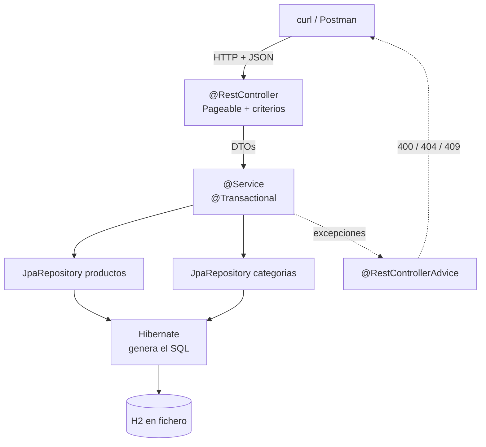

# 4. Dos proyectos paso a paso

Los **dos proyectos de la UT4**, migrados a Spring Data JPA. Mismas APIs, una fracción del código, y los dos se arrancan **con H2 en fichero y con PostgreSQL**.

| | Proyecto | Entidades | Lo nuevo |
|:-:|---|:-:|---|
| **A** | [Funkos y categorías](#proyecto-a-funkos-y-categorias) | 2 | Entidades, relación 1:N, repositorios sin cuerpo, borrado lógico, paginación |
| **B** | [La tienda](#proyecto-b-la-tienda) | 2 | El N+1 medido, la transacción de dos entidades y `@Version` |

| | Los dos, con los dos motores |
|---|---|
| **H2 en fichero** | Por defecto. Nada que instalar |
| **PostgreSQL** | `docker compose up -d` y `SPRING_PROFILES_ACTIVE=postgres`. [Cómo](#la-alternativa-postgresql) |

!!! success "Lo primero que vas a hacer"
    Borrar `FunkosRepositoryJdbc` y `FunkoRowMapper` de la [UT4](../ut4/05-proyectos.md) y poner en su lugar una interfaz **sin cuerpo**.

    | | Líneas del repositorio |
    |---|:-:|
    | UT3 · JDBC a mano | ~120 |
    | UT4 · `JdbcClient` + `RowMapper` | ~95 |
    | **UT5 · Spring Data JPA** | **0** |

    Y comprobar que **el controlador, el servicio, los DTOs y los tests de capa web no se tocan**.

---

## Lo que comparten los dos proyectos

### Las dependencias

```xml title="pom.xml — los cambios respecto a la UT4"
<!-- FUERA: lo trae data-jpa dentro -->
<!-- spring-boot-starter-jdbc -->

<!-- DENTRO -->
<dependency>
  <groupId>org.springframework.boot</groupId>
  <artifactId>spring-boot-starter-data-jpa</artifactId>
</dependency>

<!-- Se queda igual -->
<dependency>
  <groupId>com.h2database</groupId>
  <artifactId>h2</artifactId>
  <scope>runtime</scope>
</dependency>

<!-- NUEVO: el otro motor. Conviven sin problema -->
<dependency>
  <groupId>org.postgresql</groupId>
  <artifactId>postgresql</artifactId>
  <scope>runtime</scope>
</dependency>
```

!!! success "Los dos motores a la vez, y sin `if` en ningún sitio"
    **Los dos proyectos se hacen con H2 en fichero y se arrancan también contra PostgreSQL**, cambiando una variable de entorno. Ni una línea de Java cambia.

    Eso es lo que compra el ORM, y es el experimento más convincente de la unidad: el mismo código, dos motores distintos.

!!! info "Quién es quién"
    - **JPA** es la **especificación**: un estándar de Java, solo interfaces y anotaciones.
    - **Hibernate** es la **implementación** que Spring Boot trae. **Es quien escribe el SQL** que en la UT4 escribías tú.
    - **Spring Data JPA** es una capa encima que **genera los repositorios** a partir del nombre de los métodos.

    Cuando en el log sale `Hibernate: select …`, es el de en medio trabajando. Y ese SQL es el que escribiste a mano en la UT4: compáralos.

### La configuración

```properties title="application.properties"
spring.application.name=funkos-api

server.port=${PORT:8080}
api.path=/api
api.version=v1

### H2 en FICHERO
spring.datasource.url=${DB_URL:jdbc:h2:file:./datos/funkos;AUTO_SERVER=TRUE}
spring.datasource.username=${DB_USER:sa}
spring.datasource.password=${DB_PASSWORD:}

### Lo IMPORTANTE de este fichero
spring.jpa.open-in-view=false

spring.h2.console.enabled=true
spring.h2.console.path=/h2-console

server.error.include-message=always
server.error.include-binding-errors=always
server.error.include-stacktrace=never

logging.level.es.iesx=DEBUG
spring.profiles.active=${SPRING_PROFILES_ACTIVE:dev}
```

=== "dev"

    ```properties title="application-dev.properties"
    spring.jpa.hibernate.ddl-auto=update
    spring.jpa.show-sql=true
    spring.jpa.properties.hibernate.format_sql=true

    spring.jpa.defer-datasource-initialization=true
    spring.sql.init.mode=always
    spring.sql.init.data-locations=classpath:data.sql
    ```

=== "prod"

    ```properties title="application-prod.properties"
    spring.jpa.hibernate.ddl-auto=validate
    spring.jpa.show-sql=false
    spring.sql.init.mode=never
    spring.h2.console.enabled=false

    logging.level.root=WARN
    server.error.include-message=never
    server.error.include-stacktrace=never
    ```

=== "test"

    ```properties title="src/test/resources/application-test.properties"
    spring.datasource.url=jdbc:h2:mem:test;DB_CLOSE_DELAY=-1
    spring.jpa.hibernate.ddl-auto=create-drop
    spring.jpa.defer-datasource-initialization=true
    spring.sql.init.mode=always
    logging.level.root=WARN
    ```

### La alternativa: PostgreSQL

**H2 en fichero sirve para desarrollar; PostgreSQL es lo que hay en producción.** Los dos proyectos se arrancan contra los dos, y la única diferencia es el perfil.

=== "1 · Levantar el servidor"

    ```yaml title="compose.yaml — en la raíz del proyecto"
    services:
      postgres:
        image: postgres:17-alpine
        container_name: dwes-postgres
        environment:
          POSTGRES_DB: funkos
          POSTGRES_USER: dwes
          POSTGRES_PASSWORD: dwes2026
        ports:
          - "5432:5432"
        volumes:
          - postgres-datos:/var/lib/postgresql/data
        healthcheck:
          test: ["CMD-SHELL", "pg_isready -U dwes -d funkos"]
          interval: 5s
          retries: 5

    volumes:
      postgres-datos:
    ```

    ```bash
    docker compose up -d
    docker compose ps                     # healthy
    docker compose logs -f postgres       # si algo no arranca
    ```

    !!! info "El `volumes` es lo que hace que los datos persistan"
        Sin él, `docker compose down` se lleva la base entera. Con él, los datos sobreviven a parar y levantar el contenedor — igual que el fichero de H2.

=== "2 · El perfil"

    ```properties title="application-postgres.properties"
    spring.datasource.url=${DB_URL:jdbc:postgresql://localhost:5432/funkos}
    spring.datasource.username=${DB_USER:dwes}
    spring.datasource.password=${DB_PASSWORD:dwes2026}
    spring.datasource.driver-class-name=org.postgresql.Driver

    spring.jpa.hibernate.ddl-auto=update
    spring.jpa.show-sql=true
    spring.jpa.properties.hibernate.format_sql=true

    # Las tablas las crea Hibernate; los datos, data.sql
    spring.jpa.defer-datasource-initialization=true
    spring.sql.init.mode=always

    # La consola de H2 no existe aquí
    spring.h2.console.enabled=false
    ```

=== "3 · Arrancar"

    ```bash
    # Con H2 en fichero (lo de siempre)
    ./mvnw spring-boot:run

    # Con PostgreSQL
    SPRING_PROFILES_ACTIVE=postgres ./mvnw spring-boot:run
    ```

    ```bash
    # Y el .jar, igual
    java -jar target/funkos-api-0.0.1-SNAPSHOT.jar --spring.profiles.active=postgres
    ```

    En IntelliJ: **Run → Edit Configurations → Active profiles: `postgres`**, o la variable de entorno `SPRING_PROFILES_ACTIVE=postgres`.

=== "4 · Mirar los datos"

    ```bash
    docker compose exec postgres psql -U dwes -d funkos

    \dt                              -- las tablas que ha creado Hibernate
    \d funkos                        -- el detalle de una
    SELECT * FROM funkos LIMIT 5;
    \q
    ```

    **Fíjate en lo que ha creado Hibernate:** los tipos, los índices y la clave ajena con el nombre que le pusiste en `@ForeignKey`. Eso es el `schema.sql` que no has escrito.

!!! success "Lo que de verdad cambia entre los dos motores"
    | | H2 en fichero | PostgreSQL |
    |---|---|---|
    | **El Java** | — | **Ni una línea** |
    | Dónde viven los datos | `./datos/funkos.mv.db` | En el contenedor, en un *volume* |
    | Arrancar | Nada: va dentro de la aplicación | `docker compose up -d` |
    | Mirar los datos | `/h2-console` | `psql` o cualquier cliente SQL |
    | `BIGINT AUTO_INCREMENT` | Así se llama | **`BIGSERIAL`** |
    | `TIMESTAMP` | Así se llama | `timestamp(6) without time zone` |
    | Mayúsculas en los nombres | Las convierte a mayúsculas | **Las convierte a minúsculas** |
    | `MERGE … KEY(id)` del `data.sql` | Funciona | **No existe**: hace falta otra sentencia |

    **Las dos últimas filas son las que dan guerra**, y son el motivo de este apartado: el ORM te abstrae del SQL que genera Hibernate, **pero no del SQL que escribes tú**.

!!! danger "El `data.sql` sí hay que tocarlo"
    `MERGE INTO … KEY(id)` es de H2. El equivalente de PostgreSQL es:

    ```sql title="data-postgres.sql"
    INSERT INTO categorias (id, nombre, is_deleted, created_at, updated_at) VALUES
      (1, 'DISNEY', false, CURRENT_TIMESTAMP, CURRENT_TIMESTAMP),
      (2, 'MARVEL', false, CURRENT_TIMESTAMP, CURRENT_TIMESTAMP)
    ON CONFLICT (id) DO NOTHING;

    -- Y poner la secuencia en su sitio, o el primer INSERT por la API choca
    SELECT setval('categorias_id_seq', (SELECT COALESCE(MAX(id), 0) + 1 FROM categorias), false);
    ```

    ```properties title="application-postgres.properties"
    spring.sql.init.data-locations=classpath:data-postgres.sql
    ```

    | | H2 | PostgreSQL |
    |---|---|---|
    | Insertar sin duplicar | `MERGE … KEY(id)` | `INSERT … ON CONFLICT (id) DO NOTHING` |
    | Recolocar el contador | `ALTER TABLE … ALTER COLUMN id RESTART WITH 7` | `SELECT setval('tabla_id_seq', …)` |

    **Sin el `setval`, el primer `POST` de la API falla** con `duplicate key value violates unique constraint`: la secuencia sigue en 1 y los ids 1 a 6 ya están ocupados. Es el error más desconcertante del cambio de motor, y ahora ya sabes de dónde viene.

!!! warning "`ddl-auto=update` sigue sin saber renombrar, y en PostgreSQL duele más"
    En H2 borras el fichero `./datos/` y vuelves a empezar. Aquí:

    ```bash
    docker compose down -v      # el -v borra el volume, y con él los datos
    docker compose up -d
    ```

    **Y en producción eso no se puede hacer.** Por eso `prod` lleva `validate` y las migraciones se hacen con una herramienta (Flyway o Liquibase), que no entra en esta unidad pero es el siguiente paso natural.

### Las opciones de `ddl-auto`, y cuál elegir

| Valor | Qué hace | Dónde |
|---|---|---|
| `none` | Nada | Producción con migraciones |
| `validate` | **Comprueba** el esquema; si no cuadra, **no arranca** | **prod** |
| `update` | Añade lo que falta, **nunca borra** | **dev** |
| `create` | Borra y crea al arrancar | — |
| `create-drop` | Borra y crea al arrancar, y borra al parar | **test** |

!!! danger "`update` en `dev`, no `create-drop`"
    La base de datos es un **fichero** y la gracia es que los datos persistan. `create-drop` los tiraría en cada reinicio.

    En los tests sí se usa `create-drop`, porque allí la base es `mem:` y se quiere limpia.

    Y el límite de `update`: **no sabe renombrar ni borrar**. Si cambias un campo de nombre, crea la columna nueva y **deja la vieja con los datos dentro**. Para producción, `validate` y migraciones.

!!! danger "`spring.jpa.open-in-view=false` — ponlo y no lo quites"
    Viene **activado**, y Spring Boot lo avisa al arrancar:

    ```
    WARN  JpaBaseConfiguration : spring.jpa.open-in-view is enabled by default.
    ```

    Mantiene la sesión de Hibernate abierta **durante toda la petición**, incluida la serialización del JSON. Eso **esconde** los `LazyInitializationException` lanzando consultas desde el serializador, donde no las controlas.

    Apagándolo, el error **salta en desarrollo** y lo arreglas donde toca: en el mapeador.

!!! warning "`defer-datasource-initialization=true` si usas `data.sql`"
    Sin esa línea, Spring ejecuta `data.sql` **antes** de que Hibernate cree las tablas, y falla con `Table "FUNKOS" not found`. El mensaje no da ninguna pista de la causa.

---

# Proyecto A · Funkos y categorías

```
GET    /api/v1/funkos          ?page= &size= &sort= &categoria= &nombre= &precioMax=
GET    /api/v1/funkos/{id}
POST   /api/v1/funkos
PUT    /api/v1/funkos/{id}
PATCH  /api/v1/funkos/{id}
DELETE /api/v1/funkos/{id}     ← borrado lógico

GET    /api/v1/categorias      CRUD
GET    /api/v1/categorias/{id}/funkos
```

## Paso 1 · Las entidades

Aquí el modelo **deja de ser un `record`**: Hibernate construye las entidades por reflexión y necesita un constructor sin argumentos.

```java title="categorias/models/Categoria.java"
package es.iesx.funkos.categorias.models;

import jakarta.persistence.*;
import java.time.LocalDateTime;

@Entity
@Table(name = "categorias")
public class Categoria {

    @Id
    @GeneratedValue(strategy = GenerationType.IDENTITY)
    private Long id;

    @Column(nullable = false, unique = true, length = 50)
    private String nombre;

    @Column(name = "is_deleted", nullable = false)
    private boolean deleted = false;

    @Column(name = "created_at", updatable = false)
    private LocalDateTime createdAt = LocalDateTime.now();

    @Column(name = "updated_at")
    private LocalDateTime updatedAt = LocalDateTime.now();

    /** JPA lo necesita. protected para que no se use desde fuera. */
    protected Categoria() {}

    /** El que usa tu código: solo lo que el cliente decide. */
    public Categoria(String nombre) {
        this.nombre = nombre;
    }

    @PreUpdate
    void alActualizar() { this.updatedAt = LocalDateTime.now(); }

    public Long getId()                 { return id; }
    public String getNombre()           { return nombre; }
    public boolean isDeleted()          { return deleted; }
    public LocalDateTime getCreatedAt() { return createdAt; }
    public LocalDateTime getUpdatedAt() { return updatedAt; }

    public void setNombre(String nombre)   { this.nombre = nombre; }
    public void setDeleted(boolean borrado) { this.deleted = borrado; }
}
```

```java title="funkos/models/Funko.java"
package es.iesx.funkos.funkos.models;

import es.iesx.funkos.categorias.models.Categoria;
import jakarta.persistence.*;
import java.math.BigDecimal;
import java.time.LocalDateTime;

@Entity
@Table(name = "funkos", indexes = {
        @Index(name = "idx_funko_nombre",  columnList = "nombre"),
        @Index(name = "idx_funko_deleted", columnList = "is_deleted")
})
public class Funko {

    @Id
    @GeneratedValue(strategy = GenerationType.IDENTITY)
    private Long id;

    @Column(nullable = false, unique = true, length = 100)
    private String nombre;

    @Column(nullable = false, precision = 10, scale = 2)
    private BigDecimal precio;

    @Column(nullable = false)
    private Integer cantidad;

    /** Lado DUEÑO: la clave ajena vive en esta tabla. */
    @ManyToOne(fetch = FetchType.LAZY, optional = false)
    @JoinColumn(name = "categoria_id", nullable = false,
                foreignKey = @ForeignKey(name = "fk_funko_categoria"))
    private Categoria categoria;

    @Column(name = "is_deleted", nullable = false)
    private boolean deleted = false;

    @Column(name = "created_at", updatable = false)
    private LocalDateTime createdAt = LocalDateTime.now();

    @Column(name = "updated_at")
    private LocalDateTime updatedAt = LocalDateTime.now();

    protected Funko() {}

    public Funko(String nombre, BigDecimal precio, Integer cantidad, Categoria categoria) {
        this.nombre = nombre;
        this.precio = precio;
        this.cantidad = cantidad;
        this.categoria = categoria;
    }

    @PreUpdate
    void alActualizar() { this.updatedAt = LocalDateTime.now(); }

    public Long getId()                 { return id; }
    public String getNombre()           { return nombre; }
    public BigDecimal getPrecio()       { return precio; }
    public Integer getCantidad()        { return cantidad; }
    public Categoria getCategoria()     { return categoria; }
    public boolean isDeleted()          { return deleted; }
    public LocalDateTime getCreatedAt() { return createdAt; }
    public LocalDateTime getUpdatedAt() { return updatedAt; }

    public void setNombre(String nombre)          { this.nombre = nombre; }
    public void setPrecio(BigDecimal precio)      { this.precio = precio; }
    public void setCantidad(Integer cantidad)     { this.cantidad = cantidad; }
    public void setCategoria(Categoria categoria) { this.categoria = categoria; }
    public void setDeleted(boolean borrado)       { this.deleted = borrado; }
}
```

!!! success "Dos constructores y nada más: ni builder ni Lombok"
    | | Para qué |
    |---|---|
    | `protected Funko() {}` | **Lo necesita Hibernate.** `protected` para que nadie lo use desde fuera |
    | `Funko(nombre, precio, cantidad, categoria)` | **El que usa tu código.** Solo los campos que decide el cliente |

    El `id` lo pone la base de datos, `createdAt` y `updatedAt` se inicializan en la declaración, y `deleted` arranca en `false`. **No hacen falta en el constructor.**

    Con cuatro parámetros el constructor se lee sin problema, y para los cambios están los `setters`: dentro de una transacción, un `setter` ya persiste.

!!! danger "Las seis decisiones del modelo, y por qué cada una"
    **1 · `protected Funko() {}`.** Hibernate construye por reflexión. **Y por esto una entidad no puede ser un `record`**: un `record` es `final` y sus campos inmutables.

    **2 · `fetch = FetchType.LAZY` en el `@ManyToOne`.** El valor por defecto es `EAGER`: listar 20 funkos traería 20 categorías aunque nadie las mire.

    **3 · `@Column(nullable = false, unique = true)`.** Es la red de seguridad para los datos que llegan por otra vía: un `data.sql`, un script.

    **4 · `BigDecimal` con `precision` y `scale`.** Es dinero.

    **5 · `@Column(name = "is_deleted")`.** `deleted` es palabra reservada en algunos motores, y la columna va **indexada** porque **todas** las consultas la filtran.

    **6 · `foreignKey = @ForeignKey(name = …)`.** Sin el nombre, Hibernate genera `FK9s8d7f6a5s4d`, y el día que un error hable de esa restricción no sabrás cuál es.

!!! warning "`equals` y `hashCode`: NO los generes con el IDE"
    El `equals` que genera IntelliJ compara **todos** los campos. En una entidad eso rompe en cuanto la metes en un `Set`: antes de guardar el `id` es `null`, después no, el `hashCode` cambia y el elemento **se pierde dentro del `HashSet`**.

    Aquí no hacen falta: trabajamos con `List` y comparamos DTOs, que son `record` y lo traen bien hecho.

### La relación, en las dos direcciones

```java title="Categoria.java — añadir el lado inverso (opcional)"
/** mappedBy: el dueño es el campo "categoria" de Funko. SIN cascade. */
@OneToMany(mappedBy = "categoria", fetch = FetchType.LAZY)
private List<Funko> funkos = new ArrayList<>();
```

!!! info "¿Hace falta el lado inverso?"
    **No siempre.** La clave ajena está en `funkos`, así que la relación funciona **solo con el `@ManyToOne`**. El `@OneToMany` es una comodidad para navegar de la categoría a sus funkos desde el código.

    | | Cuándo ponerlo |
    |---|---|
    | **Sin `@OneToMany`** | Si para listar los funkos de una categoría vas a consultar el repositorio de funkos. **Es lo que hacemos aquí** |
    | **Con `@OneToMany`** | Si necesitas `categoria.getFunkos()` dentro de la lógica |

    Y si lo pones: **`mappedBy` es obligatorio**. Sin él, Hibernate crea una tabla intermedia `categorias_funkos` que no quieres, y los datos se escriben en un sitio y se leen de otro **sin ningún error**.

!!! danger "Nunca `cascade = ALL` en el `@OneToMany`"
    Borrar la categoría `DISNEY` borraría **todos** los funkos de Disney, sin preguntar.

    Lo que queremos es lo contrario: que **no se pueda** borrar una categoría con funkos. Eso es un **409** comprobado en el servicio.

## Paso 2 · Los datos iniciales

```sql title="src/main/resources/data.sql"
MERGE INTO categorias (id, nombre, is_deleted, created_at, updated_at) KEY(id) VALUES
  (1, 'DISNEY', false, CURRENT_TIMESTAMP, CURRENT_TIMESTAMP),
  (2, 'MARVEL', false, CURRENT_TIMESTAMP, CURRENT_TIMESTAMP),
  (3, 'ANIME',  false, CURRENT_TIMESTAMP, CURRENT_TIMESTAMP),
  (4, 'OTROS',  false, CURRENT_TIMESTAMP, CURRENT_TIMESTAMP);

MERGE INTO funkos (id, nombre, precio, cantidad, categoria_id,
                   is_deleted, created_at, updated_at) KEY(id) VALUES
  (1, 'Mickey Mouse', 15.99, 10, 1, false, CURRENT_TIMESTAMP, CURRENT_TIMESTAMP),
  (2, 'Stitch',       17.00,  8, 1, false, CURRENT_TIMESTAMP, CURRENT_TIMESTAMP),
  (3, 'Spider-Man',   19.99,  5, 2, false, CURRENT_TIMESTAMP, CURRENT_TIMESTAMP),
  (4, 'Iron Man',     21.50,  2, 2, false, CURRENT_TIMESTAMP, CURRENT_TIMESTAMP),
  (5, 'Goku',         22.50,  3, 3, false, CURRENT_TIMESTAMP, CURRENT_TIMESTAMP),
  (6, 'Naruto',       18.75,  0, 3, false, CURRENT_TIMESTAMP, CURRENT_TIMESTAMP);

ALTER TABLE categorias ALTER COLUMN id RESTART WITH 5;
ALTER TABLE funkos     ALTER COLUMN id RESTART WITH 7;
```

`MERGE` y `RESTART WITH` por lo mismo que en la UT4: con H2 en fichero, `data.sql` se ejecuta **en cada arranque**.

## Paso 3 · Los repositorios: aquí desaparece el código

```java title="funkos/repositories/FunkosRepository.java"
package es.iesx.funkos.funkos.repositories;

import es.iesx.funkos.funkos.models.Funko;
import org.springframework.data.domain.*;
import org.springframework.data.jpa.repository.*;
import org.springframework.data.repository.query.Param;

import java.math.BigDecimal;
import java.util.*;

public interface FunkosRepository
        extends JpaRepository<Funko, Long>, JpaSpecificationExecutor<Funko> {

    // ── derivadas del nombre: ni una línea de implementación ──
    Optional<Funko> findByIdAndDeletedFalse(Long id);
    List<Funko>     findByDeletedFalse();
    boolean         existsByNombreIgnoreCaseAndDeletedFalse(String nombre);
    List<Funko>     findByCategoriaNombreIgnoreCaseAndDeletedFalse(String categoria);
    long            countByCategoriaIdAndDeletedFalse(Long categoriaId);
    List<Funko>     findByPrecioLessThanEqualAndDeletedFalse(BigDecimal max);

    // ── JPQL con JOIN FETCH: evita el N+1 al paginar ──
    @Query(value      = """
                        SELECT f FROM Funko f JOIN FETCH f.categoria
                         WHERE f.deleted = false
                        """,
           countQuery = "SELECT count(f) FROM Funko f WHERE f.deleted = false")
    Page<Funko> findAllConCategoria(Pageable pageable);

    // ── agregado: lo cuenta la base de datos ──
    @Query("""
           SELECT f.categoria.nombre, count(f)
             FROM Funko f
            WHERE f.deleted = false
            GROUP BY f.categoria.nombre
            ORDER BY f.categoria.nombre
           """)
    List<Object[]> contarPorCategoria();

    // ── borrado lógico ──
    @Modifying(clearAutomatically = true, flushAutomatically = true)
    @Query("""
           UPDATE Funko f
              SET f.deleted = true, f.updatedAt = CURRENT_TIMESTAMP
            WHERE f.id = :id AND f.deleted = false
           """)
    int borradoLogico(@Param("id") Long id);
}
```

```java title="categorias/repositories/CategoriasRepository.java"
public interface CategoriasRepository extends JpaRepository<Categoria, Long> {
    Optional<Categoria> findByNombreIgnoreCaseAndDeletedFalse(String nombre);
    List<Categoria>     findByDeletedFalse();
    boolean             existsByNombreIgnoreCase(String nombre);
}
```

### Las tres formas de consultar, y cuándo cada una

| | Cómo | Cuándo |
|---|---|---|
| **1 · Derivada del nombre** | `findByCategoriaNombreIgnoreCaseAndDeletedFalse` | **Por defecto.** Mientras el nombre se lea |
| **2 · `@Query` con JPQL** | `JOIN FETCH`, `GROUP BY`, `UPDATE` | Cuando la derivada no llega o hace falta controlar el `JOIN` |
| **3 · `Specification`** | Filtros opcionales y combinables | Cuando hay 3 o más filtros que se combinan |

!!! success "Compara con lo que escribiste en la UT4"
    ```java
    // UT4 · ~15 líneas
    @Override
    public List<Funko> findByCategoria(String categoria) {
        return jdbc.sql("""
                SELECT f.* FROM funkos f
                  JOIN categorias c ON c.id = f.categoria_id
                 WHERE UPPER(c.nombre) = UPPER(:categoria) AND f.is_deleted = false
                """)
            .param("categoria", categoria).query(rowMapper).list();
    }

    // UT5 · 1 línea, sin cuerpo
    List<Funko> findByCategoriaNombreIgnoreCaseAndDeletedFalse(String categoria);
    ```

    Y el SQL que genera es **el mismo**:

    ```sql
    select f1_0.* from funkos f1_0
      join categorias c1_0 on c1_0.id = f1_0.categoria_id
     where upper(c1_0.nombre) = upper(?) and f1_0.is_deleted = false
    ```

    Spring Data ha leído **el nombre del método** —`Categoria` → `Nombre`, `IgnoreCase`, `AndDeletedFalse`— y ha escrito el `JOIN` sola.

!!! danger "Y un nombre mal escrito impide ARRANCAR"
    ```
    PropertyReferenceException: No property 'categoría' found for type 'Funko'
    ```

    En la UT4, un nombre de columna mal escrito fallaba **al ejecutar esa consulta**, quizá en producción. Aquí falla **en tu pantalla, antes del primer `curl`**.

!!! warning "`@Modifying` necesita tres cosas"
    1. **`@Modifying`**, o salta `Not supported for DML operations`.
    2. **`@Transactional`** en quien lo llama, o `TransactionRequiredException`.
    3. **`clearAutomatically = true`** si en la misma transacción tenías la entidad cargada: un `UPDATE` por JPQL **no actualiza la caché de primer nivel**, así que el objeto en memoria se queda con `deleted = false`.

## Paso 4 · Los DTOs y el mapeador

Los DTOs **son los mismos de la UT4**: `record`, sin cambios.

```java title="funkos/dto/"
public record FunkoResponse(
        Long id, String nombre, BigDecimal precio, Integer cantidad,
        String categoria, LocalDateTime createdAt, LocalDateTime updatedAt) {}

public record FunkoCreateRequest(
        @NotBlank @Size(max = 100) String nombre,
        @NotNull @DecimalMin("0.0") BigDecimal precio,
        @NotNull @PositiveOrZero Integer cantidad,
        @NotBlank String categoria) {}

public record FunkoUpdateRequest(
        @Size(max = 100) String nombre,
        @DecimalMin("0.0") BigDecimal precio,
        @PositiveOrZero Integer cantidad,
        String categoria) {}
```

El mapeador **sí cambia**: ahora construye entidades, y para modificarlas usa `setters`.

```java title="funkos/mappers/FunkoMapper.java"
@Component
public class FunkoMapper {

    /** Entidad → DTO. Se lee categoria.getNombre() DENTRO de la transacción. */
    public FunkoResponse toResponse(Funko f) {
        return new FunkoResponse(
                f.getId(), f.getNombre(), f.getPrecio(), f.getCantidad(),
                f.getCategoria().getNombre(),
                f.getCreatedAt(), f.getUpdatedAt());
    }

    public List<FunkoResponse> toResponse(List<Funko> funkos) {
        return funkos.stream().map(this::toResponse).toList();
    }

    /** POST: entidad nueva. La categoría la resuelve el servicio. */
    public Funko toModel(FunkoCreateRequest r, Categoria categoria) {
        return new Funko(r.nombre().trim(), r.precio(), r.cantidad(), categoria);
    }

    /** PUT: reemplaza todos los campos editables. */
    public void reemplazar(Funko funko, FunkoCreateRequest r, Categoria categoria) {
        funko.setNombre(r.nombre().trim());
        funko.setPrecio(r.precio());
        funko.setCantidad(r.cantidad());
        funko.setCategoria(categoria);
    }

    /** PATCH: cambia solo lo que llega distinto de null. */
    public void parchear(Funko funko, FunkoUpdateRequest r, Categoria categoria) {
        if (r.nombre()   != null) funko.setNombre(r.nombre().trim());
        if (r.precio()   != null) funko.setPrecio(r.precio());
        if (r.cantidad() != null) funko.setCantidad(r.cantidad());
        if (categoria    != null) funko.setCategoria(categoria);
    }
}
```

!!! success "La diferencia grande con la UT4"
    | | UT4 (`record`) | UT5 (`@Entity`) |
    |---|---|---|
    | Modificar | **Crear otro objeto** y guardarlo | **`setters` sobre el que ya está** |
    | `reemplazar` / `parchear` | Devolvían un `Funko` nuevo | **No devuelven nada** (`void`) |
    | Guardar el cambio | `repositorio.update(nuevo)` | **Nada**: Hibernate lo detecta |

    Dentro de una transacción las entidades están **gestionadas**: Hibernate compara el estado al confirmar (*dirty checking*) y lanza el `UPDATE` solo.

    **Los `if (… != null)` siguen siendo la semántica del PATCH.** Lo único que cambia es que ahora se aplican con `setters` en vez de construyendo un objeto.

!!! danger "El `f.getCategoria().getNombre()` del `toResponse`"
    Esa línea **toca la relación perezosa**, así que tiene que ejecutarse **dentro de la transacción**. Por eso el mapeador se llama desde el servicio, que está anotado con `@Transactional`, y nunca desde el controlador.

    Si lo llamaras desde el controlador: `LazyInitializationException`.

## Paso 5 · El servicio

```java title="funkos/services/FunkosServiceImpl.java"
@Service
public class FunkosServiceImpl implements FunkosService {

    private static final Logger log = LoggerFactory.getLogger(FunkosServiceImpl.class);

    private final FunkosRepository repositorio;
    private final CategoriasRepository categoriasRepository;
    private final FunkoMapper mapper;

    public FunkosServiceImpl(FunkosRepository repositorio,
                             CategoriasRepository categoriasRepository,
                             FunkoMapper mapper) {
        this.repositorio = repositorio;
        this.categoriasRepository = categoriasRepository;
        this.mapper = mapper;
    }

    @Override
    @Transactional(readOnly = true)
    public FunkoResponse findById(Long id) {
        return repositorio.findByIdAndDeletedFalse(id)
                .map(mapper::toResponse)
                .orElseThrow(() -> new FunkoNotFoundException(id));
    }

    @Override
    @Transactional
    public FunkoResponse save(FunkoCreateRequest request) {
        if (repositorio.existsByNombreIgnoreCaseAndDeletedFalse(request.nombre()))
            throw new FunkoConflictException("Ya existe un funko llamado " + request.nombre());

        var categoria = buscarCategoria(request.categoria());
        return mapper.toResponse(repositorio.save(mapper.toModel(request, categoria)));
    }

    @Override
    @Transactional
    public FunkoResponse update(Long id, FunkoUpdateRequest request) {
        var funko = repositorio.findByIdAndDeletedFalse(id)
                .orElseThrow(() -> new FunkoNotFoundException(id));

        var categoria = request.categoria() == null ? null : buscarCategoria(request.categoria());
        mapper.parchear(funko, request, categoria);

        return mapper.toResponse(funko);        // sin save(): dirty checking
    }

    @Override
    @Transactional
    public void deleteById(Long id) {
        var funko = repositorio.findByIdAndDeletedFalse(id)
                .orElseThrow(() -> new FunkoNotFoundException(id));

        if (funko.getCantidad() > 0)
            throw new FunkoConflictException(
                    "No se puede borrar un funko con %d unidades en stock"
                            .formatted(funko.getCantidad()));

        repositorio.borradoLogico(id);
    }

    private Categoria buscarCategoria(String nombre) {
        return categoriasRepository.findByNombreIgnoreCaseAndDeletedFalse(nombre)
                .orElseThrow(() -> new FunkoBadRequestException(
                        "La categoría " + nombre + " no existe"));
    }
}
```

```java title="categorias/services/CategoriasServiceImpl.java (el delete)"
@Override
@Transactional
public void deleteById(Long id) {
    var categoria = repositorio.findById(id)
            .filter(c -> !c.isDeleted())
            .orElseThrow(() -> new CategoriaNotFoundException(id));

    long funkos = funkosRepository.countByCategoriaIdAndDeletedFalse(id);
    if (funkos > 0)
        throw new CategoriaConflictException(
                "No se puede borrar la categoría %s: tiene %d funkos asociados"
                        .formatted(categoria.getNombre(), funkos));

    categoria.setDeleted(true);        // ← y ya está: NO hace falta save()
}
```

!!! success "El `save()` que desaparece"
    ```java
    categoria.setDeleted(true);        // ← esto ya persiste
    ```

    Dentro de una transacción, Hibernate detecta el cambio al confirmar y lanza el `UPDATE`. Llamar a `save()` no hace daño, pero es innecesario.

    Esto sorprende viniendo de la UT4, donde cada cambio era un `repositorio.update(...)` explícito. Y tiene su cara b: **un `setter` llamado por error dentro de una transacción persiste el cambio sin que nadie lo pida.**

### Las dos opciones del borrado, y cuál elegir

| | Cómo | Consecuencia |
|---|---|---|
| **Físico** | `repositorio.deleteById(id)` | El dato desaparece. Las filas que lo referencian se rompen |
| **Lógico** | `deleted = true` | El dato sigue. **Todas** las consultas llevan `AndDeletedFalse` |

!!! danger "El coste real del borrado lógico"
    **Olvidar un `AndDeletedFalse` en una sola consulta** hace que los registros borrados reaparezcan en ese endpoint. Y el programa no falla: nadie se entera hasta que un cliente ve algo que ya no existe.

    Por eso **todos** los métodos del repositorio llevan `AndDeletedFalse` en el nombre: es feo y es deliberado, porque un método sin ese sufijo **se ve a simple vista**.

    Y lo que no cubre: con datos personales, el borrado lógico **no cumple el derecho al olvido**. Ahí hay que borrar de verdad.

## Paso 6 · Paginación y criterios

```java title="funkos/services/FunkosServiceImpl.java (la búsqueda)"
@Override
@Transactional(readOnly = true)
public Page<FunkoResponse> buscar(Optional<String> categoria,
                                  Optional<String> nombre,
                                  Optional<BigDecimal> precioMax,
                                  Pageable pageable) {

    Specification<Funko> spec = (root, q, cb) -> cb.isFalse(root.get("deleted"));

    spec = categoria.map(c -> spec.and((root, q, cb) ->
                cb.equal(cb.upper(root.get("categoria").get("nombre")), c.toUpperCase())))
            .orElse(spec);

    spec = nombre.map(n -> spec.and((root, q, cb) ->
                cb.like(cb.lower(root.get("nombre")), "%" + n.toLowerCase() + "%")))
            .orElse(spec);

    spec = precioMax.map(p -> spec.and((root, q, cb) ->
                cb.lessThanOrEqualTo(root.get("precio"), p)))
            .orElse(spec);

    return repositorio.findAll(spec, pageable).map(mapper::toResponse);
}
```

```java title="funkos/controllers/FunkosRestController.java (el listado)"
@GetMapping
public ResponseEntity<Page<FunkoResponse>> buscar(
        @RequestParam Optional<String> categoria,
        @RequestParam Optional<String> nombre,
        @RequestParam Optional<BigDecimal> precioMax,
        @PageableDefault(size = 20, sort = "id") Pageable pageable) {

    return ResponseEntity.ok(
            servicio.buscar(categoria, nombre, precioMax, sanear(pageable)));
}

/** Lista blanca de campos ordenables y tope de tamaño. */
private Pageable sanear(Pageable p) {
    var permitidos = Set.of("id", "nombre", "precio", "cantidad", "createdAt");
    var orden = p.getSort().stream()
            .filter(o -> permitidos.contains(o.getProperty()))
            .toList();
    return PageRequest.of(p.getPageNumber(),
                          Math.min(p.getPageSize(), 100),
                          orden.isEmpty() ? Sort.by("id") : Sort.by(orden));
}
```

```properties
spring.data.web.pageable.default-page-size=20
spring.data.web.pageable.max-page-size=100
```

### Las tres opciones de paginación, y cuál elegir

| | Qué trae | Consultas |
|---|---|:-:|
| `List<T>` | Solo los elementos | **1** |
| `Slice<T>` | Elementos + «¿hay más?» | **1** (pide `size+1`) |
| **`Page<T>`** | Elementos + `totalElements` + `totalPages` | **2** |

**`Page` si la interfaz tiene «página 3 de 47». `Slice` si es un *scroll* infinito con «cargar más»**, y te ahorras el `SELECT count(*)`.

!!! success "Compara el `buscar` con el de la UT4"
    ```java
    // UT4: StringBuilder y un mapa de parámetros
    var sql = new StringBuilder("SELECT * FROM funkos WHERE 1 = 1");
    categoria.ifPresent(c -> { sql.append(" AND …"); params.put("categoria", c); });

    // UT5: cada filtro es una Specification que se compone con .and()
    spec = categoria.map(c -> spec.and((root, q, cb) -> cb.equal(…))).orElse(spec);
    ```

    Las dos generan el mismo SQL. La diferencia: la de la UT5 **no concatena texto SQL en ningún momento**, así que no hay forma de equivocarse e introducir una inyección.

    Y el `.map(mapper::toResponse)` del final: `Page` tiene `map`, así que la paginación se conserva (`totalElements`, `totalPages`) y lo que sale son **DTOs, no entidades**.

!!! danger "Por qué el `sanear` no es paranoia"
    **Sin lista blanca**, `?sort=` permite ordenar por **cualquier campo de la entidad**, incluidos los que no publicas. En un `Usuario`, `?sort=passwordHash` no devuelve el hash pero sí revela el **orden relativo** de los hashes.

    **Sin tope de tamaño**, `?size=1000000` carga la tabla entera: has escrito la paginación para nada.

    Y un `?sort=inventado` sin sanear provoca un `PropertyReferenceException` → **500**.

## Paso 7 · Probar el proyecto A

=== "La migración, comprobada"

    ```bash
    git diff --stat src/main/java/
    ```

    ```
     .../funkos/models/Funko.java                      |  62 ++++++---
     .../funkos/repositories/FunkosRepository.java      |  95 +------------
     .../funkos/repositories/FunkosRepositoryJdbc.java  | 118 --------------- (borrado)
     .../funkos/repositories/FunkoRowMapper.java        |  24 ------ (borrado)
     .../funkos/mappers/FunkoMapper.java                |  28 ++--
     .../funkos/services/FunkosServiceImpl.java          |  18 ++-
     6 files changed, 70 insertions(+), 275 deletions(-)
    ```

    **Ni el controlador, ni los DTOs, ni el manejador de errores, ni los tests de capa web aparecen en ese diff.**

=== "Paginación y orden"

    ```bash
    curl -s "localhost:8080/api/v1/funkos?page=0&size=2" \
      | jq '{total: .totalElements, paginas: .totalPages, nombres: [.content[].nombre]}'
    # { "total": 6, "paginas": 3, "nombres": ["Mickey Mouse", "Stitch"] }

    curl -s "localhost:8080/api/v1/funkos?sort=precio,desc&size=3" \
      | jq '[.content[] | {nombre, precio}]'

    # Campo inventado: NO revienta, ordena por id
    curl -s -o /dev/null -w "%{http_code}\n" \
      "localhost:8080/api/v1/funkos?sort=inventado,desc"        # 200

    # Tamaño enorme: se recorta
    curl -s "localhost:8080/api/v1/funkos?size=99999" | jq '.pageable.pageSize'   # 100
    ```

=== "Criterios y reglas"

    ```bash
    curl -s "localhost:8080/api/v1/funkos?categoria=anime" | jq '.totalElements'   # 2
    curl -s "localhost:8080/api/v1/funkos?nombre=man&precioMax=20" \
      | jq '[.content[].nombre]'                                  # ["Spider-Man"]

    # 409: borrar una categoría con funkos
    curl -i -X DELETE localhost:8080/api/v1/categorias/1
    # 409 · "No se puede borrar la categoría DISNEY: tiene 2 funkos asociados"

    # 409: borrar un funko con stock
    curl -i -X DELETE localhost:8080/api/v1/funkos/1              # 409

    # 204: el que tiene cantidad 0 sí
    curl -i -X DELETE localhost:8080/api/v1/funkos/6              # 204

    # Y ya no aparece: borrado lógico
    curl -s localhost:8080/api/v1/funkos | jq '[.content[].nombre] | index("Naruto")'
    # null

    # 400: categoría que no existe
    curl -i -X POST localhost:8080/api/v1/funkos \
      -H "Content-Type: application/json" \
      -d '{"nombre":"Tarta","precio":9.99,"cantidad":1,"categoria":"COCINA"}'   # 400
    ```

=== "Contar las consultas"

    ```bash
    # Con @EntityGraph o JOIN FETCH
    curl -s "localhost:8080/api/v1/funkos?size=20" > /dev/null
    ```

    En el log, **dos líneas** `Hibernate:`: la página y el `count`.

    Quita el `JOIN FETCH` y usa `findByDeletedFalse`: **1 + 20**. Eso es el N+1, y es lo que se mira en la corrección.

=== "El mismo código con PostgreSQL"

    ```bash
    docker compose up -d
    SPRING_PROFILES_ACTIVE=postgres ./mvnw spring-boot:run
    ```

    ```bash
    # Las MISMAS peticiones, contra otro motor
    curl -s "localhost:8080/api/v1/funkos?page=0&size=2" | jq '.totalElements'   # 6
    curl -i -X DELETE localhost:8080/api/v1/categorias/1                          # 409
    curl -s "localhost:8080/api/v1/funkos?categoria=anime" | jq '.totalElements'  # 2
    ```

    Y las tablas creadas por Hibernate:

    ```bash
    docker compose exec postgres psql -U dwes -d funkos -c '\d funkos'
    ```

    ```
     id          | bigint                      | not null
     nombre      | character varying(100)      | not null
     precio      | numeric(10,2)               | not null
     categoria_id| bigint                      | not null
     is_deleted  | boolean                     | not null
    Indexes:
        "funkos_pkey" PRIMARY KEY, btree (id)
        "idx_funko_nombre" btree (nombre)
    Foreign-key constraints:
        "fk_funko_categoria" FOREIGN KEY (categoria_id) REFERENCES categorias(id)
    ```

    **`git diff src/main/java/` después de este paso: vacío.** Eso es el resultado de aprendizaje.

---

# Proyecto B · La tienda

Dos entidades, el N+1 medido, la transacción de dos tablas y el bloqueo optimista.

```
GET    /api/v1/categorias        CRUD · GET /{id}/productos
GET    /api/v1/productos         ?page= &size= &sort= &categoria= &nombre= &conStock=
GET    /api/v1/productos/{id}
POST   /api/v1/productos         · PATCH · DELETE (lógico)
POST   /api/v1/productos/{id}/venta      ← toca las DOS entidades
```

## Paso 1 · Las entidades, con `@Version`

```java title="categorias/models/Categoria.java"
@Entity
@Table(name = "categorias")
public class Categoria {

    @Id @GeneratedValue(strategy = GenerationType.IDENTITY)
    private Long id;

    @Column(nullable = false, unique = true, length = 40)
    private String nombre;

    @Column(name = "unidades_vendidas", nullable = false)
    private Integer unidadesVendidas = 0;

    @Column(name = "is_deleted", nullable = false)
    private boolean deleted = false;

    protected Categoria() {}

    public Categoria(String nombre) { this.nombre = nombre; }

    public Long getId()               { return id; }
    public String getNombre()         { return nombre; }
    public Integer getUnidadesVendidas() { return unidadesVendidas; }
    public boolean isDeleted()        { return deleted; }

    public void setNombre(String nombre)    { this.nombre = nombre; }
    public void setDeleted(boolean borrado) { this.deleted = borrado; }
}
```

```java title="productos/models/Producto.java"
@Entity
@Table(name = "productos", indexes = {
        @Index(name = "idx_producto_nombre",  columnList = "nombre"),
        @Index(name = "idx_producto_deleted", columnList = "is_deleted")
})
public class Producto {

    @Id @GeneratedValue(strategy = GenerationType.IDENTITY)
    private Long id;

    @Column(nullable = false, unique = true, length = 20)
    private String sku;

    @Column(nullable = false, length = 150)
    private String nombre;

    @Column(nullable = false, precision = 10, scale = 2)
    private BigDecimal precio;

    @Column(nullable = false)
    private Integer stock;

    @ManyToOne(fetch = FetchType.LAZY, optional = false)
    @JoinColumn(name = "categoria_id", nullable = false,
                foreignKey = @ForeignKey(name = "fk_producto_categoria"))
    private Categoria categoria;

    @Column(name = "is_deleted", nullable = false)
    private boolean deleted = false;

    @Column(name = "created_at", updatable = false)
    private LocalDateTime createdAt = LocalDateTime.now();

    @Column(name = "updated_at")
    private LocalDateTime updatedAt = LocalDateTime.now();

    /** Bloqueo optimista: dos ediciones a la vez → la segunda falla. */
    @Version
    private Long version;

    protected Producto() {}

    public Producto(String sku, String nombre, BigDecimal precio,
                    Integer stock, Categoria categoria) {
        this.sku = sku;
        this.nombre = nombre;
        this.precio = precio;
        this.stock = stock;
        this.categoria = categoria;
    }

    @PreUpdate
    void alActualizar() { this.updatedAt = LocalDateTime.now(); }

    // getters y los setters de nombre, precio, stock, categoria y deleted…
}
```

!!! danger "`@Version`: el bug silencioso que evita"
    Hibernate añade `AND version = ?` a cada `UPDATE` e incrementa el número. Si otro ya lo había cambiado, el `UPDATE` afecta a **0 filas** y lanza `ObjectOptimisticLockingFailureException`.

    **Sin esto, el último en guardar pisa los cambios del primero y nadie se entera.** Se llama *lost update*, y es el clásico de un panel con dos personas trabajando.

    Se traduce a un **409** con un mensaje útil:

    ```java
    @ResponseStatus(HttpStatus.CONFLICT)
    @ExceptionHandler(ObjectOptimisticLockingFailureException.class)
    public Map<String, Object> conflictoDeEdicion(ObjectOptimisticLockingFailureException ex) {
        return Map.of("status", 409,
                "error", "Otro usuario ha modificado este producto. "
                       + "Recarga los datos y vuelve a intentarlo.");
    }
    ```

## Paso 2 · Los repositorios y el N+1

```java title="productos/repositories/ProductosRepository.java"
public interface ProductosRepository
        extends JpaRepository<Producto, Long>, JpaSpecificationExecutor<Producto> {

    Optional<Producto> findByIdAndDeletedFalse(Long id);
    boolean            existsBySkuIgnoreCase(String sku);
    long               countByCategoriaIdAndDeletedFalse(Long categoriaId);

    /** Lista paginada CON la categoría: 2 consultas, no 1+N. */
    @EntityGraph(attributePaths = {"categoria"})
    Page<Producto> findByDeletedFalse(Pageable pageable);

    /** Descuenta SOLO si hay suficiente. Devuelve las filas afectadas. */
    @Modifying(clearAutomatically = true, flushAutomatically = true)
    @Query("""
           UPDATE Producto p
              SET p.stock = p.stock - :cantidad, p.updatedAt = CURRENT_TIMESTAMP
            WHERE p.id = :id AND p.stock >= :cantidad
           """)
    int descontarStock(@Param("id") Long id, @Param("cantidad") int cantidad);
}
```

```java title="categorias/repositories/CategoriasRepository.java"
public interface CategoriasRepository extends JpaRepository<Categoria, Long> {

    Optional<Categoria> findByNombreIgnoreCaseAndDeletedFalse(String nombre);
    List<Categoria>     findByDeletedFalse();

    @Modifying(clearAutomatically = true, flushAutomatically = true)
    @Query("""
           UPDATE Categoria c SET c.unidadesVendidas = c.unidadesVendidas + :cantidad
            WHERE c.id = :id
           """)
    int sumarVendidas(@Param("id") Long id, @Param("cantidad") int cantidad);
}
```

### Las dos formas de evitar el N+1, y cuál elegir

=== "`@EntityGraph` ✅ para relaciones `@ManyToOne`"

    ```java
    @EntityGraph(attributePaths = {"categoria"})
    Page<Producto> findByDeletedFalse(Pageable pageable);
    ```

    Una línea, se combina con **cualquier** consulta derivada, y **funciona con `Pageable`**.

=== "`JOIN FETCH` para controlar el JPQL"

    ```java
    @Query(value      = "SELECT p FROM Producto p JOIN FETCH p.categoria WHERE p.deleted = false",
           countQuery = "SELECT count(p) FROM Producto p WHERE p.deleted = false")
    Page<Producto> findAllConCategoria(Pageable pageable);
    ```

    Hace falta el **`countQuery`**: sin él, Hibernate intenta contar sobre la consulta con el fetch.

!!! danger "`JOIN FETCH` de una COLECCIÓN con `Pageable` no se puede"
    ```
    HHH90003004: firstResult/maxResults specified with collection fetch; applying in memory
    ```

    Hibernate **trae la tabla entera y pagina en memoria**, que es justo lo que querías evitar.

    | | Con `Pageable` |
    |---|---|
    | `@ManyToOne` (una categoría) | **Sí**: `@EntityGraph` o `JOIN FETCH` |
    | `@OneToMany` (una lista) | **No**: carga la lista en otra consulta |

## Paso 3 · La venta: la transacción de dos entidades

```java title="productos/services/ProductosServiceImpl.java"
/**
 * Vende unidades: descuenta el stock del producto y suma al contador
 * de su categoría. Las dos cosas, o ninguna.
 */
@Override
@Transactional
public ProductoResponse vender(Long id, VentaRequest request) {

    var producto = repositorio.findByIdAndDeletedFalse(id)
            .orElseThrow(() -> new ProductoNotFoundException(id));

    // 1 · descontar de forma atómica
    if (repositorio.descontarStock(id, request.cantidad()) == 0)
        throw new ProductoConflictException(
                "Stock insuficiente de %s: piden %d, hay %d"
                        .formatted(producto.getNombre(), request.cantidad(),
                                   producto.getStock()));

    // 2 · sumar al contador de la categoría
    categoriasRepository.sumarVendidas(producto.getCategoria().getId(), request.cantidad());

    log.info("Vendidas {} unidades de {}", request.cantidad(), producto.getSku());

    return mapper.toResponse(repositorio.findByIdAndDeletedFalse(id).orElseThrow());
}
```

!!! danger "El `@Transactional` es todo el proyecto en una anotación"
    Si el paso 2 falla después del paso 1, el `rollback` deshace el descuento de stock.

    **Sin `@Transactional`**, cada `update()` se confirma solo: el stock queda descontado y el contador sin subir. **Has perdido stock sin vender nada, y nadie recibe ningún error.**

!!! danger "Y el `AND stock >= :cantidad`"
    === "❌ Mal: leer, comprobar, escribir"

        ```java
        var p = repositorio.findByIdAndDeletedFalse(id).orElseThrow();
        if (p.getStock() < cantidad) throw new ProductoConflictException("Sin stock");
        p.setStock(p.getStock() - cantidad);
        ```

        Entre el `if` y el guardado **cabe otra petición**: las dos leen 5, las dos venden 3, el stock acaba en **−1**.

        **Con JPA es más fácil caer en esto**, porque el `setStock` parece inofensivo: no hay un `UPDATE` visible que te haga pensar.

    === "✅ Bien: una sentencia atómica"

        ```java
        if (repositorio.descontarStock(id, cantidad) == 0)
            throw new ProductoConflictException("Stock insuficiente…");
        ```

        La base de datos garantiza que nadie se cuela, y las **0 filas afectadas** son la señal.

### Las tres trampas de `@Transactional`

| | Qué pasa |
|---|---|
| **Solo revierte con `RuntimeException`** | Una comprobada (`IOException`) **confirma** la transacción a medias. Si las capturas: `@Transactional(rollbackFor = Exception.class)` |
| **Si capturas la excepción dentro, no hay *rollback*** | Tiene que **salir** del método transaccional |
| **Funciona por proxy** | `this.vender(...)` desde otro método del mismo bean **no abre transacción**. Igual que `@Cacheable` |

## Paso 4 · Probar el proyecto B

=== "Una venta correcta"

    ```bash
    curl -s localhost:8080/api/v1/productos/1 | jq '{nombre, stock, categoria}'
    # { "nombre": "Teclado mecánico", "stock": 10, "categoria": "INFORMATICA" }

    curl -s -X POST localhost:8080/api/v1/productos/1/venta \
      -H "Content-Type: application/json" -d '{"cantidad":3}' | jq '{nombre, stock}'
    # { "nombre": "Teclado mecánico", "stock": 7 }

    curl -s localhost:8080/api/v1/categorias | jq '.[] | select(.nombre=="INFORMATICA")'
    # { "id": 1, "nombre": "INFORMATICA", "unidadesVendidas": 3 }
    ```

=== "La transacción, comprobada"

    ```bash
    # Antes
    curl -s "localhost:8080/api/v1/productos?size=50" | jq '[.content[] | {sku, stock}]'
    curl -s localhost:8080/api/v1/categorias | jq '[.[] | {nombre, unidadesVendidas}]'

    # Venta de más unidades de las que hay
    curl -i -X POST localhost:8080/api/v1/productos/3/venta \
      -H "Content-Type: application/json" -d '{"cantidad":999}'
    # 409 · "Stock insuficiente de Monitor 27\": piden 999, hay 1"

    # Después: NINGUNA de las dos ha cambiado
    curl -s "localhost:8080/api/v1/productos?size=50" | jq '[.content[] | {sku, stock}]'
    curl -s localhost:8080/api/v1/categorias | jq '[.[] | {nombre, unidadesVendidas}]'
    ```

    **Esos dos pares de salidas idénticas son el resultado de aprendizaje del proyecto.**

=== "El N+1, contado"

    ```bash
    curl -s "localhost:8080/api/v1/productos?size=20" > /dev/null
    ```

    ```
    Hibernate: select p1_0.id, …, c1_0.nombre from productos p1_0 join categorias c1_0 …
    Hibernate: select count(p1_0.id) from productos p1_0
    ```

    **Dos líneas.** Quita el `@EntityGraph` y serán **veintiuna**.

=== "La transacción, con PostgreSQL"

    ```bash
    docker compose up -d
    SPRING_PROFILES_ACTIVE=postgres ./mvnw spring-boot:run
    ```

    ```bash
    # La venta imposible
    curl -i -X POST localhost:8080/api/v1/productos/3/venta \
      -H "Content-Type: application/json" -d '{"cantidad":999}'        # 409

    # Comprobado DESDE la base de datos, no desde la API
    docker compose exec postgres psql -U dwes -d funkos \
      -c 'SELECT sku, stock FROM productos ORDER BY id' \
      -c 'SELECT nombre, unidades_vendidas FROM categorias ORDER BY id'
    ```

    **Ninguna de las dos tablas ha cambiado.** El `@Transactional` funciona igual, porque las transacciones no son de Spring: son de la base de datos. Spring solo dice cuándo empiezan y cuándo acaban.

    !!! info "Y aquí sí hay una diferencia real entre motores"
        H2 en fichero es **un proceso**, así que la concurrencia que puedes provocar es limitada. PostgreSQL es **un servidor de verdad**: si quieres ver una condición de carrera auténtica, lánzala aquí.

        ```bash
        # 20 ventas simultáneas de 1 unidad sobre un producto con 10 de stock
        for i in $(seq 1 20); do
          curl -s -o /dev/null -w "%{http_code} " -X POST \
            localhost:8080/api/v1/productos/1/venta \
            -H "Content-Type: application/json" -d '{"cantidad":1}' &
        done; wait; echo
        ```

        **Diez `200` y diez `409`, y el stock en 0.** Nunca en negativo: eso lo garantiza el `UPDATE … WHERE stock >= :cantidad`, no tu código Java.

        Prueba a cambiarlo por «leer, comprobar, escribir» y repite el bucle: verás el stock negativo.

=== "El bloqueo optimista"

    ```bash
    # Dos PATCH simultáneos sobre el mismo producto
    curl -s -X PATCH localhost:8080/api/v1/productos/1 \
      -H "Content-Type: application/json" -d '{"nombre":"Teclado A"}' &
    curl -s -X PATCH localhost:8080/api/v1/productos/1 \
      -H "Content-Type: application/json" -d '{"nombre":"Teclado B"}' &
    wait
    ```

    Uno de los dos devuelve **409** con el mensaje de recargar. Sin `@Version`, los dos devolverían 200 y **uno de los cambios se perdería en silencio**.

## Paso 5 · Los tests

```java title="Repositorio · @DataJpaTest"
@DataJpaTest
@ActiveProfiles("test")
class ProductosRepositoryTest {

    @Autowired ProductosRepository repositorio;
    @Autowired TestEntityManager em;

    private Categoria informatica;

    @BeforeEach
    void preparar() {
        informatica = em.persistAndFlush(new Categoria("INFORMATICA"));
    }

    @Test
    void noDevuelveLosBorradosLogicamente() {
        em.persistAndFlush(new Producto("SKU-001", "Visible",
                new BigDecimal("10.00"), 5, informatica));

        var borrado = new Producto("SKU-002", "Oculto",
                new BigDecimal("10.00"), 5, informatica);
        borrado.setDeleted(true);
        em.persistAndFlush(borrado);
        em.clear();

        assertThat(repositorio.findByDeletedFalse(PageRequest.of(0, 10)))
                .extracting(Producto::getNombre)
                .containsExactly("Visible");
    }

    @Test
    void elDescuentoFallaSiNoHayStockSuficiente() {
        var p = em.persistAndFlush(new Producto("SKU-003", "Monitor",
                new BigDecimal("229.00"), 1, informatica));
        em.clear();

        assertEquals(0, repositorio.descontarStock(p.getId(), 5));   // no hay bastante
        assertEquals(1, repositorio.descontarStock(p.getId(), 1));   // sí
    }

    @Test
    void elSkuUnicoLoImponeLaBaseDeDatos() {
        em.persistAndFlush(new Producto("SKU-004", "Uno",
                new BigDecimal("1.00"), 1, informatica));

        assertThatThrownBy(() -> em.persistAndFlush(new Producto("SKU-004", "Otro",
                new BigDecimal("1.00"), 1, informatica)))
                .isInstanceOf(PersistenceException.class);
    }
}
```

```java title="La transacción · @SpringBootTest"
@SpringBootTest
@ActiveProfiles("test")
class VentaTransaccionTest {

    @Autowired ProductosService servicio;
    @Autowired ProductosRepository productos;
    @Autowired CategoriasRepository categorias;

    @Test
    void siFallaLaVentaNoCambiaNingunaDeLasDosTablas() {
        var stockAntes = productos.findByIdAndDeletedFalse(3L).orElseThrow().getStock();
        var vendidasAntes = categorias.findById(1L).orElseThrow().getUnidadesVendidas();

        assertThrows(ProductoConflictException.class,
                () -> servicio.vender(3L, new VentaRequest(999)));

        assertEquals(stockAntes,
                productos.findByIdAndDeletedFalse(3L).orElseThrow().getStock(),
                "El stock no puede haber cambiado");
        assertEquals(vendidasAntes,
                categorias.findById(1L).orElseThrow().getUnidadesVendidas(),
                "El contador de la categoría no puede haber cambiado");
    }

    @Test
    void dosEdicionesSimultaneasProvocanConflicto() {
        var a = productos.findById(1L).orElseThrow();   // version = 0
        var b = productos.findById(1L).orElseThrow();   // version = 0

        a.setNombre("Teclado A");
        productos.saveAndFlush(a);                      // version → 1

        b.setNombre("Teclado B");
        assertThrows(ObjectOptimisticLockingFailureException.class,
                () -> productos.saveAndFlush(b));       // version 0 ≠ 1
    }
}
```

!!! success "Los tres niveles de test"
    | | Qué prueba | Tarda | Caza |
    |---|---|---|---|
    | **Mockito** | Reglas de negocio | ms | Un 409 que falta |
    | **`@DataJpaTest`** | Mapeo, relaciones y consultas | ~1 s | Un `mappedBy` mal, un `AndDeletedFalse` olvidado |
    | **`@SpringBootTest`** | Todo junto | ~3 s | El cableado y **las transacciones** |

    El **`em.clear()`** es importante: sin él lees el objeto de la caché de primer nivel y el test pasa aunque el mapeo esté mal. Hay que forzar que vuelva a la base de datos.

---

## Lo que has construido



!!! success "Comprueba los dos proyectos"
    **Comunes**

    - [ ] `./mvnw clean package` en verde con los tres tipos de test
    - [ ] Los datos **sobreviven** a parar y arrancar
    - [ ] `spring.jpa.open-in-view=false` y **ningún** `LazyInitializationException`
    - [ ] `grep -rn "FetchType.EAGER" src/` → **vacío**
    - [ ] Dinero con `BigDecimal` y `precision`/`scale`
    - [ ] `?page=&size=&sort=` funcionan; `?size=99999` se recorta; `?sort=inventado` no da 500
    - [ ] El controlador **no** devuelve entidades, solo DTOs
    - [ ] `ddl-auto=validate` en `prod`, `update` en `dev`, `create-drop` en `test`
    - [ ] **Ningún patrón builder**: constructor con los campos del cliente, y `setters`
    - [ ] **Arranca con los dos motores**: por defecto con H2 y con `SPRING_PROFILES_ACTIVE=postgres`
    - [ ] `git diff src/main/java/` después de cambiar de motor → **vacío**
    - [ ] `data-postgres.sql` con `ON CONFLICT` **y el `setval`** de cada secuencia

    **Proyecto A**

    - [ ] `git diff` de controlador, DTOs y handler respecto a la UT4: **vacío**
    - [ ] Listar 20 funkos con su categoría son **2 consultas**, no 21
    - [ ] Un funko borrado **no** aparece en ningún listado
    - [ ] Borrar una categoría con funkos → **409**

    **Proyecto B**

    - [ ] Una venta correcta cambia **las dos tablas**
    - [ ] Una venta sin stock → **409 y ninguna de las dos cambia**
    - [ ] Listar productos paginados son **2 consultas**
    - [ ] Dos PATCH simultáneos → uno recibe **409** por `@Version`

!!! info "En la UT6 no se toca nada de esto"
    Los servicios y los repositorios que acabas de escribir atenderán también un **WebSocket** y una consulta **GraphQL**. El único cambio en el servicio será un `publishEvent`: **dos líneas**.
