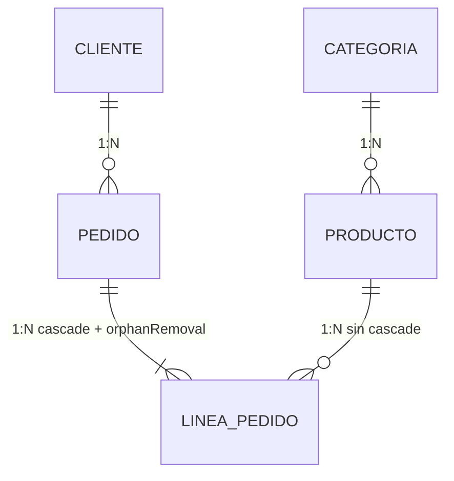
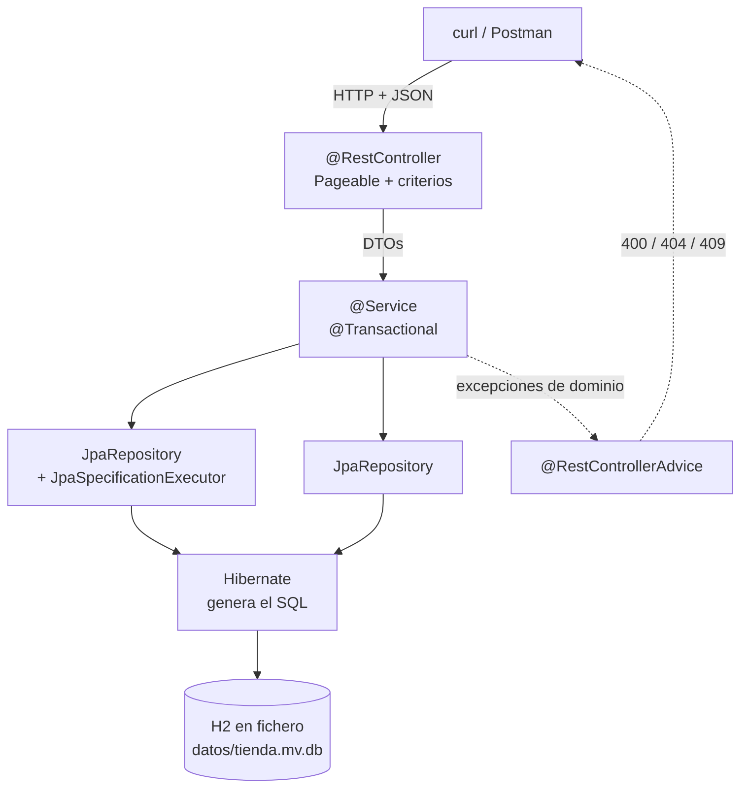

# 4. Dos proyectos paso a paso

Los **dos proyectos de la UT4**, migrados a Spring Data JPA. Mismas APIs, mismas reglas, **H2 en fichero** — y una fracción del código.

| | Proyecto | Entidades | Lo nuevo que enseña |
|:-:|---|:-:|---|
| **A** | [Funkos y categorías](#proyecto-a-funkos-y-categorias) | 2 | Entidades, una relación 1:N, repositorios sin implementar, paginación y `Specification` |
| **B** | [La tienda](#proyecto-b-la-tienda) | 4 | Relaciones en las dos direcciones, `cascade`, `orphanRemoval`, el N+1 y `@Version` |

!!! danger "La promesa de la UT4, cobrada"
    Antes de empezar, abre tu proyecto de la [UT4](../ut4/05-proyectos.md) y cuenta qué vas a tener que **tocar**:

    | | ¿Se toca? |
    |---|:-:|
    | `FunkosRestController` | **No** |
    | `FunkosServiceImpl` | No (solo para añadir la paginación, en A.6) |
    | `FunkoResponse`, `FunkoCreateRequest`, `FunkoUpdateRequest` | **No** |
    | `FunkoMapper` | Casi no |
    | `GlobalExceptionHandler` | **No** |
    | Tests de capa web | **No** |
    | `Funko` | Sí: pasa a ser `@Entity` |
    | `FunkoRowMapper` | **Se borra** |
    | `FunkosRepositoryJdbc` | **Se borra** |
    | `schema.sql` | Se borra en `dev`; se conserva para `prod` |

    **Haz la cuenta y escríbela.** Es el argumento más convincente de todo el trimestre, y dura un minuto.

!!! success "El código que desaparece"
    | | Líneas del repositorio de funkos |
    |---|:-:|
    | UT3 · JDBC a mano con `DriverManager` | ~120 |
    | UT4 · `JdbcClient` + `RowMapper` | ~95 |
    | **UT5 · Spring Data JPA** | **0** |

    Cero. La interfaz declara los métodos y **Spring Data escribe la implementación en el arranque**.

---

## Lo que comparten los dos proyectos

### Las dependencias

```xml title="pom.xml — los cambios respecto a la UT4"
<!-- FUERA: ya no hace falta, lo trae data-jpa -->
<!-- <dependency>
       <groupId>org.springframework.boot</groupId>
       <artifactId>spring-boot-starter-jdbc</artifactId>
     </dependency> -->

<!-- DENTRO -->
<dependency>
  <groupId>org.springframework.boot</groupId>
  <artifactId>spring-boot-starter-data-jpa</artifactId>
</dependency>

<!-- Se queda igual -->
<dependency>
  <groupId>com.h2database</groupId>
  <artifactId>h2</artifactId>
  <scope>runtime</scope>
</dependency>
```

```bash
./mvnw dependency:tree | grep -E "hibernate|spring-data|jdbc|h2"
```

```
+- org.springframework.boot:spring-boot-starter-data-jpa:jar:3.5.6
|  +- org.springframework.boot:spring-boot-starter-jdbc:jar:3.5.6     ← lo trae dentro
|  +- org.hibernate.orm:hibernate-core:jar:6.6.x
|  \- org.springframework.data:spring-data-jpa:jar:3.4.x
+- com.h2database:h2:jar:2.3.x
```

!!! info "Quién es quién, en una línea cada uno"
    - **JPA** es la **especificación**: un estándar de Java, solo interfaces y anotaciones.
    - **Hibernate** es la **implementación** que Spring Boot trae por defecto. **Es quien escribe el SQL** que en la UT4 escribías tú.
    - **Spring Data JPA** es una capa **encima** de JPA que te genera los repositorios a partir del nombre de los métodos.

    Cuando en el log sale `Hibernate: select …`, estás viendo al de en medio trabajando. Y ese SQL es, literalmente, el que escribiste a mano en la UT4: compáralos.

### La configuración

```properties title="application.properties"
spring.application.name=funkos-api

server.port=${PORT:8080}
api.path=/api
api.version=v1

### H2 en FICHERO
spring.datasource.url=${DB_URL:jdbc:h2:file:./datos/funkos;AUTO_SERVER=TRUE}
spring.datasource.username=${DB_USER:sa}
spring.datasource.password=${DB_PASSWORD:}
spring.datasource.driver-class-name=org.h2.Driver

### JPA · lo IMPORTANTE de este fichero
spring.jpa.open-in-view=false

spring.h2.console.enabled=true
spring.h2.console.path=/h2-console

server.error.include-message=always
server.error.include-binding-errors=always
server.error.include-stacktrace=never

logging.level.es.iesx=DEBUG
spring.profiles.active=${SPRING_PROFILES_ACTIVE:dev}
```

=== "dev"

    ```properties title="application-dev.properties"
    ### Hibernate crea el esquema desde las entidades
    spring.jpa.hibernate.ddl-auto=update
    spring.jpa.show-sql=true
    spring.jpa.properties.hibernate.format_sql=true

    ### data.sql, después de que Hibernate cree las tablas
    spring.jpa.defer-datasource-initialization=true
    spring.sql.init.mode=always
    spring.sql.init.data-locations=classpath:data.sql

    logging.level.org.hibernate.SQL=DEBUG
    ```

=== "prod"

    ```properties title="application-prod.properties"
    ### El esquema YA existe: Hibernate solo lo comprueba
    spring.jpa.hibernate.ddl-auto=validate
    spring.jpa.show-sql=false

    spring.sql.init.mode=never
    spring.h2.console.enabled=false

    logging.level.root=WARN
    logging.level.es.iesx=INFO
    server.error.include-message=never
    server.error.include-stacktrace=never
    ```

=== "test"

    ```properties title="src/test/resources/application-test.properties"
    spring.datasource.url=jdbc:h2:mem:test;DB_CLOSE_DELAY=-1
    spring.jpa.hibernate.ddl-auto=create-drop
    spring.jpa.defer-datasource-initialization=true
    spring.sql.init.mode=always
    logging.level.root=WARN
    ```

!!! danger "`update` en `dev` y no `create-drop`, porque la base de datos es un FICHERO"
    | Valor | Qué hace | Con H2 en fichero |
    |---|---|---|
    | `create-drop` | Borra y crea al arrancar, borra al parar | **Pierdes los datos en cada reinicio** |
    | `create` | Borra y crea al arrancar | Igual de malo |
    | `update` | Añade lo que falta, **nunca borra** | ✅ para desarrollo con fichero |
    | `validate` | Solo comprueba; si no cuadra, **no arranca** | ✅ para producción |
    | `none` | Nada | Producción con migraciones |

    La gracia del fichero es que los datos persistan, así que `create-drop` lo tiraría todo por tierra. **En los tests sí se usa `create-drop`**, porque allí la base de datos es `mem:` y se quiere limpia.

    Y `update` tiene su límite: **no sabe renombrar ni borrar**. Si cambias un campo de nombre, crea la columna nueva y **deja la vieja con los datos dentro**. Para producción, `validate` y migraciones con Flyway.

!!! danger "`spring.jpa.open-in-view=false` — ponlo y no lo quites"
    Viene **activado** por defecto, y Spring Boot incluso lo avisa al arrancar:

    ```
    WARN  JpaBaseConfiguration : spring.jpa.open-in-view is enabled by default.
    Therefore, database queries may be performed during view rendering.
    ```

    Lo que hace es mantener la sesión de Hibernate abierta **durante toda la petición**, incluida la serialización del JSON. Eso **esconde** los `LazyInitializationException`… lanzando consultas desde el serializador, donde no las controlas. Es una fábrica de problemas N+1 invisibles.

    Apagándolo, el error **salta en desarrollo** y te obliga a arreglarlo donde toca: en el mapeador, dentro de la transacción.

!!! warning "`defer-datasource-initialization=true` si usas `data.sql`"
    Sin esa línea, Spring ejecuta `data.sql` **antes** de que Hibernate cree las tablas, y falla con `Table "FUNKOS" not found`. Es el error número uno de este paso, y el mensaje no da ninguna pista de la causa.

---

# Proyecto A · Funkos y categorías

Dos entidades, una relación 1:N, y la API de la UT4 funcionando con el repositorio sustituido.

```
GET    /api/v1/funkos          ?page= &size= &sort= &categoria= &nombre= &precioMax=
GET    /api/v1/funkos/{id}
POST   /api/v1/funkos
PUT    /api/v1/funkos/{id}
PATCH  /api/v1/funkos/{id}
DELETE /api/v1/funkos/{id}     ← borrado lógico
GET    /api/v1/funkos/estadisticas

GET    /api/v1/categorias      CRUD completo
GET    /api/v1/categorias/{id}/funkos
```

## A.1 · Las entidades

```java title="categorias/models/Categoria.java"
package es.iesx.funkos.categorias.models;

import jakarta.persistence.*;
import java.time.LocalDateTime;
import java.util.*;

@Entity
@Table(name = "categorias")
public class Categoria {

    @Id
    @GeneratedValue(strategy = GenerationType.IDENTITY)
    private Long id;

    @Column(nullable = false, unique = true, length = 50)
    private String nombre;

    @Column(name = "is_deleted", nullable = false)
    private boolean deleted = false;

    @Column(name = "created_at", updatable = false)
    private LocalDateTime createdAt = LocalDateTime.now();

    @Column(name = "updated_at")
    private LocalDateTime updatedAt = LocalDateTime.now();

    /** Lado INVERSO: la clave ajena está en funkos. */
    @OneToMany(mappedBy = "categoria", fetch = FetchType.LAZY)
    private List<Funko> funkos = new ArrayList<>();

    protected Categoria() {}                  // JPA lo necesita

    public Categoria(String nombre) { this.nombre = nombre; }

    @PreUpdate
    void alActualizar() { this.updatedAt = LocalDateTime.now(); }

    // getters y setters…
}
```

```java title="funkos/models/Funko.java"
package es.iesx.funkos.funkos.models;

import es.iesx.funkos.categorias.models.Categoria;
import jakarta.persistence.*;
import java.math.BigDecimal;
import java.time.LocalDateTime;

@Entity
@Table(name = "funkos", indexes = {
        @Index(name = "idx_funko_nombre",  columnList = "nombre"),
        @Index(name = "idx_funko_deleted", columnList = "is_deleted")
})
public class Funko {

    @Id
    @GeneratedValue(strategy = GenerationType.IDENTITY)
    private Long id;

    @Column(nullable = false, unique = true, length = 100)
    private String nombre;

    @Column(nullable = false, precision = 10, scale = 2)
    private BigDecimal precio;

    @Column(nullable = false)
    private Integer cantidad;

    @Column(length = 500)
    private String imagen;

    /** Lado DUEÑO: la clave ajena vive en esta tabla. */
    @ManyToOne(fetch = FetchType.LAZY, optional = false)
    @JoinColumn(name = "categoria_id", nullable = false,
                foreignKey = @ForeignKey(name = "fk_funko_categoria"))
    private Categoria categoria;

    @Column(name = "is_deleted", nullable = false)
    private boolean deleted = false;

    @Column(name = "created_at", updatable = false)
    private LocalDateTime createdAt = LocalDateTime.now();

    @Column(name = "updated_at")
    private LocalDateTime updatedAt = LocalDateTime.now();

    protected Funko() {}

    public static Builder builder() { return new Builder(); }

    @PreUpdate
    void alActualizar() { this.updatedAt = LocalDateTime.now(); }

    // builder, getters y setters…
}
```

!!! danger "Las siete decisiones de este paso, y por qué cada una"
    **1. `protected Funko() {}`.** JPA construye las entidades por reflexión y necesita un constructor sin argumentos. `protected` para que nadie lo use desde fuera. **Y por esto una entidad no puede ser un `record`**: un `record` es `final` y sus campos son inmutables.

    **2. `fetch = FetchType.LAZY` en el `@ManyToOne`.** El valor por defecto es `EAGER`, y es **el problema de rendimiento número uno de JPA**: cargar 100 funkos trae 100 categorías aunque no las mires.

    **3. `mappedBy = "categoria"` en el `@OneToMany`.** Dice «el dueño es el campo `categoria` de `Funko`». Sin él, Hibernate crea una tabla intermedia `categorias_funkos` **que no quieres** y los datos se escriben en un sitio y se leen de otro, sin ningún error.

    **4. `BigDecimal` con `precision` y `scale`.** Es dinero. `0.1 + 0.2` en `double` da `0.30000000000000004`.

    **5. `@Column(name = "is_deleted")`.** `deleted` es palabra reservada en algunos motores, y la columna va **indexada** porque **todas** las consultas la filtran.

    **6. Sin `cascade` en el `@OneToMany`.** Con `CascadeType.ALL`, borrar una categoría borraría sus funkos. Lo que queremos es lo contrario: que **no se pueda** borrar una categoría con funkos, y eso es un 409 comprobado en el servicio.

    **7. Los `@Index` y el `foreignKey = @ForeignKey(name = …)`.** Sin el nombre, Hibernate genera nombres como `FK9s8d7f6a5s4d`, y el día que un error te hable de esa restricción no sabrás cuál es.

!!! warning "`equals` y `hashCode`: NO los generes con el IDE"
    El `equals` que genera IntelliJ compara **todos** los campos. En una entidad eso rompe en cuanto la metes en un `Set`: antes de guardar, el `id` es `null`; después, no. El `hashCode` cambia y el elemento **se pierde dentro del `HashSet`**.

    Si los necesitas, compara **solo por el id** y devuelve un `hashCode` constante mientras el id sea `null`. En estos proyectos no hacen falta: trabajamos con `List` y comparamos DTOs, que son `record` y lo traen bien hecho.

## A.2 · Los datos iniciales

```sql title="src/main/resources/data.sql"
MERGE INTO categorias (id, nombre, is_deleted, created_at, updated_at) KEY(id) VALUES
  (1, 'DISNEY', false, CURRENT_TIMESTAMP, CURRENT_TIMESTAMP),
  (2, 'MARVEL', false, CURRENT_TIMESTAMP, CURRENT_TIMESTAMP),
  (3, 'ANIME',  false, CURRENT_TIMESTAMP, CURRENT_TIMESTAMP),
  (4, 'OTROS',  false, CURRENT_TIMESTAMP, CURRENT_TIMESTAMP);

MERGE INTO funkos (id, nombre, precio, cantidad, imagen, categoria_id,
                   is_deleted, created_at, updated_at) KEY(id) VALUES
  (1, 'Mickey Mouse', 15.99, 10, 'https://placehold.co/300', 1, false, CURRENT_TIMESTAMP, CURRENT_TIMESTAMP),
  (2, 'Stitch',       17.00,  8, 'https://placehold.co/300', 1, false, CURRENT_TIMESTAMP, CURRENT_TIMESTAMP),
  (3, 'Spider-Man',   19.99,  5, 'https://placehold.co/300', 2, false, CURRENT_TIMESTAMP, CURRENT_TIMESTAMP),
  (4, 'Iron Man',     21.50,  2, 'https://placehold.co/300', 2, false, CURRENT_TIMESTAMP, CURRENT_TIMESTAMP),
  (5, 'Goku',         22.50,  3, 'https://placehold.co/300', 3, false, CURRENT_TIMESTAMP, CURRENT_TIMESTAMP),
  (6, 'Naruto',       18.75,  0, 'https://placehold.co/300', 3, false, CURRENT_TIMESTAMP, CURRENT_TIMESTAMP);

ALTER TABLE categorias ALTER COLUMN id RESTART WITH 5;
ALTER TABLE funkos     ALTER COLUMN id RESTART WITH 7;
```

!!! info "`MERGE` y `RESTART WITH`, igual que en la UT4"
    Con H2 en fichero, `data.sql` se ejecuta **en cada arranque**: un `INSERT` con id fijo fallaría al segundo. Y sin el `RESTART WITH`, el contador del `AUTO_INCREMENT` sigue en 1 y **el primer POST choca** con Mickey Mouse.

    No es cosa de JPA: es cosa de que la base de datos persista.

## A.3 · Los repositorios: donde desaparece el código

```java title="funkos/repositories/FunkosRepository.java"
package es.iesx.funkos.funkos.repositories;

import es.iesx.funkos.funkos.models.Funko;
import org.springframework.data.domain.*;
import org.springframework.data.jpa.repository.*;
import org.springframework.data.repository.query.Param;

import java.math.BigDecimal;
import java.util.*;

public interface FunkosRepository
        extends JpaRepository<Funko, Long>, JpaSpecificationExecutor<Funko> {

    // ── derivadas del nombre: ni una línea de implementación ──
    Optional<Funko> findByIdAndDeletedFalse(Long id);
    List<Funko>     findByDeletedFalse();
    boolean         existsByNombreIgnoreCaseAndDeletedFalse(String nombre);
    List<Funko>     findByCategoriaNombreIgnoreCaseAndDeletedFalse(String categoria);
    long            countByCategoriaIdAndDeletedFalse(Long categoriaId);
    List<Funko>     findByPrecioBetweenAndDeletedFalse(BigDecimal min, BigDecimal max);
    List<Funko>     findTop5ByDeletedFalseOrderByPrecioDesc();

    // ── JPQL con JOIN FETCH: evita el N+1 al paginar ──
    @Query(value      = """
                        SELECT f FROM Funko f JOIN FETCH f.categoria
                         WHERE f.deleted = false
                        """,
           countQuery = "SELECT count(f) FROM Funko f WHERE f.deleted = false")
    Page<Funko> findAllConCategoria(Pageable pageable);

    // ── agregado: lo cuenta la base de datos ──
    @Query("""
           SELECT f.categoria.nombre, count(f)
             FROM Funko f
            WHERE f.deleted = false
            GROUP BY f.categoria.nombre
            ORDER BY f.categoria.nombre
           """)
    List<Object[]> contarPorCategoria();

    // ── borrado lógico ──
    @Modifying(clearAutomatically = true, flushAutomatically = true)
    @Query("""
           UPDATE Funko f
              SET f.deleted = true, f.updatedAt = CURRENT_TIMESTAMP
            WHERE f.id = :id AND f.deleted = false
           """)
    int borradoLogico(@Param("id") Long id);
}
```

```java title="categorias/repositories/CategoriasRepository.java"
public interface CategoriasRepository extends JpaRepository<Categoria, Long> {
    Optional<Categoria> findByNombreIgnoreCaseAndDeletedFalse(String nombre);
    List<Categoria>     findByDeletedFalse();
    boolean             existsByNombreIgnoreCase(String nombre);
}
```

!!! success "Compara con lo que escribiste en la UT4"
    ```java
    // UT4 · ~15 líneas
    @Override
    public List<Funko> findByCategoria(String categoria) {
        return jdbc.sql("""
                SELECT f.* FROM funkos f
                  JOIN categorias c ON c.id = f.categoria_id
                 WHERE UPPER(c.nombre) = UPPER(:categoria) AND f.is_deleted = false
                """)
            .param("categoria", categoria)
            .query(rowMapper).list();
    }

    // UT5 · 1 línea, sin cuerpo
    List<Funko> findByCategoriaNombreIgnoreCaseAndDeletedFalse(String categoria);
    ```

    Y el SQL que genera es **el mismo**:

    ```sql
    select f1_0.* from funkos f1_0
      join categorias c1_0 on c1_0.id = f1_0.categoria_id
     where upper(c1_0.nombre) = upper(?) and f1_0.is_deleted = false
    ```

    Spring Data ha leído **el nombre del método** —`Categoria` → `Nombre`, `IgnoreCase`, `AndDeletedFalse`— y ha escrito el `JOIN` sola. No hay implementación en ninguna parte: crea un proxy en el arranque.

!!! danger "Y lo mejor: un nombre mal escrito impide ARRANCAR"
    ```
    PropertyReferenceException: No property 'categoría' found for type 'Funko'
    ```

    En la UT4, un nombre de columna mal escrito en el SQL fallaba **al ejecutar esa consulta**, quizá en producción tres semanas después. Aquí falla **en tu pantalla, antes del primer `curl`**.

!!! warning "`@Modifying` necesita tres cosas"
    1. **`@Modifying`**, o salta `Not supported for DML operations`.
    2. **`@Transactional`** en quien lo llama, o salta `TransactionRequiredException`.
    3. **`clearAutomatically = true`** si en la misma transacción tenías la entidad cargada: un `UPDATE` por JPQL **no actualiza la caché de primer nivel**, así que el objeto en memoria se queda con `deleted = false`.

## A.4 · El borrado lógico y las reglas

```java title="funkos/services/FunkosServiceImpl.java (los métodos clave)"
@Service
@CacheConfig(cacheNames = {"funkos"})
public class FunkosServiceImpl implements FunkosService {

    private final FunkosRepository repositorio;
    private final CategoriasRepository categoriasRepository;
    private final FunkoMapper mapper;

    public FunkosServiceImpl(FunkosRepository repositorio,
                             CategoriasRepository categoriasRepository,
                             FunkoMapper mapper) {
        this.repositorio = repositorio;
        this.categoriasRepository = categoriasRepository;
        this.mapper = mapper;
    }

    @Override
    @Transactional(readOnly = true)
    @Cacheable(key = "#id")
    public FunkoResponse findById(Long id) {
        return repositorio.findByIdAndDeletedFalse(id)
                .map(mapper::toResponse)
                .orElseThrow(() -> new FunkoNotFoundException(id));
    }

    @Override
    @Transactional
    @CacheEvict(allEntries = true)
    public FunkoResponse save(FunkoCreateRequest request) {
        if (repositorio.existsByNombreIgnoreCaseAndDeletedFalse(request.nombre()))
            throw new FunkoConflictException("Ya existe un funko llamado " + request.nombre());

        var categoria = categoriasRepository
                .findByNombreIgnoreCaseAndDeletedFalse(request.categoria())
                .orElseThrow(() -> new FunkoBadRequestException(
                        "La categoría " + request.categoria() + " no existe"));

        return mapper.toResponse(repositorio.save(mapper.toModel(request, categoria)));
    }

    @Override
    @Transactional
    @CacheEvict(allEntries = true)
    public void deleteById(Long id) {
        var funko = repositorio.findByIdAndDeletedFalse(id)
                .orElseThrow(() -> new FunkoNotFoundException(id));

        if (funko.getCantidad() > 0)
            throw new FunkoConflictException(
                    "No se puede borrar un funko con %d unidades en stock"
                            .formatted(funko.getCantidad()));

        repositorio.borradoLogico(id);
    }
}
```

```java title="categorias/services/CategoriasServiceImpl.java (el delete)"
@Override
@Transactional
public void deleteById(Long id) {
    var categoria = repositorio.findById(id)
            .filter(c -> !c.isDeleted())
            .orElseThrow(() -> new CategoriaNotFoundException(id));

    long funkos = funkosRepository.countByCategoriaIdAndDeletedFalse(id);
    if (funkos > 0)
        throw new CategoriaConflictException(
                "No se puede borrar la categoría %s: tiene %d funkos asociados"
                        .formatted(categoria.getNombre(), funkos));

    categoria.setDeleted(true);        // ← y ya está: NO hace falta save()
}
```

!!! success "Fíjate en que no hay `save()` al final del `deleteById` de categorías"
    ```java
    categoria.setDeleted(true);
    ```

    Dentro de una transacción las entidades cargadas están **gestionadas**: Hibernate detecta el cambio al confirmar (*dirty checking*) y lanza el `UPDATE` él solo.

    Esto sorprende viniendo de la UT4, donde cada cambio era un `jdbc.sql("UPDATE …").update()` explícito. Y tiene su cara b: **un `setter` llamado por error dentro de una transacción persiste el cambio sin que nadie lo pida.**

!!! danger "El coste real del borrado lógico"
    **Olvidar un `AndDeletedFalse` en una sola consulta** hace que los registros borrados reaparezcan en ese endpoint. Y como el programa no falla, nadie se entera hasta que un cliente ve un producto que ya no existe.

    Por eso **todos** los métodos del repositorio llevan `AndDeletedFalse` en el nombre: es feo y es deliberado, porque un método sin ese sufijo **se ve a simple vista**.

    | | Borrado físico | Borrado lógico |
    |---|---|---|
    | Histórico y auditoría | Se pierde | Se conserva |
    | Filas que lo referencian | Se rompen o bloquean | Siguen funcionando |
    | Recuperar un borrado por error | Backup | Un `UPDATE` |
    | Coste | Ninguno | **Todas** las consultas llevan el filtro |
    | Derecho al olvido (RGPD) | Cumple | **No cumple**: hay que borrar de verdad |

## A.5 · Paginación y criterios

```java title="funkos/services/FunkosServiceImpl.java (la búsqueda)"
@Override
@Transactional(readOnly = true)
public Page<FunkoResponse> buscar(Optional<String> categoria,
                                  Optional<String> nombre,
                                  Optional<BigDecimal> precioMax,
                                  Pageable pageable) {

    Specification<Funko> spec = (root, q, cb) -> cb.isFalse(root.get("deleted"));

    spec = categoria.map(c -> spec.and((root, q, cb) ->
                cb.equal(cb.upper(root.get("categoria").get("nombre")), c.toUpperCase())))
            .orElse(spec);

    spec = nombre.map(n -> spec.and((root, q, cb) ->
                cb.like(cb.lower(root.get("nombre")), "%" + n.toLowerCase() + "%")))
            .orElse(spec);

    spec = precioMax.map(p -> spec.and((root, q, cb) ->
                cb.lessThanOrEqualTo(root.get("precio"), p)))
            .orElse(spec);

    return repositorio.findAll(spec, pageable).map(mapper::toResponse);
}
```

```java title="funkos/controllers/FunkosRestController.java (el listado)"
@GetMapping
public ResponseEntity<Page<FunkoResponse>> buscar(
        @RequestParam Optional<String> categoria,
        @RequestParam Optional<String> nombre,
        @RequestParam Optional<BigDecimal> precioMax,
        @PageableDefault(size = 20, sort = "id") Pageable pageable) {

    return ResponseEntity.ok(
            servicio.buscar(categoria, nombre, precioMax, sanear(pageable)));
}

/** Lista blanca de campos ordenables y tope de tamaño. */
private Pageable sanear(Pageable p) {
    var permitidos = Set.of("id", "nombre", "precio", "cantidad", "createdAt");
    var orden = p.getSort().stream()
            .filter(o -> permitidos.contains(o.getProperty()))
            .toList();
    return PageRequest.of(p.getPageNumber(),
                          Math.min(p.getPageSize(), 100),
                          orden.isEmpty() ? Sort.by("id") : Sort.by(orden));
}
```

```properties
spring.data.web.pageable.default-page-size=20
spring.data.web.pageable.max-page-size=100
```

!!! success "Compara el `buscar` con el de la UT4"
    ```java
    // UT4: montar el WHERE a trozos, con un StringBuilder y un mapa de parámetros
    var sql = new StringBuilder("SELECT * FROM funkos WHERE 1 = 1");
    categoria.ifPresent(c -> { sql.append(" AND …"); params.put("categoria", c); });
    …

    // UT5: cada filtro es una Specification que se compone con .and()
    spec = categoria.map(c -> spec.and((root, q, cb) -> cb.equal(…))).orElse(spec);
    ```

    Las dos hacen lo mismo y las dos generan el mismo SQL. La diferencia: la de la UT5 **no concatena texto SQL en ningún momento**, así que no hay forma de equivocarse e introducir una inyección.

    Y el `.map(mapper::toResponse)` del final: `Page` tiene `map`, así que la paginación se conserva (`totalElements`, `totalPages`) y lo que sale son **DTOs, no entidades**.

!!! danger "Por qué el `sanear` no es paranoia"
    **Sin lista blanca**, `?sort=` permite ordenar por **cualquier campo de la entidad**, incluidos los que no publicas. En una entidad `Usuario`, `?sort=passwordHash` no devuelve el hash pero sí revela el **orden relativo** de los hashes.

    **Sin tope de tamaño**, `?size=1000000` carga la tabla entera: has escrito la paginación para nada.

    Y un `?sort=inventado` sin sanear provoca un `PropertyReferenceException` → **500**, cuando debería ser 400 o ignorarse.

## A.6 · Probar el proyecto A

=== "La migración, comprobada"

    ```bash
    git diff --stat src/main/java/
    ```

    ```
     .../funkos/models/Funko.java                 |  38 ++++---
     .../funkos/repositories/FunkosRepository.java |  95 +-----------------
     .../funkos/repositories/FunkosRepositoryJdbc.java | 118 ------------- (borrado)
     .../funkos/mappers/FunkoRowMapper.java       |  24 ------ (borrado)
     .../funkos/services/FunkosServiceImpl.java    |  12 ++-
     6 files changed, 50 insertions(+), 237 deletions(-)
    ```

    **Ni el controlador, ni los DTOs, ni el manejador de errores, ni los tests de capa web aparecen en ese diff.** Eso es lo que compraste con las capas.

=== "Paginación y orden"

    ```bash
    curl -s "localhost:8080/api/v1/funkos?page=0&size=2" \
      | jq '{total: .totalElements, paginas: .totalPages, nombres: [.content[].nombre]}'
    # { "total": 6, "paginas": 3, "nombres": ["Mickey Mouse", "Stitch"] }

    curl -s "localhost:8080/api/v1/funkos?sort=precio,desc&size=3" \
      | jq '[.content[] | {nombre, precio}]'

    # Campo inventado: NO revienta, ordena por id
    curl -s -o /dev/null -w "%{http_code}\n" \
      "localhost:8080/api/v1/funkos?sort=inventado,desc"        # 200

    # Tamaño enorme: se recorta
    curl -s "localhost:8080/api/v1/funkos?size=99999" | jq '.pageable.pageSize'   # 100
    ```

=== "Criterios y reglas"

    ```bash
    curl -s "localhost:8080/api/v1/funkos?categoria=anime" | jq '.totalElements'   # 2
    curl -s "localhost:8080/api/v1/funkos?nombre=man&precioMax=20" \
      | jq '[.content[].nombre]'                                  # ["Spider-Man"]

    # 409: borrar una categoría con funkos
    curl -i -X DELETE localhost:8080/api/v1/categorias/1
    # 409 · "No se puede borrar la categoría DISNEY: tiene 2 funkos asociados"

    # 409: borrar un funko con stock
    curl -i -X DELETE localhost:8080/api/v1/funkos/1              # 409

    # 204: el que tiene cantidad 0 sí
    curl -i -X DELETE localhost:8080/api/v1/funkos/6              # 204

    # Y ya no aparece: borrado lógico
    curl -s localhost:8080/api/v1/funkos | jq '[.content[].nombre] | index("Naruto")'
    # null

    # 400: categoría que no existe
    curl -i -X POST localhost:8080/api/v1/funkos \
      -H "Content-Type: application/json" \
      -d '{"nombre":"Tarta","precio":9.99,"cantidad":1,"categoria":"COCINA"}'   # 400
    ```

=== "Contar las consultas"

    ```bash
    # Con JOIN FETCH / @EntityGraph
    curl -s "localhost:8080/api/v1/funkos?size=20" > /dev/null
    # En el log: 2 consultas (la página + el count)

    # Quita el JOIN FETCH y usa findByDeletedFalse: 1 + 20 consultas
    ```

    **Esto es lo que se mira en la corrección.** Un N+1 se ve en el log en dos segundos y un programa que funciona no lo delata de ninguna otra manera.

---

# Proyecto B · La tienda

Cuatro entidades, relaciones en las dos direcciones, y la misma transacción de la UT4 — ahora con JPA.

```
GET    /api/v1/clientes        ?nombre= &ciudad=      CRUD + borrado lógico
GET    /api/v1/clientes/{id}/pedidos                  paginado

GET    /api/v1/productos       ?categoria= &conStock= CRUD + borrado lógico
PATCH  /api/v1/productos/{id}/stock

GET    /api/v1/pedidos         ?clienteId= &estado=   paginado
GET    /api/v1/pedidos/{id}                           con sus líneas
POST   /api/v1/pedidos                                crea Y descuenta stock
POST   /api/v1/pedidos/{id}/cancelar                  cancela Y devuelve stock
PATCH  /api/v1/pedidos/{id}/estado
GET    /api/v1/pedidos/estadisticas
```

## B.1 · Las cuatro entidades y sus relaciones



```java title="pedidos/models/Pedido.java"
@Entity
@Table(name = "pedidos", indexes = {
        @Index(name = "idx_pedido_cliente", columnList = "cliente_id"),
        @Index(name = "idx_pedido_estado",  columnList = "estado")
})
public class Pedido {

    @Id
    @GeneratedValue(strategy = GenerationType.IDENTITY)
    private Long id;

    @Column(nullable = false, unique = true, length = 20)
    private String codigo;

    @ManyToOne(fetch = FetchType.LAZY, optional = false)
    @JoinColumn(name = "cliente_id", nullable = false)
    private Cliente cliente;

    @Enumerated(EnumType.STRING)                 // NUNCA ORDINAL
    @Column(nullable = false, length = 20)
    private EstadoPedido estado = EstadoPedido.PENDIENTE;

    @Column(nullable = false, precision = 12, scale = 2)
    private BigDecimal total = BigDecimal.ZERO;

    @Column(nullable = false)
    private LocalDateTime fecha = LocalDateTime.now();

    /** COMPOSICIÓN: una línea no existe sin su pedido. */
    @OneToMany(mappedBy = "pedido",
               cascade = CascadeType.ALL,
               orphanRemoval = true,
               fetch = FetchType.LAZY)
    private List<LineaPedido> lineas = new ArrayList<>();

    @Version
    private Long version;                        // bloqueo optimista

    protected Pedido() {}

    /** Método de conveniencia: mantiene LOS DOS lados de la relación. */
    public void añadirLinea(LineaPedido linea) {
        lineas.add(linea);
        linea.setPedido(this);
    }

    public void quitarLinea(LineaPedido linea) {
        lineas.remove(linea);
        linea.setPedido(null);                   // con orphanRemoval → DELETE
    }
    // builder, getters…
}
```

```java title="pedidos/models/LineaPedido.java"
@Entity
@Table(name = "lineas_pedido")
public class LineaPedido {

    @Id
    @GeneratedValue(strategy = GenerationType.IDENTITY)
    private Long id;

    @ManyToOne(fetch = FetchType.LAZY, optional = false)
    @JoinColumn(name = "pedido_id", nullable = false)
    private Pedido pedido;

    /** SIN cascade: borrar una línea NO borra el producto. */
    @ManyToOne(fetch = FetchType.LAZY, optional = false)
    @JoinColumn(name = "producto_id", nullable = false)
    private Producto producto;

    @Column(nullable = false)
    private Integer cantidad;

    /** Se COPIA del producto al crear el pedido. */
    @Column(name = "precio_unitario", nullable = false, precision = 10, scale = 2)
    private BigDecimal precioUnitario;

    protected LineaPedido() {}

    @Transient                                   // calculado, NO se persiste
    public BigDecimal subtotal() {
        return precioUnitario.multiply(BigDecimal.valueOf(cantidad));
    }
    // builder, getters, setPedido…
}
```

!!! danger "Las cinco decisiones del modelo, y todas se corrigen"
    **1. `cascade = ALL` + `orphanRemoval = true` SOLO en `Pedido → LineaPedido`.** Es una **composición** de verdad: una línea no tiene sentido sin su pedido. Borrar el pedido borra sus líneas, y sacar una línea de la lista la borra.

    **2. NADA de cascade en `LineaPedido → Producto`.** Borrar una línea **no puede borrar el producto**. Y al revés: borrar un producto que aparece en pedidos tiene que **fallar** (lo impide la clave ajena) y devolver 409.

    **3. `@Enumerated(EnumType.STRING)`.** El valor por defecto es `ORDINAL`, que guarda **la posición**: `PENDIENTE`=0, `PAGADO`=1… Reordenar el `enum` **cambia el significado de todos los registros en silencio**. Los pedidos pendientes pasan a pagados. No hay error, no hay log.

    **4. `precioUnitario` en la línea.** Se copia del producto al crear el pedido. Si mañana sube el precio, **el pedido histórico no cambia**. Una factura de hace un año no se recalcula sola.

    **5. `@Version` en `Pedido`.** Dos administradores editando el mismo pedido a la vez: sin esto, **el último pisa los cambios del primero** y nadie se entera (*lost update*). Con esto, el segundo recibe `ObjectOptimisticLockingFailureException` → **409**.

!!! success "Los métodos `añadirLinea` y `quitarLinea` arreglan un bug clásico"
    ```java
    // ❌ Mal: solo un lado de la relación
    pedido.getLineas().add(linea);
    // La línea no tiene pedido_id → el INSERT falla con "null not allowed"

    // ❌ También mal
    linea.setPedido(pedido);
    // Funciona al guardar, pero pedido.getLineas() en memoria está vacía
    // y el código que la recorra después no ve nada

    // ✅ Bien: los dos lados, en un solo método
    pedido.añadirLinea(linea);
    ```

    **En una relación bidireccional hay que mantener los dos lados.** Hibernate solo persiste **el lado dueño** (el que tiene la clave ajena), pero tu código en memoria lee el otro. Un método de conveniencia en la entidad es la forma de no olvidarse nunca.

## B.2 · El servicio con la transacción

```java title="pedidos/services/PedidosServiceImpl.java"
@Service
public class PedidosServiceImpl implements PedidosService {

    private static final Logger log = LoggerFactory.getLogger(PedidosServiceImpl.class);

    private final PedidosRepository pedidos;
    private final ProductosRepository productos;
    private final ClientesRepository clientes;
    private final PedidoMapper mapper;

    // constructor…

    @Override
    @Transactional
    public PedidoResponse crear(PedidoCreateRequest request) {

        // 1 · el cliente existe y está activo
        var cliente = clientes.findByIdAndDeletedFalse(request.clienteId())
                .orElseThrow(() -> new ClienteNotFoundException(request.clienteId()));
        if (!cliente.isActivo())
            throw new PedidoConflictException(
                    "El cliente %s está desactivado".formatted(cliente.getNombre()));

        // 2 · agrupar líneas repetidas del mismo producto
        var cantidadPorProducto = request.lineas().stream()
                .collect(Collectors.groupingBy(LineaRequest::productoId, TreeMap::new,
                         Collectors.summingInt(LineaRequest::cantidad)));

        var pedido = Pedido.builder()
                .codigo(siguienteCodigo())
                .cliente(cliente)
                .estado(EstadoPedido.PENDIENTE)
                .fecha(LocalDateTime.now())
                .build();

        var total = BigDecimal.ZERO;

        // 3 · por cada producto: descontar stock de forma atómica y copiar el precio
        for (var e : cantidadPorProducto.entrySet()) {
            Long productoId = e.getKey();
            int cantidad = e.getValue();

            var producto = productos.findByIdAndDeletedFalse(productoId)
                    .orElseThrow(() -> new ProductoNotFoundException(productoId));

            if (productos.descontarStock(productoId, cantidad) == 0)
                throw new StockInsuficienteException(
                        "Stock insuficiente de %s (sku %s): piden %d, hay %d"
                                .formatted(producto.getNombre(), producto.getSku(),
                                           cantidad, producto.getStock()));

            pedido.añadirLinea(LineaPedido.builder()
                    .producto(producto)
                    .cantidad(cantidad)
                    .precioUnitario(producto.getPrecio())      // ← SE COPIA
                    .build());

            total = total.add(producto.getPrecio().multiply(BigDecimal.valueOf(cantidad)));
        }

        pedido.setTotal(total.setScale(2, RoundingMode.HALF_UP));

        // 4 · un solo save: la cascada guarda también las líneas
        var guardado = pedidos.save(pedido);
        log.info("Pedido {} creado para {} por {} €",
                 guardado.getCodigo(), cliente.getNombre(), guardado.getTotal());

        return mapper.toResponse(guardado);
    }

    @Override
    @Transactional
    public PedidoResponse cancelar(Long id) {
        var pedido = pedidos.findByIdConLineas(id)
                .orElseThrow(() -> new PedidoNotFoundException(id));

        if (pedido.getEstado() != EstadoPedido.PENDIENTE
                && pedido.getEstado() != EstadoPedido.PAGADO)
            throw new PedidoConflictException(
                    "No se puede cancelar un pedido en estado " + pedido.getEstado());

        for (var l : pedido.getLineas())
            productos.devolverStock(l.getProducto().getId(), l.getCantidad());

        pedido.setEstado(EstadoPedido.CANCELADO);     // dirty checking: sin save()
        return mapper.toResponse(pedido);
    }
}
```

```java title="productos/repositories/ProductosRepository.java (los dos métodos clave)"
/** Descuenta SOLO si hay suficiente. Devuelve las filas afectadas. */
@Modifying(clearAutomatically = true, flushAutomatically = true)
@Query("""
       UPDATE Producto p
          SET p.stock = p.stock - :cantidad
        WHERE p.id = :id AND p.stock >= :cantidad
       """)
int descontarStock(@Param("id") Long id, @Param("cantidad") int cantidad);

@Modifying(clearAutomatically = true, flushAutomatically = true)
@Query("UPDATE Producto p SET p.stock = p.stock + :cantidad WHERE p.id = :id")
int devolverStock(@Param("id") Long id, @Param("cantidad") int cantidad);
```

```java title="pedidos/repositories/PedidosRepository.java"
public interface PedidosRepository
        extends JpaRepository<Pedido, Long>, JpaSpecificationExecutor<Pedido> {

    /** El pedido con su cliente y sus líneas con sus productos, en UNA consulta. */
    @Query("""
           SELECT DISTINCT p FROM Pedido p
             JOIN FETCH p.cliente
             LEFT JOIN FETCH p.lineas l
             LEFT JOIN FETCH l.producto
            WHERE p.id = :id
           """)
    Optional<Pedido> findByIdConLineas(@Param("id") Long id);

    @EntityGraph(attributePaths = {"cliente"})
    Page<Pedido> findByClienteId(Long clienteId, Pageable pageable);

    @Query("SELECT COALESCE(MAX(p.id), 0) FROM Pedido p WHERE p.codigo LIKE :patron")
    Long ultimoDelAnio(@Param("patron") String patron);
}
```

!!! danger "El `UPDATE … WHERE stock >= :cantidad` sigue siendo la pieza central"
    Es **exactamente** la misma solución que en la UT4, escrita en JPQL en vez de en SQL. Y por el mismo motivo:

    === "❌ Mal: leer, comprobar, escribir"

        ```java
        var producto = productos.findById(id).orElseThrow();
        if (producto.getStock() < cantidad) throw new StockInsuficienteException(…);
        producto.setStock(producto.getStock() - cantidad);
        ```

        Entre el `if` y el guardado **cabe otra petición**. Las dos leen stock 5, las dos creen que pueden vender 3, y el stock acaba en **-1**.

        Con JPA es **más fácil caer en esto**, porque el `setStack` parece inofensivo: no hay un `UPDATE` visible que te haga pensar.

    === "✅ Bien: una sola sentencia atómica"

        ```java
        if (productos.descontarStock(id, cantidad) == 0)
            throw new StockInsuficienteException(…);
        ```

        El `UPDATE … WHERE stock >= :cantidad` es **una operación atómica**: la base de datos garantiza que nadie se cuela. Si no había bastante, afecta a **0 filas**, y eso es la señal.

    Y el `CHECK (stock >= 0)` del esquema sigue siendo la última red. Con `ddl-auto` no se genera solo: en `prod`, donde el esquema viene de un script, ponlo.

!!! warning "El `DISTINCT` del `findByIdConLineas` no es decoración"
    Un `JOIN FETCH` sobre una colección **multiplica las filas**: un pedido con 3 líneas vuelve 3 veces del `ResultSet`, y sin `DISTINCT` obtienes 3 objetos `Pedido` idénticos.

    Y ojo con mezclar `JOIN FETCH` de colección con `Pageable`: Hibernate avisa

    ```
    HHH90003004: firstResult/maxResults specified with collection fetch; applying in memory
    ```

    y **trae la tabla entera para paginar en memoria**. Para listar pedidos paginados se usa `@EntityGraph(attributePaths = {"cliente"})` —solo relaciones `@ManyToOne`— y las líneas se cargan aparte si hacen falta.

## B.3 · Probar el proyecto B

=== "Un pedido correcto"

    ```bash
    curl -s -X POST localhost:8080/api/v1/pedidos \
      -H "Content-Type: application/json" \
      -d '{"clienteId":1,"lineas":[
             {"productoId":1,"cantidad":2},
             {"productoId":4,"cantidad":1}]}' | jq '{codigo, total, lineas: [.lineas[].nombre]}'
    # { "codigo": "PED-2026-000001", "total": 179.79,
    #   "lineas": ["Teclado mecánico", "Alfombrilla XL"] }

    curl -s localhost:8080/api/v1/productos/1 | jq .stock    # 8, bajó de 10
    ```

    En el log, **un solo `save` ha hecho tres `INSERT`**: el pedido y sus dos líneas. Eso es el `cascade = ALL`.

=== "La transacción, comprobada"

    ```bash
    curl -s localhost:8080/api/v1/productos | jq '[.content[] | {id, stock}]'
    # [{"id":1,"stock":8},{"id":2,"stock":3},{"id":3,"stock":1},{"id":4,"stock":49}]

    # Tres líneas, la tercera sin stock
    curl -i -X POST localhost:8080/api/v1/pedidos \
      -H "Content-Type: application/json" \
      -d '{"clienteId":1,"lineas":[
             {"productoId":1,"cantidad":1},
             {"productoId":4,"cantidad":1},
             {"productoId":3,"cantidad":5}]}'
    # 409 · "Stock insuficiente de Monitor 27\" (sku SKU-003): piden 5, hay 1"

    curl -s localhost:8080/api/v1/productos | jq '[.content[] | {id, stock}]'
    # [{"id":1,"stock":8},{"id":2,"stock":3},{"id":3,"stock":1},{"id":4,"stock":49}]
    #  ← IDÉNTICO. El rollback deshizo los dos UPDATE y no hubo INSERT
    ```

=== "Las relaciones y la cascada"

    ```bash
    # Borrar un producto que está en un pedido: lo impide la FK
    curl -i -X DELETE localhost:8080/api/v1/productos/1
    # 409 · "La operación viola una restricción de la base de datos"

    # Borrar un pedido: la cascada borra sus líneas
    curl -i -X DELETE localhost:8080/api/v1/pedidos/1       # 204

    # Comprobar en la consola de H2 que las líneas ya no están
    # SELECT COUNT(*) FROM lineas_pedido WHERE pedido_id = 1;  → 0
    ```

=== "El N+1, cazado"

    ```bash
    # ✅ Con @EntityGraph: 2 consultas, pida lo que pida el cliente
    curl -s "localhost:8080/api/v1/pedidos?size=20" > /dev/null

    # ❌ Sin él: 1 + 20 consultas para los clientes
    ```

    ```
    Hibernate: select p1_0.id, …, c1_0.nombre from pedidos p1_0 join clientes c1_0 …
    Hibernate: select count(p1_0.id) from pedidos p1_0
    ```

    **Dos líneas en el log. Si ves veintiuna, falta el `@EntityGraph`.**

## B.4 · Los tests

```java
@DataJpaTest
@ActiveProfiles("test")
class PedidosRepositoryTest {

    @Autowired PedidosRepository pedidos;
    @Autowired TestEntityManager em;

    @Test
    void laCascadaGuardaLasLineasConElPedido() {
        var cliente  = em.persistAndFlush(new Cliente("12345678Z", "Ana", "ana@x.es"));
        var producto = em.persistAndFlush(nuevoProducto("SKU-1", "Teclado", "79.90", 10));

        var pedido = Pedido.builder().codigo("PED-2026-000001").cliente(cliente).build();
        pedido.añadirLinea(LineaPedido.builder()
                .producto(producto).cantidad(2)
                .precioUnitario(new BigDecimal("79.90")).build());

        var guardado = pedidos.saveAndFlush(pedido);
        em.clear();                                   // vaciar la caché de primer nivel

        var releido = pedidos.findByIdConLineas(guardado.getId()).orElseThrow();
        assertThat(releido.getLineas()).hasSize(1);
        assertThat(releido.getLineas().get(0).subtotal())
                .isEqualByComparingTo("159.80");
    }

    @Test
    void elOrphanRemovalBorraLaLineaAlSacarlaDeLaLista() {
        var pedido = unPedidoConDosLineas();
        pedido.quitarLinea(pedido.getLineas().get(0));
        pedidos.saveAndFlush(pedido);
        em.clear();

        assertThat(pedidos.findByIdConLineas(pedido.getId()).orElseThrow()
                          .getLineas()).hasSize(1);
    }

    @Test
    void noDevuelveLosBorradosLogicamente() {
        em.persistAndFlush(nuevoProducto("SKU-A", "Visible", "10.00", 1));
        var borrado = nuevoProducto("SKU-B", "Oculto", "10.00", 1);
        borrado.setDeleted(true);
        em.persistAndFlush(borrado);

        assertThat(productos.findByDeletedFalse())
                .extracting(Producto::getNombre)
                .containsExactly("Visible");
    }
}
```

```java
@SpringBootTest
@ActiveProfiles("test")
class PedidosTransaccionTest {

    @Autowired PedidosService servicio;
    @Autowired ProductosRepository productos;

    @Test
    void siFallaUnaLineaNoSeDescuentaNingunStock() {
        var antes = productos.findAll().stream()
                .collect(Collectors.toMap(Producto::getId, Producto::getStock));

        var request = new PedidoCreateRequest(1L, List.of(
                new LineaRequest(1L, 1),       // hay
                new LineaRequest(4L, 1),       // hay
                new LineaRequest(3L, 999)));   // NO hay

        assertThrows(StockInsuficienteException.class, () -> servicio.crear(request));

        var despues = productos.findAll().stream()
                .collect(Collectors.toMap(Producto::getId, Producto::getStock));

        assertEquals(antes, despues, "El rollback debe dejar el stock intacto");
    }

    @Test
    void elPrecioSeCongelaEnLaLinea() {
        var pedido = servicio.crear(new PedidoCreateRequest(1L,
                List.of(new LineaRequest(1L, 1))));
        var precioOriginal = pedido.lineas().get(0).precioUnitario();

        productos.actualizarPrecio(1L, new BigDecimal("999.00"));

        assertEquals(precioOriginal,
                servicio.findById(pedido.id()).lineas().get(0).precioUnitario());
    }
}
```

!!! success "Los tres niveles de test de la unidad"
    | | Qué prueba | Tarda | Caza |
    |---|---|---|---|
    | **Mockito** | Reglas de negocio | ms | Un 409 que falta |
    | **`@DataJpaTest`** | Mapeo, relaciones y consultas | ~1 s | Un `mappedBy` mal, un `AndDeletedFalse` olvidado, la cascada |
    | **`@SpringBootTest`** | Todo junto | ~3 s | El cableado y **las transacciones** |

    El `em.clear()` de los tests de repositorio es importante: **sin él, lees el objeto de la caché de primer nivel** y el test pasa aunque el mapeo esté mal. Hay que forzar que vuelva a la base de datos.

---

## Lo que has construido



!!! success "Checklist de los dos proyectos"
    **Comunes**

    - [ ] `./mvnw clean package` en verde con los tres tipos de test
    - [ ] Los datos **sobreviven** a parar y arrancar
    - [ ] `spring.jpa.open-in-view=false` y **ningún** `LazyInitializationException`
    - [ ] `grep -rn "FetchType.EAGER" src/` → **vacío**
    - [ ] `@Enumerated(EnumType.STRING)` en todos los `enum`
    - [ ] Dinero con `BigDecimal` y `precision`/`scale`
    - [ ] `?page=&size=&sort=` funcionan; `?size=99999` se recorta; `?sort=inventado` no da 500
    - [ ] El controlador **no** devuelve entidades, solo DTOs
    - [ ] `ddl-auto=validate` en `prod`, nunca `create-drop`

    **Proyecto A**

    - [ ] `git diff` de controlador, DTOs y handler respecto a la UT4: **vacío**
    - [ ] Listar 20 funkos con su categoría son **2 consultas**, no 21
    - [ ] Un funko borrado **no** aparece en ningún listado
    - [ ] Borrar una categoría con funkos → **409**

    **Proyecto B**

    - [ ] Un pedido con una línea sin stock → **409 y el stock no cambia en ninguna**
    - [ ] `cascade = ALL` + `orphanRemoval` solo en `Pedido → LineaPedido`
    - [ ] `añadirLinea` mantiene **los dos lados** de la relación
    - [ ] Borrar un producto que está en un pedido → **409**
    - [ ] El `precioUnitario` queda congelado en la línea
    - [ ] Listar pedidos paginados son **2 consultas**

!!! info "Y en la UT6 no se toca nada de esto"
    Los servicios y los repositorios que acabas de escribir atenderán también un **WebSocket** y una consulta **GraphQL**. Sin tocarlos: solo se añaden clases que los llaman.

    El único cambio en el servicio será un `publishEvent`. Dos líneas.
