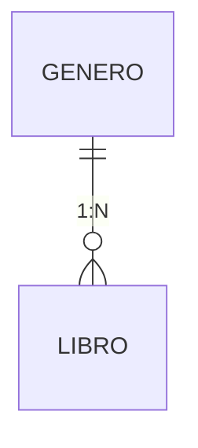
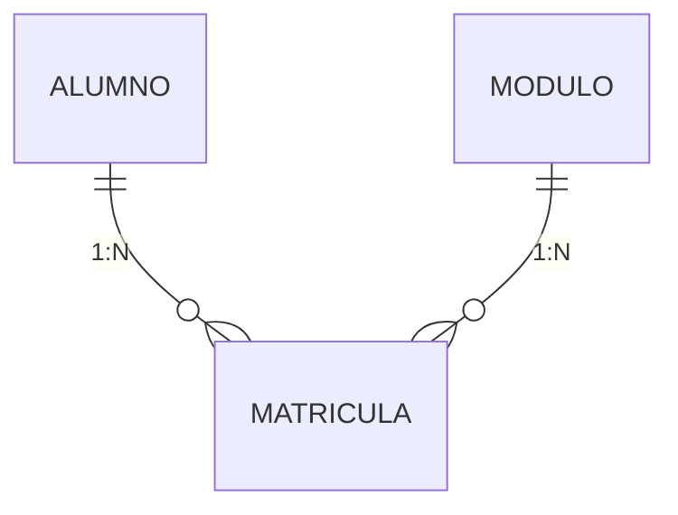
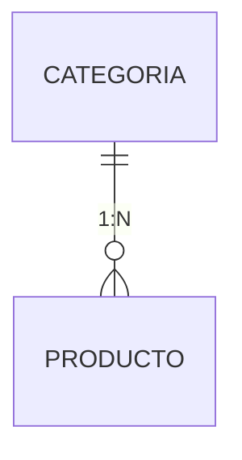

# Ejercicios prácticos — UT5 (RA6)

Tres enunciados **del mismo tamaño que el examen**: dos o tres entidades relacionadas, ocho endpoints, siete reglas y tres tests. Pensados para **resolverse en cuatro horas** con el esqueleto dado.

!!! info "Qué se te da y qué escribes tú"
    **Se te da:** `pom.xml`, los `application*.properties` de los tres perfiles, `data.sql` y la clase de arranque.

    **Escribes tú:** las entidades, los DTOs, los repositorios, el mapeador, las excepciones, el servicio, el controlador, el manejador global y tres tests.

    **No hay `schema.sql`:** el esquema lo genera Hibernate desde tus entidades, así que **el modelo de datos lo diseñas tú** y es lo primero que se corrige.

| | Enunciado | Entidades | La dificultad |
|:-:|---|:-:|---|
| **EP1** | [Biblioteca](#ep1-biblioteca) | 2 | Relación 1:N, borrado lógico y una regla sobre contadores de las dos tablas |
| **EP2** | [Instituto](#ep2-instituto) | 3 | **N:M con datos propios** y un N+1 de manual |
| **EP3** | [Tienda](#ep3-tienda) | 2 | **Transacción** y **`@Version`**: el único que trabaja la concurrencia |

!!! success "Reparto del tiempo, para que quepa"
    | | Qué | Tiempo |
    |:-:|---|:-:|
    | 1 | Las entidades y sus relaciones | 45 min |
    | 2 | DTOs y mapeador | 30 min |
    | 3 | Repositorios: derivadas, una `@Query` y la `Specification` | 50 min |
    | 4 | Servicio con las siete reglas y `@Transactional` | 70 min |
    | 5 | Controlador con `Pageable` saneado y el advice | 30 min |
    | 6 | Tres tests | 25 min |
    | 7 | Probar con `curl` y **contar las consultas** del log | 20 min |
    | | | **4 h** |

    **Si vas justo, el orden de lo que se abandona** es: las estadísticas, el tercer test y el PATCH. Nunca el `LAZY`, el `JOIN FETCH` ni el `@Transactional`: ahí están 4 de los 10 puntos.

---

## EP1 · Biblioteca

**Contexto.** Una biblioteca presta libros a sus socios. Cada libro pertenece a un género y hay que saber en todo momento cuántos ejemplares están fuera y cuántos préstamos activos tiene cada socio.

### Modelo que hay que crear



| Entidad | Campos |
|---|---|
| **`Genero`** | `id`, `nombre` (único, máx. 40), `prestamosTotales` (contador), `deleted` |
| **`Libro`** | `id`, `isbn` (único, 13 dígitos), `titulo`, `autor`, `genero` (**N:1**), `ejemplares`, `prestados`, `publicacion` (fecha), `deleted`, `createdAt`, `updatedAt` |

### Endpoints

| # | Método y ruta | Éxito |
|:-:|---|:-:|
| 1 | `GET /api/v1/libros` · **paginado**. Filtros opcionales y combinables `titulo` (contiene), `autor` (contiene), `genero` (nombre exacto), `disponibles=true` | 200 |
| 2 | `GET /api/v1/libros/{id}` · con **el nombre del género**, no su id | 200 |
| 3 | `POST /api/v1/libros` | 201 + `Location` |
| 4 | `PATCH /api/v1/libros/{id}` | 200 |
| 5 | `DELETE /api/v1/libros/{id}` · **borrado lógico** | 204 |
| 6 | `POST /api/v1/libros/{id}/prestamo` · **toca las dos entidades** | 200 |
| 7 | `POST /api/v1/libros/{id}/devolucion` | 200 |
| 8 | `GET /api/v1/generos` · `POST` · `DELETE` | — |

### Reglas de negocio

| # | Regla | Respuesta |
|:-:|---|:-:|
| R1 | `isbn` **13 dígitos** y único; `titulo` y `autor` no vacíos | **400** / **409** |
| R2 | `ejemplares` ≥ 1; `publicacion` **no futura** | **400** |
| R3 | El `genero` indicado **debe existir y no estar borrado** | **400** |
| R4 | **No se puede prestar** si `prestados == ejemplares` | **409** |
| R5 | Prestar incrementa `libro.prestados` **y** `genero.prestamosTotales`, de forma **atómica** | — |
| R6 | **No se puede devolver** si `prestados == 0` | **409** |
| R7 | **No se puede borrar** un libro con `prestados > 0`, ni un género con libros | **409** |

### Lo que se evalúa aquí

```java title="Libro.java — las cuatro decisiones del modelo"
@Entity
@Table(name = "libros", indexes = {
        @Index(name = "idx_libro_titulo",  columnList = "titulo"),
        @Index(name = "idx_libro_deleted", columnList = "is_deleted")
})
public class Libro {

    @Id @GeneratedValue(strategy = GenerationType.IDENTITY)
    private Long id;

    @Column(nullable = false, unique = true, length = 13)
    private String isbn;

    /** Lado DUEÑO: la clave ajena vive en esta tabla. LAZY, siempre. */
    @ManyToOne(fetch = FetchType.LAZY, optional = false)
    @JoinColumn(name = "genero_id", nullable = false,
                foreignKey = @ForeignKey(name = "fk_libro_genero"))
    private Genero genero;

    @Column(name = "is_deleted", nullable = false)
    private boolean deleted = false;

    protected Libro() {}          // JPA lo necesita
}
```

```java title="Genero.java — el lado inverso"
/** mappedBy: el dueño es el campo "genero" de Libro. SIN cascade. */
@OneToMany(mappedBy = "genero", fetch = FetchType.LAZY)
private List<Libro> libros = new ArrayList<>();
```

```java title="LibrosRepository.java — sin N+1"
@Query(value      = """
                    SELECT l FROM Libro l JOIN FETCH l.genero
                     WHERE l.deleted = false
                    """,
       countQuery = "SELECT count(l) FROM Libro l WHERE l.deleted = false")
Page<Libro> findAllConGenero(Pageable pageable);

@Modifying(clearAutomatically = true, flushAutomatically = true)
@Query("""
       UPDATE Libro l SET l.prestados = l.prestados + 1, l.updatedAt = CURRENT_TIMESTAMP
        WHERE l.id = :id AND l.prestados < l.ejemplares
       """)
int reservarEjemplar(@Param("id") Long id);
```

!!! danger "Los tres ítems que más puntúan en este enunciado"
    **1. `fetch = FetchType.LAZY` en el `@ManyToOne`.** El valor por defecto es `EAGER`, y entonces listar 20 libros trae 20 géneros aunque nadie los mire.

    **2. El `JOIN FETCH` con su `countQuery`.** Listar 20 libros con su género tiene que ser **2 consultas**. Si son 21, falta.

    **3. El `@Transactional` de la R5.** Si el incremento del género falla después de reservar el ejemplar, el `rollback` tiene que devolver `libro.prestados`. **Se comprueba apuntando los dos contadores, provocando el fallo y volviendo a mirar.**

---

## EP2 · Instituto

**Contexto.** Un centro gestiona las matrículas de sus alumnos en los módulos de un ciclo. Un alumno se matricula de varios módulos por curso académico, y **cada matrícula tiene su nota y su fecha**.

### Modelo que hay que crear



| Entidad | Campos |
|---|---|
| **`Alumno`** | `id`, `dni` (único, `\d{8}[A-Z]`), `nombre`, `email` (único), `deleted` |
| **`Modulo`** | `id`, `codigo` (único, 4 dígitos), `nombre`, `curso` (1 o 2), `horas`, `deleted` |
| **`Matricula`** | `id`, `alumno` (**N:1**), `modulo` (**N:1**), `curso` (`2025-2026`), `nota` (`BigDecimal(4,2)`, puede ser nula), `fechaMatricula`, **única por (alumno, modulo, curso)** |

!!! danger "La decisión de diseño que se corrige primero, y es eliminatoria"
    La relación «alumno cursa módulos» **no es un `@ManyToMany`**, porque la matrícula tiene **datos propios**: la nota y la fecha.

    | | `@ManyToMany` | Entidad intermedia |
    |---|---|---|
    | La tabla de unión | La crea Hibernate | **La defines tú** |
    | Datos propios | **Imposible** | Sí: nota, fecha |
    | Consultar la relación | No se puede | Es un repositorio más |
    | Paginar las matrículas de un alumno | No se puede | Sí |

    **Resolverlo con un `@ManyToMany` es 0 puntos en todo el bloque 1**, porque hace imposible el resto del enunciado.

### Endpoints

| # | Método y ruta | Éxito |
|:-:|---|:-:|
| 1 | `GET /api/v1/alumnos` · **paginado**. Filtros opcionales `nombre`, `dni` | 200 |
| 2 | `GET /api/v1/alumnos/{id}` · CRUD completo con **borrado lógico** | — |
| 3 | `GET /api/v1/alumnos/{id}/matriculas?curso=` · con **el nombre del módulo y la nota** | 200 |
| 4 | `GET /api/v1/alumnos/{id}/expediente?curso=` · resumen (abajo) | 200 |
| 5 | `GET /api/v1/modulos` · paginado, filtro `curso`. `POST` y `PATCH` | — |
| 6 | `POST /api/v1/matriculas` | 201 + `Location` |
| 7 | `PATCH /api/v1/matriculas/{id}/nota` | 200 |
| 8 | `DELETE /api/v1/matriculas/{id}` | 204 |

### Reglas de negocio

| # | Regla | Respuesta |
|:-:|---|:-:|
| R1 | `dni` con formato `\d{8}[A-Z]`; `email` válido; `codigo` de módulo `\d{4}` | **400** |
| R2 | `curso` con formato `AAAA-AAAA` **y años consecutivos** | **400** |
| R3 | `nota` entre **0 y 10**, con dos decimales; `horas` entre 30 y 400 | **400** |
| R4 | Alumno y módulo **deben existir y no estar borrados** | **400** |
| R5 | **Un alumno no se matricula dos veces del mismo módulo en el mismo curso** | **409** |
| R6 | **No se puede desmatricular** una matrícula que ya tiene nota | **409** |
| R7 | **No se puede borrar** un alumno ni un módulo con matrículas | **409** |

### `GET /api/v1/alumnos/{id}/expediente?curso=2025-2026`

```json
{
  "alumno": { "dni": "12345678Z", "nombre": "Ana Pérez" },
  "curso": "2025-2026",
  "matriculados": 8,
  "calificados": 6,
  "aprobados": 5,
  "suspensos": 1,
  "media": 6.83,
  "porModulo": [
    { "codigo": "0613", "nombre": "DWES",           "nota": 8.00 },
    { "codigo": "0612", "nombre": "Bases de Datos", "nota": 7.50 },
    { "codigo": "0614", "nombre": "Despliegue",     "nota": null }
  ]
}
```

!!! danger "El expediente trae un N+1 dentro, y es el ítem que decide"
    Lo obvio **está mal**:

    ```java
    // ❌ Un SELECT por cada matrícula para traer su módulo
    var matriculas = matriculasRepository.findByAlumnoIdAndCurso(id, curso);
    matriculas.forEach(m -> m.getModulo().getNombre());    // ← N+1 aquí
    ```

    Con 8 matrículas son 9 consultas; con 40, 41. Lo correcto trae el módulo **en la misma consulta**:

    ```java
    @Query("""
           SELECT m FROM Matricula m
             JOIN FETCH m.modulo
            WHERE m.alumno.id = :alumnoId AND m.curso = :curso
           """)
    List<Matricula> findConModulo(@Param("alumnoId") Long alumnoId,
                                  @Param("curso") String curso);
    ```

    **Se corrige con `show-sql=true` y contando las líneas `Hibernate:`.** Dos consultas, no nueve.

!!! warning "La media con `BigDecimal` y `RoundingMode`"
    ```java
    var media = calificadas.isEmpty() ? null : calificadas.stream()
            .map(Matricula::getNota)
            .reduce(BigDecimal.ZERO, BigDecimal::add)
            .divide(BigDecimal.valueOf(calificadas.size()), 2, RoundingMode.HALF_UP);
    ```

    Son notas: **el redondeo tiene consecuencias**. Y `calificadas.size()` puede ser **0**: hay que devolver `null`, no un `ArithmeticException`.

---

## EP3 · Tienda

**Contexto.** Una tienda gestiona su catálogo y sus ventas. Cada producto pertenece a una categoría, y vender descuenta stock. Varios administradores pueden editar el mismo producto a la vez.

### Modelo que hay que crear



| Entidad | Campos |
|---|---|
| **`Categoria`** | `id`, `nombre` (único, máx. 40), `unidadesVendidas` (contador), `deleted` |
| **`Producto`** | `id`, `sku` (único), `nombre`, `categoria` (**N:1**), `precio` (`BigDecimal(10,2)`), `stock`, `deleted`, **`@Version version`**, `createdAt`, `updatedAt` |

### Endpoints

| # | Método y ruta | Éxito |
|:-:|---|:-:|
| 1 | `GET /api/v1/productos` · **paginado**. Filtros opcionales y combinables `nombre` (contiene), `categoria` (nombre), `precioMax`, `conStock=true` | 200 |
| 2 | `GET /api/v1/productos/{id}` · con **el nombre de la categoría** | 200 |
| 3 | `POST /api/v1/productos` | 201 + `Location` |
| 4 | `PATCH /api/v1/productos/{id}` | 200 |
| 5 | `DELETE /api/v1/productos/{id}` · **borrado lógico** | 204 |
| 6 | `POST /api/v1/productos/{id}/venta` · `{"cantidad":2}` · **toca las dos entidades** | 200 |
| 7 | `POST /api/v1/productos/{id}/reposicion` · `{"cantidad":10}` | 200 |
| 8 | `GET /api/v1/categorias` · `POST` · `DELETE` · `GET /{id}/productos` paginado | — |

### Reglas de negocio

| # | Regla | Respuesta |
|:-:|---|:-:|
| R1 | `sku` único, formato `SKU-\d{3}`; `nombre` no vacío | **400** / **409** |
| R2 | `precio` ≥ 0 con dos decimales; `stock` ≥ 0; `cantidad` de venta ≥ 1 | **400** |
| R3 | La `categoria` indicada **debe existir y no estar borrada** | **400** |
| R4 | **No se puede vender** más de lo que hay en stock | **409** |
| R5 | Vender descuenta `producto.stock` **y** suma a `categoria.unidadesVendidas`, de forma **atómica** | — |
| R6 | **No se puede borrar** un producto con stock > 0, ni una categoría con productos | **409** |
| R7 | **Dos administradores editando el mismo producto a la vez**: el segundo recibe un **409** con un mensaje claro | **409** |

### La regla 7: bloqueo optimista

```java
@Version
private Long version;
```

Hibernate añade `AND version = ?` a cada `UPDATE` e incrementa el número. Si otro ya lo había cambiado, el `UPDATE` afecta a **0 filas** y lanza `ObjectOptimisticLockingFailureException`.

```java
@ResponseStatus(HttpStatus.CONFLICT)
@ExceptionHandler(ObjectOptimisticLockingFailureException.class)
public Map<String, Object> conflictoDeEdicion(ObjectOptimisticLockingFailureException ex) {
    return Map.of("status", 409,
            "error", "Otro usuario ha modificado este producto. "
                   + "Recarga los datos y vuelve a intentarlo.");
}
```

```java title="El test que lo demuestra"
@Test
void dosEdicionesSimultaneasProvocanConflicto() {
    var a = repositorio.findById(1L).orElseThrow();   // version = 0
    var b = repositorio.findById(1L).orElseThrow();   // version = 0

    a.setNombre("Teclado nuevo");
    repositorio.saveAndFlush(a);                      // version → 1

    b.setNombre("Teclado viejo");
    assertThrows(ObjectOptimisticLockingFailureException.class,
            () -> repositorio.saveAndFlush(b));       // version 0 ≠ 1
}
```

!!! danger "Sin `@Version`, el último en guardar pisa al primero y nadie se entera"
    Se llama *lost update*, y es el bug silencioso clásico de un panel de administración con dos personas trabajando. **Este es el único enunciado de la unidad que lo trabaja.**

### Y la regla 4, con el `UPDATE` condicionado

```java
@Modifying(clearAutomatically = true, flushAutomatically = true)
@Query("""
       UPDATE Producto p SET p.stock = p.stock - :cantidad
        WHERE p.id = :id AND p.stock >= :cantidad
       """)
int descontarStock(@Param("id") Long id, @Param("cantidad") int cantidad);
```

Si afecta a **0 filas**, no había bastante → 409. Nunca «leer, comprobar con un `if` y escribir»: con JPA es **más fácil caer en eso**, porque el `setStock` parece inofensivo.

---

## ¿Cabe en cuatro horas?

**Sí.** Las entidades son verbosas pero los repositorios **no tienen cuerpo**, así que el volumen total baja respecto a la UT4 aunque el modelo sea más rico.

| | Ficheros que escribes | Líneas aprox. |
|---|---|:-:|
| Entidades (2 o 3) | 3 | 170 |
| DTOs (`Response`, `CreateRequest`, `UpdateRequest`, el del resumen) | 4 | 60 |
| Repositorios (**interfaces sin cuerpo**) | 2–3 | 50 |
| Excepciones (base + 3) | 4 | 30 |
| Mapeador | 1 | 60 |
| Servicio (interfaz + impl) | 2 | 110 |
| Controlador (con `Pageable` saneado) | 1–2 | 80 |
| `@RestControllerAdvice` | 1 | 35 |
| Tests | 2 | 60 |

!!! success "Lo que se recortó respecto a versiones anteriores de estos enunciados"
    | | Antes | Ahora |
    |---|:-:|:-:|
    | Entidades | 4–5 | **2, o 3 en el EP2** |
    | Endpoints | 13–14 | **8** |
    | Reglas de negocio | 13–14 | **7** |
    | Tests exigidos | 7 | **3** |

    **Lo que se queda, porque es lo que evalúa el RA6:** una relación 1:N bien modelada, `LAZY` en todas partes, un `JOIN FETCH` que evita el N+1, la transacción de dos entidades y el `@Version` del EP3.

---

## Rúbrica de calificación

**La misma para los tres enunciados y para el examen.** Sobre 10 puntos.

!!! info "Lo que mide esta rúbrica y no la del RA5"
    En el RA5 el peso estaba en las capas. **Aquí está en el modelo de datos, el rendimiento y la integridad.** Las capas se dan por sabidas y solo aparecen como penalización.

### Bloque 1 · Modelo de datos y relaciones — 2,5 puntos

| | Se comprueba con | Puntos |
|---|---|:-:|
| 1.1 | **La relación del diagrama está bien**, con la cardinalidad correcta y la clave ajena en el lado que toca | **1,0** |
| 1.2 | El `@OneToMany` lleva **`mappedBy`**, y no hay tabla intermedia fantasma | 0,5 |
| 1.3 | **Sin `cascade` que pueda borrar un maestro**; las reglas de borrado son comprobaciones en el servicio | 0,4 |
| 1.4 | `@Enumerated(EnumType.STRING)` en los `enum`, si usas alguno. `grep -rn "@Enumerated" src/` → ninguno sin `STRING` | 0,3 |
| 1.5 | Dinero y notas con **`BigDecimal`** y `precision`/`scale`. `grep -rn "double\|float" src/main/java/**/models/` → vacío | 0,3 |

!!! danger "Eliminatoria en el EP2"
    Resolver las matrículas con `@ManyToMany` en lugar de una entidad intermedia → **0 en todo el bloque 1**.

### Bloque 2 · Rendimiento: `LAZY` y el N+1 — 2,0 puntos

| | Se comprueba con | Puntos |
|---|---|:-:|
| 2.1 | `grep -rn "FetchType.EAGER" src/` → **vacío**. Un solo `EAGER` → 0 en este ítem | **0,7** |
| 2.2 | Con `show-sql=true`, **listar una página de 20 elementos con su relación son 2 consultas**, no 21 | **0,8** |
| 2.3 | La consulta del resumen o las estadísticas trae la relación con `JOIN FETCH`, o agrupa con **`GROUP BY`** en el repositorio | 0,3 |
| 2.4 | `spring.jpa.open-in-view=false` | 0,2 |

!!! danger "El 2.2 se corrige con el log delante, y no hay otra forma"
    Un programa con N+1 **funciona perfectamente** y pasa cualquier prueba manual.

    | Consultas | Nota |
    |---|:-:|
    | 2 | **0,8** |
    | 3 a 5 | 0,4 |
    | 1 + tamaño de página | **0** |

### Bloque 3 · Repositorios y consultas — 1,5 puntos

| | Se comprueba con | Puntos |
|---|---|:-:|
| 3.1 | Al menos **cuatro consultas derivadas del nombre**, con `IgnoreCase` donde el enunciado lo pide | 0,4 |
| 3.2 | Al menos **una `@Query` con JPQL**, con `JOIN FETCH` o agregado | 0,4 |
| 3.3 | Los **filtros opcionales y combinables** del listado con **`Specification`**, no con `if` anidados ni un método por combinación | 0,4 |
| 3.4 | Los `@Modifying` llevan `@Transactional` en quien los llama y `clearAutomatically` | 0,3 |

### Bloque 4 · Validaciones en tres niveles — 2,0 puntos

| | Se comprueba con | Puntos |
|---|---|:-:|
| 4.1 | **Formato en el DTO**: las reglas R1–R3 con Bean Validation, y `@Valid` en todos los `@RequestBody` | **0,6** |
| 4.2 | Un POST inválido devuelve **400 con los errores campo a campo** | 0,4 |
| 4.3 | **Negocio en el servicio**: cada regla que necesita consultar la BD devuelve **409**, no 400 ni 500 | **0,6** |
| 4.4 | **Integridad en la entidad**: `nullable = false`, `unique = true`, `length`, y un handler de `DataIntegrityViolationException` → 409 | 0,4 |

### Bloque 5 · Integridad y transacciones — 2,0 puntos

| | Se comprueba con | Puntos |
|---|---|:-:|
| 5.1 | **Las siete reglas** se cumplen y devuelven el código indicado. *0,15 por regla* | **1,05** |
| 5.2 | La operación de dos entidades lleva `@Transactional`, y **se demuestra comparando los contadores antes y después de un fallo** | **0,6** |
| 5.3 | El descuento usa un **`UPDATE … WHERE … >= :cantidad`**, no «leer, comprobar, escribir» | 0,35 |

!!! danger "El 5.2 se demuestra, no se declara"
    Se apuntan los dos contadores, se provoca el fallo de la última operación y se vuelve a mirar. **Los dos valores tienen que estar intactos.**

    Si no lo están, 0 en el ítem **aunque la anotación esté puesta**: lo habitual es que la excepción se capture dentro del método transaccional, y entonces no hay *rollback*.

### Bloque 6 · Tests — 1,0 punto

| | Se comprueba con | Puntos |
|---|---|:-:|
| 6.1 | `./mvnw clean test` acaba en **BUILD SUCCESS**. Si no compila o hay tests comentados → **0 en el bloque** | 0,2 |
| 6.2 | **Un test con `@DataJpaTest`**: la relación, una consulta derivada o el borrado lógico | 0,3 |
| 6.3 | **Un test de servicio** con Mockito de una regla de negocio | 0,3 |
| 6.4 | **Un test de la transacción** del 5.2, o del `@Version` en el EP3 | 0,2 |

### Bloque 7 · Configuración y persistencia — 1,0 punto

| | Se comprueba con | Puntos |
|---|---|:-:|
| 7.1 | Los datos **sobreviven** a parar y arrancar | 0,3 |
| 7.2 | Tres perfiles: `dev` con `update`, `prod` con **`validate`**, `test` con `create-drop` y H2 `mem:` | 0,3 |
| 7.3 | `?page=&size=&sort=` funcionan, con **tope de tamaño** y **lista blanca** de campos ordenables | 0,3 |
| 7.4 | Sin credenciales en el código; `.env` ignorado si lo usas | 0,1 |

!!! danger "Penalizaciones — se restan del total"
    | | |
    |---|:-:|
    | Devolver una **entidad** desde un controlador | **−1,5** |
    | Cualquier **`LazyInitializationException`** en algún endpoint | **−1,0** |
    | `ddl-auto=create-drop` o `update` en el perfil `prod` | **−1,0** |
    | Concatenar un valor de entrada en un `@Query` | **−2,0** |
    | `ResponseEntity` o `HttpStatus` dentro de un `@Service` | **−1,0** |
    | `@Valid` olvidado en algún `@RequestBody` | **−1,0** |
    | `?sort=` sin lista blanca o `?size=` sin tope | **−0,5** |
    | `equals`/`hashCode` generados por el IDE en una entidad | **−0,5** |

!!! success "Nota mínima"
    Se aprueba con **5,0**. **Dos mínimos:** el bloque 1 no puede quedar en 0, y tampoco el ítem 2.1.

    | Bloque | Peso |
    |---|:-:|
    | 1 · Modelo y relaciones | 25 % |
    | 2 · `LAZY` y N+1 | 20 % |
    | 3 · Repositorios | 15 % |
    | 4 · Validaciones | 20 % |
    | 5 · Integridad y transacciones | 20 % |
    | 6 · Tests | 10 % |
    | 7 · Configuración | 10 % |

    *(Suman 12 puntos de criterios sobre un máximo de 10: permite compensar un bloque flojo, salvo los dos mínimos.)*

!!! info "Orden de corrección"
    1. `./mvnw clean test` → bloque 6.1.
    2. **Los cuatro `grep`**: `FetchType.EAGER`, `@Enumerated` sin `STRING`, `double` en los modelos, `ResponseEntity` en los servicios. **Dos minutos y un 15 % de la nota.**
    3. Abrir las entidades y dibujar el modelo → bloque 1.
    4. `java -jar` con `show-sql=true`, pedir un listado paginado y **contar las consultas** → bloque 2.2.
    5. Las peticiones del enunciado → bloque 5.1.
    6. Un POST inválido → bloques 4.1 y 4.2.
    7. Apuntar los contadores, provocar el fallo y volver a mirar → bloque 5.2.
    8. Parar, arrancar y volver a listar → bloque 7.1.
    9. `?size=99999` y `?sort=inventado` → bloque 7.3.

    Se entrega comprimido **sin `target/` ni `datos/`**, con un `README.md` que incluya **el diagrama del modelo**.
