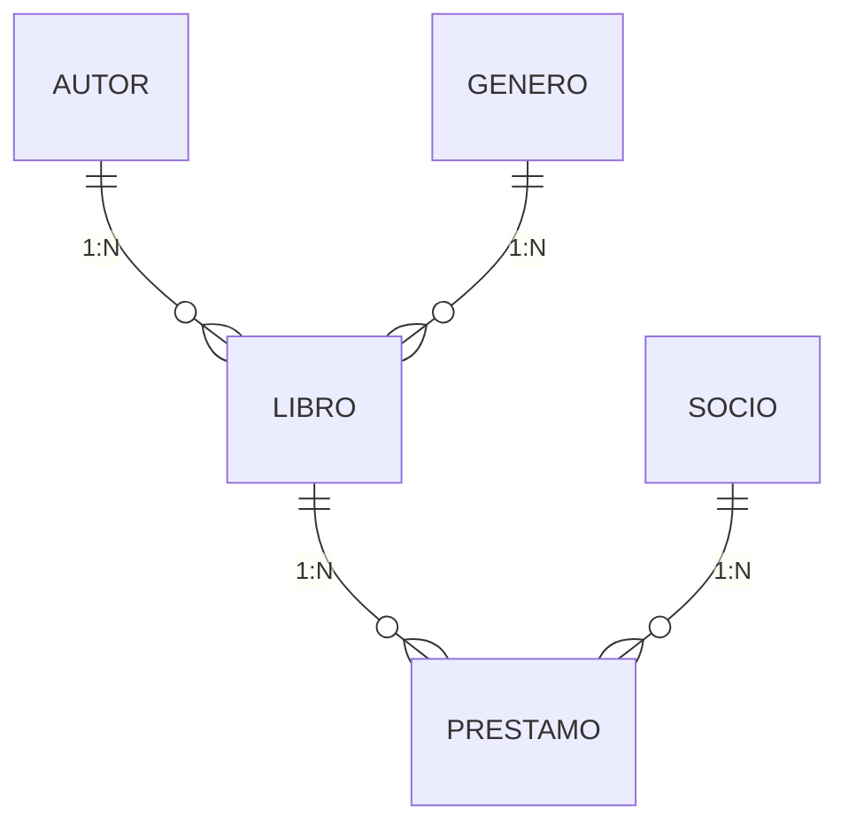
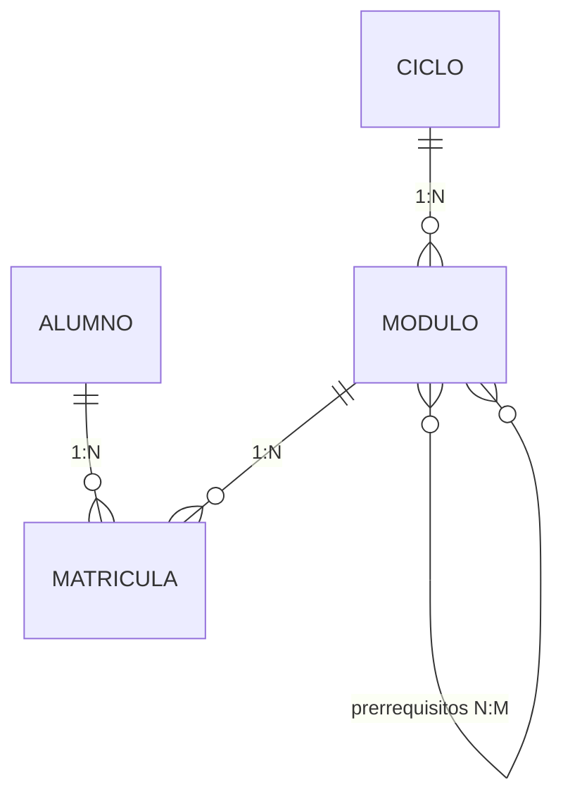
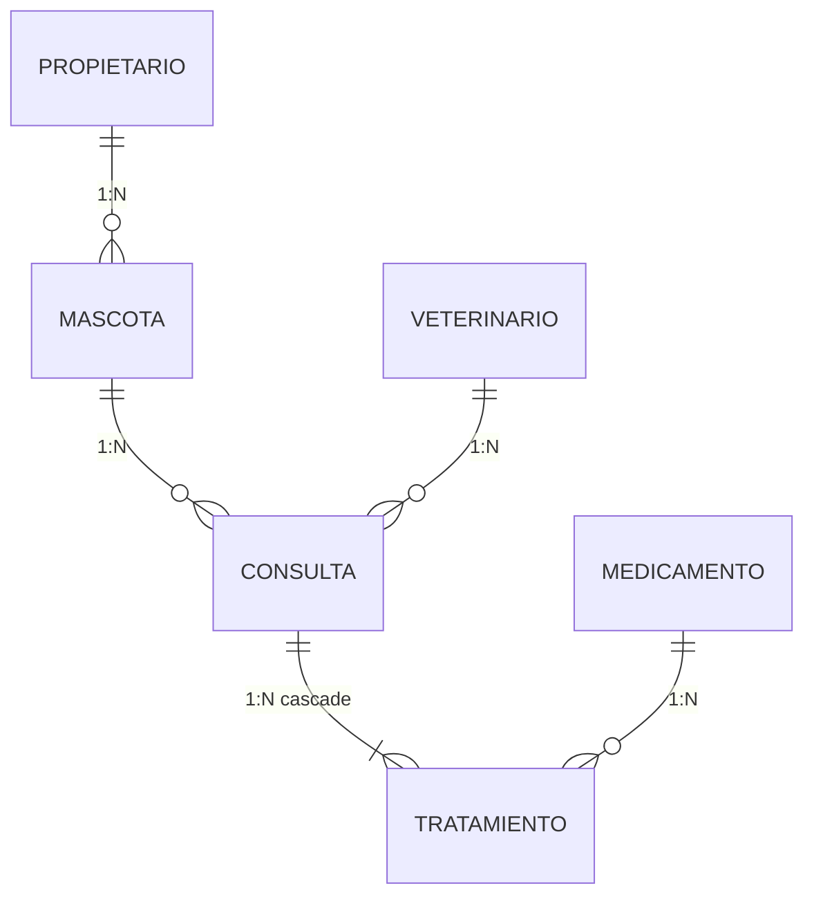

# Ejercicios prácticos — UT5 (RA6)

Tres enunciados **del mismo formato y la misma extensión que el examen**. Se resuelven igual que los [dos proyectos paso a paso](04-proyectos.md): Spring Data JPA, H2 en fichero, entidades con relaciones, validaciones, paginación y los tres niveles de test.

!!! success "Qué evalúa el RA6 y qué no"
    El RA6 es *«desarrolla aplicaciones web de acceso a almacenes de datos, aplicando medidas para mantener la **seguridad y la integridad** de la información»*.

    Traducido a lo que se corrige aquí:

    | | |
    |---|---|
    | **Integridad** | Relaciones bien modeladas, claves ajenas, restricciones, transacciones atómicas, bloqueo optimista |
    | **Seguridad** | Nada de concatenar en consultas, nada de exponer entidades, `?sort=` con lista blanca |
    | **JPA e Hibernate** | Entidades, relaciones, `LAZY`, cascada, repositorios, JPQL, `Specification`, **sin N+1** |
    | **Validaciones** | Bean Validation en los DTOs, reglas de negocio en el servicio, restricciones en la tabla |

    **La arquitectura por capas ya se evaluó en el RA5**: aquí se da por sabida y solo resta puntos si está mal.

| | Enunciado | Entidades | Tiempo | Dificultad característica |
|:-:|---|:-:|:-:|---|
| **EP1** | [Biblioteca con préstamos](#ep1-biblioteca-con-prestamos) | 4 | 4 h | Reglas que consultan **otras filas** antes de insertar |
| **EP2** | [Instituto: matrículas y notas](#ep2-instituto-matriculas-y-notas) | 4 | 4 h | **N:M con datos propios** y una consulta que provoca N+1 |
| **EP3** | [Clínica veterinaria](#ep3-clinica-veterinaria) | 5 | 4 h | **Transacción multi-tabla** y bloqueo optimista |

!!! info "Qué se te da y qué escribes tú"
    **Se te da:** el `pom.xml`, los `application*.properties` de los tres perfiles, el `data.sql` y la clase de arranque.

    **Escribes tú:** las entidades (**el esquema lo genera Hibernate**), DTOs, repositorios, mapeadores, excepciones, servicios, controladores, el manejador global y los tests.

    **Importante y distinto de la UT4:** aquí **no hay `schema.sql`**. El esquema sale de tus entidades con `ddl-auto=update`, así que **el modelo de datos lo diseñas tú** y es la primera cosa que se corrige.

---

## EP1 · Biblioteca con préstamos

**Contexto.** Una biblioteca municipal necesita una API para su catálogo y sus préstamos. Un libro tiene un autor y un género; de cada libro hay varios ejemplares. Los socios piden libros prestados con un plazo de devolución, y la biblioteca necesita saber en todo momento qué está fuera y qué está vencido.

### Modelo de datos que hay que crear



| Entidad | Campos |
|---|---|
| **`Autor`** | `id`, `nombre` (único), `nacionalidad`, `nacimiento` (fecha), `deleted` |
| **`Genero`** | `id`, `nombre` (único, máx. 40), `deleted` |
| **`Libro`** | `id`, `isbn` (único, 13 dígitos), `titulo`, `autor` (N:1), `genero` (N:1), `ejemplares`, `prestados`, `publicacion` (fecha), `deleted`, `createdAt`, `updatedAt` |
| **`Socio`** | `id`, `numeroSocio` (único, `SOC-00001`), `nombre`, `email` (único), `alta` (fecha), `activo`, `deleted` |
| **`Prestamo`** | `id`, `libro` (N:1), `socio` (N:1), `fecha`, `vencimiento`, `devolucion` (puede ser nula), `estado` (`enum`: `ACTIVO`, `DEVUELTO`, `VENCIDO`) |

### Endpoints que hay que implementar

| # | Método y ruta | Qué hace | Éxito |
|:-:|---|---|:-:|
| 1 | `GET /api/v1/libros` | **Paginado**. Filtros opcionales y combinables: `titulo` (contiene), `autor` (nombre, contiene), `genero` (nombre exacto), `disponibles=true` | 200 |
| 2 | `GET /api/v1/libros/{id}` | Uno, con **el nombre del autor y del género**, no sus ids | 200 |
| 3 | `POST` · `PUT` · `PATCH` · `DELETE` de `/api/v1/libros` | CRUD, con **borrado lógico** | 201/200/200/204 |
| 4 | `GET /api/v1/autores` · `/{id}` · CRUD | Con borrado lógico | — |
| 5 | `GET /api/v1/autores/{id}/libros` | Paginado | 200 |
| 6 | `GET /api/v1/generos` · CRUD | Con borrado lógico | — |
| 7 | `GET /api/v1/socios` · `/{id}` · CRUD | Con borrado lógico | — |
| 8 | `POST /api/v1/prestamos` | Presta un libro a un socio | 201 + `Location` |
| 9 | `POST /api/v1/prestamos/{id}/devolucion` | Devuelve | 200 |
| 10 | `GET /api/v1/prestamos` | Paginado. Filtros `socioId`, `libroId`, `estado`, `vencidos=true` | 200 |
| 11 | `GET /api/v1/socios/{id}/historial` | Paginado, con título del libro y fechas | 200 |
| 12 | `GET /api/v1/libros/mas-prestados?limite=5` | Ranking | 200 |
| 13 | `GET /api/v1/prestamos/estadisticas` | Resumen (abajo) | 200 |

### Reglas de negocio

| # | Regla | Respuesta |
|:-:|---|:-:|
| R1 | `isbn` exactamente 13 dígitos y **único** | **400** / **409** |
| R2 | `email` del socio con formato válido y **único**; `numeroSocio` con formato `SOC-\d{5}` | **400** / **409** |
| R3 | `ejemplares` ≥ 1; `publicacion` **no futura**; `nacimiento` del autor **no futuro** | **400** |
| R4 | El autor y el género de un libro **deben existir y no estar borrados** | **400** |
| R5 | **No se puede prestar** si `prestados == ejemplares` | **409** |
| R6 | **Un socio no puede tener más de 3 préstamos activos** | **409** |
| R7 | **Un socio con algún préstamo vencido no puede pedir otro** | **409** |
| R8 | Un socio **inactivo** no puede pedir préstamos | **409** |
| R9 | El `vencimiento` son **15 días naturales** desde la fecha del préstamo, **calculado por el servidor** | — |
| R10 | **No se puede devolver** un préstamo que ya está `DEVUELTO` | **409** |
| R11 | Devolver pone `devolucion = hoy`, estado `DEVUELTO` y **decrementa `prestados`** | — |
| R12 | **No se puede borrar** un autor con libros, un género con libros, un libro con préstamos activos, ni un socio con préstamos activos | **409** |
| R13 | Un préstamo pasa a `VENCIDO` automáticamente cuando `vencimiento < hoy` y no se ha devuelto | — |

!!! danger "R5, R6 y R7 son el núcleo del ejercicio"
    Las tres necesitan **consultar el estado de otras filas antes de insertar**, y eso es exactamente lo que el RA6 evalúa.

    **R5** se hace con un `UPDATE` condicionado, no con «leer, comprobar, escribir»:

    ```java
    @Modifying(clearAutomatically = true, flushAutomatically = true)
    @Query("""
           UPDATE Libro l SET l.prestados = l.prestados + 1
            WHERE l.id = :id AND l.prestados < l.ejemplares
           """)
    int reservarEjemplar(@Param("id") Long id);
    ```

    Si afecta a **0 filas**, no había ejemplares libres → 409.

    **R6 y R7** son dos consultas de conteo:

    ```java
    long countBySocioIdAndEstado(Long socioId, EstadoPrestamo estado);

    @Query("""
           SELECT count(p) FROM Prestamo p
            WHERE p.socio.id = :socioId
              AND p.devolucion IS NULL
              AND p.vencimiento < CURRENT_DATE
           """)
    long vencidosDe(@Param("socioId") Long socioId);
    ```

    Y **todo el método `prestar` va en una sola transacción**: si falla la R6 después de reservar el ejemplar, el `prestados` no puede quedar incrementado.

!!! tip "R13: cuidado con guardar un estado derivado"
    `VENCIDO` se puede calcular (`devolucion == null && vencimiento < hoy`), así que **guardarlo en una columna es redundante y se queda obsoleto solo**.

    Dos soluciones válidas, y hay que elegir una y justificarla en el `README`:

    1. **Calcularlo al leer**, en el mapeador. El campo `estado` solo guarda `ACTIVO` o `DEVUELTO`.
    2. **Guardarlo y actualizarlo** con una tarea programada (`@Scheduled`) que lo recalcule cada noche.

    La 1 es más simple y no se desincroniza nunca. La 2 permite consultarlo con un índice, que importa con millones de filas.

### `GET /api/v1/prestamos/estadisticas`

```json
{
  "prestamosActivos": 23,
  "vencidos": 4,
  "devueltosEsteMes": 61,
  "duracionMediaDias": 11.3,
  "porGenero": { "COMIC": 5, "ENSAYO": 7, "NOVELA": 11 },
  "librosSinEjemplaresLibres": ["Dune", "Fundación"],
  "sociosConVencidos": [
    { "numeroSocio": "SOC-00012", "nombre": "Ana Pérez", "vencidos": 2 }
  ],
  "topLibros": [
    { "isbn": "9788497593793", "titulo": "Dune", "veces": 14 }
  ]
}
```

!!! warning "`porGenero` y `topLibros` se resuelven con `GROUP BY`, no en Java"
    Traer 10.000 préstamos a memoria para contarlos agrupados es **exactamente lo que el RA6 penaliza**. La agrupación la hace la base de datos:

    ```java
    @Query("""
           SELECT p.libro.genero.nombre, count(p)
             FROM Prestamo p
            WHERE p.devolucion IS NULL
            GROUP BY p.libro.genero.nombre
            ORDER BY p.libro.genero.nombre
           """)
    List<Object[]> contarActivosPorGenero();
    ```

    Y `topLibros` es un `GROUP BY` con `ORDER BY count(*) DESC` y `Pageable` para el `LIMIT`.

---

## EP2 · Instituto: matrículas y notas

**Contexto.** Un centro de FP gestiona las matrículas de sus alumnos en los módulos de cada ciclo. Un alumno se matricula de varios módulos por curso académico, y cada matrícula tiene **su nota y su fecha**. Algunos módulos de segundo exigen tener aprobados módulos de primero.

### Modelo de datos que hay que crear



| Entidad | Campos |
|---|---|
| **`Ciclo`** | `id`, `codigo` (único, ej. `DAW`), `nombre`, `nivel` (`enum`: `GM`, `GS`), `deleted` |
| **`Modulo`** | `id`, `codigo` (único, 4 dígitos), `nombre`, `ciclo` (N:1), `curso` (1 o 2), `horas`, `prerrequisitos` (**N:M consigo mismo**), `deleted` |
| **`Alumno`** | `id`, `dni` (único, con letra válida), `nombre`, `email` (único), `telefono`, `alta` (fecha), `deleted` |
| **`Matricula`** | `id`, `alumno` (N:1), `modulo` (N:1), `curso` (`2025-2026`), `nota` (`BigDecimal(4,2)`, puede ser nula), `fechaMatricula`, **única por (alumno, modulo, curso)** |

!!! danger "La decisión de diseño que se corrige primero"
    La relación «alumno cursa módulos» **no es un `@ManyToMany`**, porque la matrícula tiene **datos propios**: la nota y la fecha.

    | | `@ManyToMany` | Entidad intermedia |
    |---|---|---|
    | La tabla de unión | La crea Hibernate | **La defines tú** |
    | Datos propios | **Imposible** | Sí: nota, fecha, estado |
    | Consultar la relación | No se puede | Es un repositorio más |
    | Paginar las matrículas de un alumno | No se puede | Sí |

    **El `@ManyToMany` solo se usa para los prerrequisitos**, que es una relación sin datos propios: «este módulo exige estos otros».

    Resolver esto con un `@ManyToMany` para las matrículas es **0 puntos en el bloque 1 de la rúbrica**, porque hace imposible el resto del enunciado.

### Endpoints que hay que implementar

| # | Método y ruta | Qué hace | Éxito |
|:-:|---|---|:-:|
| 1 | `GET /api/v1/alumnos` | Paginado. Filtros `nombre`, `dni`, `cicloCodigo` | 200 |
| 2 | `GET /api/v1/alumnos/{id}` · CRUD completo | Con borrado lógico | — |
| 3 | `GET /api/v1/alumnos/{id}/matriculas?curso=` | Paginado, **con el nombre del módulo y la nota** | 200 |
| 4 | `GET /api/v1/alumnos/{id}/expediente?curso=` | Resumen (abajo) | 200 |
| 5 | `GET /api/v1/ciclos` · CRUD · `GET /api/v1/ciclos/{id}/modulos` | — | — |
| 6 | `GET /api/v1/modulos` | Paginado. Filtros `cicloCodigo`, `curso` | 200 |
| 7 | `GET /api/v1/modulos/{id}` | Con **la lista de nombres de sus prerrequisitos** | 200 |
| 8 | `POST /api/v1/modulos/{id}/prerrequisitos` | Añade un prerrequisito | 200 |
| 9 | `GET /api/v1/modulos/{id}/alumnos?curso=` | Paginado | 200 |
| 10 | `POST /api/v1/matriculas` | Matricula, comprobando todas las reglas | 201 + `Location` |
| 11 | `PATCH /api/v1/matriculas/{id}/nota` | Pone o cambia la nota | 200 |
| 12 | `DELETE /api/v1/matriculas/{id}` | Desmatricula | 204 |
| 13 | `GET /api/v1/matriculas/estadisticas?curso=` | Resumen | 200 |

### Reglas de negocio

| # | Regla | Respuesta |
|:-:|---|:-:|
| R1 | `dni` con formato `\d{8}[A-Z]` **y letra de control correcta** | **400** |
| R2 | `email` válido y único; `codigo` de módulo `\d{4}`; `codigo` de ciclo 3 letras mayúsculas | **400** / **409** |
| R3 | `curso` con formato `AAAA-AAAA` **y años consecutivos** | **400** |
| R4 | `nota` entre **0 y 10**, con dos decimales | **400** |
| R5 | `horas` del módulo entre 30 y 400; `curso` del módulo 1 o 2 | **400** |
| R6 | El alumno y el módulo **deben existir y no estar borrados** | **400** |
| R7 | **Un alumno no se matricula dos veces del mismo módulo en el mismo curso** | **409** |
| R8 | **No se puede matricular de un módulo de 2.º sin tener aprobados todos sus prerrequisitos** (nota ≥ 5), y el mensaje **dice cuáles faltan** | **409** |
| R9 | Un módulo **no puede ser prerrequisito de sí mismo**, ni crear un ciclo de dependencias | **409** |
| R10 | Un prerrequisito **debe ser del mismo ciclo** y de un curso anterior | **409** |
| R11 | **No se puede desmatricular** si la matrícula ya tiene nota | **409** |
| R12 | **No se puede borrar** un ciclo con módulos, un módulo con matrículas, ni un alumno con matrículas | **409** |
| R13 | Un alumno **no puede matricularse de más de 12 módulos** en el mismo curso | **409** |

!!! danger "R8 es la regla del ejercicio, y trae un N+1 dentro"
    La comprobación obvia es ésta, **y está mal**:

    ```java
    // ❌ Un SELECT por cada matrícula para traer su módulo
    var aprobados = matriculasRepository.findByAlumnoId(alumnoId).stream()
            .filter(m -> m.getNota() != null
                      && m.getNota().compareTo(APROBADO) >= 0)
            .map(m -> m.getModulo().getId())      // ← N+1 aquí
            .collect(Collectors.toSet());
    ```

    Con 40 matrículas son **41 consultas**. Lo correcto trae **solo los ids** en una:

    ```java
    @Query("""
           SELECT m.modulo.id FROM Matricula m
            WHERE m.alumno.id = :alumnoId AND m.nota >= 5.00
           """)
    Set<Long> idsModulosAprobados(@Param("alumnoId") Long alumnoId);
    ```

    **Una consulta, y no trae ni una entidad entera.** De 41 a 1.

    **Parte del ejercicio es verlo en el log con `show-sql=true` y corregirlo.** Se corrige contando las consultas, no leyendo el código.

!!! tip "R9: el ciclo de dependencias"
    Si A exige B y B exige A, matricularse de cualquiera es imposible. Y con tres módulos (A→B→C→A) el bucle no se ve a simple vista.

    La comprobación al añadir un prerrequisito: **recorrer el grafo** desde el candidato buscando el módulo actual.

    ```java
    private boolean creariaCiclo(Modulo modulo, Modulo candidato) {
        var visitados = new HashSet<Long>();
        var pendientes = new ArrayDeque<Modulo>();
        pendientes.add(candidato);
        while (!pendientes.isEmpty()) {
            var m = pendientes.poll();
            if (m.getId().equals(modulo.getId())) return true;
            if (!visitados.add(m.getId())) continue;
            pendientes.addAll(m.getPrerrequisitos());
        }
        return false;
    }
    ```

    Es un recorrido en anchura, y **cuidado**: recorrer `getPrerrequisitos()` en un bucle vuelve a ser N+1. Con un `@EntityGraph` o un `JOIN FETCH` de la relación, una sola consulta por nivel.

### `GET /api/v1/alumnos/{id}/expediente?curso=2025-2026`

```json
{
  "alumno": { "dni": "12345678Z", "nombre": "Ana Pérez" },
  "curso": "2025-2026",
  "ciclo": "DAW",
  "matriculados": 8,
  "calificados": 6,
  "aprobados": 5,
  "suspensos": 1,
  "pendientes": 2,
  "media": 6.83,
  "horasAprobadas": 420,
  "porModulo": [
    { "codigo": "0613", "nombre": "DWES",            "horas": 130, "nota": 8.00 },
    { "codigo": "0612", "nombre": "Bases de Datos",  "horas": 120, "nota": 7.50 },
    { "codigo": "0614", "nombre": "Despliegue",      "horas": 100, "nota": null  }
  ]
}
```

!!! warning "La media con `BigDecimal` y `RoundingMode`, no con `average()`"
    ```java
    var media = calificadas.stream()
            .map(Matricula::getNota)
            .reduce(BigDecimal.ZERO, BigDecimal::add)
            .divide(BigDecimal.valueOf(calificadas.size()), 2, RoundingMode.HALF_UP);
    ```

    Son notas: **el redondeo tiene consecuencias**. Un 4,995 con `double` puede salir como 4,99 o como 5,00 según el día, y eso es la diferencia entre aprobar y suspender.

    Y `calificadas.size()` puede ser **0**: hay que devolver `null` en la media, no un `ArithmeticException`.

---

## EP3 · Clínica veterinaria

**Contexto.** Una clínica veterinaria gestiona sus pacientes, consultas y almacén. En cada consulta el veterinario puede aplicar tratamientos que **consumen medicamentos del almacén**, y la factura de la consulta se cierra con un total. Varios veterinarios pueden editar la misma consulta.

### Modelo de datos que hay que crear



| Entidad | Campos |
|---|---|
| **`Propietario`** | `id`, `dni` (único), `nombre`, `telefono`, `email` (único), `deleted` |
| **`Mascota`** | `id`, `chip` (único, 15 dígitos), `nombre`, `especie` (`enum`), `raza`, `nacimiento` (fecha), `propietario` (N:1), `deleted` |
| **`Veterinario`** | `id`, `colegiado` (único), `nombre`, `especialidad` (`enum`), `activo`, `deleted` |
| **`Medicamento`** | `id`, `codigo` (único), `nombre`, `precio` (`BigDecimal(10,2)`), `stock`, `requiereReceta` (booleano), `deleted` |
| **`Consulta`** | `id`, `codigo` (único, `CON-2026-000123`), `mascota` (N:1), `veterinario` (N:1), `fecha`, `motivo`, `diagnostico`, `estado` (`enum`: `ABIERTA`, `CERRADA`, `FACTURADA`, `ANULADA`), `importeConsulta`, `total`, `tratamientos` (1:N con cascada), **`@Version`** |
| **`Tratamiento`** | `id`, `consulta` (N:1), `medicamento` (N:1), `cantidad`, `precioUnitario`, `indicaciones` |

### Endpoints que hay que implementar

| # | Método y ruta | Qué hace | Éxito |
|:-:|---|---|:-:|
| 1 | `GET /api/v1/propietarios` · CRUD · `/{id}/mascotas` | Paginado, con borrado lógico | — |
| 2 | `GET /api/v1/mascotas` | Paginado. Filtros `nombre`, `especie`, `propietarioId`, `chip` | 200 |
| 3 | `GET /api/v1/mascotas/{id}` · CRUD · `/{id}/historial` | Historial paginado de consultas | — |
| 4 | `GET /api/v1/veterinarios` · CRUD · `/{id}/consultas` | — | — |
| 5 | `GET /api/v1/medicamentos` | Paginado. Filtros `nombre`, `conStock`, `requiereReceta` | 200 |
| 6 | `POST` · `PATCH` · `DELETE` de medicamentos · `PATCH /{id}/stock` | — | — |
| 7 | `POST /api/v1/consultas` | Abre una consulta. Estado `ABIERTA` | 201 + `Location` |
| 8 | `GET /api/v1/consultas/{id}` | Con mascota, veterinario y **sus tratamientos con nombres** | 200 |
| 9 | `POST /api/v1/consultas/{id}/tratamientos` | **Añade tratamientos y descuenta stock** | 200 |
| 10 | `DELETE /api/v1/consultas/{id}/tratamientos/{tid}` | Quita uno y **devuelve el stock** | 200 |
| 11 | `POST /api/v1/consultas/{id}/cerrar` | Fija el diagnóstico y calcula el `total` | 200 |
| 12 | `POST /api/v1/consultas/{id}/anular` | Anula y **devuelve todo el stock** | 200 |
| 13 | `GET /api/v1/consultas` | Paginado. Filtros `mascotaId`, `veterinarioId`, `estado`, `desde`, `hasta` | 200 |
| 14 | `GET /api/v1/consultas/estadisticas` | Resumen | 200 |

### La operación clave

```json
POST /api/v1/consultas/7/tratamientos
{
  "tratamientos": [
    { "medicamentoId": 4, "cantidad": 2, "indicaciones": "1 cada 12 h, 5 días" },
    { "medicamentoId": 9, "cantidad": 1, "indicaciones": "Dosis única" }
  ]
}
```

El servidor: comprueba que la consulta está `ABIERTA`, que hay stock de **todos** los medicamentos, lo descuenta, copia los precios y recalcula el `total`.

### Reglas de negocio

| # | Regla | Respuesta |
|:-:|---|:-:|
| R1 | `chip` 15 dígitos y único; `dni` con formato válido; `colegiado` único | **400** / **409** |
| R2 | `nacimiento` de la mascota **no futuro**; `fecha` de consulta no futura | **400** |
| R3 | `cantidad` ≥ 1; `precio` ≥ 0; `importeConsulta` ≥ 0 | **400** |
| R4 | Mascota, veterinario y medicamentos **deben existir y no estar borrados** | **400** |
| R5 | El veterinario debe estar **activo** | **409** |
| R6 | `codigo` de consulta generado por el servidor, **correlativo por año** | — |
| R7 | **Si falta stock de un medicamento, no se descuenta ninguno** y no se añade ningún tratamiento | **409** |
| R8 | Solo se pueden añadir o quitar tratamientos con la consulta **`ABIERTA`** | **409** |
| R9 | Cerrar calcula `total = importeConsulta + Σ(precioUnitario × cantidad)` y pasa a `CERRADA`. **Requiere diagnóstico no vacío** | **409** / **400** |
| R10 | Transiciones válidas: `ABIERTA → CERRADA → FACTURADA`, y `ABIERTA|CERRADA → ANULADA` | **409** |
| R11 | Anular **devuelve todo el stock** de los tratamientos. No se puede anular una `FACTURADA` | **409** |
| R12 | `total` y `precioUnitario` los calcula **siempre el servidor** | — |
| R13 | **Dos veterinarios editando la misma consulta a la vez**: el segundo recibe un **409** con un mensaje claro | **409** |
| R14 | No se puede borrar un propietario con mascotas, una mascota con consultas, ni un medicamento usado en algún tratamiento | **409** |

!!! danger "R13 es el bloqueo optimista, y es el único enunciado que lo trabaja"
    ```java
    @Version
    private Long version;
    ```

    Hibernate añade `AND version = ?` a cada `UPDATE` e incrementa el número. Si otro ya lo había cambiado, el `UPDATE` afecta a **0 filas** y lanza:

    ```
    org.springframework.orm.ObjectOptimisticLockingFailureException
    ```

    **Sin esto, el último en guardar pisa los cambios del primero y nadie se entera.** Se llama *lost update*, y en una clínica significa perder un diagnóstico escrito.

    Hay que traducirlo a un 409 útil:

    ```java
    @ResponseStatus(HttpStatus.CONFLICT)
    @ExceptionHandler(ObjectOptimisticLockingFailureException.class)
    public Map<String, Object> conflictoDeEdicion(ObjectOptimisticLockingFailureException ex) {
        return Map.of("status", 409,
                "error", "Otro usuario ha modificado esta consulta. "
                       + "Recarga los datos y vuelve a intentarlo.");
    }
    ```

    **Y hay que demostrarlo con un test**, provocando el conflicto a propósito:

    ```java
    @Test
    void dosEdicionesSimultaneasProvocanConflicto() {
        var a = repositorio.findById(1L).orElseThrow();   // version = 0
        var b = repositorio.findById(1L).orElseThrow();   // version = 0

        a.setDiagnostico("Otitis");
        repositorio.saveAndFlush(a);                      // version → 1

        b.setDiagnostico("Dermatitis");
        assertThrows(ObjectOptimisticLockingFailureException.class,
                () -> repositorio.saveAndFlush(b));       // version 0 ≠ 1
    }
    ```

!!! danger "R7 es la transacción, y se corrige comparando el estado"
    Un bloque de tres tratamientos donde falta stock del tercero **no puede dejar descontados los dos primeros**.

    ```java
    @Transactional
    public ConsultaResponse añadirTratamientos(Long id, TratamientosRequest req) { … }
    ```

    Con el `UPDATE` condicionado de siempre:

    ```java
    @Modifying(clearAutomatically = true, flushAutomatically = true)
    @Query("""
           UPDATE Medicamento m SET m.stock = m.stock - :cantidad
            WHERE m.id = :id AND m.stock >= :cantidad
           """)
    int descontarStock(@Param("id") Long id, @Param("cantidad") int cantidad);
    ```

    **Cómo se comprueba:** se apunta el stock de todos los medicamentos, se manda un bloque que falle en el último, y se vuelve a mirar. **Los dos listados tienen que ser idénticos**, y los tratamientos no pueden haberse añadido.

### `GET /api/v1/consultas/estadisticas`

```json
{
  "total": 142,
  "porEstado": { "ABIERTA": 3, "CERRADA": 18, "FACTURADA": 118, "ANULADA": 3 },
  "facturado": 18420.50,
  "ticketMedio": 156.11,
  "porEspecie": { "PERRO": 78, "GATO": 51, "AVE": 9, "OTRO": 4 },
  "medicamentoMasUsado": { "codigo": "MED-0045", "nombre": "Amoxicilina", "unidades": 213 },
  "medicamentosSinStock": 4,
  "veterinarioMasActivo": { "colegiado": "COL-1234", "nombre": "Dra. Ruiz", "consultas": 61 }
}
```

---

## Rúbrica de calificación

**La misma para los tres enunciados y para el examen.** Sobre 10 puntos, y cada ítem se comprueba con una acción concreta.

!!! info "Lo que esta rúbrica mide y la del RA5 no"
    En el RA5 el peso estaba en las capas. **Aquí el peso está en el modelo de datos, el rendimiento y la integridad.** Las capas se dan por sabidas y solo aparecen como penalización.

### Bloque 1 · Modelo de datos y relaciones — 2,5 puntos

| | Se comprueba con | Puntos |
|---|---|:-:|
| 1.1 | **Las relaciones del diagrama están todas**, con la cardinalidad correcta y la clave ajena en el lado que toca | **1,0** |
| 1.2 | Todos los `@OneToMany` llevan **`mappedBy`**. `grep -rn "@OneToMany" src/` y comprobar uno a uno | 0,5 |
| 1.3 | `cascade` y `orphanRemoval` **solo donde hay composición**; ningún `cascade = ALL` que pueda borrar un maestro | 0,4 |
| 1.4 | `@Enumerated(EnumType.STRING)` en **todos** los `enum`. `grep -rn "@Enumerated" src/` → ninguno sin `STRING` | 0,3 |
| 1.5 | Dinero y notas con **`BigDecimal`** y `precision`/`scale`. `grep -rn "double\|float" src/main/java/**/models/` → vacío | 0,3 |

!!! danger "El 1.1 tiene una condición eliminatoria"
    En el **EP2**, resolver las matrículas con un `@ManyToMany` en lugar de una entidad intermedia es **0 puntos en todo el bloque 1**, porque hace imposible guardar la nota y, con ella, la mitad del enunciado.

### Bloque 2 · Rendimiento: `LAZY` y el N+1 — 2,0 puntos

| | Se comprueba con | Puntos |
|---|---|:-:|
| 2.1 | `grep -rn "FetchType.EAGER" src/` → **sin resultados**. Un solo `EAGER` → 0 en este ítem | **0,7** |
| 2.2 | Con `show-sql=true`, **listar una página de 20 elementos con su relación son 2 consultas**, no 21. Se cuenta en el log | **0,8** |
| 2.3 | La consulta de agregados (estadísticas, ranking) se resuelve con **`GROUP BY` en el repositorio**, no trayendo todas las filas a Java | 0,3 |
| 2.4 | `spring.jpa.open-in-view=false` en `application.properties` | 0,2 |

!!! danger "El 2.2 se corrige con el log delante, y no hay otra forma"
    Un programa con N+1 **funciona perfectamente** y pasa cualquier prueba manual. Se pide un listado paginado, se cuentan las líneas `Hibernate:` del log, y se apunta el número.

    Con `JOIN FETCH` + `countQuery` o con `@EntityGraph`: **2**. Sin ellos: **1 + tamaño de página**.

### Bloque 3 · Repositorios y consultas — 1,5 puntos

| | Se comprueba con | Puntos |
|---|---|:-:|
| 3.1 | **Consultas derivadas del nombre** para lo sencillo, al menos cinco distintas y con `IgnoreCase` donde el enunciado lo pide | 0,4 |
| 3.2 | Al menos **dos `@Query` con JPQL**, una de ellas con `JOIN FETCH` o agregado | 0,4 |
| 3.3 | Los **filtros opcionales y combinables** del listado con **`Specification`**, no con `if` anidados ni con un método por combinación | 0,4 |
| 3.4 | Los `@Modifying` llevan `@Transactional` en quien los llama y `clearAutomatically` donde hace falta | 0,3 |

### Bloque 4 · Validaciones en tres niveles — 2,0 puntos

| | Se comprueba con | Puntos |
|---|---|:-:|
| 4.1 | **Formato en el DTO**: las reglas R1–R5 del enunciado con anotaciones de Bean Validation, y `@Valid` en todos los `@RequestBody` | **0,6** |
| 4.2 | Un POST inválido devuelve **400 con los errores campo a campo** | 0,4 |
| 4.3 | **Negocio en el servicio**: cada regla que necesita consultar la BD devuelve **409**, no 400 ni 500 | **0,6** |
| 4.4 | **Integridad en la entidad**: `nullable = false`, `unique = true`, `length`, y un handler de `DataIntegrityViolationException` → 409 | 0,4 |

!!! tip "Los tres niveles se ponen los tres, y se distinguen por el código"
    | | Dónde | Código |
    |---|---|:-:|
    | Formato, un campo aislado | DTO | **400** |
    | Formato, dos campos del mismo objeto | DTO, `@AssertTrue` | **400** |
    | Necesita consultar la base de datos | **Servicio** | **409** |
    | Última red | Entidad / tabla | 409 vía handler |

    Devolver **400 donde toca 409** resta: lo primero es «está mal escrito», lo segundo es «está bien escrito pero choca con el estado actual del sistema».

### Bloque 5 · Integridad y transacciones — 2,0 puntos

| | Se comprueba con | Puntos |
|---|---|:-:|
| 5.1 | **Las reglas de negocio del enunciado se cumplen** y devuelven el código indicado. *0,1 por regla, hasta 1,0* | **1,0** |
| 5.2 | La operación multi-tabla lleva `@Transactional`, y **se demuestra comparando el estado antes y después de un fallo** | **0,6** |
| 5.3 | El descuento de stock o de ejemplares se hace con un **`UPDATE … WHERE … >= :cantidad`**, no con «leer, comprobar, escribir» | 0,4 |

!!! danger "El 5.2 se demuestra, no se declara"
    Se apunta el estado (stock, `prestados`, lo que corresponda) de **todas** las filas implicadas, se provoca el fallo de la última operación, y se vuelve a mirar.

    **Los dos listados tienen que ser idénticos.** Si no lo son, 0 en el ítem aunque la anotación esté puesta: lo normal en ese caso es que la excepción se capture dentro del método transaccional, y entonces **no hay rollback**.

### Bloque 6 · Tests — 1,0 punto

| | Se comprueba con | Puntos |
|---|---|:-:|
| 6.1 | `./mvnw clean test` acaba en **BUILD SUCCESS**. Si no compila o hay tests comentados → **0 en todo el bloque** | 0,2 |
| 6.2 | Al menos **3 tests con `@DataJpaTest`**: uno de una relación, uno de una consulta derivada y uno del borrado lógico | 0,4 |
| 6.3 | Al menos **3 tests de servicio** con Mockito, uno por regla de negocio distinta | 0,2 |
| 6.4 | **Un test de la transacción** del 5.2, que compare el estado antes y después | 0,2 |

### Bloque 7 · Configuración y persistencia — 1,0 punto

| | Se comprueba con | Puntos |
|---|---|:-:|
| 7.1 | Los datos **sobreviven** a parar y arrancar (H2 en fichero, `ddl-auto` adecuado) | 0,3 |
| 7.2 | Tres perfiles: `dev` con `update`, `prod` con **`validate`**, `test` con `create-drop` y H2 `mem:` | 0,3 |
| 7.3 | `?page=&size=&sort=` funcionan, con **tope de tamaño** y **lista blanca** de campos ordenables | 0,3 |
| 7.4 | `.env` en `.gitignore` y `.env.example` presente; sin credenciales en el código | 0,1 |

!!! danger "Penalizaciones — se restan del total"
    | | |
    |---|:-:|
    | Devolver una **entidad** desde un controlador | **−1,5** |
    | Cualquier **`LazyInitializationException`** en algún endpoint | **−1,0** |
    | `ddl-auto=create-drop` o `update` en el perfil `prod` | **−1,0** |
    | Concatenar un valor de entrada en un `@Query` | **−2,0** |
    | `ResponseEntity` o `HttpStatus` dentro de un `@Service` | **−1,0** |
    | `@Valid` olvidado en algún `@RequestBody` | **−1,0** |
    | Aceptar del cliente un dato que debe calcular el servidor (total, precio congelado, estado, código) | **−1,0** |
    | `?sort=` sin lista blanca o `?size=` sin tope | **−0,5** |
    | `equals`/`hashCode` generados por el IDE en una entidad | **−0,5** |
    | `System.out.println` en lugar de un `Logger` | **−0,25** |

!!! success "Nota mínima y cómo se reparte"
    Se aprueba con **5,0**, y hay dos mínimos: **el bloque 1 no puede quedar en 0** y **el ítem 2.1 tampoco** (`EAGER` por todas partes).

    | Bloque | Peso | Qué mide del RA6 |
    |---|:-:|---|
    | 1 · Modelo y relaciones | 25 % | **Que el almacén de datos está bien diseñado** |
    | 2 · `LAZY` y N+1 | 20 % | Que el acceso es eficiente |
    | 3 · Repositorios | 15 % | Que se consulta con las herramientas de JPA |
    | 4 · Validaciones | 20 % | **Integridad de la información** |
    | 5 · Transacciones | 20 % | **Integridad frente a fallos y concurrencia** |
    | 6 · Tests | 10 % | Que se puede comprobar |
    | 7 · Configuración | 10 % | Que funciona fuera de tu portátil |

    *(Los bloques suman 12 puntos de criterios sobre un máximo de 10: los ítems se puntúan y la nota se trunca a 10. Permite compensar un bloque flojo con otro excelente, salvo los dos mínimos.)*

!!! info "Cómo se corrige, paso a paso"
    1. `./mvnw clean test` → bloque 6.1 y la penalización de compilación.
    2. **Los cuatro `grep`**: `FetchType.EAGER`, `@Enumerated` sin `STRING`, `double` en los modelos, `ResponseEntity` en los servicios. **Dos minutos y un 15 % de la nota.**
    3. Abrir las entidades y dibujar el modelo → bloque 1 completo.
    4. `java -jar` con `show-sql=true`, pedir un listado paginado y **contar las consultas** → bloque 2.2.
    5. La colección de peticiones del enunciado → bloque 5.1.
    6. Un POST inválido → bloque 4.1 y 4.2.
    7. Apuntar el estado, provocar el fallo de la operación transaccional, volver a apuntar → bloque 5.2.
    8. Parar, arrancar y volver a listar → bloque 7.1.
    9. `?size=99999` y `?sort=inventado` → bloque 7.3.

    Se entrega el proyecto comprimido **sin `target/` ni `datos/`**, con un `README.md` que incluya **el diagrama del modelo de datos** y cómo arrancarlo.
