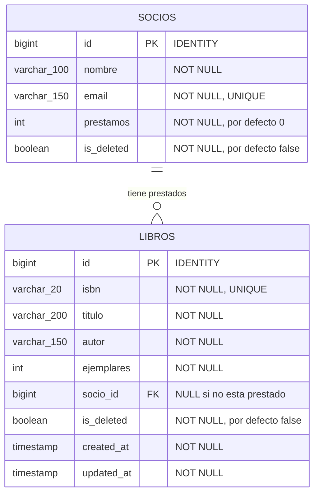
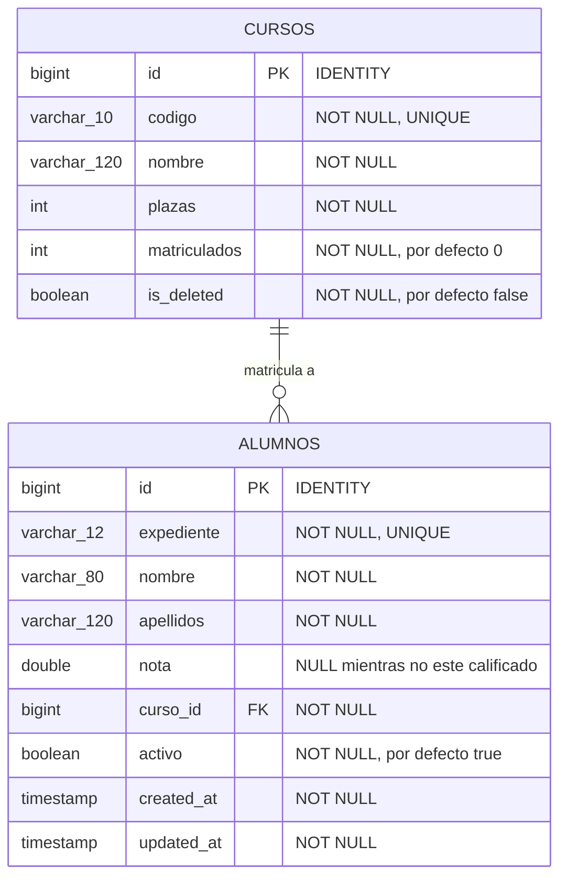
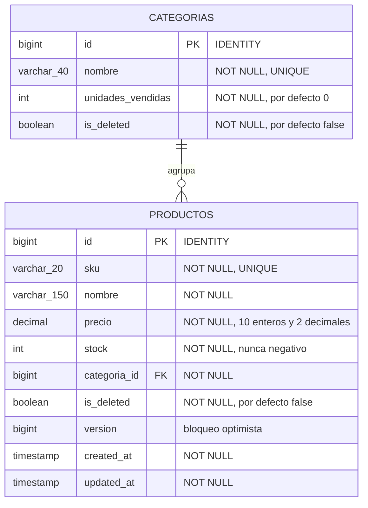

# Examen práctico — UT5 (RA6)

!!! danger "Esta página ES el examen"
    **El examen de la UT5 es uno de estos tres enunciados, con otro dominio.** Misma estructura, mismo material entregado y misma calificación.

    Es **el examen de la UT4 más Spring Data JPA**: las mismas capas y los mismos códigos de estado, pero con el modelo como entidad, el repositorio generado por Spring Data y **paginación en el listado**.

| | Enunciado | Entidades | Lo que añade |
|:-:|---|:-:|---|
| **E1** | [Biblioteca](#e1-biblioteca) | 2 | Relación 1:N opcional y borrado lógico |
| **E2** | [Instituto](#e2-instituto) | 2 | El N+1 y un agregado con `@Query` |
| **E3** | [Tienda](#e3-tienda) | 2 | Transacción de dos entidades y `@Version` |

---

## Material entregado

| | Fichero | Estado |
|:-:|---|---|
| 1 | `pom.xml` con `data-jpa`, `validation`, H2 y PostgreSQL | **Completo** |
| 2 | `application.properties` y los perfiles `dev` / `prod` / `test` | **Completos** |
| 3 | `data.sql` y `data-postgres.sql` | **Completos** |
| 4 | `…ApiApplication.java` | **Completa** |
| 5 | **Los mapeadores** | **Completos**, y son la especificación de tus entidades |
| 6 | **`GlobalExceptionHandler.java`** | **Incompleto**: le faltan los mensajes y un manejador |
| 7 | **La colección de Bruno** | **Incompleta**: le faltan las pruebas que te piden |

!!! warning "No hay `schema.sql`"
    El esquema lo genera Hibernate **desde tus entidades**. El punto 2 de cada enunciado dice cómo tienen que quedar las tablas: eso es lo que se compara.

## Material que entregas

| | Qué | Detalle |
|:-:|---|---|
| 1 | **Las entidades** | Con sus anotaciones, su relación y el constructor que exige el mapeador |
| 2 | **Los DTOs** | `Response`, `CreateRequest`, `UpdateRequest` y el de la operación, con validaciones |
| 3 | **Los repositorios JPA** | Interfaces: derivadas, una `@Query`, `@EntityGraph` y `@Modifying` |
| 4 | **Las excepciones** | Tres clases con `@ResponseStatus` |
| 5 | **El servicio** | Interfaz e implementación, con las reglas y los `@Transactional` |
| 6 | **Los controladores** | Con **paginación saneada** |
| 7 | **El `GlobalExceptionHandler` completado** | Los mensajes que faltan **y un manejador nuevo** |
| 8 | **La colección de Bruno completada** | Las peticiones y comprobaciones que pide el enunciado |

Se entrega comprimido, **sin `target/` ni `datos/`**, con la carpeta `bruno/` dentro y un `README.md` de diez líneas.

## Condiciones

| | |
|---|---|
| Documentación permitida | **La chuleta de la unidad impresa**. Nada más |
| Defensa oral | **No hay**: se corrige el código, la salida de las peticiones y la colección de Bruno |
| Nota mínima | **5,0**, y el bloque de rendimiento no puede quedar en 0 |

---

## El `GlobalExceptionHandler` entregado

**Está a medias a propósito.** Compila y funciona, pero los mensajes están sin escribir y **falta un manejador entero**, que cambia en cada enunciado.

```java title="common/GlobalExceptionHandler.java · ENTREGADO INCOMPLETO"
@RestControllerAdvice
public class GlobalExceptionHandler {

    /** 400 con los errores campo a campo. */
    @ResponseStatus(HttpStatus.BAD_REQUEST)
    @ExceptionHandler(MethodArgumentNotValidException.class)
    public Map<String, Object> validacion(MethodArgumentNotValidException ex) {
        Map<String, String> campos = new LinkedHashMap<>();
        for (var error : ex.getBindingResult().getFieldErrors()) {
            campos.put(error.getField(), error.getDefaultMessage());
        }
        return Map.of("status", 400,
                "error", "",                        // TODO 1 · escribe el mensaje
                "campos", campos);
    }

    /** 400 cuando el JSON no se puede ni leer. */
    @ResponseStatus(HttpStatus.BAD_REQUEST)
    @ExceptionHandler(HttpMessageNotReadableException.class)
    public Map<String, Object> jsonIlegible() {
        return Map.of("status", 400,
                "error", "");                       // TODO 2 · escribe el mensaje
    }

    /** 400 cuando /recurso/abc intenta convertirse en un Long. */
    @ResponseStatus(HttpStatus.BAD_REQUEST)
    @ExceptionHandler(MethodArgumentTypeMismatchException.class)
    public Map<String, Object> tipoMalo(MethodArgumentTypeMismatchException ex) {
        return Map.of("status", 400,
                "error", "");                       // TODO 3 · usa ex.getName() en el mensaje
    }

    /** 409 cuando salta una restriccion de la tabla: UNIQUE, CHECK, FK. */
    @ResponseStatus(HttpStatus.CONFLICT)
    @ExceptionHandler(DataIntegrityViolationException.class)
    public Map<String, Object> integridad() {
        return Map.of("status", 409,
                "error", "");                       // TODO 4 · escribe el mensaje
    }

    // TODO 5 · FALTA UN MANEJADOR ENTERO.
    //          Cual es, lo dice el punto 6 de tu enunciado.
}
```

| | Qué hay que hacer |
|:-:|---|
| **TODO 1 a 4** | Escribir mensajes **útiles para quien llama a la API**: qué ha pasado y, si se puede, en qué campo |
| **TODO 5** | **Añadir el manejador que pide tu enunciado**, con su `@ResponseStatus`, su `@ExceptionHandler` y su mensaje |

!!! info "Qué NO va en esta clase"
    Tus excepciones propias (`…NotFoundException`, `…ConflictException`) llevan su `@ResponseStatus` en la propia clase: **Spring las traduce solas y no necesitan manejador**.

## La colección de Bruno entregada

[Bruno](https://www.usebruno.com/) es un cliente de API de código abierto: las peticiones son **ficheros de texto `.bru`** que viajan con el proyecto y se versionan en Git.

```
bruno/
├── bruno.json
├── environments/
│   └── local.bru
├── 01-listar.bru
├── 02-crear.bru
├── 03-obtener-por-id.bru
└── …
```

```json title="bruno/bruno.json · entregado"
{
  "version": "1",
  "name": "examen-ut5",
  "type": "collection",
  "ignore": ["node_modules", ".git"]
}
```

```
# bruno/environments/local.bru · entregado
vars {
  baseUrl: http://localhost:8080
  apiPath: /api/v1
}
```

**Un fichero `.bru` de ejemplo, completo, para que copies la forma:**

```
# bruno/01-listar.bru · ENTREGADO como ejemplo
meta {
  name: Listar paginado
  type: http
  seq: 1
}

get {
  url: {{baseUrl}}{{apiPath}}/recursos?page=0&size=3&sort=id,asc
  body: none
  auth: none
}

assert {
  res.status: eq 200
  res.body.totalElements: gte 1
}

tests {
  test("devuelve una pagina con 3 elementos como maximo", function() {
    expect(res.getStatus()).to.equal(200);
    expect(res.getBody().content).to.be.an("array");
    expect(res.getBody().content.length).to.be.at.most(3);
  });

  test("trae los metadatos de paginacion", function() {
    const b = res.getBody();
    expect(b).to.have.property("totalElements");
    expect(b).to.have.property("totalPages");
    expect(b.number).to.equal(0);
  });
}
```

**Y cómo se guarda un dato de una petición para usarlo en la siguiente:**

```
# bruno/02-crear.bru · ENTREGADO como ejemplo
meta {
  name: Crear
  type: http
  seq: 2
}

post {
  url: {{baseUrl}}{{apiPath}}/recursos
  body: json
  auth: none
}

body:json {
  {
    "campo": "valor"
  }
}

script:post-response {
  bru.setVar("creadoId", res.getBody().id);
}

assert {
  res.status: eq 201
}

tests {
  test("devuelve 201 y la cabecera Location", function() {
    expect(res.getStatus()).to.equal(201);
    expect(res.getHeader("location")).to.be.a("string");
  });
}
```

| Bloque | Para qué |
|---|---|
| `meta` | Nombre y **orden** (`seq`) dentro de la colección |
| `get` / `post` / `patch` / `delete` | El verbo y la URL, con las variables del entorno |
| `body:json` | El cuerpo de la petición |
| `assert` | Comprobaciones de una línea: `eq`, `neq`, `gt`, `gte`, `isNumber`… |
| `tests` | Comprobaciones con código, para lo que `assert` no alcanza |
| `script:post-response` | Guardar datos de la respuesta en variables: `bru.setVar(...)` |

!!! success "Cómo se ejecuta y cómo se corrige"
    ```bash
    # Desde la interfaz: abrir la carpeta bruno/ y elegir el entorno "local"
    # Desde la terminal, la coleccion entera:
    cd bruno
    bru run --env local
    ```

    **Se corrige ejecutando `bru run --env local` con tu API levantada.** Cada prueba en verde es un ítem comprobado; una prueba que no existe es un ítem sin puntuar.

---

# E1 · Biblioteca

Una API REST para gestionar los libros de una biblioteca y sus préstamos a socios.

## 1 · Diagrama relacional



## 2 · Definición de las tablas

**No escribes este SQL: lo tiene que generar Hibernate desde tus entidades.** Así es como tienen que quedar las tablas.

```sql
CREATE TABLE socios (
    id          BIGINT       NOT NULL AUTO_INCREMENT,
    nombre      VARCHAR(100) NOT NULL,
    email       VARCHAR(150) NOT NULL,
    prestamos   INT          NOT NULL,
    is_deleted  BOOLEAN      NOT NULL,
    PRIMARY KEY (id),
    CONSTRAINT uk_socio_email UNIQUE (email)
);

CREATE TABLE libros (
    id          BIGINT       NOT NULL AUTO_INCREMENT,
    isbn        VARCHAR(20)  NOT NULL,
    titulo      VARCHAR(200) NOT NULL,
    autor       VARCHAR(150) NOT NULL,
    ejemplares  INT          NOT NULL,
    socio_id    BIGINT       NULL,
    is_deleted  BOOLEAN      NOT NULL,
    created_at  TIMESTAMP,
    updated_at  TIMESTAMP,
    PRIMARY KEY (id),
    CONSTRAINT uk_libro_isbn   UNIQUE (isbn),
    CONSTRAINT fk_libro_socio  FOREIGN KEY (socio_id) REFERENCES socios (id)
);

CREATE INDEX idx_libro_autor   ON libros (autor);
CREATE INDEX idx_libro_deleted ON libros (is_deleted);
```

```bash
# Como se comprueba que tus entidades generan esto
docker compose up -d
SPRING_PROFILES_ACTIVE=postgres ./mvnw spring-boot:run
docker compose exec postgres psql -U dwes -d biblioteca -c '\d libros'
```

## 3 · Los mapeadores entregados

```java title="libros/mappers/LibroMapper.java · COMPLETO"
@Component
public class LibroMapper {

    /** Se lee getSocio() DENTRO de la transaccion: la relacion es LAZY. */
    public LibroResponse toResponse(Libro l) {
        return new LibroResponse(
                l.getId(), l.getIsbn(), l.getTitulo(), l.getAutor(),
                l.getEjemplares(),
                l.getSocio() == null ? null : l.getSocio().getNombre(),
                l.getCreatedAt(), l.getUpdatedAt());
    }

    public List<LibroResponse> toResponse(List<Libro> libros) {
        return libros.stream().map(this::toResponse).toList();
    }

    /** POST: entidad nueva, sin socio. */
    public Libro toModel(LibroCreateRequest r) {
        return new Libro(r.isbn().trim(), r.titulo().trim(),
                         r.autor().trim(), r.ejemplares());
    }

    /** PUT: reemplaza los campos editables. */
    public void reemplazar(Libro libro, LibroCreateRequest r) {
        libro.setTitulo(r.titulo().trim());
        libro.setAutor(r.autor().trim());
        libro.setEjemplares(r.ejemplares());
    }

    /** PATCH: solo lo que llega distinto de null. El ISBN no se cambia. */
    public void parchear(Libro libro, LibroUpdateRequest r) {
        if (r.titulo()     != null) libro.setTitulo(r.titulo().trim());
        if (r.autor()      != null) libro.setAutor(r.autor().trim());
        if (r.ejemplares() != null) libro.setEjemplares(r.ejemplares());
    }
}
```

```java title="socios/mappers/SocioMapper.java · COMPLETO"
@Component
public class SocioMapper {

    public SocioResponse toResponse(Socio s) {
        return new SocioResponse(s.getId(), s.getNombre(), s.getEmail(), s.getPrestamos());
    }

    public Socio toModel(SocioCreateRequest r) {
        return new Socio(r.nombre().trim(), r.email().trim().toLowerCase());
    }
}
```

| Lo que ves en el mapeador | Lo que tienes que escribir |
|---|---|
| `new Libro(isbn, titulo, autor, ejemplares)` | Constructor con **esos cuatro**, más el `protected` sin argumentos |
| `l.getSocio()` puede ser `null` | `@ManyToOne(fetch = LAZY)` hacia `Socio`, **opcional** |
| `setTitulo`, `setAutor`, `setEjemplares` | Esos tres `setters`, y **ningún otro** |
| No hay `setIsbn` ni `setId` | El ISBN no se cambia después de crear |
| `LibroResponse(…, socioNombre, …)` | **Ocho componentes**, y el del socio es **el nombre**, no el id |
| `new Socio(nombre, email)` | Constructor con dos; `prestamos` arranca en 0 |

## 4 · La API

| Método | Ruta | Devuelve |
|---|---|---|
| `GET` | `/api/v1/libros` · `?page=` `&size=` `&sort=` `&autor=` `&disponibles=` | **200** con una **página** |
| `GET` | `/api/v1/libros/{id}` | **200** con el libro |
| `POST` | `/api/v1/libros` | **201** + cabecera `Location` |
| `PATCH` | `/api/v1/libros/{id}` | **200** con el libro actualizado |
| `DELETE` | `/api/v1/libros/{id}` | **204** · borrado **lógico** |
| `POST` | `/api/v1/libros/{id}/prestar` · `{ "socioId": 3 }` | **200** con el libro prestado |
| `POST` | `/api/v1/libros/{id}/devolver` | **200** con el libro devuelto |
| `GET` | `/api/v1/socios` · `?page=` `&size=` `&sort=` | **200** con una página |
| `GET` | `/api/v1/socios/{id}` · `POST` · `DELETE` | CRUD básico |
| `GET` | `/api/v1/socios/{id}/libros` | **200** con la lista de libros prestados |

**La paginación es obligatoria en los dos listados**, con `page`, `size` y `sort`, tamaño máximo 100 y lista blanca de campos ordenables.

## 5 · Reglas

| | Regla | Código |
|:-:|---|:-:|
| **R1** | `isbn` de 13 caracteres · `titulo` y `autor` no vacíos · `ejemplares` ≥ 0 · `email` con formato válido | **400** |
| **R2** | El `isbn` y el `email` no se repiten | **409** |
| **R3** | Prestar descuenta un ejemplar **y** suma 1 al contador del socio, o ninguna de las dos | **409** si no quedan ejemplares |
| **R4** | Un socio no puede tener más de **3** libros prestados a la vez | **409** |
| **R5** | Un libro prestado no se puede borrar · el borrado es **lógico** y los borrados no aparecen en ningún listado | **409** |
| **R6** | Un `id` o un `socioId` que no existe | **404** |

## 6 · Lo que hay que completar del `GlobalExceptionHandler`

| | |
|---|---|
| **TODO 1 a 4** | Los cuatro mensajes |
| **TODO 5** | **Un manejador de `NoHandlerFoundException`** que devuelva **404** con un mensaje que diga que esa ruta no existe |

```properties title="Y para que esa excepción llegue a tu manejador, hace falta esto"
spring.mvc.throw-exception-if-no-handler-found=true
spring.web.resources.add-mappings=false
```

## 7 · Calificación posible

!!! info "Esta calificación es una referencia, no es definitiva"
    La puntuación final es la [rúbrica común](#rubrica-comun), igual para los tres enunciados.

| | Qué se valora | Puntos |
|:-:|---|:-:|
| 1 | **Las entidades**: anotaciones, relación `LAZY` opcional y los constructores que exige el mapeador | **2,5** |
| 2 | **Paginación** en los dos listados, saneada y con los metadatos correctos | **1,5** |
| 3 | **Repositorios JPA** sin implementación, con las derivadas y el `@Modifying` del borrado lógico | **1,5** |
| 4 | Capas, DTOs y validación | **1,5** |
| 5 | Las reglas R1 a R6 y las excepciones propias | **1,5** |
| 6 | El `GlobalExceptionHandler` completado, con el manejador nuevo | **0,5** |
| 7 | La colección de **Bruno** con las pruebas del punto 8 | **1,0** |
| | | **10,0** |

## 8 · Pruebas con Bruno que hay que entregar

| | Fichero | Qué tiene que comprobar |
|:-:|---|---|
| 1 | `01-listar-paginado.bru` | **200**, `content` con 3 elementos como máximo, y `totalElements` y `totalPages` presentes |
| 2 | `02-crear-libro.bru` | **201**, cabecera `Location`, y guarda el `id` en una variable |
| 3 | `03-obtener-por-id.bru` | **200** usando la variable del paso anterior, y el `isbn` coincide |
| 4 | `04-isbn-repetido.bru` | **409** al crear el mismo ISBN otra vez |
| 5 | `05-validacion.bru` | **400** con un ISBN de 5 caracteres, y `campos.isbn` existe en la respuesta |
| 6 | `06-prestar.bru` | **200**, el libro queda con `socioNombre`, y los ejemplares **bajan en 1** |
| 7 | `07-tope-de-prestamos.bru` | **409** al prestar un cuarto libro al mismo socio |
| 8 | `08-borrado-logico.bru` | **204** al borrar, y después el libro **no aparece** en el listado |
| 9 | `09-ruta-inexistente.bru` | **404** al pedir `/api/v1/noexiste` *(el TODO 5)* |

**Dos de ellas, resueltas, para que veas el nivel que se pide:**

```
# bruno/06-prestar.bru
meta {
  name: Prestar un libro
  type: http
  seq: 6
}

post {
  url: {{baseUrl}}{{apiPath}}/libros/1/prestar
  body: json
  auth: none
}

body:json {
  {
    "socioId": 1
  }
}

assert {
  res.status: eq 200
}

tests {
  test("el libro queda a nombre del socio", function() {
    expect(res.getStatus()).to.equal(200);
    expect(res.getBody().socioNombre).to.be.a("string");
  });

  test("los ejemplares bajan en uno", function() {
    expect(res.getBody().ejemplares).to.be.below(bru.getVar("ejemplaresAntes"));
  });
}
```

```
# bruno/08-borrado-logico.bru
meta {
  name: Borrado logico
  type: http
  seq: 8
}

delete {
  url: {{baseUrl}}{{apiPath}}/libros/{{creadoId}}
  body: none
  auth: none
}

assert {
  res.status: eq 204
}

tests {
  test("devuelve 204 sin cuerpo", function() {
    expect(res.getStatus()).to.equal(204);
  });
}
```

---

## Notas del E1

!!! success "Lo que de verdad se mide aquí"
    **El `@EntityGraph` del listado.** El mapeador lee `getSocio()`, así que listar 20 libros sin él son **21 consultas**. Se cuenta con `show-sql=true`.

    **El `@Transactional` de la R3.** Descontar el ejemplar, subir el contador del socio y asignar el `socio_id` van juntos. Se comprueba provocando el fallo y mirando **las dos tablas**.

    **El `== 0` del `@Modifying`.** Un `UPDATE … WHERE ejemplares >= 1` devuelve las filas afectadas: si son 0, no quedaban. Leer, comprobar y escribir no vale.

!!! warning "Dos errores habituales"
    **1 · La relación es opcional.** Un libro sin prestar no tiene socio: `@ManyToOne(optional = true)` y el campo admite `null`. Con `optional = false`, no se puede crear ningún libro.

    **2 · `LibroCreateRequest` no lleva `socioId`.** Un libro se crea sin prestar, y el mapeador entregado no lo pasa. Si tu DTO lo acepta, se puede dar de alta un libro ya prestado saltándose las reglas R3 y R4.

---

# E2 · Instituto

Una API REST para los alumnos matriculados en cursos, con sus notas.

## 1 · Diagrama relacional



## 2 · Definición de las tablas

**No escribes este SQL: lo tiene que generar Hibernate desde tus entidades.**

```sql
CREATE TABLE cursos (
    id            BIGINT       NOT NULL AUTO_INCREMENT,
    codigo        VARCHAR(10)  NOT NULL,
    nombre        VARCHAR(120) NOT NULL,
    plazas        INT          NOT NULL,
    matriculados  INT          NOT NULL,
    is_deleted    BOOLEAN      NOT NULL,
    PRIMARY KEY (id),
    CONSTRAINT uk_curso_codigo UNIQUE (codigo)
);

CREATE TABLE alumnos (
    id          BIGINT       NOT NULL AUTO_INCREMENT,
    expediente  VARCHAR(12)  NOT NULL,
    nombre      VARCHAR(80)  NOT NULL,
    apellidos   VARCHAR(120) NOT NULL,
    nota        DOUBLE       NULL,
    curso_id    BIGINT       NOT NULL,
    activo      BOOLEAN      NOT NULL,
    created_at  TIMESTAMP,
    updated_at  TIMESTAMP,
    PRIMARY KEY (id),
    CONSTRAINT uk_alumno_expediente UNIQUE (expediente),
    CONSTRAINT fk_alumno_curso FOREIGN KEY (curso_id) REFERENCES cursos (id)
);

CREATE INDEX idx_alumno_apellidos ON alumnos (apellidos);
CREATE INDEX idx_alumno_activo    ON alumnos (activo);
```

## 3 · Los mapeadores entregados

```java title="alumnos/mappers/AlumnoMapper.java · COMPLETO"
@Component
public class AlumnoMapper {

    /** Toca getCurso() DOS veces: el listado necesita @EntityGraph. */
    public AlumnoResponse toResponse(Alumno a) {
        return new AlumnoResponse(
                a.getId(), a.getExpediente(), a.getNombre(), a.getApellidos(),
                a.getNota(), a.getCurso().getCodigo(), a.getCurso().getNombre(),
                a.isActivo());
    }

    public List<AlumnoResponse> toResponse(List<Alumno> alumnos) {
        return alumnos.stream().map(this::toResponse).toList();
    }

    /** El curso lo resuelve el servicio a partir del CODIGO que manda el cliente. */
    public Alumno toModel(AlumnoCreateRequest r, Curso curso) {
        return new Alumno(r.expediente().trim().toUpperCase(),
                          r.nombre().trim(), r.apellidos().trim(), curso);
    }

    public void parchear(Alumno alumno, AlumnoUpdateRequest r, Curso curso) {
        if (r.nombre()    != null) alumno.setNombre(r.nombre().trim());
        if (r.apellidos() != null) alumno.setApellidos(r.apellidos().trim());
        if (curso         != null) alumno.setCurso(curso);
    }
}
```

```java title="cursos/mappers/CursoMapper.java · COMPLETO"
@Component
public class CursoMapper {

    public CursoResponse toResponse(Curso c) {
        return new CursoResponse(c.getId(), c.getCodigo(), c.getNombre(),
                                 c.getPlazas(), c.getMatriculados());
    }

    public Curso toModel(CursoCreateRequest r) {
        return new Curso(r.codigo().trim().toUpperCase(), r.nombre().trim(), r.plazas());
    }

    /** Para las estadisticas: la fila viene de una @Query con agregados. */
    public EstadisticaResponse toEstadistica(Object[] fila) {
        return new EstadisticaResponse(
                (String) fila[0],                       // codigo del curso
                ((Number) fila[1]).longValue(),         // alumnos calificados
                fila[2] == null ? null : ((Number) fila[2]).doubleValue());   // nota media
    }
}
```

| Lo que ves en el mapeador | Lo que tienes que escribir |
|---|---|
| `new Alumno(expediente, nombre, apellidos, curso)` | Constructor con **esos cuatro**, más el `protected` sin argumentos |
| `a.getCurso().getCodigo()` y `.getNombre()` | `@ManyToOne(fetch = LAZY, optional = false)` hacia `Curso` |
| **No hay `setNota`** | La nota se pone por su propio endpoint, **no por el PATCH** |
| **No hay `setExpediente`** | El expediente es inmutable |
| **No hay `setMatriculados`** | Ese contador lo lleva una `@Query` con `@Modifying`, no un `setter` |
| `AlumnoResponse(…, cursoCodigo, cursoNombre, activo)` | **Ocho componentes** |
| `toEstadistica(Object[] fila)` | Una `@Query` que devuelve `List<Object[]>` con tres columnas |

## 4 · La API

| Método | Ruta | Devuelve |
|---|---|---|
| `GET` | `/api/v1/alumnos` · `?page=` `&size=` `&sort=` `&curso=` `&apellidos=` `&notaMin=` | **200** con una **página** |
| `GET` | `/api/v1/alumnos/{id}` | **200** con el alumno |
| `POST` | `/api/v1/alumnos` | **201** + cabecera `Location` |
| `PATCH` | `/api/v1/alumnos/{id}` | **200** con el alumno actualizado |
| `DELETE` | `/api/v1/alumnos/{id}` | **204** · baja lógica (`activo = false`) |
| `PUT` | `/api/v1/alumnos/{id}/nota` · `{ "nota": 7.5 }` | **200** con el alumno calificado |
| `GET` | `/api/v1/cursos` · `?page=` `&size=` `&sort=` | **200** con una página |
| `GET` | `/api/v1/cursos/{id}` · `POST` · `DELETE` | CRUD básico |
| `GET` | `/api/v1/cursos/{id}/alumnos` · `?page=` `&size=` | **200** con una página |
| `GET` | `/api/v1/cursos/estadisticas` | **200** con la nota media y el recuento **por curso** |

**La paginación es obligatoria en los tres listados.**

## 5 · Reglas

| | Regla | Código |
|:-:|---|:-:|
| **R1** | `expediente` de 4 a 12 caracteres · `nombre` y `apellidos` no vacíos · `plazas` > 0 · `nota` entre 0 y 10 | **400** |
| **R2** | El `expediente` y el `codigo` del curso no se repiten | **409** |
| **R3** | Matricular suma 1 al contador del curso, y **no se puede pasar de `plazas`** | **409** |
| **R4** | Un curso con alumnos activos no se puede borrar | **409** |
| **R5** | Las estadísticas las calcula **la base de datos** con una `@Query`: `count` y `avg` | — |
| **R6** | Un `id` o un código de curso que no existe | **404** |

## 6 · Lo que hay que completar del `GlobalExceptionHandler`

| | |
|---|---|
| **TODO 1 a 4** | Los cuatro mensajes |
| **TODO 5** | **Un manejador de `PropertyReferenceException`** que devuelva **400** diciendo que ese campo de ordenación no existe, en lugar del 500 que sale por defecto |

```java title="La firma, para que no se pierda tiempo buscándola"
// org.springframework.data.mapping.PropertyReferenceException
// ex.getPropertyName() devuelve el campo que ha pedido el cliente
```

## 7 · Calificación posible

!!! info "Esta calificación es una referencia, no es definitiva"
    La puntuación final es la [rúbrica común](#rubrica-comun), igual para los tres enunciados.

| | Qué se valora | Puntos |
|:-:|---|:-:|
| 1 | **Las entidades**: anotaciones, relación `LAZY` obligatoria y los constructores que exige el mapeador | **2,0** |
| 2 | **Paginación** en los tres listados, saneada, **sin N+1** | **2,0** |
| 3 | **Repositorios JPA**: derivadas, la `@Query` de las estadísticas y el `@Modifying` del contador | **2,0** |
| 4 | Capas, DTOs y validación | **1,5** |
| 5 | Las reglas R1 a R6 y las excepciones propias | **1,0** |
| 6 | El `GlobalExceptionHandler` completado, con el manejador nuevo | **0,5** |
| 7 | La colección de **Bruno** con las pruebas del punto 8 | **1,0** |
| | | **10,0** |

## 8 · Pruebas con Bruno que hay que entregar

| | Fichero | Qué tiene que comprobar |
|:-:|---|---|
| 1 | `01-listar-paginado.bru` | **200**, `content` ≤ `size`, `totalElements` y `totalPages` presentes |
| 2 | `02-ordenar.bru` | **200** con `?sort=apellidos,asc`, y la lista llega ordenada |
| 3 | `03-sort-inventado.bru` | **400** con `?sort=noexiste` *(el TODO 5)*, **no 500** |
| 4 | `04-crear-alumno.bru` | **201**, `Location`, y guarda el `id` |
| 5 | `05-expediente-repetido.bru` | **409** |
| 6 | `06-poner-nota.bru` | **200** y la `nota` queda en el cuerpo; con `nota: 11` → **400** |
| 7 | `07-plazas-llenas.bru` | **409** al matricular por encima de `plazas` |
| 8 | `08-borrar-curso-con-alumnos.bru` | **409** |
| 9 | `09-estadisticas.bru` | **200**, un elemento por curso, y `notaMedia` es un número o `null` |

```
# bruno/03-sort-inventado.bru · resuelto, para que veas el nivel
meta {
  name: Orden por un campo que no existe
  type: http
  seq: 3
}

get {
  url: {{baseUrl}}{{apiPath}}/alumnos?sort=noexiste,asc
  body: none
  auth: none
}

assert {
  res.status: eq 400
}

tests {
  test("no revienta con un 500", function() {
    expect(res.getStatus()).to.not.equal(500);
  });

  test("devuelve 400 y explica el campo", function() {
    expect(res.getStatus()).to.equal(400);
    expect(res.getBody().error).to.be.a("string").and.not.empty;
  });
}
```

---

## Notas del E2

!!! danger "El N+1 es el ítem que más pesa aquí"
    El mapeador toca `getCurso()` **dos veces por alumno**. Listar 20 alumnos sin `@EntityGraph` son **21 consultas**.

    ```bash
    curl -s "localhost:8080/api/v1/alumnos?size=20" > /dev/null
    ```

    | Líneas `Hibernate:` en el log | Nota del ítem |
    |---|---|
    | **2** (la página y el `count`) | Total |
    | 3–4 | Parcial |
    | **21** | **Cero** |

!!! danger "Y las estadísticas no se calculan en Java"
    ```java
    var alumnos = repositorio.findAll();                       // ❌ la tabla entera
    var media = alumnos.stream()
            .collect(groupingBy(a -> a.getCurso().getCodigo(),
                     averagingDouble(Alumno::getNota)));       // ❌ y un N+1 de propina
    ```

    Con 5.000 alumnos son 5.001 consultas y toda la tabla en memoria para devolver cuatro números.

    ```java
    @Query("""
           SELECT a.curso.codigo, count(a), avg(a.nota)
             FROM Alumno a
            WHERE a.activo = true AND a.nota IS NOT NULL
            GROUP BY a.curso.codigo
            ORDER BY a.curso.codigo
           """)
    List<Object[]> estadisticasPorCurso();
    ```

!!! warning "La `nota` admite `null`"
    Un alumno recién matriculado no está calificado. El tipo es `Double`, no `double`, y la consulta de estadísticas filtra `a.nota IS NOT NULL` para que la media no cuente a los no calificados.

---

# E3 · Tienda

Una API REST de productos por categoría, con ventas y concurrencia.

## 1 · Diagrama relacional



## 2 · Definición de las tablas

**No escribes este SQL: lo tiene que generar Hibernate desde tus entidades.**

```sql
CREATE TABLE categorias (
    id                 BIGINT      NOT NULL AUTO_INCREMENT,
    nombre             VARCHAR(40) NOT NULL,
    unidades_vendidas  INT         NOT NULL,
    is_deleted         BOOLEAN     NOT NULL,
    PRIMARY KEY (id),
    CONSTRAINT uk_categoria_nombre UNIQUE (nombre)
);

CREATE TABLE productos (
    id            BIGINT        NOT NULL AUTO_INCREMENT,
    sku           VARCHAR(20)   NOT NULL,
    nombre        VARCHAR(150)  NOT NULL,
    precio        DECIMAL(10,2) NOT NULL,
    stock         INT           NOT NULL,
    categoria_id  BIGINT        NOT NULL,
    is_deleted    BOOLEAN       NOT NULL,
    version       BIGINT,
    created_at    TIMESTAMP,
    updated_at    TIMESTAMP,
    PRIMARY KEY (id),
    CONSTRAINT uk_producto_sku UNIQUE (sku),
    CONSTRAINT fk_producto_categoria FOREIGN KEY (categoria_id) REFERENCES categorias (id)
);

CREATE INDEX idx_producto_nombre  ON productos (nombre);
CREATE INDEX idx_producto_deleted ON productos (is_deleted);
```

## 3 · Los mapeadores entregados

```java title="productos/mappers/ProductoMapper.java · COMPLETO"
@Component
public class ProductoMapper {

    public ProductoResponse toResponse(Producto p) {
        return new ProductoResponse(
                p.getId(), p.getSku(), p.getNombre(), p.getPrecio(), p.getStock(),
                p.getCategoria().getNombre(), p.getCreatedAt(), p.getUpdatedAt());
    }

    public List<ProductoResponse> toResponse(List<Producto> productos) {
        return productos.stream().map(this::toResponse).toList();
    }

    /** La categoria la resuelve el servicio a partir del NOMBRE que manda el cliente. */
    public Producto toModel(ProductoCreateRequest r, Categoria categoria) {
        return new Producto(r.sku().trim().toUpperCase(), r.nombre().trim(),
                            r.precio(), r.stock(), categoria);
    }

    public void reemplazar(Producto p, ProductoCreateRequest r, Categoria categoria) {
        p.setNombre(r.nombre().trim());
        p.setPrecio(r.precio());
        p.setStock(r.stock());
        p.setCategoria(categoria);
    }

    public void parchear(Producto p, ProductoUpdateRequest r, Categoria categoria) {
        if (r.nombre()  != null) p.setNombre(r.nombre().trim());
        if (r.precio()  != null) p.setPrecio(r.precio());
        if (r.stock()   != null) p.setStock(r.stock());
        if (categoria   != null) p.setCategoria(categoria);
    }
}
```

```java title="categorias/mappers/CategoriaMapper.java · COMPLETO"
@Component
public class CategoriaMapper {

    public CategoriaResponse toResponse(Categoria c) {
        return new CategoriaResponse(c.getId(), c.getNombre(), c.getUnidadesVendidas());
    }

    public Categoria toModel(CategoriaCreateRequest r) {
        return new Categoria(r.nombre().trim().toUpperCase());
    }
}
```

| Lo que ves en el mapeador | Lo que tienes que escribir |
|---|---|
| `new Producto(sku, nombre, precio, stock, categoria)` | Constructor con **esos cinco**, más el `protected` sin argumentos |
| `p.getCategoria().getNombre()` | `@ManyToOne(fetch = LAZY, optional = false)` hacia `Categoria` |
| `setNombre`, `setPrecio`, `setStock`, `setCategoria` | Esos cuatro `setters` |
| **No hay `setSku`** | El SKU es inmutable |
| **No hay `setUnidadesVendidas`** | Ese contador lo lleva una `@Query` con `@Modifying` |
| `ProductoResponse(…, categoriaNombre, …)` | **Ocho componentes**, con el **nombre** de la categoría |

## 4 · La API

| Método | Ruta | Devuelve |
|---|---|---|
| `GET` | `/api/v1/productos` · `?page=` `&size=` `&sort=` `&categoria=` `&nombre=` `&conStock=` | **200** con una **página** |
| `GET` | `/api/v1/productos/{id}` | **200** con el producto |
| `POST` | `/api/v1/productos` | **201** + cabecera `Location` |
| `PUT` | `/api/v1/productos/{id}` | **200** con el producto reemplazado |
| `PATCH` | `/api/v1/productos/{id}` | **200** con el producto actualizado |
| `DELETE` | `/api/v1/productos/{id}` | **204** · borrado **lógico** |
| `POST` | `/api/v1/productos/{id}/venta` · `{ "cantidad": 3 }` | **200** con el producto |
| `GET` | `/api/v1/categorias` · `?page=` `&size=` `&sort=` | **200** con una página |
| `GET` | `/api/v1/categorias/{id}` · `POST` · `DELETE` | CRUD básico |

**La paginación es obligatoria en los dos listados.**

## 5 · Reglas

| | Regla | Código |
|:-:|---|:-:|
| **R1** | `sku` de 4 a 20 caracteres · `nombre` no vacío · `precio` > 0 · `stock` ≥ 0 · `cantidad` ≥ 1 | **400** |
| **R2** | El `sku` y el `nombre` de la categoría no se repiten | **409** |
| **R3** | Vender descuenta stock **y** suma al contador de la categoría, o ninguna de las dos | **409** si no hay stock |
| **R4** | El stock **nunca** puede quedar negativo, ni con peticiones simultáneas | **409** |
| **R5** | Dos ediciones simultáneas del mismo producto: la segunda falla | **409** |
| **R6** | Un `id` o una categoría que no existe | **404** / **400** |

## 6 · Lo que hay que completar del `GlobalExceptionHandler`

| | |
|---|---|
| **TODO 1 a 4** | Los cuatro mensajes |
| **TODO 5** | **Un manejador de `ObjectOptimisticLockingFailureException`** que devuelva **409** con un mensaje que le diga al cliente que **recargue los datos y lo vuelva a intentar** *(la R5)* |

## 7 · Calificación posible

!!! info "Esta calificación es una referencia, no es definitiva"
    La puntuación final es la [rúbrica común](#rubrica-comun), igual para los tres enunciados.

| | Qué se valora | Puntos |
|:-:|---|:-:|
| 1 | **Las entidades**, con `@Version`, `BigDecimal` con `precision`/`scale` y los constructores del mapeador | **2,0** |
| 2 | **Paginación** en los dos listados, saneada, **sin N+1** | **1,5** |
| 3 | **Repositorios JPA**, con el `@Modifying` del descuento de stock condicionado | **1,5** |
| 4 | Capas, DTOs y validación | **1,5** |
| 5 | **La venta transaccional** y el stock que nunca queda negativo | **2,0** |
| 6 | El `GlobalExceptionHandler` completado, con el **409 del bloqueo optimista** | **0,5** |
| 7 | La colección de **Bruno** con las pruebas del punto 8 | **1,0** |
| | | **10,0** |

## 8 · Pruebas con Bruno que hay que entregar

| | Fichero | Qué tiene que comprobar |
|:-:|---|---|
| 1 | `01-listar-paginado.bru` | **200**, `content` ≤ `size`, metadatos de paginación |
| 2 | `02-filtrar-con-stock.bru` | **200** con `?conStock=true`, y ningún elemento con `stock` 0 |
| 3 | `03-crear-producto.bru` | **201**, `Location`, y guarda el `id` |
| 4 | `04-sku-repetido.bru` | **409** |
| 5 | `05-validacion.bru` | **400** con `precio: -1`, y `campos.precio` existe |
| 6 | `06-venta-correcta.bru` | **200**, el `stock` baja en la cantidad vendida |
| 7 | `07-venta-sin-stock.bru` | **409** con `cantidad: 999` |
| 8 | `08-stock-intacto.bru` | Después del 409, el `stock` es **el mismo que antes** |
| 9 | `09-contador-categoria.bru` | `unidadesVendidas` de la categoría **ha subido** tras la venta correcta |

```
# bruno/07-venta-sin-stock.bru · resuelto, para que veas el nivel
meta {
  name: Venta sin stock suficiente
  type: http
  seq: 7
}

post {
  url: {{baseUrl}}{{apiPath}}/productos/{{creadoId}}/venta
  body: json
  auth: none
}

body:json {
  {
    "cantidad": 999
  }
}

assert {
  res.status: eq 409
}

tests {
  test("rechaza la venta con 409", function() {
    expect(res.getStatus()).to.equal(409);
  });

  test("el mensaje explica que no hay stock", function() {
    expect(res.getBody().error).to.be.a("string").and.not.empty;
  });
}

docs {
  El stock de ANTES lo guarda la peticion 06 con bru.setVar("stockTrasVenta", ...),
  y la peticion 08 comprueba que sigue siendo el mismo despues de este 409.
}
```

---

## Notas del E3

!!! danger "La R4 se prueba con peticiones simultáneas"
    ```bash
    # 20 ventas de 1 unidad sobre un producto con 10 de stock
    for i in $(seq 1 20); do
      curl -s -o /dev/null -w "%{http_code} " -X POST \
        localhost:8080/api/v1/productos/1/venta \
        -H "Content-Type: application/json" -d '{"cantidad":1}' &
    done; wait; echo
    ```

    **Diez 200, diez 409, y el stock en 0.** Si sale negativo, has leído-comprobado-escrito en vez de usar:

    ```java
    @Modifying(clearAutomatically = true, flushAutomatically = true)
    @Query("""
           UPDATE Producto p SET p.stock = p.stock - :cantidad
            WHERE p.id = :id AND p.stock >= :cantidad
           """)
    int descontarStock(@Param("id") Long id, @Param("cantidad") int cantidad);
    ```

    En el examen este bucle se lanza **contra PostgreSQL**, donde la concurrencia es real.

!!! danger "Y la R5 con dos PATCH a la vez"
    ```bash
    curl -s -X PATCH localhost:8080/api/v1/productos/1 \
      -H "Content-Type: application/json" -d '{"nombre":"A"}' &
    curl -s -X PATCH localhost:8080/api/v1/productos/1 \
      -H "Content-Type: application/json" -d '{"nombre":"B"}' &
    wait
    ```

    Uno de los dos devuelve **409**. Sin `@Version`, los dos devuelven 200 y **uno de los cambios se pierde en silencio**: eso es un *lost update*, y es justo lo que el TODO 5 del manejador convierte en una respuesta entendible.

---

# Rúbrica común

**Igual para los tres enunciados y para el examen.** Sobre 10 puntos.

## Bloque 1 · Las entidades y el mapeo — 2,0 puntos

| | Se comprueba con | Puntos |
|---|---|:-:|
| 1.1 | Las entidades **compilan con los mapeadores entregados sin tocarlos**: constructores, `getters` y `setters` exactos | **0,6** |
| 1.2 | Las tablas generadas coinciden con el punto 2 del enunciado: tipos, `UNIQUE`, `NOT NULL` y la clave ajena | 0,5 |
| 1.3 | El constructor `protected` sin argumentos y uno con los campos del cliente. **Ningún builder** | 0,4 |
| 1.4 | La relación con `@ManyToOne` + `@JoinColumn`, y `mappedBy` si pones el lado inverso | 0,3 |
| 1.5 | `BigDecimal` con `precision`/`scale` para el dinero, `Double` para lo que admite `null` | 0,2 |

## Bloque 2 · Paginación — 1,5 puntos

| | Se comprueba con | Puntos |
|---|---|:-:|
| 2.1 | **Todos los listados** del enunciado devuelven `Page`, con `page`, `size` y `sort` | **0,6** |
| 2.2 | `Pageable` **saneado**: lista blanca de campos y tope de tamaño. `?size=99999` se recorta | 0,4 |
| 2.3 | `?sort=inventado` **no da 500** | 0,3 |
| 2.4 | Una página fuera de rango devuelve **200 con lista vacía**, no 404 | 0,2 |

## Bloque 3 · Rendimiento: `LAZY` y el N+1 — 1,5 puntos

| | Se comprueba con | Puntos |
|---|---|:-:|
| 3.1 | `grep -rn "FetchType.EAGER" src/main/java/` → **vacío** | 0,4 |
| 3.2 | Listar 20 elementos son **2 consultas**, no 21. Se cuentan las líneas `Hibernate:` | **0,8** |
| 3.3 | `spring.jpa.open-in-view=false` y **ningún** `LazyInitializationException` | 0,3 |

## Bloque 4 · Repositorios y consultas — 1,5 puntos

| | Se comprueba con | Puntos |
|---|---|:-:|
| 4.1 | Los repositorios son **interfaces sin implementación**. `grep -rln "implements .*Repository" src/main/java/` → **vacío** | 0,5 |
| 4.2 | Los filtros van por **derivadas o `Specification`**, no filtrando en Java con `stream` | 0,4 |
| 4.3 | El agregado o el contador se hacen con **`@Query`**, no cargando la tabla en memoria | 0,3 |
| 4.4 | El `UPDATE` masivo lleva `@Modifying` **y** `clearAutomatically = true` | 0,3 |

## Bloque 5 · Capas, DTOs y validación — 1,5 puntos

| | Se comprueba con | Puntos |
|---|---|:-:|
| 5.1 | `grep -rn "ResponseEntity\|HttpStatus" src/main/java/**/services/` → **vacío** | 0,5 |
| 5.2 | Ningún controlador devuelve ni recibe una **entidad**: solo DTOs, y son `record` | 0,5 |
| 5.3 | Todos los `@RequestBody` llevan **`@Valid`**, un POST inválido da **400** con los campos | 0,5 |

## Bloque 6 · Integridad y transacciones — 1,5 puntos

| | Se comprueba con | Puntos |
|---|---|:-:|
| 6.1 | La operación de las dos entidades lleva **`@Transactional`**, y se demuestra con **las dos tablas** antes y después de un fallo | **0,7** |
| 6.2 | El contador no queda negativo: `UPDATE … WHERE … >=` y mirar las filas afectadas | 0,4 |
| 6.3 | Las lecturas llevan `@Transactional(readOnly = true)` y las excepciones propias tienen `@ResponseStatus` | 0,4 |

## Bloque 7 · El `GlobalExceptionHandler` — 0,5 puntos

| | Se comprueba con | Puntos |
|---|---|:-:|
| 7.1 | Los **cuatro mensajes** escritos, útiles y en castellano | 0,2 |
| 7.2 | **El manejador que pide el enunciado**, con su código de estado y su mensaje | **0,3** |

## Bloque 8 · Pruebas con Bruno — 1,0 punto

| | Se comprueba con | Puntos |
|---|---|:-:|
| 8.1 | `bru run --env local` se ejecuta **sin errores de sintaxis** y con la API levantada | 0,2 |
| 8.2 | **Las nueve peticiones** del punto 8 existen, con su `seq` en orden | 0,3 |
| 8.3 | Cada una comprueba **el código de estado y algo del cuerpo**, no solo el 200 | **0,3** |
| 8.4 | Al menos una **encadena** datos con `bru.setVar` en lugar de usar ids fijos | 0,2 |

## Bloque 9 · Configuración y persistencia — 1,0 punto

| | Se comprueba con | Puntos |
|---|---|:-:|
| 9.1 | `ddl-auto`: **`update`** en dev, **`validate`** en prod, **`create-drop`** en test | 0,4 |
| 9.2 | Los datos **sobreviven** a parar y arrancar, y arranca dos veces seguidas sin error | 0,3 |
| 9.3 | **Arranca también con PostgreSQL** y `git diff src/main/java/` sale **vacío** | 0,3 |

## Penalizaciones

| | |
|---|:-:|
| Haber modificado los mapeadores entregados para que encajen con tus entidades | **−1,5** |
| Un `FetchType.EAGER` en cualquier relación | **−1,0** |
| Serializar entidades en lugar de DTOs | **−1,0** |
| Cargar una tabla entera para filtrar, contar o paginar en Java | **−1,0** |
| Un listado del enunciado **sin paginar** | **−0,5** |
| `cascade = ALL` u `orphanRemoval` sin que el enunciado lo pida | **−0,5** |
| `equals`/`hashCode` generados por el IDE en una entidad | **−0,25** |
| `System.out.println` en lugar de un `Logger` | **−0,25** |

## Pesos y mínimos

| Bloque | Peso |
|---|:-:|
| 1 · Entidades y mapeo | 20 % |
| 2 · Paginación | 15 % |
| 3 · `LAZY` y N+1 | 15 % |
| 4 · Repositorios | 15 % |
| 5 · Capas, DTOs y validación | 15 % |
| 6 · Integridad y transacciones | 15 % |
| 7 · Manejador de errores | 5 % |
| 8 · Bruno | 10 % |
| 9 · Configuración | 10 % |

Suman **12 puntos de criterios sobre un máximo de 10**, lo que permite compensar un bloque flojo.

Se aprueba con **5,0**, y **el bloque 3 no puede quedar en 0**: el RA6 habla de *«gestionar la persistencia de forma eficiente»*, y un listado con N+1 no lo es.

## Orden de corrección

1. `git diff` de los mapeadores → bloque 1.1 y la penalización mayor.
2. `./mvnw clean package` y arrancar.
3. **Los tres `grep`** (`EAGER`, `ResponseEntity` en servicios, `implements …Repository`).
4. `show-sql=true`, listar 20 elementos y **contar las líneas `Hibernate:`** → bloque 3.2.
5. `cd bruno && bru run --env local` → bloque 8 entero, y de paso la mitad de los bloques 2, 5 y 6.
6. `?sort=inventado`, `?size=99999` y `?page=500` → bloque 2.
7. Provocar el fallo de la operación transaccional y mirar **las dos tablas** → bloque 6.1.
8. El bucle de 20 peticiones simultáneas → bloque 6.2.
9. Comparar las tablas generadas con el punto 2 del enunciado → bloque 1.2.
10. Parar, arrancar, y arrancar con `postgres` → bloque 9.
