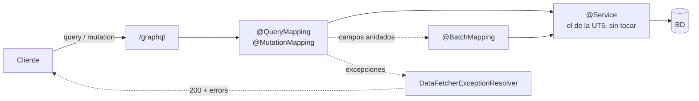

# 2. GraphQL

**Un solo endpoint, `/graphql`, y el cliente dice qué campos quiere.** Nada más cambia: los servicios y los repositorios de la UT4 y la UT5 se reutilizan tal cual.

| | REST | GraphQL |
|---|---|---|
| URLs | Una por recurso | **Una sola**: `/graphql` |
| Qué devuelve | Lo que decide el servidor | **Lo que pide el cliente** |
| Traer de más | `?` y endpoints a medida | No: pides los campos |
| Traer de menos | Varias peticiones | **Una** con los anidados |
| Versionado | `/v1`, `/v2` | El esquema crece |
| Códigos HTTP | 200/400/404/409 | **Siempre 200** + `errors` |

---

## 2.1. El esquema: el contrato

El esquema vive en `src/main/resources/graphql/schema.graphqls` y es **de donde sale todo**: la validación, la documentación y el autocompletado del playground.

```graphql title="schema.graphqls"
type Producto {
    id: ID!
    nombre: String!
    precio: Float!
    stock: Int!
    categoria: Categoria!
}

type Categoria {
    id: ID!
    nombre: String!
    productos: [Producto!]!
}

input ProductoInput {
    nombre: String!
    precio: Float!
    stock: Int!
    categoriaId: ID!
}

type Query {
    productos: [Producto!]!
    productoById(id: ID!): Producto
    categorias: [Categoria!]!
    categoriaById(id: ID!): Categoria
}

type Mutation {
    crearProducto(input: ProductoInput!): Producto!
    actualizarProducto(id: ID!, input: ProductoInput!): Producto!
    eliminarProducto(id: ID!): Boolean!
}

type Subscription {
    productoCreado: Producto!
}
```

### Las cuatro piezas, y cuándo cada una

| | Qué es | Cuándo |
|---|---|---|
| `type` | Un objeto que **sale** | Lo que devuelves: `Producto`, `Categoria` |
| `input` | Un objeto que **entra** | Los argumentos de las mutaciones |
| `enum` | Valores cerrados | `enum Estado { ACTIVO INACTIVO }` |
| `Query` / `Mutation` / `Subscription` | Los tres puntos de entrada | Leer / escribir / escuchar |

!!! success "Los tipos y los símbolos, de una vez"
    **Escalares:** `Int`, `Float`, `String`, `Boolean`, `ID`.

    | Se escribe | Significa |
    |---|---|
    | `String` | Puede ser `null` |
    | `String!` | **No** puede ser `null` |
    | `[Producto]` | La lista puede ser `null`, y sus elementos también |
    | `[Producto!]!` | **La lista existe siempre y ningún elemento es `null`** |

    **`[Producto!]!` es lo que quieres casi siempre**: una colección vacía es `[]`, no `null`.

!!! warning "`type` e `input` no son intercambiables"
    Un `type` **no** se puede usar como argumento, y un `input` no se puede devolver. Si lo intentas, la aplicación **no arranca**:

    ```
    The type 'Producto' is not an input type, but was used in an input type position
    ```

    Por eso hay un `ProductoInput` aparte del `Producto`, igual que en REST hay un `ProductoCreateRequest` aparte del `ProductoResponse`. **Es la misma idea del DTO.**

---

## 2.2. Instalación y configuración

```xml title="pom.xml"
<dependency>
  <groupId>org.springframework.boot</groupId>
  <artifactId>spring-boot-starter-graphql</artifactId>
</dependency>

<!-- Solo si usas Subscription -->
<dependency>
  <groupId>org.springframework.boot</groupId>
  <artifactId>spring-boot-starter-webflux</artifactId>
</dependency>

<dependency>
  <groupId>org.springframework.graphql</groupId>
  <artifactId>spring-graphql-test</artifactId>
  <scope>test</scope>
</dependency>
```

```properties title="application.properties"
spring.graphql.path=/graphql
spring.graphql.graphiql.enabled=true
spring.graphql.graphiql.path=/graphiql
```

!!! danger "`graphiql.enabled=true` solo en `dev`"
    El playground **expone el esquema entero** con introspección: todos los tipos, todos los campos y todas las mutaciones. En producción va a `false`, junto con la consola de H2 y Swagger UI.

---

## 2.3. El controlador: resolutores

```java title="productos/graphql/ProductosGraphQLController.java"
@Controller
public class ProductosGraphQLController {

    private final ProductosService productosService;
    private final CategoriasService categoriasService;

    /** Para la suscripción: un bus en memoria. */
    private final Sinks.Many<ProductoResponse> creados =
            Sinks.many().multicast().onBackpressureBuffer();

    public ProductosGraphQLController(ProductosService productosService,
                                      CategoriasService categoriasService) {
        this.productosService = productosService;
        this.categoriasService = categoriasService;
    }

    // ───── Queries ─────
    @QueryMapping
    public List<ProductoResponse> productos() {
        return productosService.findAll();
    }

    @QueryMapping
    public ProductoResponse productoById(@Argument Long id) {
        return productosService.findById(id);          // lanza 404 → error GraphQL
    }

    // ───── Mutaciones ─────
    @MutationMapping
    public ProductoResponse crearProducto(@Argument @Valid ProductoInput input) {
        var creado = productosService.save(input.toRequest());
        creados.tryEmitNext(creado);                   // avisa a los suscriptores
        return creado;
    }

    @MutationMapping
    public ProductoResponse actualizarProducto(@Argument Long id,
                                               @Argument @Valid ProductoInput input) {
        return productosService.update(id, input.toRequest());
    }

    @MutationMapping
    public Boolean eliminarProducto(@Argument Long id) {
        productosService.deleteById(id);
        return true;
    }

    // ───── Suscripción ─────
    @SubscriptionMapping
    public Flux<ProductoResponse> productoCreado() {
        return creados.asFlux();
    }
}
```

### Las cuatro anotaciones, y para qué sirve cada una

| | Resuelve | Equivale en REST a |
|---|---|---|
| `@QueryMapping` | Un campo de `Query` | `@GetMapping` |
| `@MutationMapping` | Un campo de `Mutation` | `@PostMapping` / `@PutMapping` / `@DeleteMapping` |
| `@SubscriptionMapping` | Un campo de `Subscription` | Un WebSocket |
| `@SchemaMapping` / `@BatchMapping` | **Un campo dentro de un tipo** | — |

!!! success "El método se llama igual que el campo del esquema"
    `productoById(id: ID!)` en el esquema → `public ProductoResponse productoById(@Argument Long id)`.

    Si no coinciden, GraphQL **no avisa al arrancar**: la consulta devuelve `null` en ese campo y te quedas mirando. Para que no pase, se pone `@QueryMapping("productoById")` con el nombre explícito, o se revisa el esquema a la primera consulta.

!!! danger "Los resolutores devuelven DTOs, no entidades"
    Es la misma regla de la UT5, y aquí importa más: GraphQL **navega** por los campos. Si devuelves la entidad, el cliente puede pedir `categoria { productos { categoria { … } } }` y provocar un bucle de consultas que no habías previsto.

### El campo calculado y el N+1

```java title="Resolver un campo que no está en el DTO"
/** Campo del tipo Producto que NO viene del servicio. */
@SchemaMapping(typeName = "Producto", field = "stockBajo")
public Boolean stockBajo(ProductoResponse producto) {
    return producto.stock() < 5;
}

/** Resuelve categoria para TODOS los productos de golpe: 1 consulta, no N. */
@BatchMapping(typeName = "Producto")
public Map<ProductoResponse, CategoriaResponse> categoria(List<ProductoResponse> productos) {
    var ids = productos.stream().map(ProductoResponse::categoriaId).distinct().toList();
    var porId = categoriasService.findAllById(ids).stream()
            .collect(toMap(CategoriaResponse::id, c -> c));
    return productos.stream()
            .collect(toMap(p -> p, p -> porId.get(p.categoriaId())));
}
```

!!! danger "`@SchemaMapping` por elemento es el N+1 de GraphQL"
    `@SchemaMapping` se ejecuta **una vez por cada elemento de la lista**. Con 50 productos, eso son **50 consultas** para traer las categorías.

    **`@BatchMapping` recibe la lista completa y devuelve un `Map`.** Una consulta. Es el equivalente exacto del `JOIN FETCH` de la UT5, y es lo que se corrige en el examen.

---

## 2.4. Probar la API

=== "Leer con los anidados"

    ```graphql
    query {
      productos {
        id
        nombre
        precio
        categoria { nombre }
      }
    }
    ```

    **Esa consulta anidada es el argumento de venta de GraphQL**: en REST serían dos peticiones, o un endpoint hecho a medida.

=== "Pedir menos campos"

    ```graphql
    query {
      productos { nombre precio }
    }
    ```

    El mismo endpoint, la mitad de JSON. En REST harían falta `?fields=` o un DTO nuevo.

=== "Crear"

    ```graphql
    mutation {
      crearProducto(input: {
        nombre: "Raqueta Pro", precio: 120.5, stock: 10, categoriaId: "1"
      }) {
        id
        nombre
        categoria { nombre }
      }
    }
    ```

    **La mutación también elige los campos de la respuesta**: eso que va entre llaves al final.

=== "Borrar y escuchar"

    ```graphql
    mutation { eliminarProducto(id: "1") }
    ```

    ```graphql
    subscription {
      productoCreado { id nombre precio }
    }
    ```

    La suscripción se queda abierta y recibe cada producto nuevo. Por debajo **es un WebSocket**: lo mismo del tema 1, con el esquema por delante.

=== "Con `curl`"

    ```bash
    curl -s localhost:8080/graphql \
      -H "Content-Type: application/json" \
      -d '{"query":"{ productos { nombre categoria { nombre } } }"}' | jq
    ```

    ```json
    { "data": { "productos": [
        { "nombre": "Teclado mecánico", "categoria": { "nombre": "INFORMATICA" } }
    ]}}
    ```

---

## 2.5. Los errores

```java title="graphql/GraphQLExceptionResolver.java"
@Component
public class GraphQLExceptionResolver extends DataFetcherExceptionResolverAdapter {

    @Override
    protected GraphQLError resolveToSingleError(Throwable ex, DataFetchingEnvironment env) {
        var tipo = switch (ex) {
            case ProductoNotFoundException e -> ErrorType.NOT_FOUND;
            case ProductoConflictException e -> ErrorType.BAD_REQUEST;
            default -> null;                      // los demás, sin tocar
        };
        if (tipo == null) return null;

        return GraphqlErrorBuilder.newError(env)
                .errorType(tipo)
                .message(ex.getMessage())
                .build();
    }
}
```

!!! danger "GraphQL devuelve **200** incluso cuando falla"
    ```json
    {
      "errors": [{
        "message": "No se ha encontrado el producto con id: 99",
        "extensions": { "classification": "NOT_FOUND" }
      }],
      "data": { "productoById": null }
    }
    ```

    **El código HTTP es 200.** El error va dentro del cuerpo, en `errors`, y `data` puede traer una parte buena y otra a `null`.

    Consecuencia práctica: un cliente que solo mire `response.status` **no se entera de nada**. Y en los tests, `GraphQlTester` tiene `.errors()` justo por esto.

!!! warning "Sin el resolutor, el mensaje se pierde"
    Por defecto, cualquier excepción que no reconozca sale como:

    ```
    "message": "INTERNAL_ERROR for 8f3a1b…"
    ```

    Ese identificador solo sirve para buscarlo en el log del servidor. **El cliente se queda sin saber qué ha pasado**, y por eso el resolutor es obligatorio.

---

## El flujo completo



!!! success "Lo que hay que llevarse"
    - El **esquema** es el contrato: tipos, `input`, y `!` donde no puede haber `null`
    - **Cuatro anotaciones**: `@QueryMapping`, `@MutationMapping`, `@SubscriptionMapping` y `@BatchMapping`
    - **`@BatchMapping`, no `@SchemaMapping`**, para los campos anidados de una lista
    - **Siempre 200**: los errores van en `errors`, y hacen falta el resolutor y `ErrorType`
    - El servicio **no se toca**: es el de la UT5

---

## Casos especiales

### Un `null` en un campo marcado con `!`

Si tu resolutor devuelve `null` en un campo declarado `String!`, GraphQL **no devuelve ese campo a `null`: anula el objeto padre entero** y lo reporta como error.

```graphql
type Producto { categoria: Categoria! }     # ← el "!"
```

Un producto cuya categoría se haya borrado hace que **el producto desaparezca de la lista**, no solo su categoría. La no-nulabilidad **se propaga hacia arriba**.

**Qué hacer:** marca con `!` solo lo que de verdad no puede faltar. En la duda, sin `!`: un campo `null` es un problema pequeño; un listado que se anula entero, no.

### Todo va por `POST`, y eso quita la caché

| | Comportamiento |
|---|---|
| Varias `query` en una petición | **En paralelo** |
| Varias `mutation` en una petición | **En serie y en orden**: la segunda ve el efecto de la primera |
| Verbo HTTP | **`POST` siempre**, también para leer |

Y la consecuencia de lo último: **la caché HTTP no funciona.** `ETag`, `Cache-Control` y las cachés intermedias se apoyan en que un `GET` con la misma URL devuelve lo mismo, y aquí la URL es siempre `/graphql`.

En REST la caché es gratis. En GraphQL hay que montarla dentro de la aplicación —`@Cacheable` en el servicio, como en la UT4— o delante con una caché que entienda consultas.

**Esta fila y la de los códigos de estado son las que deciden en la práctica**: GraphQL gana cuando el cliente es una app con muchas pantallas sobre los mismos datos; REST gana cuando el consumo es homogéneo y la caché importa.

### Monitorizar una API que siempre responde 200

Un panel que avise de 4xx y 5xx **no avisará nunca** con GraphQL: los errores van en el cuerpo y el estado es 200.

**Qué monitorizar:** la presencia del campo `errors` en la respuesta, y las `classification` que traen dentro. Los 4xx solo salen cuando el fallo es **anterior** a GraphQL: un JSON mal formado (400) o la autenticación (401).

### El controlador que reutiliza el servicio de la UT5

```java title="funkos/graphql/FunkosGraphQlController.java"
@Controller
public class FunkosGraphQlController {

    private final FunkosService servicio;              // ← EL MISMO de REST

    public FunkosGraphQlController(FunkosService servicio) {
        this.servicio = servicio;
    }

    @QueryMapping
    public List<FunkoResponse> funkos(@Argument Optional<String> categoria) {
        return servicio.buscar(categoria, Optional.empty(), Optional.empty(),
                               Pageable.unpaged()).getContent();
    }

    @QueryMapping
    public FunkoResponse funkoById(@Argument Long id) {
        return servicio.findById(id);          // lanza FunkoNotFoundException
    }

    @MutationMapping
    public FunkoResponse crearFunko(@Argument @Valid FunkoCreateRequest input) {
        return servicio.save(input);
    }

    @MutationMapping
    public Boolean borrarFunko(@Argument Long id) {
        servicio.deleteById(id);
        return true;
    }
}
```

!!! success "Lo importante es lo que NO hay"
    **Ni una línea de lógica de negocio.** Llama a los mismos métodos de `FunkosService` que el `@RestController`, y las excepciones propias suben igual.

    Cuatro métodos de fontanería más un `@BatchMapping`. **Eso es lo que compraste con las capas en la UT4: el tercer transporte sale casi gratis.**

    Y al revés: si el servicio lanzara `ResponseStatusException` con un `HttpStatus`, aquí no habría nada que traducir, porque **en GraphQL un código HTTP no significa nada**.

### Apagar el esquema en producción

```properties
spring.graphql.graphiql.enabled=false              # el playground
spring.graphql.schema.introspection.enabled=false  # descargar el esquema
```

La introspección permite a cualquiera **bajarse tu esquema completo**: todos los tipos, todos los campos, todas las mutaciones. Es lo que hace funcionar el playground, y es un mapa regalado para quien busque por dónde entrar.
