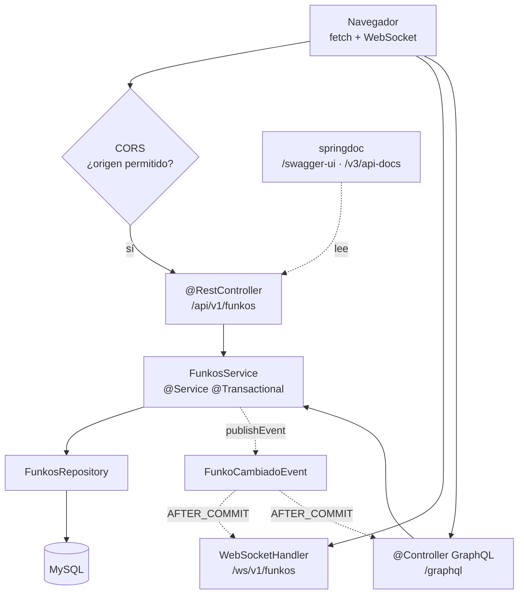

# 6. Proyecto paso a paso · CORS y OpenAPI

**CORS** para que el navegador pueda llamarte, y **OpenAPI** para que alguien pueda usar tu API sin preguntarte nada. Tres pasos, y es el tema más rentable de la unidad.

!!! success "Lo que vas a tener al final"
    ```
    GET /v3/api-docs              ← la especificación OpenAPI en JSON
    GET /swagger-ui/index.html    ← la interfaz, solo en dev
    OPTIONS /api/**               ← el preflight de CORS, respondido
    ```

!!! info "Por qué estos dos van juntos"
    Los dos son **el contrato con quien consume tu API**, y los dos se olvidan hasta que algo falla:

    - **CORS** es la razón por la que tu API funciona con `curl` y falla desde un navegador. El error no está en tu código: está en que no has dicho quién puede llamarte.
    - **OpenAPI** es la razón por la que alguien puede usar tu API sin preguntarte nada.

    Una API sin documentar es una API que solo sabe usar quien la escribió.

---

## Paso 1 · CORS y OpenAPI

```xml title="pom.xml"
<dependency>
  <groupId>org.springdoc</groupId>
  <artifactId>springdoc-openapi-starter-webmvc-ui</artifactId>
  <version>2.7.0</version>
</dependency>
```

```java title="config/CorsConfig.java"
@Configuration
public class CorsConfig implements WebMvcConfigurer {

    private final String[] origenes;

    public CorsConfig(@Value("${cors.origenes-permitidos}") String[] origenes) {
        this.origenes = origenes;
    }

    @Override
    public void addCorsMappings(CorsRegistry registry) {
        registry.addMapping("/api/**")
                .allowedOrigins(origenes)
                .allowedMethods("GET", "POST", "PUT", "PATCH", "DELETE", "OPTIONS")
                .allowedHeaders("*")
                .exposedHeaders("Location")      // para que el cliente lea el 201
                .allowCredentials(true)
                .maxAge(3600);
    }
}
```

```properties title="application-dev.properties"
cors.origenes-permitidos=http://localhost:5173,http://localhost:3000
```

```properties title="application-prod.properties"
cors.origenes-permitidos=https://miapp.es
```

```java title="config/OpenApiConfig.java"
@Configuration
public class OpenApiConfig {

    @Bean
    public OpenAPI apiInfo(@Value("${api.version:v1}") String version) {
        return new OpenAPI()
            .info(new Info()
                .title("API REST de Funkos — DWES 2.º DAW")
                .version(version)
                .description("""
                    API REST de gestión de funkos y categorías.

                    Construida en la UT4 (capas), la UT5 (JPA) y la UT6
                    (WebSockets, GraphQL y documentación).

                    Además de REST, la misma lógica está disponible en:
                    - **WebSocket**: `/ws/v1/funkos` (notificaciones)
                    - **GraphQL**: `/graphql` (consultas, mutaciones y suscripciones)
                    """)
                .contact(new Contact().name("2.º DAW · IES Ejemplo").email("dwes@iesx.es"))
                .license(new License().name("CC BY-NC-SA 4.0")
                         .url("https://creativecommons.org/licenses/by-nc-sa/4.0/")))
            .servers(List.of(
                new Server().url("http://localhost:8080").description("Desarrollo"),
                new Server().url("https://api.miapp.es").description("Producción")))
            .tags(List.of(
                new Tag().name("Funkos").description("CRUD y búsqueda de funkos"),
                new Tag().name("Categorías").description("CRUD de categorías")));
    }
}
```

```properties title="application-prod.properties"
springdoc.api-docs.enabled=false
springdoc.swagger-ui.enabled=false
```

## Paso 2 · Documentar un endpoint de verdad

```java title="funkos/controllers/FunkosRestController.java (anotado)"
@RestController
@RequestMapping("${api.path:/api}/${api.version:v1}/funkos")
@Tag(name = "Funkos", description = "CRUD y búsqueda de funkos")
public class FunkosRestController {

    @Operation(
        summary = "Lista funkos, paginados y con filtros opcionales",
        description = """
            Devuelve una página de funkos. Todos los filtros son opcionales y
            combinables. Los borrados lógicamente no aparecen nunca.

            El tamaño máximo de página es 100; valores mayores se recortan.
            Los campos ordenables son: id, nombre, precio, cantidad, createdAt.
            """)
    @ApiResponses({
        @ApiResponse(responseCode = "200", description = "Página de funkos")
    })
    @GetMapping
    public ResponseEntity<Page<FunkoResponse>> findAll(
            @Parameter(description = "Filtra por nombre de categoría, sin distinguir mayúsculas",
                       example = "ANIME")
            @RequestParam Optional<String> categoria,
            @Parameter(description = "Precio mínimo, incluido", example = "10.00")
            @RequestParam Optional<BigDecimal> precioMin,
            @PageableDefault(size = 20, sort = "id") Pageable pageable) { … }

    @Operation(summary = "Obtiene un funko por su id")
    @ApiResponses({
        @ApiResponse(responseCode = "200", description = "Funko encontrado",
            content = @Content(schema = @Schema(implementation = FunkoResponse.class))),
        @ApiResponse(responseCode = "400", description = "El id no es un número",
            content = @Content),
        @ApiResponse(responseCode = "404", description = "No existe un funko con ese id",
            content = @Content)
    })
    @GetMapping("/{id}")
    public ResponseEntity<FunkoResponse> findById(
            @Parameter(description = "Id del funko", example = "1", required = true)
            @PathVariable Long id) { … }

    @Operation(summary = "Crea un funko")
    @ApiResponses({
        @ApiResponse(responseCode = "201", description = "Creado. Devuelve la cabecera Location",
            content = @Content(schema = @Schema(implementation = FunkoResponse.class))),
        @ApiResponse(responseCode = "400", description = "Datos inválidos, con el detalle por campo",
            content = @Content),
        @ApiResponse(responseCode = "409", description = "Ya existe un funko con ese nombre",
            content = @Content)
    })
    @PostMapping
    public ResponseEntity<FunkoResponse> create(
            @Valid @RequestBody FunkoCreateRequest funko) { … }
}
```

```java title="funkos/dto/FunkoResponse.java (anotado)"
@Schema(description = "Datos de un funko")
public record FunkoResponse(
        @Schema(description = "Identificador único", example = "1")
        Long id,
        @Schema(description = "Nombre del funko", example = "Mickey Mouse")
        String nombre,
        @Schema(description = "Precio en euros", example = "15.99")
        BigDecimal precio,
        @Schema(description = "Unidades en stock", example = "10")
        Integer cantidad,
        @Schema(description = "URL de la imagen", example = "https://placehold.co/300")
        String imagen,
        @Schema(description = "Nombre de la categoría", example = "DISNEY")
        String categoria,
        @Schema(description = "Fecha de creación, en ISO-8601")
        LocalDateTime createdAt,
        @Schema(description = "Fecha de la última modificación, en ISO-8601")
        LocalDateTime updatedAt) {}
```

!!! success "Qué deduce `springdoc` solo y qué hay que escribir"
    | Lo deduce de tu código | Hay que escribirlo |
    |---|---|
    | Ruta, verbo, parámetros | **Para qué sirve** el endpoint |
    | Tipos y obligatoriedad (de `@NotBlank`, `@Min`…) | **Qué errores** devuelve y cuándo |
    | Esquema completo de los DTOs | **Ejemplos** de valores reales |
    | Enumerados y sus valores | Las **reglas** que no son de formato |

    La columna de la izquierda sale sola y es lo que convierte Swagger en útil desde el minuto uno. La de la derecha es la que convierte «una lista de endpoints» en **documentación**.

    Y lo que nunca se podrá deducir: que un POST devuelve 409 si el nombre está repetido. Eso es una regla de negocio y hay que decirla.

## Paso 3 · Probarlo

```bash
./mvnw spring-boot:run
```

| | |
|---|---|
| `http://localhost:8080/swagger-ui/index.html` | La interfaz, con «Try it out» |
| `http://localhost:8080/v3/api-docs` | El JSON de la especificación |
| `http://localhost:8080/graphiql` | El playground de GraphQL |
| `http://localhost:8080/graphql/schema` | El esquema GraphQL impreso |
| `http://localhost:8080/ws-test.html` | La página de notificaciones |

```bash
# Comprobar CORS: el preflight
curl -i -X OPTIONS localhost:8080/api/v1/funkos \
  -H "Origin: http://localhost:5173" \
  -H "Access-Control-Request-Method: POST" \
  -H "Access-Control-Request-Headers: content-type"
```

```
HTTP/1.1 200
Access-Control-Allow-Origin: http://localhost:5173
Access-Control-Allow-Methods: POST
Access-Control-Allow-Headers: content-type
Access-Control-Max-Age: 3600
```

```bash
# Un origen NO permitido
curl -i -X OPTIONS localhost:8080/api/v1/funkos \
  -H "Origin: https://sitio-malo.es" \
  -H "Access-Control-Request-Method: POST"
# HTTP/1.1 403
# Invalid CORS request
```

```bash
# Y en el perfil prod, Swagger no existe
SPRING_PROFILES_ACTIVE=prod ./mvnw spring-boot:run
curl -s -o /dev/null -w "%{http_code}\n" localhost:8080/swagger-ui/index.html
# 404
```

---

---

## Paso 4 · Los tests

```java
@SpringBootTest @AutoConfigureMockMvc @ActiveProfiles("test")
class CorsYDocsTest {

    @Autowired MockMvc mockMvc;

    @Test
    void elPreflightDeUnOrigenPermitidoDevuelveLasCabeceras() throws Exception {
        mockMvc.perform(options("/api/v1/funkos")
                    .header("Origin", "http://localhost:5173")
                    .header("Access-Control-Request-Method", "POST"))
               .andExpect(status().isOk())
               .andExpect(header().string("Access-Control-Allow-Origin",
                                          "http://localhost:5173"));
    }

    @Test
    void unOrigenNoPermitidoSeRechaza() throws Exception {
        mockMvc.perform(options("/api/v1/funkos")
                    .header("Origin", "https://sitio-malo.es")
                    .header("Access-Control-Request-Method", "POST"))
               .andExpect(status().isForbidden());
    }

    @Test
    void laEspecificacionOpenApiSeGenera() throws Exception {
        mockMvc.perform(get("/v3/api-docs"))
               .andExpect(status().isOk())
               .andExpect(jsonPath("$.openapi").exists())
               .andExpect(jsonPath("$.paths['/api/v1/funkos']").exists());
    }
}
```

---

## Checklist

- [ ] Swagger lista **todos** los endpoints con descripciones y errores
- [ ] Los **409 de negocio** están documentados uno a uno, diciendo en qué caso salta cada uno
- [ ] Todos los DTOs tienen `@Schema` con **ejemplos realistas**, no `"string"` ni `0`
- [ ] El *preflight* de un origen permitido devuelve las cabeceras
- [ ] Un origen **no** permitido devuelve **403**
- [ ] `exposedHeaders("Location")` puesto, y el cliente lee la cabecera del 201
- [ ] CORS configurado **por perfiles**, sin comodín
- [ ] Swagger y `/v3/api-docs` devuelven **404** con el perfil `prod`
- [ ] El `README.md` tiene tres `curl` que funcionan al copiar y pegar

---

## Lo que has construido



!!! success "Checklist antes de darlo por bueno"
    **WebSockets**

    - [ ] Dos pestañas reciben la notificación a la vez
    - [ ] Cerrar una pestaña no rompe las notificaciones a la otra
    - [ ] Un POST que devuelve 409 o 400 **no** genera notificación
    - [ ] `setAllowedOrigins` configurado, sin comodín

    **GraphQL**

    - [ ] `{ funkos { contenido { nombre } } }` devuelve **solo** el nombre
    - [ ] Pedir la categoría de 100 funkos son **2 consultas**, no 101
    - [ ] Un id inexistente devuelve `errors` con `classification: NOT_FOUND`
    - [ ] Las excepciones de la UT4 funcionan **sin tocarlas**
    - [ ] `introspection.enabled=false` en el perfil `prod`

    **Documentación y CORS**

    - [ ] Swagger lista todos los endpoints con descripciones y errores
    - [ ] El *preflight* de un origen permitido devuelve las cabeceras
    - [ ] Un origen no permitido devuelve **403**
    - [ ] `exposedHeaders("Location")` para que el cliente lea el 201
    - [ ] Swagger devuelve **404** con el perfil `prod`

    **Y lo que demuestra que la arquitectura aguanta**

    - [ ] `git diff` de los servicios: **solo el `publishEvent`**
    - [ ] `git diff` de los repositorios: **vacío**
    - [ ] `grep ResponseEntity` en los servicios: **vacío**

!!! info "El diff de toda la unidad, en el servicio"
    ```diff
    + private final ApplicationEventPublisher eventos;
    + eventos.publishEvent(new FunkoCambiadoEvent(Tipo.CREATE, respuesta));
    ```

    Dos líneas, y a cambio tienes dos transportes nuevos y la API documentada.

    **Eso es lo que se evalúa en esta unidad**: no escribir WebSockets, sino haber construido en la UT4 algo sobre lo que se puedan añadir.
