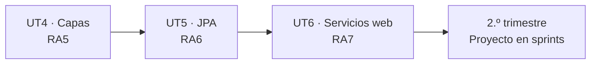

# Ejercicios prácticos — UT6 (RA7)

**Nueve enunciados del formato del examen**: tres de WebSockets, tres de GraphQL y tres de documentación. Se resuelven igual que los [tres proyectos paso a paso](04-proyecto-websockets.md), **sobre tu proyecto de la UT5**.

!!! success "Qué evalúa el RA7 y qué no"
    El RA7 es *«desarrolla **servicios web reutilizables** y accesibles mediante protocolos web, verificando su funcionamiento»*.

    La palabra que decide la corrección es **reutilizables**:

    | | |
    |---|---|
    | **Reutilizables** | El mismo servicio atiende REST, WebSocket y GraphQL. **`git diff` de los servicios: solo el `publishEvent`** |
    | **Accesibles por protocolos web** | WebSocket sobre el `101`, GraphQL sobre `POST /graphql`, CORS para el navegador |
    | **Verificando su funcionamiento** | Tests de los tres transportes, y **contar las consultas** del N+1 |
    | **Documentados** | OpenAPI con los errores de negocio incluidos |

    **Las capas se evaluaron en el RA5 y el modelo de datos en el RA6.** Aquí lo que se mide es que la arquitectura aguantaba.

| Bloque | EP | Enunciado | Tiempo |
|---|:-:|---|:-:|
| **WebSockets** | WS1 | [Sala de subastas](#ws1-sala-de-subastas) · bidireccional | 3 h |
| | WS2 | [Chat de soporte](#ws2-chat-de-soporte) · salas y persistencia | 3 h |
| | WS3 | [Monitor de pedidos](#ws3-monitor-de-pedidos) · dos canales y `@Scheduled` | 3 h |
| **GraphQL** | GQ1 | [API GraphQL completa](#gq1-api-graphql-completa) · el N+1 medido | 3 h |
| | GQ2 | [GraphQL con suscripciones](#gq2-graphql-con-suscripciones) · tiempo real | 4 h |
| | GQ3 | [GraphQL frente a REST, medido](#gq3-graphql-frente-a-rest-medido) · informe con datos | 3 h |
| **OpenAPI** | DOC1 | [Documentación completa](#doc1-documentacion-completa) · sin preguntas | 2 h |
| | DOC2 | [Cliente de otra API](#doc2-cliente-de-otra-api) · desde el otro lado | 3 h |
| | DOC3 | [Página de integración](#doc3-pagina-de-integracion) · los tres transportes | 4 h |

!!! info "Qué se te da y qué escribes tú"
    **Se te da:** tu propio proyecto de la UT5, o uno de referencia equivalente si no lo terminaste.

    **Escribes tú:** solo las clases nuevas del transporte. **Si tienes que tocar un servicio o un repositorio para algo más que publicar un evento, el ejercicio está mal resuelto** — y lo que está mal no es este ejercicio, es la arquitectura de hace dos meses.

---

# Bloque 1 · WebSockets

## WS1 · Sala de subastas

**Contexto.** Una plataforma de subastas necesita que los pujadores vean las pujas de los demás **al instante** y puedan pujar **por el mismo canal**. Es el único enunciado de verdad bidireccional.

### Modelo (se añade a tu proyecto)

| Entidad | Campos |
|---|---|
| **`Subasta`** | `id`, `codigo` (único), `articulo`, `descripcion`, `precioInicial`, `precioActual`, `incrementoMinimo`, `inicio`, `fin`, `estado` (`enum`: `PROGRAMADA`, `ABIERTA`, `CERRADA`, `ANULADA`), `ganador` (texto, puede ser nulo) |
| **`Puja`** | `id`, `subasta` (N:1), `usuario`, `importe`, `instante` |

### Endpoints y canal

| # | Qué | Detalle |
|:-:|---|---|
| 1 | `POST /api/v1/subastas` | Crea, estado `PROGRAMADA`. `precioActual = precioInicial` |
| 2 | `GET /api/v1/subastas` · `/{id}` | Paginado, con el número de pujas |
| 3 | `POST /api/v1/subastas/{id}/abrir` · `/cerrar` | Transiciones manuales |
| 4 | `GET /api/v1/subastas/{id}/pujas` | Historial paginado, de más reciente a más antigua |
| 5 | **`WS /ws/v1/subastas/{id}`** | **Bidireccional**: el cliente **puja** por aquí |

### El protocolo del WebSocket

**Lo que manda el cliente:**

```json
{ "tipo": "PUJA", "usuario": "ana", "importe": 45.00 }
```

**Lo que recibe, al conectarse:**

```json
{ "tipo": "ESTADO", "codigo": "SUB-001", "articulo": "Cuadro",
  "precioActual": 40.00, "pujas": 11, "estado": "ABIERTA",
  "cierra": "2026-10-20T19:00:00" }
```

**Lo que reciben todos, si la puja es válida:**

```json
{ "tipo": "PUJA", "usuario": "ana", "importe": 45.00, "pujas": 12 }
```

**Lo que recibe SOLO quien pujó, si no es válida:**

```json
{ "tipo": "ERROR", "motivo": "Tu puja (42.00) no supera la actual (45.00) más el incremento mínimo (1.00)" }
```

**Lo que reciben todos al cerrarse, sin que nadie pregunte:**

```json
{ "tipo": "CERRADA", "ganador": "ana", "importe": 45.00 }
```

### Reglas

| # | Regla | Dónde se nota |
|:-:|---|---|
| R1 | La puja debe superar `precioActual + incrementoMinimo` | **ERROR solo al pujador** |
| R2 | La subasta debe estar `ABIERTA` | ERROR solo al pujador |
| R3 | `importe` positivo y con dos decimales; `usuario` no vacío | ERROR solo al pujador |
| R4 | Una puja válida **se persiste** y actualiza `precioActual` | — |
| R5 | Al reconectar, el cliente recibe el **`ESTADO` actual** | Primer mensaje |
| R6 | Al llegar `fin`, el servidor cierra la subasta **solo** y avisa a todos | `@Scheduled(fixedDelay = 10000)` |
| R7 | Cerrar fija `ganador` con el usuario de la puja más alta | — |
| R8 | **Dos pujas simultáneas por el mismo importe** se resuelven de forma determinista: gana la primera y la segunda recibe ERROR | — |
| R9 | `setAllowedOrigins` por perfiles | — |

!!! danger "R8 es la dificultad real, y es la misma de la UT4 y la UT5"
    Dos pujas de 45,00 € que llegan a la vez. Sin cuidado, las dos leen `precioActual = 40`, las dos se consideran válidas y **las dos se guardan**: hay dos pujas ganadoras.

    La solución es la de siempre, **comprobar y escribir en la misma sentencia**:

    ```java
    @Modifying(clearAutomatically = true, flushAutomatically = true)
    @Query("""
           UPDATE Subasta s SET s.precioActual = :importe
            WHERE s.id = :id
              AND s.estado = 'ABIERTA'
              AND :importe >= s.precioActual + s.incrementoMinimo
           """)
    int pujar(@Param("id") Long id, @Param("importe") BigDecimal importe);
    ```

    Si afecta a **0 filas**, la puja no era válida → ERROR a ese cliente. Y la puja solo se inserta si el `UPDATE` tuvo éxito, **dentro de la misma transacción**.

!!! tip "Responder a UN cliente, no a todos"
    Es lo que distingue este enunciado de los otros dos:

    ```java
    @Override
    protected void handleTextMessage(WebSocketSession sesion, TextMessage mensaje) {
        try {
            var puja = mapper.readValue(mensaje.getPayload(), PujaMensaje.class);
            var resultado = servicio.pujar(subastaDeLaSesion(sesion), puja);   // puede lanzar
            enviarATodos(subastaId, json(resultado));                           // broadcast
        } catch (PujaInvalidaException e) {
            sesion.sendMessage(new TextMessage(json(                            // solo a él
                    new ErrorMensaje("ERROR", e.getMessage()))));
        } catch (JsonProcessingException e) {
            sesion.sendMessage(new TextMessage(json(
                    new ErrorMensaje("ERROR", "Mensaje mal formado"))));
        }
    }
    ```

    Y ojo: **lo que llega por el socket no pasa por `@Valid`**. Hay que validarlo a mano o invocar el `Validator` tú:

    ```java
    private final Validator validator;      // jakarta.validation.Validator, inyectado

    var errores = validator.validate(puja);
    if (!errores.isEmpty()) throw new PujaInvalidaException(
            errores.iterator().next().getMessage());
    ```

---

## WS2 · Chat de soporte

**Contexto.** Una aplicación necesita un chat entre un usuario y un técnico, organizado en salas. Los mensajes se guardan; los avisos de «está escribiendo», no.

### Modelo

| Entidad | Campos |
|---|---|
| **`Sala`** | `id`, `codigo` (único), `asunto`, `usuario`, `tecnico` (puede ser nulo), `estado` (`enum`: `ABIERTA`, `ATENDIDA`, `CERRADA`), `apertura`, `cierre` |
| **`Mensaje`** | `id`, `sala` (N:1), `autor`, `texto` (máx. 1000), `instante` |

### Endpoints y canal

| # | Qué | Detalle |
|:-:|---|---|
| 1 | `POST /api/v1/salas` | Abre una sala, estado `ABIERTA` |
| 2 | `POST /api/v1/salas/{id}/asignar` | Asigna técnico → `ATENDIDA` |
| 3 | `POST /api/v1/salas/{id}/cerrar` | → `CERRADA`, fija `cierre` |
| 4 | `GET /api/v1/salas` | Paginado. Filtros `estado`, `usuario`, `tecnico` |
| 5 | `GET /api/v1/salas/{id}/mensajes` | **Historial paginado**, de más reciente a más antiguo |
| 6 | **`WS /ws/v1/chat/{salaId}`** | Bidireccional |

### El protocolo

| Tipo | Dirección | ¿Se persiste? |
|---|---|:-:|
| `{"tipo":"MENSAJE","autor":"ana","texto":"Hola"}` | Cliente → servidor → **todos** | **Sí** |
| `{"tipo":"ESCRIBIENDO","autor":"ana"}` | Cliente → servidor → **los demás** | **No** |
| `{"tipo":"ENTRA","autor":"tecnico1","conectados":2}` | Servidor → todos | No |
| `{"tipo":"SALE","autor":"ana","conectados":1}` | Servidor → todos | No |
| `{"tipo":"HISTORIAL","mensajes":[…]}` | Servidor → quien se conecta | — |

### Reglas

| # | Regla | Respuesta |
|:-:|---|:-:|
| R1 | `texto` no vacío, máximo 1000 caracteres | ERROR al emisor |
| R2 | Una sala **`CERRADA` rechaza mensajes nuevos** | ERROR al emisor |
| R3 | Al conectarse se reciben **los últimos 20 mensajes** de la sala | — |
| R4 | `ESCRIBIENDO` se reenvía **a los demás, no al emisor** | — |
| R5 | `ENTRA` y `SALE` llevan el número de conectados **de esa sala** | — |
| R6 | El `autor` se guarda en la sesión al conectarse, **no viene en cada mensaje** | — |
| R7 | Una sesión de una sala **no recibe** mensajes de otra | — |
| R8 | Los mensajes se persisten **después de confirmar** la transacción | — |
| R9 | `setAllowedOrigins` por perfiles | — |

!!! danger "R6 y R7 son la dificultad: la sesión tiene estado"
    Es la primera vez que una sesión WebSocket guarda algo:

    ```java
    @Override
    public void afterConnectionEstablished(WebSocketSession sesion) {
        var salaId = salaDeLaUri(sesion.getUri());
        var autor  = parametro(sesion.getUri(), "autor");   // ?autor=ana

        sesion.getAttributes().put("salaId", salaId);
        sesion.getAttributes().put("autor",  autor);

        porSala.computeIfAbsent(salaId, k -> new CopyOnWriteArraySet<>()).add(sesion);
        enviarASala(salaId, json(new Aviso("ENTRA", autor, porSala.get(salaId).size())));
        sesion.sendMessage(new TextMessage(json(ultimos20(salaId))));
    }
    ```

    **Y el `Map<Long, Set<WebSocketSession>>` tiene que ser concurrente en los dos niveles:** `ConcurrentHashMap` por fuera y `CopyOnWriteArraySet` por dentro. El `computeIfAbsent` es el de la [UT2](../ut2/ejercicios.md).

    El `afterConnectionClosed` tiene que **quitar la sesión de su sala** y, si la sala se queda vacía, **borrar la entrada del mapa**. Sin eso, el mapa crece para siempre.

!!! tip "R4: a los demás, no al emisor"
    ```java
    for (var s : porSala.getOrDefault(salaId, Set.of())) {
        if (s.getId().equals(emisor.getId())) continue;       // ← salta al emisor
        // … enviar …
    }
    ```

    Parece un detalle y es lo que hace que la interfaz no parpadee: ver «estás escribiendo» de ti mismo es desconcertante.

---

## WS3 · Monitor de pedidos

**Contexto.** Una cocina necesita un panel con todos los pedidos en curso, y cada cliente quiere seguir **solo el suyo**. El mismo cambio genera **dos mensajes distintos** para dos audiencias.

### Endpoints y canales

| # | Qué | Detalle |
|:-:|---|---|
| 1 | **`WS /ws/v1/cocina`** | Todos los pedidos abiertos, con sus líneas y el tiempo transcurrido |
| 2 | **`WS /ws/v1/pedidos/{id}`** | Solo el estado de ese pedido |
| 3 | `POST /api/v1/pedidos/{id}/estado` | `RECIBIDO → PREPARANDO → LISTO → ENTREGADO` |
| 4 | `GET /api/v1/pedidos/cocina` | El mismo contenido que el canal 1, por REST |

### Los dos mensajes del mismo evento

=== "Canal de cocina"

    ```json
    { "tipo": "ACTUALIZACION",
      "pedidos": [
        { "codigo": "PED-2026-000041", "estado": "PREPARANDO",
          "minutos": 7, "retrasado": false, "mesa": 4,
          "lineas": [{ "producto": "Hamburguesa", "cantidad": 2 },
                     { "producto": "Patatas",     "cantidad": 1 }] },
        { "codigo": "PED-2026-000042", "estado": "RECIBIDO",
          "minutos": 23, "retrasado": true, "mesa": 7, "lineas": [ … ] }
      ],
      "resumen": { "abiertos": 2, "retrasados": 1, "minutosMedios": 15.0 } }
    ```

=== "Canal del cliente"

    ```json
    { "tipo": "ESTADO", "codigo": "PED-2026-000041",
      "estado": "PREPARANDO", "minutos": 7,
      "mensaje": "Tu pedido se está preparando" }
    ```

    **Sin las líneas, sin el resumen y sin los demás pedidos.** El cliente no tiene por qué ver los pedidos de otras mesas.

### Reglas

| # | Regla |
|:-:|---|
| R1 | Un cambio de estado notifica **a los dos canales**, con **contenido distinto** |
| R2 | El canal del cliente solo recibe **su** pedido |
| R3 | Al conectarse a `/ws/v1/cocina` se recibe **el estado completo** de los pedidos abiertos |
| R4 | `@Scheduled(fixedDelay = 30000)` recalcula y **reenvía** los tiempos al canal de cocina |
| R5 | Un pedido con más de **20 minutos** se marca `"retrasado": true` |
| R6 | **Si no hay nadie conectado a cocina, el `@Scheduled` no hace nada** (y se comprueba) |
| R7 | Transiciones de estado válidas únicamente → **409** por REST |
| R8 | `ENTREGADO` saca el pedido del canal de cocina |
| R9 | `setAllowedOrigins` por perfiles |

!!! danger "R1: un evento, dos mensajes"
    ```java
    @TransactionalEventListener(phase = TransactionPhase.AFTER_COMMIT)
    public void alCambiarEstado(PedidoCambiadoEvent e) {
        cocinaHandler.enviarATodos(json(resumenDeCocina()));          // mensaje A
        pedidoHandler.enviarAlPedido(e.pedidoId(), json(estadoDe(e)));// mensaje B
    }
    ```

    Dos `handler` distintos, dos formatos distintos, **un solo evento publicado por el servicio**. Y el servicio sigue sin saber que existe ningún WebSocket.

!!! warning "R6 parece trivial y es un criterio de la rúbrica"
    ```java
    @Scheduled(fixedDelay = 30_000)
    public void refrescarTiempos() {
        if (cocinaHandler.conectados() == 0) return;     // ← esto
        cocinaHandler.enviarATodos(json(resumenDeCocina()));
    }
    ```

    Sin ese `return`, cada 30 segundos consultas la base de datos, montas el JSON y lo tiras a la basura. **Toda la noche, con el restaurante cerrado.**

    Y hace falta `@EnableScheduling` en la clase principal, o el método no se ejecuta nunca y nada avisa.

---

# Bloque 2 · GraphQL

## GQ1 · API GraphQL completa

**Contexto.** El esquema GraphQL completo del dominio de tu [reto de la UT5](../ut5/ejercicios-practicos.md), con sus tres o cuatro entidades, sobre los servicios que ya tienes.

### Lo que hay que construir

| # | Qué | Detalle |
|:-:|---|---|
| 1 | **Esquema** con todos los tipos del dominio | `type`, `input`, `enum`, con los `!` correctos |
| 2 | **Queries** de las tres entidades | Con filtros opcionales, paginación y campos anidados **en las dos direcciones** |
| 3 | **Mutaciones** de todas las escrituras | Incluidas las de negocio, no solo CRUD |
| 4 | **`@BatchMapping` en TODAS las relaciones** | Medido con `show-sql=true` |
| 5 | **Dos campos calculados** con `@SchemaMapping` | Que no existan en la entidad |
| 6 | Excepciones traducidas a `ErrorType` | Con mensajes útiles |
| 7 | Límites de profundidad y complejidad | Y `introspection` apagada en `prod` |
| 8 | Tests con `GraphQlTester` | 3 de consulta, 2 de mutación, 2 de error |

### El esquema de referencia (ejemplo con el dominio de la biblioteca)

```graphql
type Libro {
    id: ID!
    isbn: String!
    titulo: String!
    autor: Autor!                 # @BatchMapping
    genero: Genero!               # @BatchMapping
    ejemplares: Int!
    prestados: Int!
    disponibles: Int!             # @SchemaMapping: CALCULADO
    prestamos(estado: EstadoPrestamo): [Prestamo!]!   # @BatchMapping
}

type Socio {
    id: ID!
    numeroSocio: String!
    nombre: String!
    prestamosActivos: Int!        # @SchemaMapping: CALCULADO
    puedePrestar: Boolean!        # @SchemaMapping: CALCULADO con las reglas R6 y R7
    historial: [Prestamo!]!       # @BatchMapping
}

type PaginaLibros { contenido: [Libro!]!  total: Int!  pagina: Int!  totalPaginas: Int! }

input LibroFiltro { titulo: String  autor: String  genero: String  disponibles: Boolean }

type Query {
    libros(filtro: LibroFiltro, pagina: Int = 0, tamano: Int = 20): PaginaLibros!
    libroById(id: ID!): Libro
    libroByIsbn(isbn: String!): Libro
    socios(nombre: String): [Socio!]!
    masPrestados(limite: Int = 5): [Libro!]!
}

type Mutation {
    crearLibro(input: LibroInput!): Libro!
    prestar(libroId: ID!, socioId: ID!): Prestamo!
    devolver(prestamoId: ID!): Prestamo!
    borrarLibro(id: ID!): Boolean!
}
```

!!! danger "El ítem 4 es el que más puntúa, y se corrige contando"
    Esta consulta, con 20 libros:

    ```graphql
    { libros(tamano: 20) { contenido { titulo autor { nombre } genero { nombre } } } }
    ```

    | | Consultas SQL |
    |---|:-:|
    | Sin `@BatchMapping` | **1 + 20 + 20 = 41** |
    | Con `@BatchMapping` en autor y género | **3** |

    ```java
    @BatchMapping(typeName = "Libro")
    public Map<LibroResponse, AutorResponse> autor(List<LibroResponse> libros) {
        var ids = libros.stream().map(LibroResponse::autorId).distinct().toList();
        var porId = autoresService.findAllById(ids).stream()
                .collect(Collectors.toMap(AutorResponse::id, a -> a));
        return libros.stream().collect(Collectors.toMap(l -> l,
                                       l -> porId.get(l.autorId())));
    }
    ```

    **Y el `distinct()` importa:** si 15 de los 20 libros son del mismo autor, sin él pides 20 ids para 6 autores distintos.

!!! tip "El ítem 5: campos que no existen en la entidad"
    ```java
    @SchemaMapping(typeName = "Libro", field = "disponibles")
    public Integer disponibles(LibroResponse libro) {
        return libro.ejemplares() - libro.prestados();
    }

    @SchemaMapping(typeName = "Socio", field = "puedePrestar")
    public Boolean puedePrestar(SocioResponse socio) {
        return socio.activo()
            && socio.prestamosActivos() < 3
            && socio.vencidos() == 0;
    }
    ```

    **Esto es lo que GraphQL hace mejor que REST:** `puedePrestar` es una regla de negocio expuesta como un campo. En REST tendrías que inventar un endpoint `/socios/{id}/puede-prestar` o devolverlo siempre aunque nadie lo use.

    Y fíjate en que la regla **ya está en el servicio**: el resolutor solo la expone.

---

## GQ2 · GraphQL con suscripciones

**Contexto.** Lo mismo que GQ1, pero el núcleo es el **tiempo real por GraphQL**. Es el enunciado más difícil de los nueve.

### Lo que hay que construir

| # | Qué |
|:-:|---|
| 1 | Las queries y mutaciones básicas del dominio (menos exhaustivas que en GQ1) |
| 2 | **`subscription` con filtro por argumento**: `entidadCambiada(tipo: "CREATE")` solo recibe las creaciones |
| 3 | **`contadorEnVivo`** emite estadísticas agregadas **cada 5 segundos**, con `Flux.interval` |
| 4 | El **mismo `ApplicationEvent`** alimenta la suscripción GraphQL **y** el WebSocket del bloque 1 |
| 5 | **Cerrar el navegador cancela la suscripción** y libera el `Flux` — y se demuestra |
| 6 | Tests de suscripción con `GraphQlTester` y `StepVerifier` |

```graphql
type Subscription {
    entidadCambiada(tipo: TipoCambio): Notificacion!
    contadorEnVivo: Estadisticas!
}

enum TipoCambio { CREATE, UPDATE, DELETE }

type Notificacion { tipo: TipoCambio!  entidad: String!  id: ID!  instante: String! }
type Estadisticas { total: Int!  activos: Int!  instante: String! }
```

!!! danger "El ítem 5 es el que se olvida, y es una fuga de memoria"
    ```java
    private final Sinks.Many<Notificacion> emisor =
            Sinks.many().multicast().onBackpressureBuffer();

    @SubscriptionMapping
    public Flux<Notificacion> entidadCambiada(@Argument Optional<TipoCambio> tipo) {
        return emisor.asFlux()
                .filter(n -> tipo.map(t -> t == n.tipo()).orElse(true))
                .doOnCancel(() -> log.info("Suscripción cancelada"))
                .doOnTerminate(() -> log.info("Suscripción terminada"));
    }
    ```

    **Un `Flux` que nadie cancela sigue recibiendo eventos para siempre.** Con `onBackpressureBuffer`, el búfer crece hasta agotar la memoria.

    **Cómo se demuestra:** abre la suscripción en GraphiQL, cierra la pestaña, y comprueba en el log que aparece `Suscripción cancelada`. Si no aparece, está mal.

!!! warning "`Sinks.many().multicast()` y no `.unicast()`"
    | | Qué hace |
    |---|---|
    | `unicast()` | **Un solo** suscriptor. El segundo recibe un error |
    | `multicast()` | Varios suscriptores, **cada uno recibe lo que se emite desde que se suscribió** |
    | `replay()` | Varios, y los nuevos reciben también lo anterior |

    Para notificaciones, `multicast()`. Y `tryEmitNext` en vez de `emitNext` para no tener que decidir una estrategia de error en cada emisión:

    ```java
    @TransactionalEventListener(phase = TransactionPhase.AFTER_COMMIT)
    public void alCambiar(EntidadCambiadaEvent e) {
        emisor.tryEmitNext(new Notificacion(e.tipo(), e.entidad(), e.id(),
                                            LocalDateTime.now().toString()));
    }
    ```

!!! tip "El ítem 3: `Flux.interval`"
    ```java
    @SubscriptionMapping
    public Flux<Estadisticas> contadorEnVivo() {
        return Flux.interval(Duration.ofSeconds(5))
                   .map(tick -> servicio.estadisticasEnVivo())
                   .doOnCancel(() -> log.info("Contador cancelado"));
    }
    ```

    **Y aquí la fuga es peor:** este `Flux` genera carga (una consulta cada 5 segundos) aunque el cliente se haya ido. El `doOnCancel` no es decoración: es la prueba de que se libera.

---

## GQ3 · GraphQL frente a REST, medido

**Contexto.** Las dos APIs sobre el mismo servicio, un cliente que pinte la misma pantalla con cada una, y **un informe con números**. Es el enunciado para quien quiera entender cuándo *no* usar GraphQL.

### Lo que hay que construir

| # | Qué |
|:-:|---|
| 1 | La API GraphQL de tu dominio, al nivel de GQ1 pero con **dos entidades** en vez de tres |
| 2 | Un **cliente HTML** que pinte la misma pantalla **dos veces**: una llamando a REST y otra a GraphQL |
| 3 | **Tres pantallas distintas**, diseñadas para que el resultado sea distinto en cada una |
| 4 | Un `README.md` con la tabla de mediciones y **las conclusiones razonadas** |
| 5 | **Al menos una pantalla donde REST gane**, y explicar por qué |

### Las tres pantallas

| | Pantalla | Qué pide | Quién debería ganar |
|:-:|---|---|---|
| **P1** | Listado simple | 20 elementos, solo nombre y precio | **GraphQL** (menos bytes) |
| **P2** | Detalle con relaciones | 1 elemento + su categoría + sus 5 últimos pedidos | **GraphQL** (1 petición en vez de 3) |
| **P3** | Recurso completo, consultado 10 veces | El mismo elemento entero, repetidamente | **REST** (caché HTTP) |

### La tabla que hay que rellenar

| | | REST | GraphQL |
|---|---|:-:|:-:|
| **P1** | Peticiones HTTP | | 1 |
| | Bytes transferidos | | |
| | Consultas SQL | | |
| | Tiempo hasta pintar (ms) | | |
| **P2** | Peticiones HTTP | | 1 |
| | Bytes transferidos | | |
| | Consultas SQL | | |
| | Tiempo hasta pintar (ms) | | |
| **P3** | Peticiones HTTP | | |
| | **Peticiones que llegan al servidor** | | |
| | Bytes transferidos | | |

!!! danger "P3 es la pantalla que importa, y es donde REST gana"
    Pedir diez veces el mismo recurso:

    ```bash
    # REST: con ETag, nueve de las diez respuestas son 304 Not Modified, sin cuerpo
    curl -i localhost:8080/api/v1/productos/1
    # ETag: "a1b2c3"
    curl -i localhost:8080/api/v1/productos/1 -H 'If-None-Match: "a1b2c3"'
    # HTTP/1.1 304 Not Modified     ← 0 bytes de cuerpo, 0 consultas SQL
    ```

    ```bash
    # GraphQL: diez POST a /graphql, diez respuestas completas, diez veces la BD
    ```

    **GraphQL no puede usar la caché HTTP** porque todo va por `POST` al mismo endpoint. Hay que montar la caché aparte (en el servidor, o con una librería del cliente como Apollo), y eso es trabajo que en REST viene gratis.

    **Si tu informe no incluye esta pantalla, el ejercicio está incompleto**: medir solo donde gana GraphQL no es medir.

!!! tip "Cómo medir cada cosa"
    - **Peticiones y bytes:** DevTools → pestaña Red → la barra de estado de abajo («N requests, X kB transferred»).
    - **Consultas SQL:** `show-sql=true` y contar las líneas `Hibernate:` del log. Reinicia entre pantallas para no mezclar.
    - **Tiempo hasta pintar:** `performance.now()` antes de la primera petición y después del último `render`, o la columna *Finish* de DevTools.
    - **Peticiones que llegan al servidor:** cuéntalas en el log de acceso, no en el navegador. En P3 es donde se ve el 304.

    Y repite cada medición **tres veces**, descartando la primera: la JVM necesita calentarse y el primer acceso incluye la compilación JIT.

---

# Bloque 3 · Documentación y CORS

## DOC1 · Documentación completa

**Contexto.** Toda tu API documentada **para que alguien la use sin preguntarte nada**. Es el enunciado más corto y el que más retorno tiene.

### Lo que hay que construir

| # | Qué |
|:-:|---|
| 1 | `@Operation` con `summary` y `description` en **todos** los endpoints |
| 2 | `@ApiResponses` con **todos** los códigos de cada endpoint, incluidos los **409 de negocio** |
| 3 | `@Parameter` con `description` y `example` en **todos** los parámetros |
| 4 | `@Schema` con ejemplos **realistas** en todos los DTOs |
| 5 | Agrupación por `@Tag`, con descripciones |
| 6 | Metadatos de la API: título, versión, descripción, contacto, licencia y servidores |
| 7 | CORS **por perfiles** con `exposedHeaders` |
| 8 | Swagger y `/v3/api-docs` **apagados en `prod`**, comprobado con un `curl` |
| 9 | `README.md` con la URL de Swagger y **tres `curl` que funcionen al copiar y pegar** |
| 10 | La colección de Postman **exportada del `/v3/api-docs`**, no hecha a mano |

!!! danger "El ítem 2 es el que decide la nota"
    `springdoc` deduce las rutas, los tipos y la obligatoriedad. **No puede deducir** que un POST devuelve 409 si el nombre está repetido.

    Y ese es justo el dato que necesita quien va a consumir tu API.

    ```java
    @ApiResponse(responseCode = "409",
        description = """
            Conflicto. Puede ser por:
            - Ya existe un libro con ese ISBN
            - El socio tiene 3 préstamos activos (máximo permitido)
            - El socio tiene algún préstamo vencido sin devolver
            - No quedan ejemplares libres de ese libro

            El cuerpo indica cuál de los cuatro ha sido.
            """)
    ```

    **Cuatro causas distintas para el mismo código.** Si tu documentación dice solo «Conflicto», el cliente no puede hacer nada con esa información.

!!! success "La prueba definitiva, y es la que se usa para corregir"
    **Se le da tu Swagger a otra persona y se le pide que haga cinco operaciones, incluida una que provoque un 409. Si tiene que preguntarte algo, falta documentación.**

    Lo que siempre falta, en este orden:

    1. **Los códigos de error y en qué caso sale cada uno.** Lo más frecuente con diferencia.
    2. **Ejemplos con valores reales.** `"string"` y `0` no sirven: hay que saber que la categoría es `DISNEY` y no `disney` ni `1`.
    3. **Las reglas de negocio.** Que no se puede borrar un género con libros no está en ninguna anotación.
    4. **Qué devuelve exactamente el 400.** El cliente necesita saber que el cuerpo lleva `campos` con los errores por campo para poder pintarlos.

---

## DOC2 · Cliente de otra API

**Contexto.** Consume la API de otra persona **usando solo su documentación**, y escribe un informe de lo que faltaba. Se aprende desde el otro lado.

### Lo que hay que construir

| # | Qué |
|:-:|---|
| 1 | Documentar la tuya al nivel de DOC1 *(es la mitad del trabajo)* |
| 2 | Un **cliente Java con `RestClient`** que consuma la API ajena: listar, crear, provocar un error y manejarlo |
| 3 | El cliente mapea las respuestas a **tus propios `record`**, no a los suyos |
| 4 | Manejo de los tres casos: 2xx, 4xx con cuerpo de error, y **fallo de conexión** |
| 5 | Tests del cliente con **`MockRestServiceServer`**, sin depender de que su servidor esté levantado |
| 6 | Un **informe** de lo que faltaba en su documentación y lo que tuviste que adivinar o preguntar |

```java
@Component
public class CatalogoAjenoClient {

    private final RestClient cliente;

    public CatalogoAjenoClient(RestClient.Builder builder,
                               @Value("${api.externa.url}") String base) {
        this.cliente = builder.baseUrl(base).build();
    }

    public List<LibroAjeno> listar(String titulo) {
        return cliente.get()
                .uri(b -> b.path("/api/v1/libros")
                           .queryParamIfPresent("titulo", Optional.ofNullable(titulo))
                           .build())
                .retrieve()
                .onStatus(HttpStatusCode::is4xxClientError, (req, res) -> {
                    throw new ApiAjenaException("Petición rechazada: " + res.getStatusCode());
                })
                .body(new ParameterizedTypeReference<>() {});
    }
}
```

!!! danger "El ítem 4: el fallo de conexión no es un 4xx"
    ```java
    try {
        return cliente.listar(titulo);
    } catch (ResourceAccessException e) {              // el servidor no responde
        throw new ApiAjenaNoDisponibleException(
                "El catálogo externo no está disponible", e);
    }
    ```

    `ResourceAccessException` es lo que salta cuando **no hay respuesta**: el servidor está caído, el DNS no resuelve, se agotó el tiempo de espera. No es un código de estado, porque no hay respuesta que tenga código.

    Y hay que poner **tiempos de espera**, o una API ajena que tarda deja tu hilo colgado:

    ```java
    @Bean
    public RestClient.Builder restClientBuilder() {
        var factory = new SimpleClientHttpRequestFactory();
        factory.setConnectTimeout(Duration.ofSeconds(3));
        factory.setReadTimeout(Duration.ofSeconds(5));
        return RestClient.builder().requestFactory(factory);
    }
    ```

!!! tip "El ítem 5: tests sin el servidor del otro"
    ```java
    @RestClientTest(CatalogoAjenoClient.class)
    class CatalogoAjenoClientTest {

        @Autowired CatalogoAjenoClient cliente;
        @Autowired MockRestServiceServer servidor;

        @Test
        void mapeaLaRespuestaAMisRecords() {
            servidor.expect(requestTo("/api/v1/libros"))
                    .andRespond(withSuccess("""
                        [{"id":1,"titulo":"Dune","autor":{"nombre":"Herbert"}}]""",
                        MediaType.APPLICATION_JSON));

            assertThat(cliente.listar(null))
                    .extracting(LibroAjeno::titulo).containsExactly("Dune");
        }

        @Test
        void un409SeTraduceAMiExcepcion() {
            servidor.expect(requestTo("/api/v1/libros"))
                    .andRespond(withStatus(HttpStatus.CONFLICT));

            assertThrows(ApiAjenaException.class, () -> cliente.listar(null));
        }
    }
    ```

    **Tus tests no pueden depender de que el servidor de otra persona esté encendido.** `MockRestServiceServer` simula las respuestas, así que el test pasa siempre y comprueba exactamente lo tuyo: el mapeo y el manejo de errores.

---

## DOC3 · Página de integración

**Contexto.** Una página web que consuma **tus tres transportes a la vez**, servida desde otro puerto para que CORS sea obligatorio de verdad.

### Lo que hay que construir

| # | Qué |
|:-:|---|
| 1 | Documentar la API al nivel de DOC1 |
| 2 | Una página HTML + JavaScript **servida desde otro puerto** (`npx serve -p 5173` o similar) |
| 3 | Un **listado paginado con REST**, con botones de página anterior y siguiente |
| 4 | Un **detalle con GraphQL**, pidiendo solo los campos que muestra |
| 5 | **Actualización en vivo por WebSocket** cuando alguien cambie algo desde Postman |
| 6 | Manejo de los tres tipos de error: el 4xx de REST, el `errors` de GraphQL y la **desconexión del WebSocket con reintento** |
| 7 | CORS configurado para el puerto de la página, y **documentado en el `README` por qué hace falta** |

!!! danger "El ítem 6, la parte del WebSocket, es la que nadie hace"
    ```javascript
    let ws, intentos = 0;

    function conectar() {
      ws = new WebSocket("ws://localhost:8080/ws/v1/funkos");

      ws.onopen = () => { intentos = 0; estado("Conectado"); };

      ws.onmessage = e => { /* … refrescar el listado … */ };

      ws.onclose = () => {
        estado("Desconectado, reintentando…");
        const espera = Math.min(1000 * 2 ** intentos, 30000);   // 1s, 2s, 4s… hasta 30s
        intentos++;
        setTimeout(conectar, espera);
      };

      ws.onerror = () => ws.close();        // fuerza el onclose y el reintento
    }
    conectar();
    ```

    **Es la retirada exponencial (*exponential backoff*).** Sin ella pasa una de dos cosas:

    - **Sin reintento:** reinicias el servidor y la página se queda muerta para siempre. El usuario no sabe que ya no se actualiza.
    - **Reintentando cada 100 ms:** mil conexiones por segundo contra un servidor que está arrancando, y le impides arrancar.

    El tope de 30 segundos es importante: sin él, tras una hora caído la espera serían días.

!!! tip "El ítem 7: por qué CORS es obligatorio aquí"
    Servir la página desde el puerto 5173 y la API desde el 8080 son **dos orígenes distintos**, así que **todas** las peticiones pasan por CORS, incluido el `OPTIONS` de *preflight*.

    Y el WebSocket **no** usa CORS, pero sí `setAllowedOrigins`, que es el equivalente del lado de Spring. Son dos configuraciones distintas y hay que poner las dos:

    ```java
    // Para /api/**
    registry.addMapping("/api/**").allowedOrigins("http://localhost:5173")…

    // Para /ws/**
    registry.addHandler(handler, "/ws/v1/funkos")
            .setAllowedOrigins("http://localhost:5173");
    ```

    Es la mejor forma de entender que **CORS es cosa del navegador**: el WebSocket va al mismo servidor, desde la misma página, y no le aplica.

---

## Rúbrica de calificación

**Una por bloque**, sobre 10 puntos. En el examen entra **un enunciado de cada bloque** o uno combinado, y se corrige con la rúbrica que corresponda.

### Bloque común a los tres · Reutilización — 2,0 puntos

!!! danger "Es el mismo criterio en las tres rúbricas, y es el que más pesa"
    | | Se comprueba con | Puntos |
    |---|---|:-:|
    | **C.1** | `git diff --stat src/main/java/**/services/` → **solo las líneas del `publishEvent`** | **1,0** |
    | **C.2** | `git diff --stat src/main/java/**/repositories/` → **vacío** *(salvo los métodos nuevos que pida el enunciado)* | 0,5 |
    | **C.3** | `grep -rn "ResponseEntity\|HttpStatus" src/main/java/**/services/` → **sin resultados** | 0,5 |

    Si el enunciado ha obligado a reescribir la lógica de negocio, **lo que está mal no es este ejercicio: es la arquitectura de la UT4**. Y eso es exactamente lo que el RA7 mide con la palabra *reutilizables*.

### Rúbrica del bloque 1 · WebSockets

| | Criterio | Se comprueba con | Puntos |
|---|---|---|:-:|
| 1.1 | **Reutilización** (C.1 + C.2 + C.3) | los tres comandos | **2,0** |
| 1.2 | Colección de sesiones **concurrente** | `CopyOnWriteArraySet` / `ConcurrentHashMap`. Un `ArrayList` o `HashSet` → 0 | 0,8 |
| 1.3 | La sesión se quita **en los tres sitios** y al fallar el envío | `afterConnectionClosed`, `handleTransportError`, `catch` del envío | 0,7 |
| 1.4 | **`try` por sesión** dentro del bucle de *broadcast* | Se cierra una pestaña y se comprueba que las demás siguen recibiendo | 0,7 |
| 1.5 | **`@TransactionalEventListener(AFTER_COMMIT)`** | Un POST que da 409 **no** genera notificación | **1,0** |
| 1.6 | Se manda el **DTO**, no la entidad | Lectura del notificador | 0,5 |
| 1.7 | `setAllowedOrigins` **por perfiles y sin comodín** | `grep -rn 'setAllowedOrigins' src/` | 0,5 |
| 1.8 | **Los requisitos funcionales del enunciado** | *0,2 por regla, hasta 1,8* | **1,8** |
| 1.9 | Un test que compruebe que **la notificación llega** | `./mvnw test` | 0,5 |
| 1.10 | Un test que compruebe que **un fallo NO notifica** | `assertThrows(TimeoutException.class, …)` | 0,5 |

### Rúbrica del bloque 2 · GraphQL

| | Criterio | Se comprueba con | Puntos |
|---|---|---|:-:|
| 2.1 | **Reutilización** (C.1 + C.2 + C.3) | los tres comandos | **2,0** |
| 2.2 | **`@BatchMapping` en todas las relaciones, MEDIDO** | `show-sql=true`, consulta anidada, **contar las consultas**. 2–3 consultas → total; 1+N → **0** | **2,0** |
| 2.3 | Esquema correcto: `!` bien puestos, `input` para mutaciones, `enum` propios | Lectura del `.graphqls` | 1,0 |
| 2.4 | **Al menos dos campos calculados** con `@SchemaMapping` que no existan en la entidad | Lectura del controlador | 0,7 |
| 2.5 | Mutaciones con **`@Valid`** y las de negocio, no solo CRUD | Una mutación inválida devuelve `errors` | 0,8 |
| 2.6 | Excepciones del dominio traducidas a **`ErrorType`** con mensaje útil | Un id inexistente → `classification: NOT_FOUND` | 0,8 |
| 2.7 | **Límites** de profundidad y complejidad configurados | Una consulta anidada a 15 niveles se rechaza | 0,5 |
| 2.8 | `introspection` y `graphiql` **apagados en `prod`** | `SPRING_PROFILES_ACTIVE=prod` y comprobar | 0,5 |
| 2.9 | **Los requisitos del enunciado elegido** | — | 1,0 |
| 2.10 | Tests con `GraphQlTester`: 3 de consulta, 2 de mutación, **2 de error** | `./mvnw test` | 0,7 |

!!! danger "El ítem 2.2 vale 2 puntos y es todo o nada"
    Se pone `show-sql=true`, se pide una consulta que atraviese **dos relaciones** con un tamaño de página de 20, y se cuentan las líneas `Hibernate:` del log.

    | Resultado | Nota del ítem |
    |---|:-:|
    | 2 o 3 consultas | **2,0** |
    | Entre 4 y 10 | 1,0 |
    | Más de 10 (patrón 1+N) | **0** |

    Un programa con N+1 funciona perfectamente y pasa cualquier prueba manual. **No hay otra forma de detectarlo**, y es el contenido difícil de GraphQL.

### Rúbrica del bloque 3 · Documentación y CORS

| | Criterio | Se comprueba con | Puntos |
|---|---|---|:-:|
| 3.1 | **Reutilización** (C.3 únicamente, aquí no hay eventos) | `grep` en los servicios | 0,5 |
| 3.2 | **Todos** los endpoints con `@Operation` (`summary` **y** `description`) | Recorrer Swagger. *Proporcional: endpoints documentados / total* | **1,5** |
| 3.3 | **Todos** los códigos de respuesta en `@ApiResponses`, incluidos los **409 de negocio con su causa concreta** | Comparar con las reglas del enunciado | **2,0** |
| 3.4 | DTOs con `@Schema` y **ejemplos realistas** (no `"string"` ni `0`) | Pestaña *Schemas* de Swagger | 1,0 |
| 3.5 | `@Parameter` con `description` y `example` en todos los parámetros | — | 0,5 |
| 3.6 | Metadatos: título, versión, descripción, contacto, licencia, servidores | Cabecera de Swagger | 0,5 |
| 3.7 | CORS **por perfiles**, sin comodín, con **`exposedHeaders`** | `curl -X OPTIONS` con origen permitido y con uno que no | **1,0** |
| 3.8 | Swagger y `/v3/api-docs` devuelven **404** con el perfil `prod` | `SPRING_PROFILES_ACTIVE=prod` y dos `curl` | 0,8 |
| 3.9 | `README.md` con **tres `curl` que funcionan al copiar y pegar** | Se copian y se ejecutan | 0,7 |
| 3.10 | **Los requisitos del enunciado elegido** | — | 1,0 |
| 3.11 | **La prueba del tercero**: otra persona hace cinco operaciones, incluido un 409, **sin preguntar** | *0,1 por operación conseguida sin ayuda* | **0,5** |

!!! danger "Penalizaciones — comunes a los tres bloques"
    | | |
    |---|:-:|
    | Reescribir lógica de negocio en una clase del transporte | **−2,0** |
    | `ArrayList` o `HashSet` para las sesiones WebSocket | **−1,0** |
    | Notificar **dentro** de la transacción (sin `AFTER_COMMIT`) | **−1,0** |
    | Mandar la **entidad** por el WebSocket o por GraphQL | **−1,0** |
    | `setAllowedOrigins("*")` o sin configurar | **−1,0** |
    | `introspection` de GraphQL activada en `prod` | **−0,5** |
    | Swagger accesible con el perfil `prod` | **−0,5** |
    | Un `Flux` de suscripción sin `doOnCancel` *(solo GQ2)* | **−0,5** |
    | `@Scheduled` sin comprobar si hay alguien conectado *(solo WS3)* | **−0,3** |
    | `System.out.println` en lugar de un `Logger` | **−0,25** |

!!! success "Nota mínima y cómo se reparte"
    Se aprueba con **5,0**, y hay un mínimo: **el criterio de reutilización (1.1 / 2.1 / 3.1) no puede quedar en 0**. El RA7 dice literalmente *«servicios web **reutilizables**»*; si el servicio ha tenido que cambiar, no se ha demostrado.

    | | Bloque 1 · WS | Bloque 2 · GraphQL | Bloque 3 · Docs |
    |---|:-:|:-:|:-:|
    | Reutilización | **20 %** | **20 %** | 5 % |
    | Lo propio del transporte | 32 % | **45 %** | **70 %** |
    | Requisitos del enunciado | 18 % | 10 % | 10 % |
    | Configuración y seguridad | 5 % | 10 % | 18 % |
    | Tests | 10 % | 7 % | — |

!!! info "Cómo se corrige, paso a paso"
    1. `./mvnw clean test` → los ítems de tests y la penalización de compilación.
    2. **Los tres comandos del criterio común.** `git diff --stat` de servicios y repositorios, y el `grep` de `ResponseEntity`. **Dos minutos y un 20 % de la nota.**
    3. `java -jar` con `show-sql=true`:
        - **Bloque 1:** dos pestañas de la página de prueba, un POST correcto y un POST que dé 409. Se mira qué llega y qué no.
        - **Bloque 2:** una consulta anidada en GraphiQL y **contar las consultas del log**.
        - **Bloque 3:** recorrer Swagger endpoint por endpoint, comparando con las reglas del enunciado.
    4. Los `curl` de CORS, con origen permitido y con uno que no.
    5. `SPRING_PROFILES_ACTIVE=prod` y comprobar que Swagger, GraphiQL y la introspección están apagados.
    6. Los `curl` del `README`, copiados y pegados tal cual.

    Se entrega el proyecto comprimido **sin `target/` ni `datos/`**, con un `README.md` que incluya cómo arrancarlo, las URL de los tres transportes y los tres `curl`.

---

## Qué llevas de aquí al 2.º trimestre



En enero el proyecto parte de lo que tienes: **una API con capas, persistencia, tiempo real y documentada**. Lo que se añade es seguridad (UT8), despliegue (UT9) y trabajo en equipo.

!!! success "La frase con la que se cierra el trimestre"
    *El diff de esta unidad en tu servicio son dos líneas. A cambio tienes dos transportes nuevos y la API documentada.*

    *Eso no lo has conseguido esta unidad: lo conseguiste en octubre, separando las capas.*
